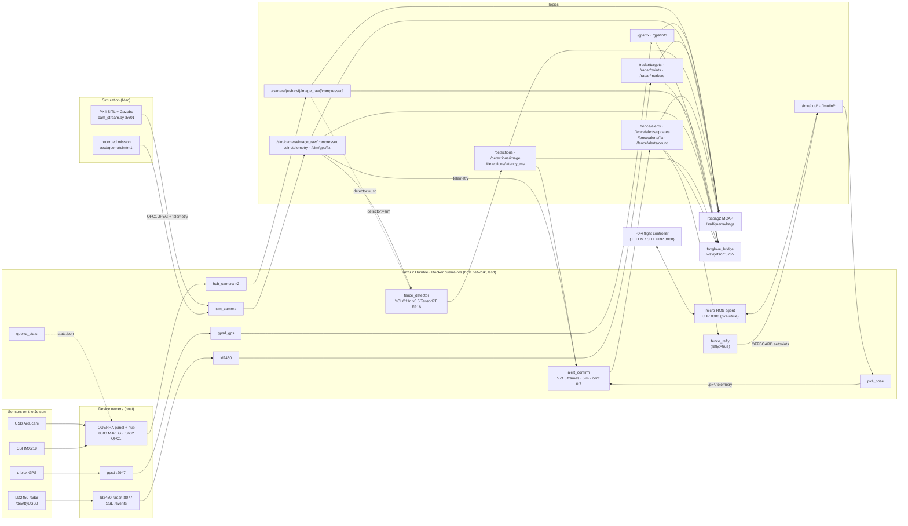
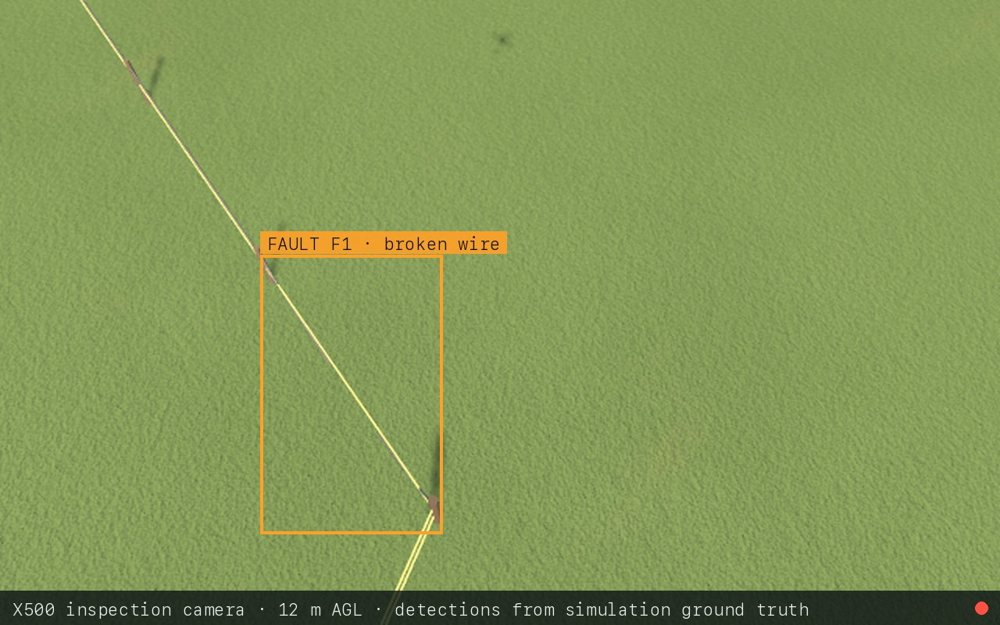
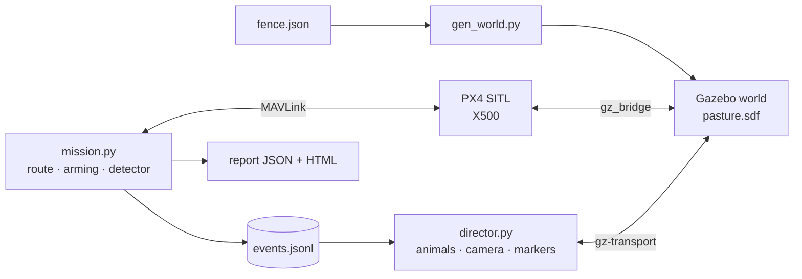
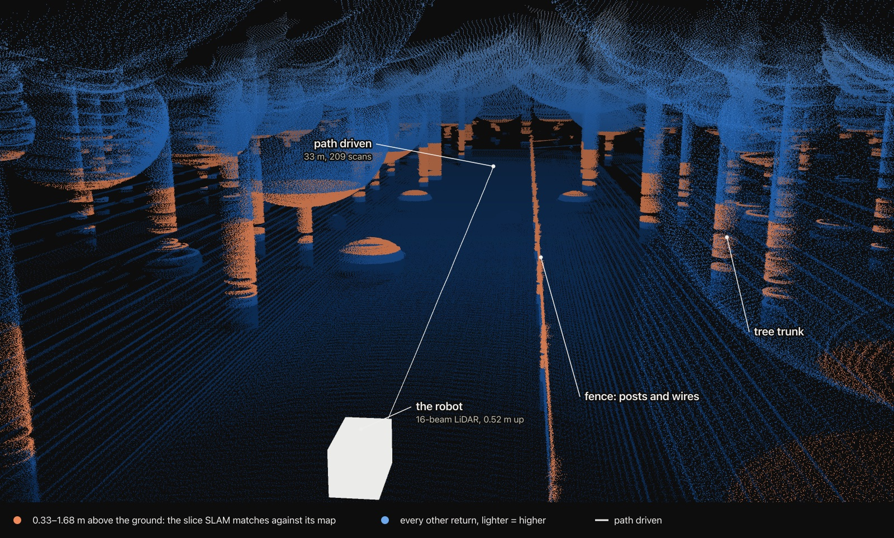

# Querra Fence · Gardian X500

[English](README.md) · [Polski](README.pl.md) · [Română](README.ro.md) · [Português](README.pt.md) · [Deutsch](README.de.md) · [Español](README.es.md) · [Hrvatski](README.hr.md) · **Български** · [Dansk](README.da.md)


**Сигурна ограда: пазете животните си от хищници.** Страницата на проекта, със сензорите и плана:
**[cosminbmemetea.github.io/querra-fence](https://cosminbmemetea.github.io/querra-fence/?lang=bg)**

Автономна проверка на електрическа ограда с PX4 **Holybro X500**, изцяло симулирана в **Gazebo Harmonic**.
Дронът сам облита оградата, открива повреди (скъсана жица, паднал стълб, клон, който дава на късо жиците), измерва
къде оградата губи напрежение, забелязва животни, излезли от кошарата, каца и пише доклад с GPS координатите на всяка
находка.

Подробната документация в `docs/` е на английски.


<p>
  
  
</p>

## Полево контролно табло

Jetson пуска уеб табло на порт 8080 (`http://mmx-desktop.local:8080`) за телефон в хотспота или лаптоп. Показва двете
камери на живо, целите на радара LD2450 и GPS fix-а и пуска и спира събирането на данни с детектора на оградата v0.3.
Работи без интернет, на английски или полски. Кодът и архитектурата са в [`jetson/panel/`](jetson/panel/). Картата на
радара има избледняваща топлинна карта на заетостта (вкл./изкл. и Изчисти), а картата за ROS 2 пуска и спира ROS 2,
показва честотите на темите и записва bag файлове.


 

GPS координатите в тези записи са размазани.

Приложение за работния плот: `sudo apt install ./querra-fence-panel_0.6.0_arm64.deb` добавя в дока на Jetson икона
**Querra Fence**, която отваря таблото отново (и го стартира, ако е нужно). Вижте [packaging/deb/](packaging/deb/).

## ROS 2 (фази 1–3)

Сензорите на Jetson са и теми в ROS 2 Humble. Възлите работят в Docker на SSD и са клиенти на услугите, които
притежават хардуера: камерите от хъба на таблото, GPS от gpsd, радара от услугата ld2450-radar. Публикуват изображения
`sensor_msgs`, `NavSatFix`, цели на радара, `PointCloud2` и маркери. Записите са rosbag2 MCAP файлове, а Foxglove се
свързва към `ws://<jetson>:8765`. Използвайте картата за ROS 2 в таблото или `ros2/ros.sh`. Подробностите са в
[docs/ros2.md](docs/ros2.md).

Фаза 2 пуска детектора на оградата в ROS 2: `fence_detector` изпълнява TensorRT FP16 двигателя на модела YOLO11n v0.3
на графичния процесор на Jetson (около 15 Hz, 20–30 ms на кадър от JPEG до рамките) и публикува
`vision_msgs/Detection2DArray` и анотирано изображение. `alert_confirm` превръща откриванията в `/fence/alerts` само
когато 5 от последните 8 кадъра съвпаднат в рамките на 5 м на земята. `./ros.sh demo` (или **Demo** в таблото)
възпроизвежда записана мисия от Gazebo през цялата верига; `./ros.sh demo tcp://<mac>:5601` използва симулацията на
живо. Подредба за Foxglove: [`ros2/foxglove/querra-layout.json`](ros2/foxglove/querra-layout.json).

Фаза 3 свързва самия PX4: `./ros.sh demo tcp://<mac>:5601 px4:=true` пуска micro-ROS агент на UDP 8888. uXRCE-DDS
клиентът на PX4 му публикува `/fmu/out/*`, а `px4_pose` превръща собствената позиция и посока на дрона в
`/px4/telemetry`, по която след това се поставят сигналите. На Mac `tools/uxrce_relay.py <jetson>` препраща клиента на
PX4 SITL към Jetson, така че в PX4 нищо не се променя. В един симулиран полет позицията от PX4 съвпадна с телеметрията
на симулатора с точност 0,6 м (медиана), а трите истински повреди бяха сигнализирани на 2,4 м, 3,0 м и 4,2 м от
истинските им позиции. С `refly:=true` Jetson поема управлението след обиколката за проверка: превключва PX4 в
OFFBOARD, прелита ниско над всяка потвърдена повреда, за да я огледа отблизо, и връща управлението с Return. В SITL
целият полет мина успешно: 8 прелитания, после връщане и кацане. Проверката отблизо още не е надеждна, защото
детекторът е обучен на 12 м, а не на 6 м. Подробности и честните числа: [docs/ros2.md](docs/ros2.md#phase-3-px4-over-uxrce-dds).



## Какво прави един полет

| Стъпка | Какво става |
|---|---|
| План | Многоъгълникът на оградата от `fence.json` става изгладен маршрут на 2,5 м извън жицата, с 56 точки |
| Полет | PX4 излита до 12 м, облита 414 м ограда с 5 м/с, връща се и каца (около 2,5 мин) |
| Откриване | Наклонена камера за проверка и симулиран EM сензор съобщават повреди, загуба на напрежение и животни извън многоъгълника |
| Доклад | `reports/raport_*.json` за програми, `raport_*.html` с карта, таблици и профил на напрежението |

Резултатът от примерния полет в [`docs/sample-report`](docs/sample-report/sample-report.html):
открити **3 от 3 повреди** и **3 от 3 избягали животни**, напрежението на горната жица се губи веднага след скъсването,
преброени **9 от 24 животни** (обиколка по периметъра вижда само 10 до 15 м навътре в кошарата).

## Демо

**Камерата за проверка.** Какво вижда дронът от 12 м, с откриванията, нарисувани върху кадъра.

<p>
  
  
</p>

**Трите повреди на земята.**


**Преди излитане.** X500 на площадката си и електропастирът в началото на оградата.

<p>
  
  
</p>

**Докладът.** Отваря се на езика, на който е бил полетът, и има меню с девет езика: EN, RO, PL, PT, DE, ES, HR, BG, DA.


## Бърз старт

Тествано на Mac с Apple Silicon (M2, 8 GB) с PX4 `main` (v1.18 beta) и Gazebo Harmonic 8.10.

1. Компилирайте PX4 за симулация веднъж, със собствената настройка на PX4 за Gazebo:

   ```bash
   git clone --recursive https://github.com/PX4/PX4-Autopilot.git ~/PX4-Autopilot
   cd ~/PX4-Autopilot
   ./Tools/setup/macos.sh --sim-tools
   source .venv/bin/activate
   make px4_sitl
   ```

2. Пуснете проверката:

   ```bash
   git clone https://github.com/CosminBMemetea/querra-fence.git
   cd querra-fence
   ./start.sh
   ```

   Gazebo се отваря, дронът лети, откриванията се появяват в терминала, а докладът се отваря в браузъра.
   **Enter** за още един полет, **Ctrl+C** затваря всичко.

| Команда | Какво прави |
|---|---|
| `./start.sh` | Напълно автоматичен полет за проверка и доклад (по подразбиране) |
| `./start.sh manual` | Само симулацията; конзолата на PX4 (`pxh>`) остава в терминала за вашите команди |
| `./start.sh headless` | Като по подразбиране, без прозореца на Gazebo; най-леко за лаптоп |
| `./start.sh mission` | Само полетът за проверка, върху вече работеща симулация |
| `./start.sh demo` | Заснет полет, който генерира наново всичко в `docs/media` |
| `./start.sh guard` | Земя + въздух: наземна станция при портата (RGB, термо, iToF, монитор на оградата) изпраща дрона, когато види проблем; камерите ѝ са RTSP потоци ([подробности](docs/ground-station.md)) |
| `./stop.sh` | Спира всички процеси, включително остатъци от сринато стартиране |
| `tools/install_launcher.sh` | Слага на работния плот `Gardian Sim.command`, който се пуска с двоен клик |

Добавете `--lang <код>` към който и да е режим (или задайте `GARDIAN_LANG`), за да са терминалът и докладът на друг
език: `en` (по подразбиране), `ro`, `pl`, `pt`, `de`, `es`, `hr`, `bg` или `da`. Езикът на доклада може да се смени и
след това. PX4 на друго място: `PX4_DIR=/път/до/PX4-Autopilot ./start.sh`. В дървото на PX4 нищо не се променя.

## Наземна станция + дрон

`./start.sh guard` добавя наземна станция в стил Jetson на стълб при портата: RGB и термокамера на мачтата, iToF
сензор за дълбочина на стълба на портата и монитор на оградата в далечния край на жицата. Наблюдава постоянно и
изпраща дрона, когато животно излезе през портата или напрежението в оградата падне. Камерите ѝ се публикуват като
RTSP потоци, така че истински Jetson може да пуска моделите си върху симулацията, преди да отиде на полето.
Вижте [docs/ground-station.md](docs/ground-station.md).

**Попитайте Jetson какво вижда.** `brain/server.py` работи на Jetson: взема RTSP кадрите и състоянието на живо
(`sim/state_server.py`), отговаря на написани въпроси с локален модел за зрение и език (Ollama), основан на данните от
сензорите, и изговаря отговора (Piper). Инсталиране и сценарий: [docs/jetson-brain.md](docs/jetson-brain.md).


## Истински сензор: радарът LD2450 на Jetson

Първият истински хардуер на наземната станция е HiLink LD2450, mmWave радар на 24 GHz, който следи до 3 цели.
Свързва се с Jetson през USB-сериен адаптер CH340.
`radar/` го чете и предоставя страница на радара на живо:
- цели върху ветрило от ±60°, с плавно движение, следи и топлинна карта;
- разстояние, ъгъл, скорост и вид движение за всяка цел;
- 60-секундна графика на разстоянието и дневник на активността.

Пакетиран е като Debian пакет, който работи като системна услуга и добавя икона на приложението на работния плот:

```bash
sudo apt install ./ld2450-radar_1.0.1_all.deb     # от страницата с версии (releases)
# после отворете "LD2450 Radar" или http://<jetson>:8077 от всяко устройство в мрежата
```

Подробностите, свързването и JSON/SSE API са в [radar/README.md](radar/README.md).


## Как работи



| Път | Роля |
|---|---|
| `fence.json` | Единственият източник на истина: многоъгълникът на оградата, стълбовете, повредите, стадото, избягалите животни, настройките на полета и камерата |
| `sim/gen_world.py` | Генерира света в Gazebo: ограда с две жици, изолирана порта и електропастир, повреди, дървета, стопански двор, стадо; облик „rich“ (небе, трева с текстура, хълмове) или първоначалният „classic“ |
| `models/x500_fence` | X500 от PX4 плюс камера за проверка 640×400 при 15 fps, наклонена на 55° надолу, по-лека от стандартната 1280×960 |
| `sim/mission.py` | pymavlink: параметри на PX4 за плавен полет, качване на мисията, активиране като GCS, детектор, доклад |
| `sim/director.py` | Python за Gazebo: пасящи и скитащи животни, следяща камера, планиран маршрут и маркери на откриванията |
| `sim/geo.py` | Обща геометрия: стълбове, места на повредите, външен маршрут, точка в многоъгълник, локални ⇄ GPS, модел на напрежението |
| `sim/report.py` | HTML доклад със SVG карта, профил на напрежението и меню за езика (девет езика) |
| `sim/i18n.py` | Всяко съобщение, което човек чете, на девет езика (EN, RO, PL, PT, DE, ES, HR, BG, DA) |
| `tools/` | Запис на демото, генератор на медия, записвач на сценарии, стартер на работния плот, текстури на тревата (`make_textures.py`), неподвижни изображения (`snap_world.sh`) |
| `ground/`, `brain/` | Симулираният възел на наземната станция; мозъкът на Jetson, който отговаря на въпроси за това, което вижда |
| `radar/` | mmWave радарът LD2450 на Jetson: уеб изглед на живо и неговият Debian пакет |

## Настройка

Целият сценарий е в `fence.json`. Променете го и пуснете отново; светът се генерира наново.
Обликът по подразбиране „rich“ добавя небе, ниско слънце, трева с текстура, хълмове и стопански двор, а пасището
остава равно. `"look": "classic"` в `fence.json` (или `GARDIAN_LOOK=classic`) връща първоначалния равен зелен свят,
който данните за обучение на детектора все още използват.

```json
"fence":   { "polygon": [[10, 6], [70, -4], [128, 14], ...], "post_spacing_m": 6.0, "strand_heights_m": [0.55, 1.0] },
"faults":  [{ "id": "F1", "type": "wire_break", "segment": 22, "strand": 1 }, ...],
"herd":    { "cows": 14, "sheep": 10 },
"mission": { "altitude_m": 12.0, "speed_ms": 5.0, "offset_outside_m": 2.5, "camera_pitch_deg": 55 }
```

Координатите са в локални метри (x на изток, y на север) около `origin`, който задава GPS позицията на пасището.

## Детекторът на оградата на Jetson (YOLO11n)

Симулацията вече обучава истинското възприятие на дрона. `tools/make_dataset.py` генерира случайни ферми в Gazebo и
етикетира всеки кадър от известната 3D геометрия: 7 класа, без ръчно етикетиране. YOLO11n, обучен върху тези кадри,
работи като TensorRT FP16 двигател на Jetson Orin Nano. Jetson чете симулираната камера на дрона през локалната мрежа
(`tools/cam_stream.py`), докато PX4 изпълнява мисията, и записва всяко откриване с GPS.

| Модел | Val mAP50 | На Jetson (симулирана мисия) | Версия |
|---|---|---|---|
| v0.1 · checkpoint от епоха 2 | 0.72 | открита скъсана жица F1 (0.78); слаб при падналия стълб | `model-v0.1` |
| v0.2 · 25 епохи | 0.921 | 13.3 fps; F1, F2, F3 открити (0.94 / 0.96 / 0.84); 385 кадъра с фалшива скъсана жица | `model-v0.2` |
| v0.3 · дообучен с целеви данни | 0.916 (отделен тест 0.912) | `wire_break` тест mAP50 0.58 → 0.68; с GPS потвърждаване 5 от 8 фалшивите сигнали 33 → 6, всички повреди открити | `model-v0.3` |
| v0.4 · двата вида на света | 0.956 (отделен тест 0.938 classic, 0.938 rich) | свят rich: 3 от 3 повреди (v0.3: 1 от 3); мисия classic: 13 фалшиви сигнала (v0.3: 5), затова се ползва само за полети на живо в Gazebo | `model-v0.4` |
| v0.5 · пози от полета, JPEG на потока | 0.952 (отделен тест 0.937 classic, 0.937 rich) | обучен на кадри в пози от полета, компресирани като потока от камерата: 3 от 3 повреди и 0 фалшиви сигнала в двата полета на живо (v0.4: 13 classic, 6 rich); моделът по подразбиране | `model-v0.5` |


- [Дневник на обучението](docs/retraining-log.md): какво е пропуснала всяка версия и какво се е променило.
- [Карта на модела](docs/model-card.md): данни, метрики, ограничения и как да се възпроизведе.
- [Модели и данни](ml/README.md): регистър на всички модели и набори от данни, записи от обученията и sha256 на файловете на моделите.
- [Интеграция с Jetson](docs/jetson-integration.md): източникът на камера `sim:`, детекторът и полевият режим в querra-scout.

## Наземен робот под дърветата (симулация, фаза 0)

Под короните дронът не вижда оградата и не може да лети безопасно, а GNSS греши с няколко метра. Там може да
патрулира малък наземен робот: оградено пасище в гората, парк за елени, заграждение в зоологическа градина. Фаза 0
работи в Gazebo: 500 м ограда през процедурно генерирана гора с пет повреди, skid-steer робот с 16-лъчев LiDAR,
камера, IMU и GNSS, който се влошава под короните, а „мозъкът“ на патрула работи в ROS 2 на Jetson.



- **Teach and repeat със slam_toolbox:** роботът минава веднъж по обиколката и строи карта, а после при всеки патрул
  се локализира спрямо нея. Завърши обиколката в 10 от 10 патрула, на 0,18 м от маршрута (95-и персентил), като
  позицията от SLAM беше на 0,26 м от истинската (медиана) и винаги под 1 м. Под дърветата GNSS грешеше с 4,3 м
  (медиана), а само с одометрията на колелата роботът заседна след около 100 м.
- **На Orin Nano** целият стек на наземния робот използва около 1,2 от 6-те ядра.
- **Повреди от земята:** детекторът за изглед от земята ground-v0.1 работи върху страничната камера на робота, на
  Jetson. В 10 патрула на живо всеки път откри и петте повреди, 50 от 50, без нито една фалшива тревога.

Стартиране: `./ugv.sh` на Mac и `./ros.sh ugv tcp://<mac>:5611 pose:=slam slam:=localization detect:=true` на Jetson. Подробности, фигури и резултати: [docs/ugv.md](docs/ugv.md).

## Симулация и реалност

Полетът е истински PX4 код: същата мисия, същите параметри и същите MAVLink команди биха управлявали физически X500.
Възприятието още не е истинско, и рамките в демо изображенията го казват:

- **Откриването** в `sim/mission.py` все още използва истинските позиции от Gazebo, за да покаже какво би съобщила
  камерата. Моделът за зрение, който го заменя, вече работи на Jetson (вижте [Детекторът на оградата](#детекторът-на-оградата-на-jetson-yolo11n)).
- **Напрежението в оградата** идва от прост модел на веригата по оградата. Истинска версия изисква сензор, който улавя
  от въздуха импулсите на електропастира, или неподвижни монитори на напрежението по оградата.
- **Покритие**: от 12 м камерата вижда около 10 до 15 м на всяка страна. За преброяване на цялото стадо е нужен
  допълнителен полет по мрежа.

## План

1. Обучение на детектор върху потока от камерата в Gazebo, после върху истински снимки на огради (скъсана жица,
   наклонен стълб, растителност, говеда, овце)
2. Внос на оградата от обиколка с GPS или от файл KML/GeoJSON вместо локални метри
3. Гимбал и термокамера за нощни проверки
4. Полет по мрежа за преброяване на цялото стадо
5. Сигнали на телефона и карта на отворените повреди
6. Радарът LD2450 като истински брояч при портата в режим охрана, вместо симулирания iToF сензор
7. Хардуер: X500 V2, Pixhawk, Raspberry Pi 5 или Jetson като бордови компютър, със същия MAVLink код на мисията

Нощната охрана от хищници (термокамера и радар при портата) е планирана; вижте
[страницата на проекта](https://cosminbmemetea.github.io/querra-fence/?lang=bg#roadmap).

## Бележки

- Симулацията говори девет езика (`--lang pl`, `--lang de`, …). Дневниците винаги са на английски. В JSON данните
  текстът, който човек чете, се пази на всички езици.
- Linux още не е тестван. Скриптовете очакват средата на PX4 за Gazebo под macOS (`Tools/setup/macos/.pixi`) и отварят
  доклада с `open`.
- Дневниците на всяко стартиране са в `run/`: `mission.log`, `px4.log`, `gz_server.log`, `director.log`.
  Двете грешки „Unable to load Ogre Plugin“ в `gz_server.log` са нормални за macOS; камерата рендерира въпреки това.
