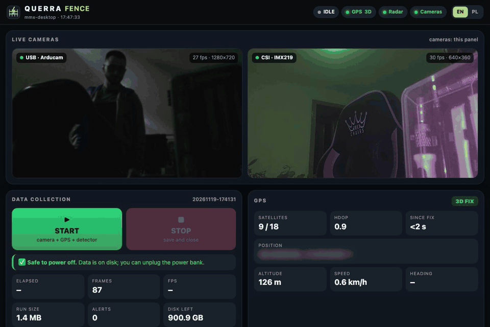
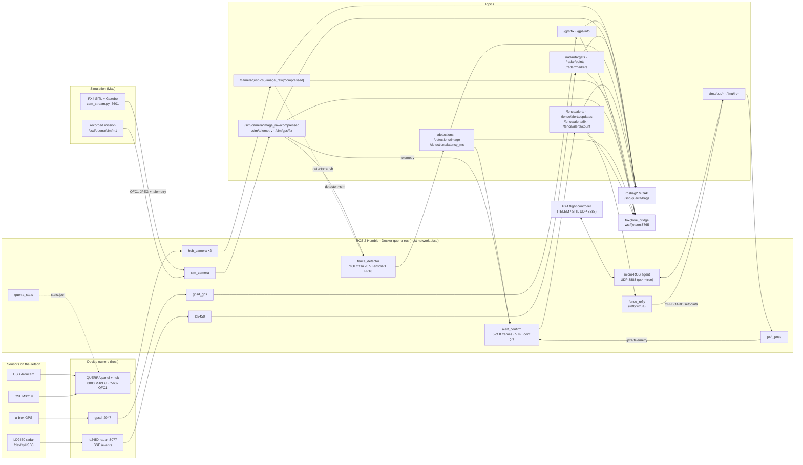
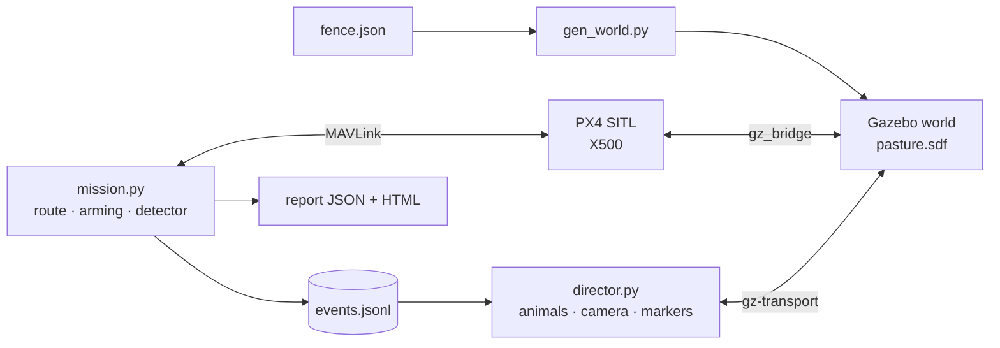
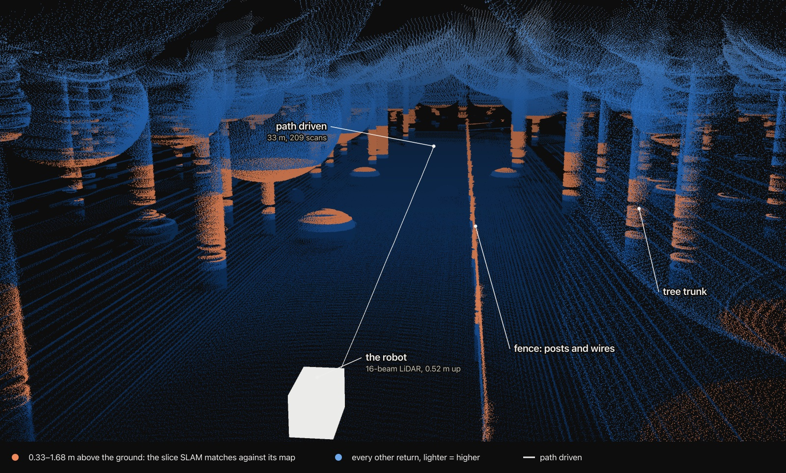

# Querra Fence · Gardian X500

[English](README.md) · [Polski](README.pl.md) · [Română](README.ro.md) · [Português](README.pt.md) · [Deutsch](README.de.md) · [Español](README.es.md) · [Hrvatski](README.hr.md) · [Български](README.bg.md) · **Dansk**


**Sikkert hegn: beskyt dine dyr mod rovdyr.** Projektsiden med sensorerne og køreplanen:
**[cosminbmemetea.github.io/querra-fence](https://cosminbmemetea.github.io/querra-fence/?lang=da)**

Autonom inspektion af el-hegn med en PX4 **Holybro X500**, simuleret fra ende til anden i **Gazebo Harmonic**.
Dronen flyver selv langs hegnet, finder fejl (brudt tråd, væltet pæl, en gren der kortslutter trådene), måler hvor
hegnet mister spænding, opdager dyr der er sluppet ud af folden, lander og skriver en rapport med GPS-koordinaterne for
hvert fund.

Den detaljerede dokumentation i `docs/` er på engelsk.


<p>
  
  
</p>

## Feltkontrolpanel

Jetsonen kører et webpanel på port 8080 (`http://mmx-desktop.local:8080`) til en telefon på hotspottet eller en
bærbar. Det viser begge kameraer live, LD2450-radarens mål og GPS-fixet, og det starter og stopper dataindsamlingen med
hegnsdetektoren v0.3. Det virker offline, på engelsk eller polsk. Koden og arkitekturen ligger i
[`jetson/panel/`](jetson/panel/). Radarkortet har et heatmap over tilstedeværelse, der falmer (til/fra og Ryd), og
ROS 2-kortet starter og stopper ROS 2, viser topic-frekvenser og optager bags.



 

GPS-koordinaterne er sløret i disse optagelser.

Skrivebordsstarter: `sudo apt install ./querra-fence-panel_0.6.0_arm64.deb` lægger et **Querra Fence**-ikon i
Jetsonens dock, der åbner panelet igen (og starter det, hvis det er nødvendigt). Se [packaging/deb/](packaging/deb/).

## ROS 2 (fase 1–3)

Jetsonens sensorer er også ROS 2 Humble-topics. Noderne kører i Docker på SSD'en og er klienter af de tjenester, der
ejer hardwaren: kameraer fra panelets hub, GPS fra gpsd, radar fra tjenesten ld2450-radar. De udgiver
`sensor_msgs`-billeder, `NavSatFix`, radarmål, `PointCloud2` og markører. Optagelser er rosbag2 MCAP-filer, og Foxglove
forbinder til `ws://<jetson>:8765`. Brug panelets ROS 2-kort eller `ros2/ros.sh`. Detaljerne står i
[docs/ros2.md](docs/ros2.md).

Fase 2 kører hegnsdetektoren i ROS 2: `fence_detector` kører TensorRT FP16-motoren til modellen YOLO11n v0.3 på
Jetsonens GPU (omkring 15 Hz, 20–30 ms pr. billede fra JPEG til bokse) og udgiver `vision_msgs/Detection2DArray` plus
et annoteret billede. `alert_confirm` gør kun detektioner til `/fence/alerts`, når 5 af de sidste 8 billeder er enige
inden for 5 m på jorden. `./ros.sh demo` (eller **Demo** i panelet) afspiller en optaget Gazebo-mission gennem hele
kæden; `./ros.sh demo tcp://<mac>:5601` bruger den levende simulering. Foxglove-layout:
[`ros2/foxglove/querra-layout.json`](ros2/foxglove/querra-layout.json).

Fase 3 forbinder selve PX4: `./ros.sh demo tcp://<mac>:5601 px4:=true` starter en micro-ROS-agent på UDP 8888. PX4's
uXRCE-DDS-klient udgiver `/fmu/out/*` til den, og `px4_pose` gør dronens egen position og kurs til `/px4/telemetry`, som
derefter placerer alarmerne. På Mac'en videresender `tools/uxrce_relay.py <jetson>` klienten fra PX4 SITL til Jetsonen,
så intet ændres i PX4. I én simuleret flyvning stemte PX4's position overens med simulatorens telemetri inden for
0,6 m (median), og de tre rigtige fejl blev meldt 2,4 m, 3,0 m og 4,2 m fra deres sande position. Med `refly:=true`
overtager Jetsonen derefter efter inspektionsrunden: den skifter PX4 til OFFBOARD, flyver lavt over hver bekræftet fejl
for at se den tæt på og afleverer igen med Return. I SITL virkede hele flyvningen: 8 overflyvninger, derefter retur og
landing. Nærtjekket er endnu ikke pålideligt, fordi detektoren er trænet i 12 m og ikke i 6 m. Detaljer og de ærlige
tal: [docs/ros2.md](docs/ros2.md#phase-3-px4-over-uxrce-dds).



## Hvad én flyvning gør

| Trin | Hvad der sker |
|---|---|
| Planlæg | Hegnets polygon i `fence.json` bliver til en udglattet rute 2,5 m uden for tråden, med 56 punkter |
| Flyv | PX4 letter til 12 m, flyver de 414 m hegn med 5 m/s, vender tilbage og lander (omkring 2,5 min) |
| Opdag | Et skråtstillet inspektionskamera og en simuleret EM-sensor melder fejl, spændingstab og dyr uden for polygonen |
| Rapport | `reports/raport_*.json` til software, `raport_*.html` med kort, tabeller og spændingsprofil |

Resultatet af eksempelflyvningen i [`docs/sample-report`](docs/sample-report/sample-report.html):
**3 af 3 fejl** fundet, **3 af 3 undslupne dyr** fundet, spænding tabt på den øverste tråd lige efter bruddet,
**9 af 24 dyr** talt (en tur langs omkredsen ser kun 10 til 15 m ind i folden).

## Demo

**Inspektionskameraet.** Hvad dronen ser fra 12 m, med detektionerne tegnet på billedet.

<p>
  
  
</p>

**De tre fejl på jorden.**


**Før start.** X500 på sin plads og hegnsapparatet ved starten af hegnet.

<p>
  
  
</p>

**Rapporten.** Den åbner på det sprog, flyvningen kørte på, og har en menu med ni sprog: EN, RO, PL, PT, DE, ES, HR,
BG, DA.


## Hurtig start

Testet på en Mac med Apple Silicon (M2, 8 GB) med PX4 `main` (v1.18 beta) og Gazebo Harmonic 8.10.

1. Byg PX4 til simulering én gang, med PX4's eget Gazebo-setup:

   ```bash
   git clone --recursive https://github.com/PX4/PX4-Autopilot.git ~/PX4-Autopilot
   cd ~/PX4-Autopilot
   ./Tools/setup/macos.sh --sim-tools
   source .venv/bin/activate
   make px4_sitl
   ```

2. Kør inspektionen:

   ```bash
   git clone https://github.com/CosminBMemetea/querra-fence.git
   cd querra-fence
   ./start.sh
   ```

   Gazebo åbner, dronen flyver, detektionerne vises i terminalen, og rapporten åbner i browseren.
   **Enter** for endnu en flyvning, **Ctrl+C** lukker det hele.

| Kommando | Hvad den gør |
|---|---|
| `./start.sh` | Fuldautomatisk inspektionsflyvning og rapport (standard) |
| `./start.sh manual` | Kun simuleringen; PX4-konsollen (`pxh>`) bliver i terminalen til dine egne kommandoer |
| `./start.sh headless` | Som standard, men uden Gazebo-vinduet; lettest på en bærbar |
| `./start.sh mission` | Kun inspektionsflyvningen, på en simulering der allerede kører |
| `./start.sh demo` | En filmet flyvning, der genskaber alt i `docs/media` |
| `./start.sh guard` | Jord + luft: en jordstation ved lågen (RGB, termisk, iToF, hegnsmonitor) sender dronen ud, når den ser et problem; dens kameraer er RTSP-streams ([detaljer](docs/ground-station.md)) |
| `./stop.sh` | Stopper alle processer, også rester fra en kørsel der gik ned |
| `tools/install_launcher.sh` | Lægger en `Gardian Sim.command` på skrivebordet, der starter med dobbeltklik |

Tilføj `--lang <kode>` til en vilkårlig tilstand (eller sæt `GARDIAN_LANG`) for at få terminalen og rapporten på et
andet sprog: `en` (standard), `ro`, `pl`, `pt`, `de`, `es`, `hr`, `bg` eller `da`. Rapportens sprog kan også skiftes
bagefter. PX4 et andet sted: `PX4_DIR=/sti/til/PX4-Autopilot ./start.sh`. Intet i PX4-træet ændres.

## Jordstation + drone

`./start.sh guard` tilføjer en jordstation i Jetson-stil på en pæl ved lågen: RGB- og termisk kamera på masten, en
iToF-dybdesensor på lågestolpen og en hegnsmonitor i den fjerne ende af tråden. Den holder hele tiden øje og sender
dronen ud, når et dyr går ud gennem lågen, eller hegnsspændingen falder. Dens kameraer udgives som RTSP-streams, så en
rigtig Jetson kan køre sine modeller på simuleringen, før den kommer ud i marken.
Se [docs/ground-station.md](docs/ground-station.md).

**Spørg Jetsonen, hvad den ser.** `brain/server.py` kører på Jetsonen: den tager RTSP-billederne og den levende
tilstand (`sim/state_server.py`), besvarer skrevne spørgsmål med en lokal billed- og sprogmodel (Ollama), der bygger på
sensordata, og siger svaret højt (Piper). Opsætning og forløb: [docs/jetson-brain.md](docs/jetson-brain.md).


## Rigtig sensor: LD2450-radaren på Jetsonen

Jordstationens første rigtige hardware er en HiLink LD2450, en 24 GHz mmWave-radar, der følger op til 3 mål.
Den er forbundet til Jetsonen gennem en CH340 USB-seriel adapter.
`radar/` læser den og leverer en live-radarside:
- mål på en vifte på ±60°, med glidende bevægelse, spor og et heatmap;
- afstand, vinkel, hastighed og bevægelsestype for hvert mål;
- en afstandsgraf over 60 sekunder og en aktivitetslog.

Den er pakket som en Debian-pakke, der kører som systemtjeneste og lægger et app-ikon på skrivebordet:

```bash
sudo apt install ./ld2450-radar_1.0.1_all.deb     # fra udgivelsessiden (releases)
# åbn derefter "LD2450 Radar" eller http://<jetson>:8077 fra en hvilken som helst enhed på netværket
```

Detaljer, ledningsføring og JSON/SSE-API'et står i [radar/README.md](radar/README.md).


## Sådan virker det



| Sti | Rolle |
|---|---|
| `fence.json` | Den eneste kilde til sandhed: hegnets polygon, pæle, fejl, flok, undslupne dyr, flyve- og kameraindstillinger |
| `sim/gen_world.py` | Genererer Gazebo-verdenen: tostrenget hegn med isoleret låge og hegnsapparat, fejl, træer, gårdsplads, flok; et "rich"-look (himmel, græs med tekstur, bakker) eller det oprindelige "classic" |
| `models/x500_fence` | PX4's X500 plus et inspektionskamera på 640×400 ved 15 fps, vinklet 55° nedad, lettere end standardkameraet på 1280×960 |
| `sim/mission.py` | pymavlink: PX4-parametre for blød flyvning, upload af missionen, armering som GCS, detektor, rapport |
| `sim/director.py` | Gazebo-Python: græssende og vandrende dyr, følgekamera, planlagt rute og detektionsmarkører |
| `sim/geo.py` | Fælles geometri: pæle, fejlenes placering, ydre rute, punkt i polygon, lokal ⇄ GPS, spændingsmodel |
| `sim/report.py` | HTML-rapport med SVG-kort, spændingsprofil og en sprogmenu (ni sprog) |
| `sim/i18n.py` | Hver meddelelse et menneske læser, på ni sprog (EN, RO, PL, PT, DE, ES, HR, BG, DA) |
| `tools/` | Optagelse af demo, mediegenerator, scenarieoptager, skrivebordsstarter, græsteksturer (`make_textures.py`), stillbilleder (`snap_world.sh`) |
| `ground/`, `brain/` | Jordstationens simulerede node; Jetson-hjernen, der svarer på spørgsmål om det, den ser |
| `radar/` | LD2450 mmWave-radar på Jetsonen: live-webvisning og dens Debian-pakke |

## Konfiguration

Hele scenariet ligger i `fence.json`. Ret det og start igen; verdenen genereres på ny.
Standard-looket "rich" tilføjer himmel, lav sol, græs med tekstur, bakker og en gårdsplads, og folden forbliver flad.
`"look": "classic"` i `fence.json` (eller `GARDIAN_LOOK=classic`) henter den oprindelige flade, grønne verden
tilbage, som detektorens træningsdata stadig bruger.

```json
"fence":   { "polygon": [[10, 6], [70, -4], [128, 14], ...], "post_spacing_m": 6.0, "strand_heights_m": [0.55, 1.0] },
"faults":  [{ "id": "F1", "type": "wire_break", "segment": 22, "strand": 1 }, ...],
"herd":    { "cows": 14, "sheep": 10 },
"mission": { "altitude_m": 12.0, "speed_ms": 5.0, "offset_outside_m": 2.5, "camera_pitch_deg": 55 }
```

Koordinaterne er lokale meter (x mod øst, y mod nord) omkring `origin`, som fastlægger markens GPS-position.

## Hegnsdetektor på Jetsonen (YOLO11n)

Simuleringen træner nu dronens rigtige perception. `tools/make_dataset.py` genererer tilfældige gårde i Gazebo og
mærker hvert billede ud fra den kendte 3D-geometri: 7 klasser, uden håndmærkning. En YOLO11n trænet på de billeder
kører som TensorRT FP16-motor på en Jetson Orin Nano. Jetsonen læser dronens simulerede kamera over det lokale netværk
(`tools/cam_stream.py`), mens PX4 flyver missionen, og logger hver detektion med GPS.

| Model | Val mAP50 | På Jetsonen (simuleret mission) | Udgivelse |
|---|---|---|---|
| v0.1 · checkpoint fra epoke 2 | 0.72 | brudt tråd F1 fundet (0.78); svag på den væltede pæl | `model-v0.1` |
| v0.2 · 25 epoker | 0.921 | 13.3 fps; F1, F2, F3 alle fundet (0.94 / 0.96 / 0.84); 385 billeder med falsk brudt tråd | `model-v0.2` |
| v0.3 · finjusteret på målrettede data | 0.916 (tilbageholdt test 0.912) | `wire_break` test mAP50 0.58 → 0.68; med GPS-bekræftelse 5 af 8 falske alarmer 33 → 6, alle fejl fundet | `model-v0.3` |
| v0.4 · begge verdensudseender | 0.956 (tilbageholdt test 0.938 classic, 0.938 rich) | verden rich: 3 af 3 fejl (v0.3: 1 af 3); mission classic: 13 falske alarmer (v0.3: 5), så den bruges kun til flyvninger live i Gazebo | `model-v0.4` |
| v0.5 · flyvepositioner, stream-JPEG | 0.952 (tilbageholdt test 0.937 classic, 0.937 rich) | trænet på billeder i flyvepositioner, komprimeret som kamerastreamet: 3 af 3 fejl og 0 falske alarmer i begge live-flyvninger (v0.4: 13 classic, 6 rich); standardmodellen | `model-v0.5` |


- [Træningslog](docs/retraining-log.md): hvad hver version overså, og hvad der blev ændret.
- [Modelkort](docs/model-card.md): data, målinger, begrænsninger og hvordan resultaterne genskabes.
- [Modeller og data](ml/README.md): register over alle modeller og datasæt, træningsforløb og sha256 for modelfilerne.
- [Jetson-integration](docs/jetson-integration.md): kamerakilden `sim:`, detektoren og felttilstanden i querra-scout.

## Jordrobot under træerne (simulering, fase 0)

Under trækronerne kan dronen hverken se hegnet eller flyve sikkert, og GNSS rammer flere meter forkert. Der kan en
lille jordrobot patruljere i stedet: en indhegnet skovfold, en hjortepark, et anlæg i en zoologisk have. Fase 0 kører
i Gazebo: 500 m hegn gennem en proceduralt genereret skov med fem fejl, en skid-steer-robot med 16-stråles LiDAR,
kamera, IMU og GNSS, der bliver dårligere under kronerne, og patruljens "hjerne" i ROS 2 på Jetson.



- **Teach and repeat med slam_toolbox:** robotten kører runden én gang og bygger et kort, og derefter lokaliserer den
  sig på det ved hver patrulje. Den gennemførte runden i 10 af 10 patruljer, 0,18 m fra ruten (95. percentil), med
  SLAM-positionen 0,26 m fra den sande (median) og hele tiden under 1 m. Under træerne ramte GNSS 4,3 m forkert
  (median), og på hjulodometri alene sad robotten fast efter omkring 100 m.
- **På Orin Nano** bruger hele jordrobottens stak omkring 1,2 af de 6 kerner.
- **Fejl fra jorden:** jordudsynsdetektoren ground-v0.1 kører på robottens sidekamera, på Jetson. I 10 patruljer
  live fandt den alle 5 fejl hver gang, 50 af 50, uden én falsk alarm.

Kør det med `./ugv.sh` på Mac'en og `./ros.sh ugv tcp://<mac>:5611 pose:=slam slam:=localization detect:=true` på Jetson. Detaljer, figurer og resultater: [docs/ugv.md](docs/ugv.md).

## Simuleret kontra virkelig

Flyvningen er rigtig PX4-kode: den samme mission, de samme parametre og MAVLink-kommandoer ville styre en fysisk X500.
Perceptionen er endnu ikke rigtig, og boksene i demobillederne siger det:

- **Detektionen** i `sim/mission.py` bruger stadig de sande positioner fra Gazebo til at vise, hvad kameraet ville
  melde. Billedmodellen, der erstatter den, kører allerede på Jetsonen (se [Hegnsdetektor](#hegnsdetektor-på-jetsonen-yolo11n)).
- **Hegnsspændingen** kommer fra en simpel kredsløbsmodel langs hegnet. En rigtig version kræver en sensor, der opfanger
  hegnsapparatets impulser gennem luften, eller faste spændingsmonitorer på hegnet.
- **Dækning**: fra 12 m ser kameraet omkring 10 til 15 m til hver side. At tælle hele flokken kræver en ekstra gitterflyvning.

## Køreplan

1. Træne en detektor på kamerastreamen fra Gazebo og derefter på rigtige hegnsfotos (brudt tråd, skæv pæl,
   bevoksning, kvæg, får)
2. Importere hegnet fra en GPS-gåtur eller en KML/GeoJSON-fil i stedet for lokale meter
3. Gimbal og termisk kamera til natinspektioner
4. Gitterflyvning for at tælle hele flokken
5. Alarmer til telefonen og et kort over åbne fejl
6. LD2450-radaren som rigtig tæller ved lågen i vagttilstand, i stedet for den simulerede iToF-sensor
7. Hardware: X500 V2, Pixhawk, Raspberry Pi 5 eller Jetson som ledsagecomputer, med den samme MAVLink-missionskode

Rovdyrsovervågning om natten (termisk kamera og radar ved lågen) er planlagt; se
[projektsiden](https://cosminbmemetea.github.io/querra-fence/?lang=da#roadmap).

## Noter

- Simuleringen taler ni sprog (`--lang pl`, `--lang de`, …). Logs er altid på engelsk. I JSON-dataene gemmes tekst, som
  et menneske læser, på alle sprog.
- Linux er endnu ikke testet. Scripterne forventer PX4's Gazebo-miljø til macOS (`Tools/setup/macos/.pixi`) og åbner
  rapporten med `open`.
- Logs fra hver kørsel ligger i `run/`: `mission.log`, `px4.log`, `gz_server.log`, `director.log`.
  De to fejl "Unable to load Ogre Plugin" i `gz_server.log` er normale på macOS; kameraet renderer alligevel.
