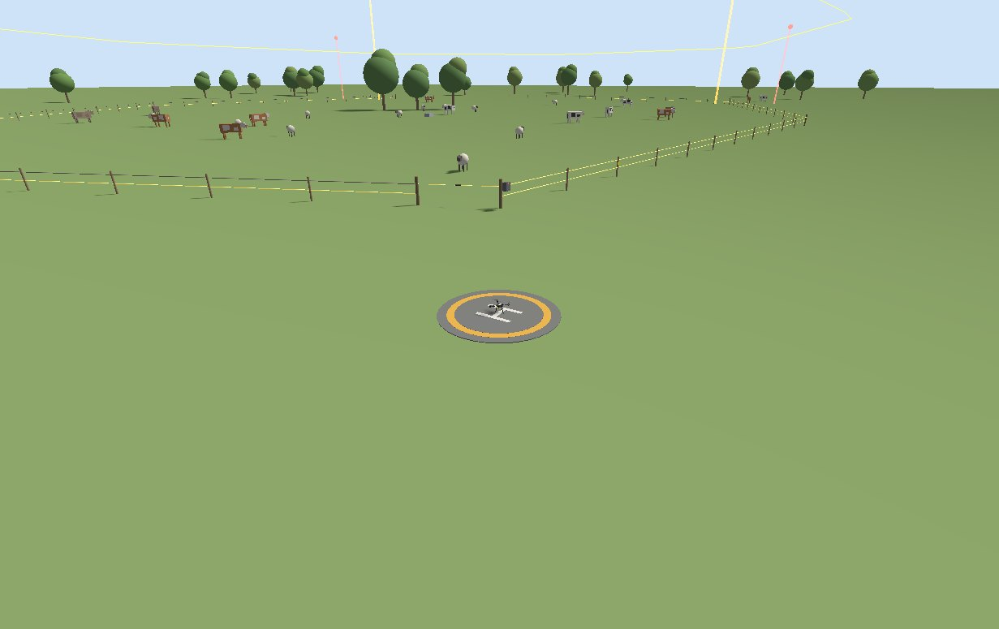
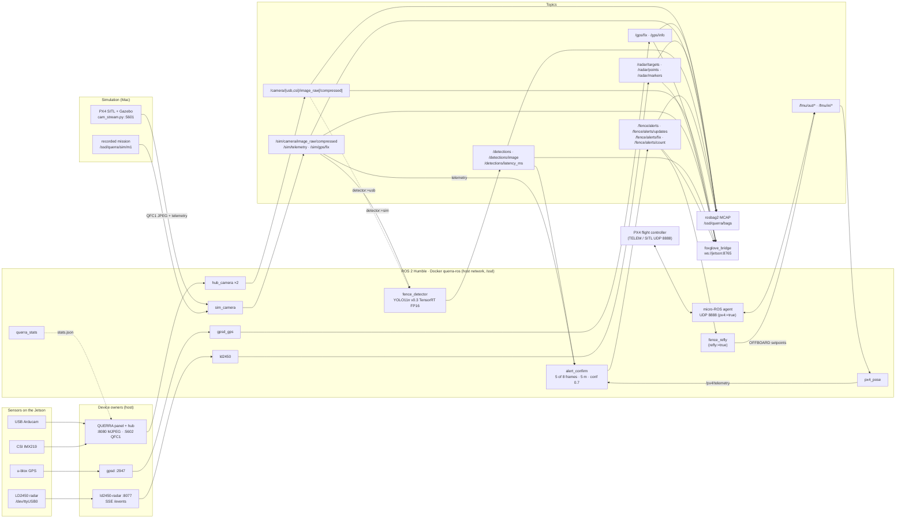
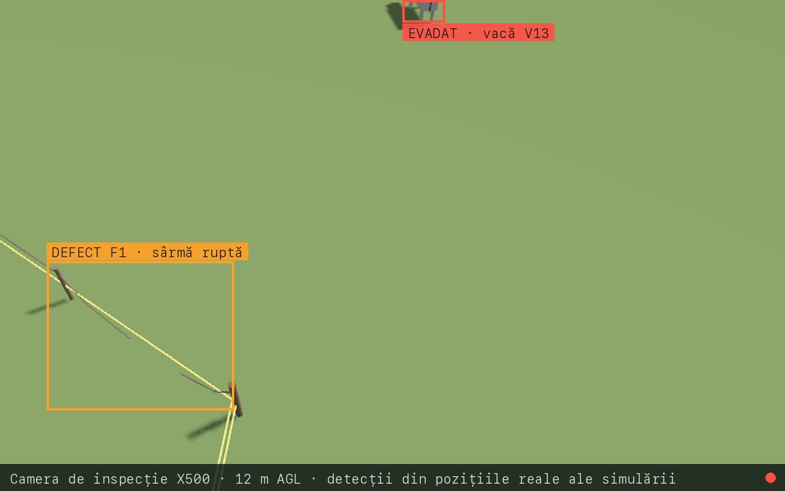
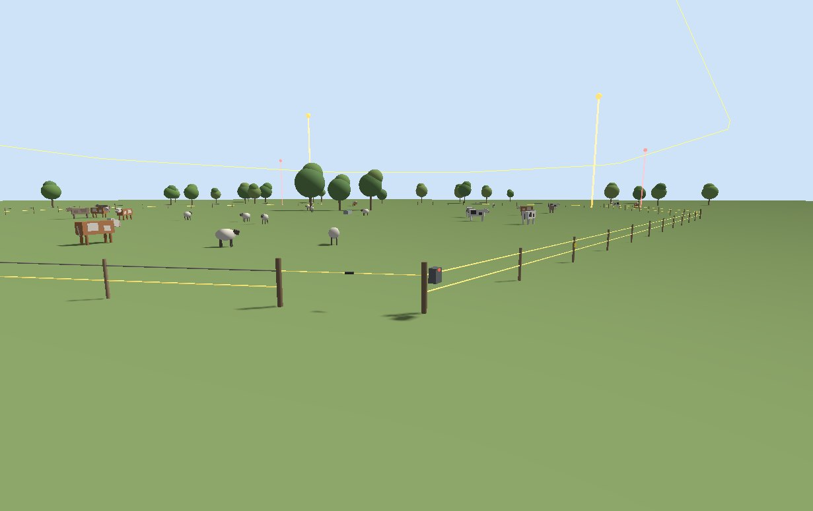
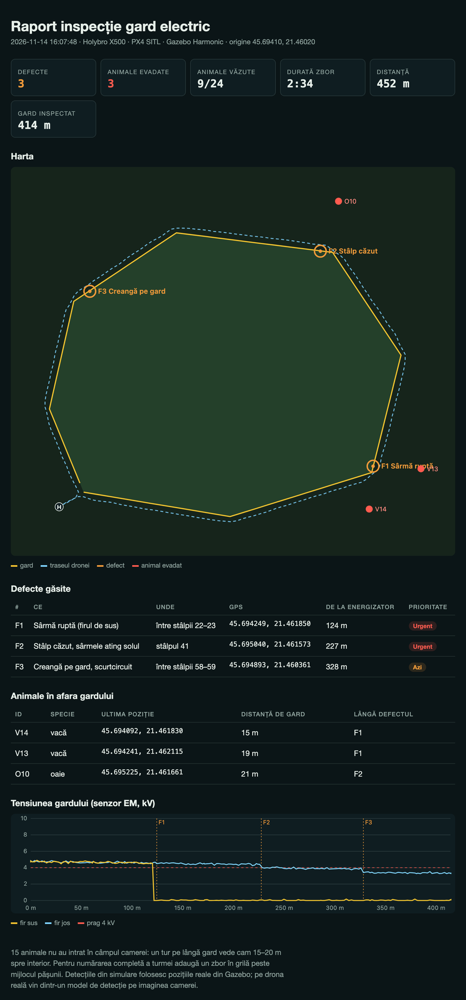
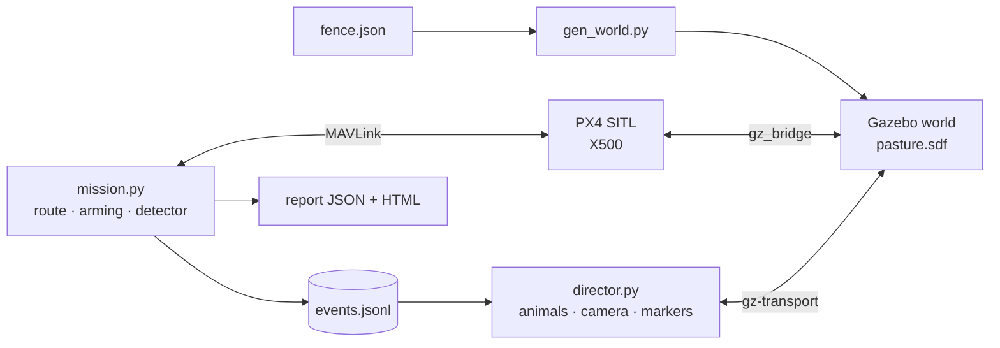

# Querra Fence · Gardian X500

[English](README.md) · [Polski](README.pl.md) · [Română](README.ro.md) · [Português](README.pt.md) · [Deutsch](README.de.md) · [Español](README.es.md) · **Hrvatski** · [Български](README.bg.md) · [Dansk](README.da.md)


**Sigurna ograda: zaštitite svoje životinje od grabežljivaca.** Stranica projekta sa senzorima i planom razvoja:
**[cosminbmemetea.github.io/querra-fence](https://cosminbmemetea.github.io/querra-fence/?lang=hr)**

Autonomni pregled električne ograde dronom PX4 **Holybro X500**, u potpunosti simuliran u **Gazebo Harmonic**.
Dron sam leti uz liniju ograde, pronalazi kvarove (prekinuta žica, srušeni stup, grana koja kratko spaja žice), mjeri
gdje ograda gubi napon, uočava životinje koje su izašle iz obora, slijeće i piše izvješće s GPS koordinatama svakog
nalaza.

Detaljna dokumentacija u `docs/` je na engleskom.



<p>
  
  
</p>

## Terenska upravljačka ploča

Jetson pokreće web ploču na portu 8080 (`http://mmx-desktop.local:8080`) za mobitel na hotspotu ili laptop. Prikazuje
obje kamere uživo, ciljeve radara LD2450 i GPS fix te pokreće i zaustavlja prikupljanje podataka s detektorom ograde
v0.3. Radi bez interneta, na engleskom ili poljskom. Kod i arhitektura su u [`jetson/panel/`](jetson/panel/). Kartica
radara ima toplinsku kartu zauzetosti koja blijedi (uklj./isklj. i Očisti), a kartica ROS 2 pokreće i zaustavlja ROS 2,
prikazuje frekvencije topica i snima bagove.


 

GPS koordinate na ovim snimkama su zamućene.

Pokretač na radnoj površini: `sudo apt install ./querra-fence-panel_0.6.0_arm64.deb` dodaje u dock Jetsona ikonu
**Querra Fence** koja ponovno otvara ploču (i pokreće je ako treba). Vidi [packaging/deb/](packaging/deb/).

## ROS 2 (faze 1–3)

Senzori Jetsona su i ROS 2 Humble topici. Čvorovi rade u Dockeru na SSD-u i klijenti su usluga koje upravljaju
hardverom: kamere iz huba ploče, GPS iz gpsd-a, radar iz usluge ld2450-radar. Objavljuju slike `sensor_msgs`,
`NavSatFix`, ciljeve radara, `PointCloud2` i oznake. Snimke su rosbag2 MCAP datoteke, a Foxglove se spaja na
`ws://<jetson>:8765`. Koristite karticu ROS 2 na ploči ili `ros2/ros.sh`. Detalji su u [docs/ros2.md](docs/ros2.md).

Faza 2 pokreće detektor ograde u ROS 2: `fence_detector` izvodi TensorRT FP16 mehanizam modela YOLO11n v0.3 na GPU-u
Jetsona (oko 15 Hz, 20–30 ms po slici od JPEG-a do okvira) i objavljuje `vision_msgs/Detection2DArray` te označenu
sliku. `alert_confirm` pretvara detekcije u `/fence/alerts` samo kad se 5 od posljednjih 8 slika složi unutar 5 m na
tlu. `./ros.sh demo` (ili **Demo** na ploči) reproducira snimljenu Gazebo misiju kroz cijeli lanac;
`./ros.sh demo tcp://<mac>:5601` koristi simulaciju uživo. Raspored za Foxglove:
[`ros2/foxglove/querra-layout.json`](ros2/foxglove/querra-layout.json).

Faza 3 spaja sam PX4: `./ros.sh demo tcp://<mac>:5601 px4:=true` pokreće micro-ROS agenta na UDP 8888. uXRCE-DDS
klijent u PX4 mu objavljuje `/fmu/out/*`, a `px4_pose` pretvara vlastiti položaj i smjer drona u `/px4/telemetry`,
prema kojem se zatim smještaju upozorenja. Na Macu `tools/uxrce_relay.py <jetson>` prosljeđuje klijent PX4 SITL-a na
Jetson, pa se u PX4 ništa ne mijenja. U jednom simuliranom letu položaj iz PX4 slagao se s telemetrijom simulatora
unutar 0,6 m (medijan), a tri stvarna kvara javljena su 2,4 m, 3,0 m i 4,2 m od svojih pravih položaja.
S `refly:=true` Jetson zatim preuzima upravljanje nakon kruga pregleda: prebacuje PX4 u OFFBOARD, nisko preleti svaki
potvrđeni kvar da ga pogleda izbliza i vraća upravljanje naredbom Return. U SITL-u je cijeli let uspio: 8 preleta, zatim
povratak i slijetanje. Provjera izbliza još nije pouzdana jer je detektor učen na 12 m, a ne na 6 m. Detalji i iskreni
brojevi: [docs/ros2.md](docs/ros2.md#phase-3-px4-over-uxrce-dds).



## Što radi jedan let

| Korak | Što se događa |
|---|---|
| Plan | Poligon ograde iz `fence.json` postaje izglađena ruta 2,5 m izvan žice, s 56 točaka |
| Let | PX4 polijeće na 12 m, preleti 414 m ograde brzinom 5 m/s, vraća se i slijeće (oko 2,5 min) |
| Otkrivanje | Nagnuta kamera za pregled i simulirani EM senzor javljaju kvarove, gubitak napona i životinje izvan poligona |
| Izvješće | `reports/raport_*.json` za programe, `raport_*.html` s kartom, tablicama i profilom napona |

Rezultat primjernog leta u [`docs/sample-report`](docs/sample-report/sample-report.html):
pronađena **3 od 3 kvara** i **3 od 3 odbjegle životinje**, napon izgubljen na gornjoj žici odmah iza prekida,
izbrojano **9 od 24 životinje** (prelet po obodu vidi samo 10 do 15 m u obor).

## Demo

**Kamera za pregled.** Što dron vidi s 12 m, s detekcijama nacrtanima na slici.

<p>
  
  
</p>

**Tri kvara na tlu.**


**Prije polijetanja.** X500 na svojoj platformi i električni pastir na početku ograde.

<p>
  
  
</p>

**Izvješće.** Otvara se na jeziku na kojem je let izveden i ima izbornik s devet jezika: EN, RO, PL, PT, DE, ES, HR,
BG, DA.



## Brzi početak

Testirano na Macu s Apple Siliconom (M2, 8 GB) s PX4 `main` (v1.18 beta) i Gazebo Harmonic 8.10.

1. Jednom izgradite PX4 za simulaciju, s PX4-ovom vlastitom postavom za Gazebo:

   ```bash
   git clone --recursive https://github.com/PX4/PX4-Autopilot.git ~/PX4-Autopilot
   cd ~/PX4-Autopilot
   ./Tools/setup/macos.sh --sim-tools
   source .venv/bin/activate
   make px4_sitl
   ```

2. Pokrenite pregled:

   ```bash
   git clone https://github.com/CosminBMemetea/querra-fence.git
   cd querra-fence
   ./start.sh
   ```

   Otvara se Gazebo, dron leti, detekcije se pojavljuju u terminalu, a izvješće se otvara u pregledniku.
   **Enter** za novi let, **Ctrl+C** zatvara sve.

| Naredba | Što radi |
|---|---|
| `./start.sh` | Potpuno automatski let pregleda i izvješće (zadano) |
| `./start.sh manual` | Samo simulacija; PX4 konzola (`pxh>`) ostaje u terminalu za vaše naredbe |
| `./start.sh headless` | Kao zadano, ali bez prozora Gazeba; najlakše za laptop |
| `./start.sh mission` | Samo let pregleda, na simulaciji koja već radi |
| `./start.sh demo` | Snimljeni let koji ponovno stvara sve u `docs/media` |
| `./start.sh guard` | Tlo + zrak: zemaljska stanica na vratima (RGB, termalna, iToF, monitor ograde) šalje dron kad uoči problem; njezine kamere su RTSP tokovi ([detalji](docs/ground-station.md)) |
| `./stop.sh` | Zaustavlja sve procese, uključujući ostatke srušenog pokretanja |
| `tools/install_launcher.sh` | Dodaje na radnu površinu `Gardian Sim.command` koji se pokreće dvostrukim klikom |

Dodajte `--lang <kod>` bilo kojem načinu (ili postavite `GARDIAN_LANG`) da terminal i izvješće budu na drugom jeziku:
`en` (zadano), `ro`, `pl`, `pt`, `de`, `es`, `hr`, `bg` ili `da`. Jezik izvješća može se promijeniti i naknadno.
PX4 na drugom mjestu: `PX4_DIR=/putanja/do/PX4-Autopilot ./start.sh`. U stablu PX4 ništa se ne mijenja.

## Zemaljska stanica + dron

`./start.sh guard` dodaje zemaljsku stanicu u stilu Jetsona na stupu kod vrata: RGB i termalnu kameru na jarbolu, iToF
senzor dubine na stupu vrata i monitor ograde na drugom kraju žice. Stalno nadzire i šalje dron kad životinja izađe
kroz vrata ili padne napon ograde. Njezine kamere objavljuju se kao RTSP tokovi, pa pravi Jetson može pokretati svoje
modele na simulaciji prije odlaska na teren. Vidi [docs/ground-station.md](docs/ground-station.md).

**Pitajte Jetson što vidi.** `brain/server.py` radi na Jetsonu: uzima RTSP slike i stanje uživo
(`sim/state_server.py`), odgovara na upisana pitanja lokalnim modelom za vid i jezik (Ollama) utemeljenim na podacima
sa senzora i izgovara odgovor (Piper). Postavljanje i scenarij: [docs/jetson-brain.md](docs/jetson-brain.md).


## Pravi senzor: radar LD2450 na Jetsonu

Prvi pravi hardver zemaljske stanice je HiLink LD2450, mmWave radar od 24 GHz koji prati do 3 cilja.
Na Jetson se spaja preko USB-serijskog adaptera CH340.
`radar/` ga čita i poslužuje stranicu radara uživo:
- ciljevi na lepezi od ±60°, s glatkim kretanjem, tragovima i toplinskom kartom;
- udaljenost, kut, brzina i vrsta kretanja svakog cilja;
- graf udaljenosti od 60 sekundi i dnevnik aktivnosti.

Zapakiran je kao Debian paket koji radi kao sistemska usluga i dodaje ikonu aplikacije na radnu površinu:

```bash
sudo apt install ./ld2450-radar_1.0.1_all.deb     # sa stranice izdanja (releases)
# zatim otvorite "LD2450 Radar" ili http://<jetson>:8077 s bilo kojeg uređaja u mreži
```

Detalji, spajanje i JSON/SSE API su u [radar/README.md](radar/README.md).


## Kako radi



| Putanja | Uloga |
|---|---|
| `fence.json` | Jedini izvor istine: poligon ograde, stupovi, kvarovi, stado, odbjegle životinje, postavke leta i kamere |
| `sim/gen_world.py` | Stvara Gazebo svijet: ogradu s dvije žice, izoliranim vratima i električnim pastirom, kvarove, drveće, štalu, stado |
| `models/x500_fence` | X500 iz PX4 plus kamera za pregled 640×400 pri 15 fps, nagnuta 55° prema dolje, lakša od standardne 1280×960 |
| `sim/mission.py` | pymavlink: PX4 parametri za mirni let, učitavanje misije, aktiviranje kao GCS, detektor, izvješće |
| `sim/director.py` | Python za Gazebo: životinje koje pasu i lutaju, kamera koja prati, planirana ruta i oznake detekcija |
| `sim/geo.py` | Zajednička geometrija: stupovi, mjesta kvarova, vanjska ruta, točka u poligonu, lokalno ⇄ GPS, model napona |
| `sim/report.py` | HTML izvješće s SVG kartom, profilom napona i izbornikom jezika (devet jezika) |
| `sim/i18n.py` | Svaka poruka koju čovjek čita, na devet jezika (EN, RO, PL, PT, DE, ES, HR, BG, DA) |
| `tools/` | Snimanje demonstracije, generator medija, snimač scenarija, pokretač na radnoj površini |
| `ground/`, `brain/` | Simulirani čvor zemaljske stanice; Jetsonov mozak koji odgovara na pitanja o onome što vidi |
| `radar/` | mmWave radar LD2450 na Jetsonu: web prikaz uživo i Debian paket |

## Konfiguracija

Cijeli scenarij nalazi se u `fence.json`. Promijenite ga i ponovno pokrenite; svijet se ponovno stvara.

```json
"fence":   { "polygon": [[10, 6], [70, -4], [128, 14], ...], "post_spacing_m": 6.0, "strand_heights_m": [0.55, 1.0] },
"faults":  [{ "id": "F1", "type": "wire_break", "segment": 22, "strand": 1 }, ...],
"herd":    { "cows": 14, "sheep": 10 },
"mission": { "altitude_m": 12.0, "speed_ms": 5.0, "offset_outside_m": 2.5, "camera_pitch_deg": 55 }
```

Koordinate su u lokalnim metrima (x prema istoku, y prema sjeveru) oko `origin`, koji određuje GPS položaj pašnjaka.

## Detektor ograde na Jetsonu (YOLO11n)

Simulacija sada uči pravu percepciju drona. `tools/make_dataset.py` stvara nasumične farme u Gazebu i označava svaku
sliku iz poznate 3D geometrije: 7 klasa, bez ručnog označavanja. YOLO11n učen na tim slikama radi kao TensorRT FP16
mehanizam na Jetsonu Orin Nano. Jetson čita simuliranu kameru drona preko lokalne mreže (`tools/cam_stream.py`) dok
PX4 leti misiju i bilježi svaku detekciju s GPS-om.

| Model | Val mAP50 | Na Jetsonu (simulirana misija) | Izdanje |
|---|---|---|---|
| v0.1 · checkpoint iz epohe 2 | 0.72 | pronađena prekinuta žica F1 (0.78); slab na srušenom stupu | `model-v0.1` |
| v0.2 · 25 epoha | 0.921 | 13.3 fps; F1, F2, F3 svi pronađeni (0.94 / 0.96 / 0.84); 385 slika s lažnom prekinutom žicom | `model-v0.2` |
| v0.3 · dodatno učen na ciljanim podacima | 0.916 (odvojeni test 0.912) | `wire_break` test mAP50 0.58 → 0.68; s GPS potvrdom 5 od 8 lažna upozorenja 33 → 6, svi kvarovi pronađeni | `model-v0.3` |


- [Dnevnik učenja](docs/retraining-log.md): što je koja verzija promašila i što se promijenilo.
- [Kartica modela](docs/model-card.md): podaci, metrike, ograničenja i kako ponoviti rezultate.
- [Integracija s Jetsonom](docs/jetson-integration.md): izvor kamere `sim:`, detektor i terenski način u querra-scout.

## Simulacija naspram stvarnosti

Let je pravi PX4 kod: ista misija, isti parametri i iste MAVLink naredbe upravljale bi fizičkim X500.
Percepcija još nije prava, a okviri na demonstracijskim slikama to i kažu:

- **Otkrivanje** u `sim/mission.py` i dalje koristi stvarne položaje iz Gazeba da pokaže što bi kamera javila.
  Model vida koji ga zamjenjuje već radi na Jetsonu (vidi [Detektor ograde](#detektor-ograde-na-jetsonu-yolo11n)).
- **Napon ograde** dolazi iz jednostavnog modela strujnog kruga duž ograde. Prava verzija treba senzor koji iz zraka
  hvata impulse električnog pastira ili fiksne monitore napona na ogradi.
- **Pokrivenost**: s 12 m kamera vidi oko 10 do 15 m na svaku stranu. Za brojanje cijelog stada treba dodatni let po mreži.

## Plan razvoja

1. Učiti detektor na toku kamere iz Gazeba, zatim na pravim fotografijama ograda (prekinuta žica, nagnuti stup,
   vegetacija, goveda, ovce)
2. Uvoz ograde iz GPS obilaska ili datoteke KML/GeoJSON umjesto lokalnih metara
3. Gimbal i termalna kamera za noćne preglede
4. Let po mreži za brojanje cijelog stada
5. Upozorenja na mobitel i karta otvorenih kvarova
6. Radar LD2450 kao pravi brojač na vratima u načinu straže, umjesto simuliranog iToF senzora
7. Hardver: X500 V2, Pixhawk, Raspberry Pi 5 ili Jetson kao računalo na letjelici, s istim MAVLink kodom misije

Noćni nadzor grabežljivaca (termalna kamera i radar na vratima) je u planu; vidi
[stranicu projekta](https://cosminbmemetea.github.io/querra-fence/?lang=hr#roadmap).

## Napomene

- Simulacija govori devet jezika (`--lang pl`, `--lang de`, …). Dnevnici su uvijek na engleskom. U JSON podacima tekst
  koji čita čovjek sprema se na svim jezicima.
- Demonstracijske slike u `docs/media` zasad imaju rumunjske natpise; `./start.sh demo` ih ponovno stvara na engleskom.
- Linux još nije testiran. Skripte očekuju PX4-ovo Gazebo okruženje za macOS (`Tools/setup/macos/.pixi`) i otvaraju
  izvješće naredbom `open`.
- Dnevnici svakog pokretanja nalaze se u `run/`: `mission.log`, `px4.log`, `gz_server.log`, `director.log`.
  Dvije pogreške „Unable to load Ogre Plugin” u `gz_server.log` normalne su na macOS-u; kamera svejedno prikazuje sliku.
