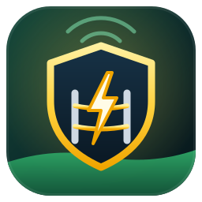
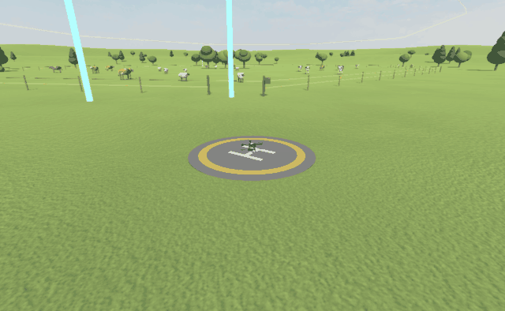
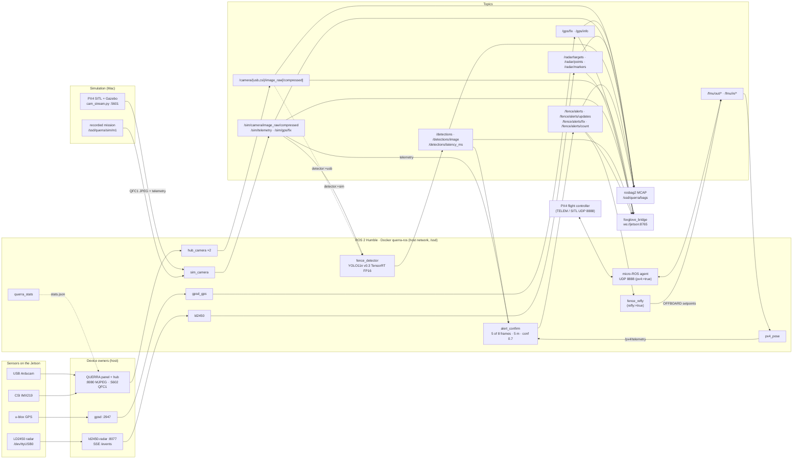
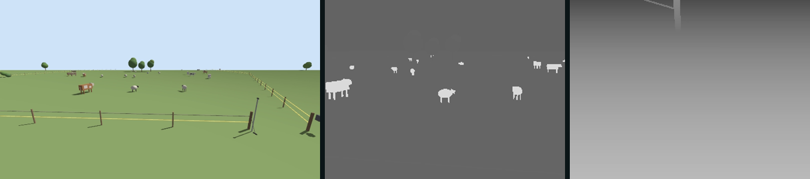
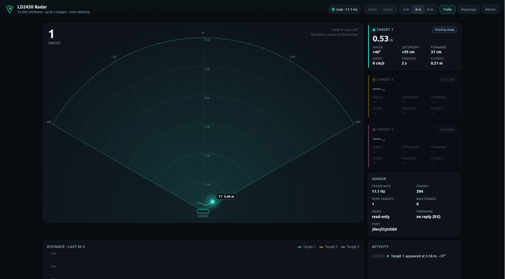
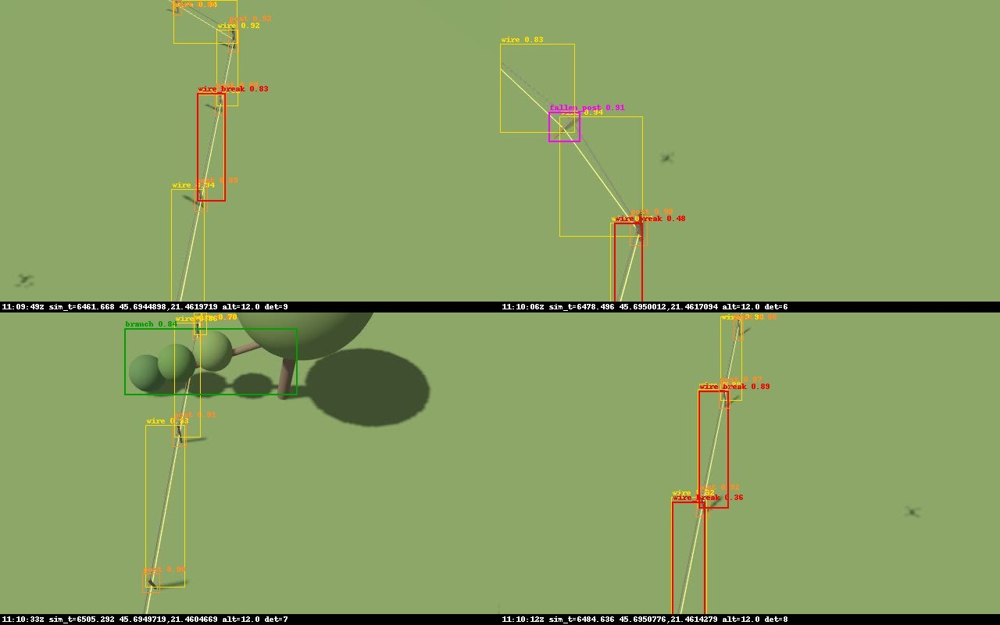

# Querra Fence · Gardian X500

**English** · [Polski](README.pl.md) · [Română](README.ro.md) · [Português](README.pt.md) · [Deutsch](README.de.md) · [Español](README.es.md) · [Hrvatski](README.hr.md) · [Български](README.bg.md) · [Dansk](README.da.md)



**Safe fence: protect your animals from predators.** Project page with the sensors and the roadmap:
**[cosminbmemetea.github.io/querra-fence](https://cosminbmemetea.github.io/querra-fence/)**

Autonomous electric-fence inspection with a PX4 **Holybro X500**, simulated end to end in **Gazebo Harmonic**.
The drone flies the fence line on its own, finds faults (broken wire, fallen post, a branch shorting the wires),
measures where the fence loses voltage, spots animals that got out of the paddock, lands, and writes a report
with GPS coordinates for every finding.


<p>
  
  
</p>

## Field control panel

The Jetson runs a web dashboard on port 8080 (`http://mmx-desktop.local:8080`) for a phone on the hotspot or a laptop.
It shows both cameras live, the LD2450 radar targets and the GPS fix, and starts and stops data collection with the
v0.3 fence detector. It works offline, in English or Polish. Code and architecture are in
[`jetson/panel/`](jetson/panel/). The radar card has a decaying occupancy heatmap (on/off and Clear), and the ROS 2 card
starts and stops ROS 2, shows topic rates and records bags.


 

GPS coordinates are blurred in these captures.

Desktop launcher: `sudo apt install ./querra-fence-panel_0.6.0_arm64.deb` adds a **Querra Fence** icon to the Jetson's
dock that reopens the panel (and starts it if needed). See [packaging/deb/](packaging/deb/).

## ROS 2 (phases 1–3)

The Jetson's sensors are also ROS 2 Humble topics. The nodes run in Docker on the SSD and are clients of the services
that own the hardware: cameras from the panel hub, GPS from gpsd, radar from the ld2450-radar service. They publish
`sensor_msgs` images, `NavSatFix`, radar targets, `PointCloud2` and markers. Recordings are rosbag2 MCAP files, and
Foxglove connects to `ws://<jetson>:8765`. Use the panel's ROS 2 card or `ros2/ros.sh`. See
[docs/ros2.md](docs/ros2.md) for the details and the phase 3 plan.

Phase 2 runs the fence detector on ROS 2: `fence_detector` runs the YOLO11n model-v0.3 TensorRT FP16 engine on the
Jetson GPU (about 15 Hz, 20–30 ms per frame from JPEG to boxes) and publishes `vision_msgs/Detection2DArray` plus an
annotated image. `alert_confirm` turns detections into `/fence/alerts` only when 5 of the last 8 frames agree within 5 m
on the ground. `./ros.sh demo` (or **Demo** in the panel) replays a recorded Gazebo mission through the whole chain;
`./ros.sh demo tcp://<mac>:5601` uses the live simulation. Foxglove layout: [`ros2/foxglove/querra-layout.json`](ros2/foxglove/querra-layout.json).

Phase 3 connects PX4 itself: `./ros.sh demo tcp://<mac>:5601 px4:=true` starts a micro-ROS agent on UDP 8888. PX4's
uXRCE-DDS client publishes `/fmu/out/*` to it, and `px4_pose` turns the vehicle's own position and heading into
`/px4/telemetry`, which then places the alerts. On the Mac, `tools/uxrce_relay.py <jetson>` forwards PX4 SITL's client
to the Jetson, so nothing in PX4 changes. In one simulated flight, the PX4 pose agreed with the simulator's telemetry
within 0.6 m (median), and the three real faults were alerted 2.4 m, 3.0 m and 4.2 m from their true positions.
With `refly:=true`, the Jetson then takes over after the inspection loop. It switches PX4 to OFFBOARD, flies low
over every confirmed fault for a close look, and hands back with Return. In SITL the whole flight worked: 8 visits,
then Return and landing. The close-up check is not reliable yet, because the detector was trained at 12 m, not 6 m.
Details and the honest numbers: [docs/ros2.md](docs/ros2.md#phase-3-px4-over-uxrce-dds).




## What one flight does

| Step | What happens |
|---|---|
| Plan | The fence polygon in `fence.json` becomes a smoothed route 2.5 m outside the wire, 56 waypoints |
| Fly | PX4 takes off to 12 m, flies the 414 m fence loop at 5 m/s, returns and lands (about 2.5 min) |
| Detect | A tilted inspection camera and a simulated EM sensor report faults, voltage loss and animals outside the polygon |
| Report | `reports/raport_*.json` for software, `raport_*.html` with map, tables and the voltage profile |

Result of the sample run in [`docs/sample-report`](docs/sample-report/sample-report.html):
**3 of 3 faults** found, **3 of 3 escaped animals** found, voltage lost on the top wire right after the break,
**9 of 24 animals** counted (a perimeter pass only sees 10 to 15 m into the paddock).

## Demo

**Inspection camera.** What the drone sees at 12 m, with detections drawn on the frame.

<p>
  
  
</p>

**The three faults on the ground.**


**Before takeoff.** The X500 on its pad, and the energizer at the start of the fence.

<p>
  
  
</p>

**The report.** It opens in the language the flight ran in and has a menu for nine languages: EN, RO, PL, PT, DE,
ES, HR, BG, DA.


## Quick start

Tested on an Apple Silicon Mac (M2, 8 GB) with PX4 `main` (v1.18 beta) and Gazebo Harmonic 8.10.

1. Build PX4 for simulation once, with PX4's own Gazebo setup:

   ```bash
   git clone --recursive https://github.com/PX4/PX4-Autopilot.git ~/PX4-Autopilot
   cd ~/PX4-Autopilot
   ./Tools/setup/macos.sh --sim-tools
   source .venv/bin/activate
   make px4_sitl
   ```

2. Run the inspection:

   ```bash
   git clone https://github.com/CosminBMemetea/querra-fence.git
   cd querra-fence
   ./start.sh
   ```

   Gazebo opens, the drone flies, detections print in the terminal, and the report opens in your browser.
   Press **Enter** for another flight, **Ctrl+C** to close everything.

| Command | What it does |
|---|---|
| `./start.sh` | Full automatic inspection flight and report (default) |
| `./start.sh manual` | Simulation only; the PX4 console (`pxh>`) stays in the terminal for your own commands |
| `./start.sh headless` | Same as the default without the Gazebo window, lightest on a laptop |
| `./start.sh mission` | Only the inspection flight, on a simulation that is already running |
| `./start.sh demo` | A filmed flight that regenerates everything in `docs/media` |
| `./start.sh guard` | Ground + air: a ground station at the gate (RGB, thermal, iToF, fence monitor) sends the drone when it sees a problem; its cameras stream as RTSP ([details](docs/ground-station.md)) |
| `./stop.sh` | Stops every process, including leftovers from a crashed run |
| `tools/install_launcher.sh` | Adds a double-click `Gardian Sim.command` to the Desktop |

Add `--lang <code>` to any mode (or set `GARDIAN_LANG`) to get the terminal and the report in another language: `en` (default),
`ro`, `pl`, `pt`, `de`, `es`, `hr`, `bg` or `da`. The report can switch language afterwards.
PX4 somewhere else: `PX4_DIR=/path/to/PX4-Autopilot ./start.sh`. Nothing inside the PX4 tree is modified.

## Ground station + drone

`./start.sh guard` adds a Jetson-style ground station on a pole at the gate: RGB and thermal cameras on the mast,
an iToF depth sensor on the gate post, and a fence monitor at the far end of the wire. It watches all the time and
sends the drone when an animal leaves through the gate or the fence voltage drops. Its cameras are published as
RTSP streams, so a real Jetson can run its models on the simulation before it goes to the field.
See [docs/ground-station.md](docs/ground-station.md).

**Ask the Jetson what it sees.** `brain/server.py` runs on the Jetson: it takes the RTSP frames and the live state
(`sim/state_server.py`), answers typed questions with a local vision-language model (Ollama) grounded in sensor facts,
and speaks the answer (Piper). Setup and run sheet: [docs/jetson-brain.md](docs/jetson-brain.md).



## Real sensor: LD2450 radar on the Jetson

The first real hardware on the ground station is a HiLink LD2450, a 24 GHz mmWave radar that tracks up to 3 targets.
It connects to the Jetson through a CH340 USB-serial adapter.
`radar/` reads it and serves a live radar page:
- targets on a ±60° fan, with smooth motion, trails and a heatmap;
- distance, angle, speed and motion for each target;
- a 60-second distance chart and an activity feed.

It is packaged as a Debian package that runs as a system service and adds an app icon to the desktop:

```bash
sudo apt install ./ld2450-radar_1.0.1_all.deb     # from the release page
# then open "LD2450 Radar", or http://<jetson>:8077 from any device on the network
```

Details, wiring and the JSON/SSE API are in [radar/README.md](radar/README.md).



## How it works


| Path | Role |
|---|---|
| `fence.json` | Single source of truth: fence polygon, posts, faults, herd, escaped animals, flight and camera settings |
| `sim/gen_world.py` | Generates the Gazebo world: two-strand fence with insulated gate and energizer, faults, trees, farmyard, herd; a "rich" look (sky, textured grass, hills) or the original "classic" one |
| `models/x500_fence` | PX4's X500 plus a 640×400, 15 fps inspection camera tilted 55° down, lighter than the stock 1280×960 one |
| `sim/mission.py` | pymavlink: smooth-flight PX4 parameters, mission upload, arming as a GCS, detector, report |
| `sim/director.py` | Gazebo Python: grazing and wandering animals, follow camera, planned route and detection markers |
| `sim/geo.py` | Shared geometry: posts, fault anchors, outward route, point-in-polygon, local ⇄ GPS, voltage model |
| `sim/report.py` | HTML report with an SVG map, the voltage profile and a language menu (nine languages) |
| `sim/i18n.py` | Every message a person reads, in nine languages (EN, RO, PL, PT, DE, ES, HR, BG, DA) |
| `tools/` | Demo capture, media builder, scenario recorder, Desktop launcher, grass textures (`make_textures.py`), still renders (`snap_world.sh`) |
| `ground/`, `brain/` | Simulated ground station node; the Jetson brain that answers questions about what it sees |
| `radar/` | LD2450 mmWave radar on the Jetson: live web view and its Debian package |

## Configuration

Everything about the scenario lives in `fence.json`. Change it and start again; the world regenerates.
The default "rich" look adds a sky, a low sun, textured grass, hills and a farmyard, and keeps the paddock flat.
`"look": "classic"` in `fence.json` (or `GARDIAN_LOOK=classic`) brings back the original flat green world, which the
detector's training data still uses.

```json
"fence":   { "polygon": [[10, 6], [70, -4], [128, 14], ...], "post_spacing_m": 6.0, "strand_heights_m": [0.55, 1.0] },
"faults":  [{ "id": "F1", "type": "wire_break", "segment": 22, "strand": 1 }, ...],
"herd":    { "cows": 14, "sheep": 10 },
"mission": { "altitude_m": 12.0, "speed_ms": 5.0, "offset_outside_m": 2.5, "camera_pitch_deg": 55 }
```

Coordinates are local metres (x east, y north) around `origin`, which sets the GPS position of the pasture.

## Fence detector on the Jetson (YOLO11n)

The simulation now trains the drone's real perception. `tools/make_dataset.py` renders random farms in Gazebo and
labels every frame from the known 3D geometry: 7 classes, no hand labelling. A YOLO11n trained on those frames runs as
a TensorRT FP16 engine on a Jetson Orin Nano. The Jetson reads the simulated drone camera over the LAN
(`tools/cam_stream.py`) while PX4 flies the mission, and logs every detection with GPS.

| Model | Val mAP50 | On the Jetson (simulated mission) | Release |
|---|---|---|---|
| v0.1 · epoch-2 checkpoint | 0.72 | F1 broken wire found (0.78); weak on the fallen post | `model-v0.1` |
| v0.2 · 25 epochs | 0.921 | 13.3 fps; F1, F2, F3 all found (0.94 / 0.96 / 0.84); 385 false broken-wire frames | `model-v0.2` |
| v0.3 · fine-tuned on targeted data | 0.916 (held-out test 0.912) | `wire_break` test mAP50 0.58 → 0.68; with 5-of-8 GPS confirmation, false alerts 33 → 6, all faults found | `model-v0.3` |



- [Retraining log](docs/retraining-log.md): what each version missed and what changed.
- [Model card](docs/model-card.md): data, metrics, limits and how to reproduce.
- [Jetson integration](docs/jetson-integration.md): the `sim:` camera source, the detector and field mode in querra-scout.

## Simulated versus real

The flight is real PX4 code: the same mission, parameters and MAVLink commands would drive a physical X500.
The sensing is not real yet, and the boxes in the demo images say so:

- **Detection** in `sim/mission.py` still uses the true positions from Gazebo to show what the camera would report.
  The vision model that replaces it runs on the Jetson today (see [Fence detector](#fence-detector-on-the-jetson-yolo11n)).
- **Fence voltage** comes from a simple circuit model along the fence. A real version needs a sensor that picks up
  the energizer pulses from the air, or fixed voltage monitors on the fence.
- **Coverage**: at 12 m the camera sees about 10 to 15 m to each side. Counting the whole herd needs an extra grid flight.

## Roadmap

1. Train a detector on the Gazebo camera stream, then on real fence photos (broken wire, leaning post, vegetation, cattle, sheep)
2. Import the fence from a GPS walk or a KML/GeoJSON file instead of local metres
3. Gimbal and thermal camera for night inspections
4. Grid flight for full herd counts
5. Alerts to a phone and a map view of open faults
6. The LD2450 radar as the real gate counter in guard mode, in place of the simulated iToF sensor
7. Hardware: X500 V2, Pixhawk, Raspberry Pi 5 or Jetson companion computer, same MAVLink mission code

Predator watch at night (thermal camera and radar at the gate) is planned; see the
[project page](https://cosminbmemetea.github.io/querra-fence/#roadmap).

## Notes

- The simulation speaks nine languages (`--lang pl`, `--lang de`, …). Logs are always in English. In the JSON
  data, text a person reads is stored in every language.
- Linux is not tested yet. The scripts expect PX4's macOS Gazebo environment (`Tools/setup/macos/.pixi`) and use `open` for the report.
- Logs for every run are in `run/`: `mission.log`, `px4.log`, `gz_server.log`, `director.log`.
  The two "Unable to load Ogre Plugin" errors in `gz_server.log` are normal on macOS; the camera renders anyway.
