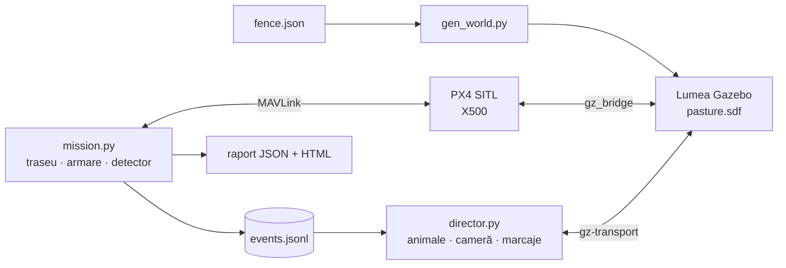

# Querra Fence · Gardian X500

*Română · [English](README.en.md)*

Inspecție autonomă a gardului electric cu o dronă **Holybro X500** pe PX4, simulată cap-coadă în **Gazebo Harmonic**.
Drona zboară singură de-a lungul gardului, găsește defectele (sârmă ruptă, stâlp căzut, creangă care scurtcircuitează firele),
măsoară unde gardul rămâne fără tensiune, vede animalele ieșite din țarc, aterizează și scrie un raport
cu coordonatele GPS ale fiecărei probleme.


<p>
  
  
</p>

## Ce face un zbor

| Pas | Ce se întâmplă |
|---|---|
| Plan | Conturul gardului din `fence.json` devine un traseu rotunjit la 2,5 m în exteriorul sârmei, 56 de puncte |
| Zbor | PX4 decolează la 12 m, face turul de 414 m al gardului cu 5 m/s, se întoarce și aterizează (cam 2,5 min) |
| Detecție | O cameră înclinată și un senzor EM simulat raportează defectele, pierderea de tensiune și animalele din afara gardului |
| Raport | `reports/raport_*.json` pentru alte programe, `raport_*.html` cu hartă, tabele și profilul de tensiune |

Rezultatul zborului din [`docs/sample-report`](docs/sample-report/sample-report.html):
**3 din 3 defecte** găsite, **3 din 3 animale evadate** găsite, tensiune pierdută pe firul de sus imediat după ruptură,
**9 din 24 de animale** numărate (un tur pe lângă gard vede doar 10–15 m spre interiorul pășunii).

## Demo

**Camera de inspecție.** Ce vede drona de la 12 m, cu detecțiile desenate pe imagine.

<p>
  
  
</p>

**Cele trei defecte, de aproape.**


**Înainte de decolare.** X500 pe platformă și energizatorul de la capătul gardului.

<p>
  
  
</p>

**Raportul de la final.**


## Pornire rapidă

Testat pe un Mac cu Apple Silicon (M2, 8 GB), cu PX4 `main` (v1.18 beta) și Gazebo Harmonic 8.10.

1. Compilezi o dată PX4 pentru simulare, cu instalarea Gazebo din PX4:

   ```bash
   git clone --recursive https://github.com/PX4/PX4-Autopilot.git ~/PX4-Autopilot
   cd ~/PX4-Autopilot
   ./Tools/setup/macos.sh --sim-tools
   source .venv/bin/activate
   make px4_sitl
   ```

2. Pornești inspecția:

   ```bash
   git clone https://github.com/CosminBMemetea/querra-fence.git
   cd querra-fence
   ./start.sh
   ```

   Se deschide Gazebo, drona zboară, detecțiile apar în terminal, iar raportul se deschide în browser.
   **Enter** = încă un zbor, **Ctrl+C** = închide tot.

| Comandă | Ce face |
|---|---|
| `./start.sh` | Zbor automat de inspecție și raport (implicit) |
| `./start.sh manual` | Doar simularea; consola PX4 (`pxh>`) rămâne în terminal pentru comenzile tale |
| `./start.sh fara-gui` | Ca varianta implicită, fără fereastra Gazebo; cel mai ușor pentru laptop |
| `./start.sh misiune` | Doar zborul de inspecție, pe o simulare deja pornită |
| `./start.sh demo` | Un zbor filmat care refă toate imaginile din `docs/media` |
| `./stop.sh` | Oprește tot, inclusiv procese rămase de la o rulare căzută |
| `tools/install_launcher.sh` | Pune pe Desktop `Gardian Sim.command`: dublu-click și pornește |

PX4 în alt loc: `PX4_DIR=/cale/spre/PX4-Autopilot ./start.sh`. Nu se modifică nimic în PX4.

## Cum funcționează



| Fișier | Rol |
|---|---|
| `fence.json` | Singura sursă de adevăr: conturul gardului, stâlpii, defectele, turma, animalele evadate, setările de zbor și cameră |
| `sim/gen_world.py` | Generează lumea Gazebo: gard cu două fire, poartă izolată, energizator, defecte, copaci, grajd, turmă |
| `models/x500_fence` | X500 din PX4 plus o cameră de inspecție 640×400 la 15 fps, înclinată 55° în jos, mai ușoară decât cea standard 1280×960 |
| `sim/mission.py` | pymavlink: parametri PX4 pentru zbor lin, urcarea misiunii, armare ca stație de sol, detector, raport |
| `sim/director.py` | Python Gazebo: animale care pasc și se plimbă, cameră urmăritoare, traseul și marcajele detecțiilor |
| `sim/geo.py` | Geometrie comună: stâlpi, poziția defectelor, traseul exterior, punct-în-poligon, local ⇄ GPS, modelul de tensiune |
| `sim/report.py` | Raportul HTML cu hartă SVG și profilul de tensiune |
| `tools/` | Filmarea demo, generarea imaginilor, scurtătura de pe Desktop |

## Configurare

Tot scenariul e în `fence.json`. Îl modifici și pornești din nou; lumea se regenerează singură.

```json
"fence":   { "polygon": [[10, 6], [70, -4], [128, 14], ...], "post_spacing_m": 6.0, "strand_heights_m": [0.55, 1.0] },
"faults":  [{ "id": "F1", "type": "wire_break", "segment": 22, "strand": 1 }, ...],
"herd":    { "cows": 14, "sheep": 10 },
"mission": { "altitude_m": 12.0, "speed_ms": 5.0, "offset_outside_m": 2.5, "camera_pitch_deg": 55 }
```

Coordonatele sunt în metri locali (x spre est, y spre nord) față de `origin`, care fixează poziția GPS a pășunii.

## Ce e simulat și ce e real

Zborul e cod PX4 real: aceeași misiune, aceiași parametri și aceleași comenzi MAVLink ar conduce un X500 adevărat.
Partea de senzori nu e încă reală, iar imaginile demo spun asta:

- **Detecția** folosește pozițiile adevărate din Gazebo ca să arate ce ar raporta camera. Pe dronă se înlocuiește
  cu un model de recunoaștere pe imaginile camerei (clasa `Detector` din `sim/mission.py`).
- **Tensiunea gardului** vine dintr-un model electric simplu de-a lungul gardului. Varianta reală are nevoie de un senzor
  care prinde pulsurile energizatorului din aer, sau de monitoare de tensiune fixe pe gard.
- **Acoperirea**: de la 12 m camera vede cam 10–15 m în fiecare parte. Pentru numărarea întregii turme e nevoie de un zbor în grilă.

## Ce urmează

1. Un model de detecție antrenat pe imaginile camerei din Gazebo, apoi pe poze reale (sârmă ruptă, stâlp înclinat, vegetație, vaci, oi)
2. Gardul importat dintr-un traseu GPS sau dintr-un fișier KML/GeoJSON, în loc de metri locali
3. Gimbal și cameră termală pentru inspecții pe timp de noapte
4. Zbor în grilă pentru numărarea completă a turmei
5. Alerte pe telefon și o hartă cu defectele nerezolvate
6. Hardware: X500 V2, Pixhawk, un calculator de bord Raspberry Pi 5 sau Jetson, același cod de misiune MAVLink

## Bine de știut

- Mesajele din terminal și raportul HTML sunt în română.
- Pe Linux nu e testat încă. Scripturile folosesc mediul Gazebo pentru macOS din PX4 (`Tools/setup/macos/.pixi`) și comanda `open` pentru raport.
- Logurile fiecărei rulări sunt în `run/`: `mission.log`, `px4.log`, `gz_server.log`, `director.log`.
  Cele două erori „Unable to load Ogre Plugin” din `gz_server.log` sunt normale pe Mac: camera randează oricum.
