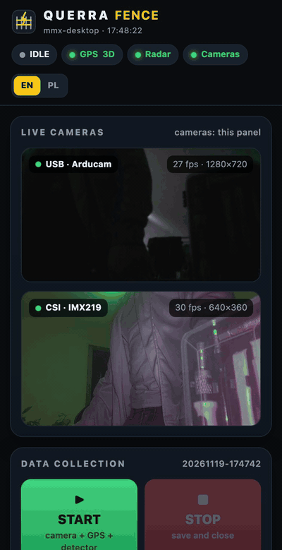
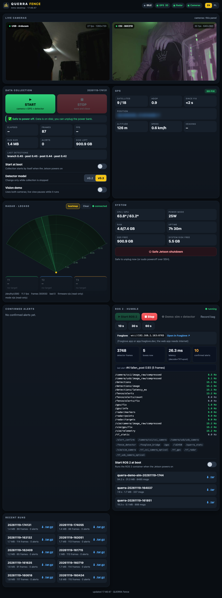
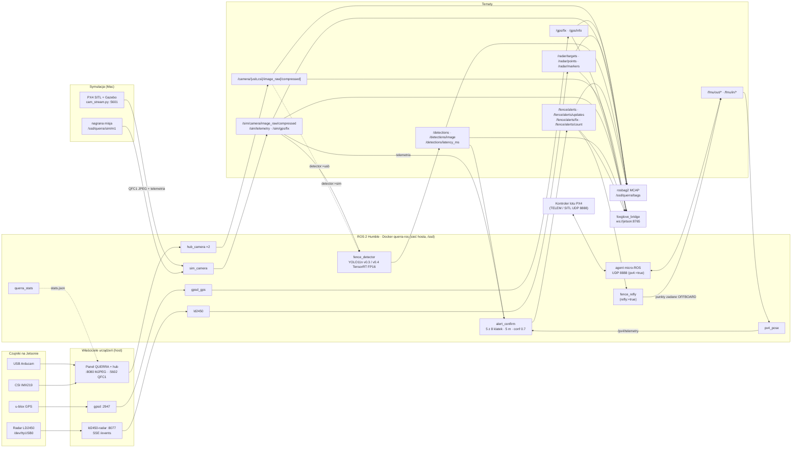
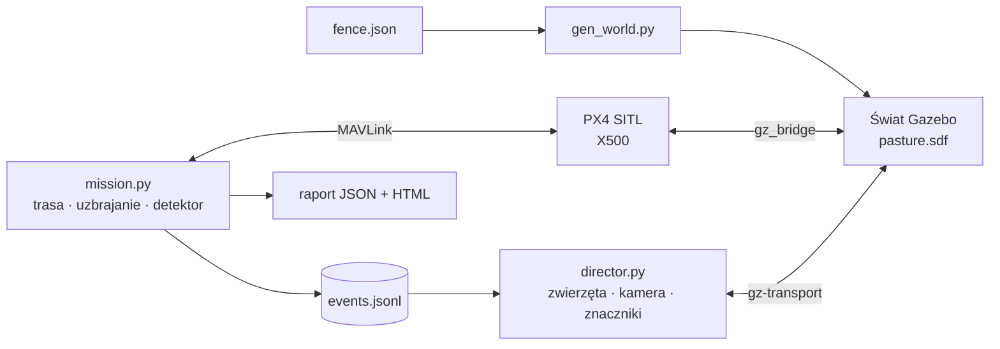

# Querra Fence · Gardian X500

[English](README.md) · **Polski** · [Română](README.ro.md) · [Português](README.pt.md) · [Deutsch](README.de.md) · [Español](README.es.md) · [Hrvatski](README.hr.md) · [Български](README.bg.md) · [Dansk](README.da.md)


**Bezpieczne ogrodzenie: chroń swoje zwierzęta przed drapieżnikami.** Strona projektu z czujnikami i planem rozwoju:
**[cosminbmemetea.github.io/querra-fence](https://cosminbmemetea.github.io/querra-fence/?lang=pl)**

Autonomiczna inspekcja ogrodzenia elektrycznego dronem PX4 **Holybro X500**, w pełni symulowana w **Gazebo Harmonic**.
Dron sam przelatuje wzdłuż ogrodzenia, znajduje usterki (zerwany drut, przewrócony słupek, gałąź zwierająca przewody),
mierzy, w którym miejscu ogrodzenie traci napięcie, wykrywa zwierzęta, które wydostały się z pastwiska, ląduje i pisze
raport ze współrzędnymi GPS każdego znaleziska.

Szczegółowa dokumentacja w `docs/` jest po angielsku.


<p>
  
  
</p>

## Panel sterowania w terenie

Jetson uruchamia panel webowy na porcie 8080 (`http://mmx-desktop.local:8080`) dla telefonu w hotspocie albo laptopa.
Pokazuje obraz na żywo z obu kamer, cele radaru LD2450 i fix GPS, a także uruchamia i zatrzymuje zbieranie danych
z detektorem ogrodzenia v0.3. Działa offline, po angielsku lub po polsku. Kod i architektura są w
[`jetson/panel/`](jetson/panel/). Karta radaru ma zanikającą mapę cieplną obecności (wł./wył. i Wyczyść), a karta ROS 2
uruchamia i zatrzymuje ROS 2, pokazuje częstotliwości tematów i nagrywa bagi.


 

Współrzędne GPS na tych nagraniach są rozmyte.

Aplikacja na pulpit: `sudo apt install ./querra-fence-panel_0.6.0_arm64.deb` dodaje ikonę **Querra Fence** do docka
Jetsona. Ikona otwiera panel (i w razie potrzeby go uruchamia). Zobacz [packaging/deb/](packaging/deb/).

## ROS 2 (fazy 1–3)

Czujniki Jetsona są też tematami ROS 2 Humble. Węzły działają w Dockerze na dysku SSD i są klientami usług, które
obsługują sprzęt: kamery z huba panelu, GPS z gpsd, radar z usługi ld2450-radar. Publikują obrazy `sensor_msgs`,
`NavSatFix`, cele radaru, `PointCloud2` i znaczniki. Nagrania to pliki rosbag2 MCAP, a Foxglove łączy się z
`ws://<jetson>:8765`. Użyj karty ROS 2 w panelu albo `ros2/ros.sh`. Szczegóły i plan fazy 3:
[docs/ros2.md](docs/ros2.md).

Faza 2 uruchamia detektor ogrodzenia w ROS 2: `fence_detector` wykonuje silnik TensorRT FP16 modelu YOLO11n v0.3 na GPU
Jetsona (około 15 Hz, 20–30 ms na klatkę od JPEG do ramek) i publikuje `vision_msgs/Detection2DArray` oraz obraz
z zaznaczeniami. `alert_confirm` zamienia wykrycia w `/fence/alerts` tylko wtedy, gdy 5 z ostatnich 8 klatek zgadza się
co do miejsca na ziemi w promieniu 5 m. `./ros.sh demo` (albo **Demo** w panelu) odtwarza nagraną misję z Gazebo przez
cały łańcuch; `./ros.sh demo tcp://<mac>:5601` (model-v0.4) używa symulacji na żywo. Układ Foxglove:
[`ros2/foxglove/querra-layout.json`](ros2/foxglove/querra-layout.json).

Faza 3 podłącza samo PX4: `./ros.sh demo tcp://<mac>:5601 px4:=true` uruchamia agenta micro-ROS na UDP 8888. Klient
uXRCE-DDS w PX4 publikuje do niego `/fmu/out/*`, a `px4_pose` zamienia własną pozycję i kurs drona w `/px4/telemetry`,
na podstawie którego umieszczane są alerty. Na Macu `tools/uxrce_relay.py <jetson>` przekazuje klienta PX4 SITL do
Jetsona, więc w PX4 nic się nie zmienia. W jednym symulowanym locie pozycja z PX4 zgadzała się z telemetrią symulatora
z dokładnością 0,6 m (mediana), a trzy prawdziwe usterki zostały zgłoszone 2,4 m, 3,0 m i 4,2 m od ich prawdziwych
pozycji. Z `refly:=true` Jetson przejmuje sterowanie po okrążeniu inspekcyjnym. Przełącza PX4 w tryb OFFBOARD, przelatuje
nisko nad każdą potwierdzoną usterką, aby obejrzeć ją z bliska, i oddaje sterowanie poleceniem Return. W SITL cały
lot zadziałał: 8 przelotów, potem powrót i lądowanie. Sprawdzenie z bliska nie jest jeszcze wiarygodne, bo detektor
był trenowany na wysokości 12 m, a nie 6 m. Szczegóły i uczciwe liczby:
[docs/ros2.md](docs/ros2.md#phase-3-px4-over-uxrce-dds).




## Co robi jeden lot

| Krok | Co się dzieje |
|---|---|
| Plan | Wielokąt ogrodzenia z `fence.json` zamienia się w wygładzoną trasę 2,5 m na zewnątrz drutu, 56 punktów |
| Lot | PX4 wznosi się na 12 m, okrąża 414 m ogrodzenia z prędkością 5 m/s, wraca i ląduje (około 2,5 min) |
| Wykrywanie | Pochylona kamera inspekcyjna i symulowany czujnik EM zgłaszają usterki, spadki napięcia i zwierzęta poza wielokątem |
| Raport | `reports/raport_*.json` dla programów, `raport_*.html` z mapą, tabelami i profilem napięcia |

Wynik przykładowego lotu w [`docs/sample-report`](docs/sample-report/sample-report.html):
znalezione **3 z 3 usterek** i **3 z 3 zbiegłych zwierząt**, utrata napięcia na górnym drucie tuż za zerwaniem,
policzone **9 z 24 zwierząt** (przelot po obwodzie widzi tylko 10–15 m w głąb pastwiska).

## Demo

**Kamera inspekcyjna.** Co widzi dron z wysokości 12 m, z wykryciami narysowanymi na klatce.

<p>
  
  
</p>

**Trzy usterki na ziemi.**


**Przed startem.** X500 na lądowisku i elektryzator na początku ogrodzenia.

<p>
  
  
</p>

**Raport.** Otwiera się w języku, w którym odbył się lot, i ma menu z dziewięcioma językami: EN, RO, PL, PT, DE,
ES, HR, BG, DA.


## Szybki start

Testowane na Macu z Apple Silicon (M2, 8 GB) z PX4 `main` (v1.18 beta) i Gazebo Harmonic 8.10.

1. Zbuduj raz PX4 do symulacji, z własną konfiguracją Gazebo od PX4:

   ```bash
   git clone --recursive https://github.com/PX4/PX4-Autopilot.git ~/PX4-Autopilot
   cd ~/PX4-Autopilot
   ./Tools/setup/macos.sh --sim-tools
   source .venv/bin/activate
   make px4_sitl
   ```

2. Uruchom inspekcję:

   ```bash
   git clone https://github.com/CosminBMemetea/querra-fence.git
   cd querra-fence
   ./start.sh
   ```

   Otwiera się Gazebo, dron leci, wykrycia pojawiają się w terminalu, a raport otwiera się w przeglądarce.
   **Enter** uruchamia kolejny lot, **Ctrl+C** zamyka wszystko.

| Polecenie | Co robi |
|---|---|
| `./start.sh` | Pełny automatyczny lot inspekcyjny i raport (domyślnie) |
| `./start.sh manual` | Tylko symulacja; konsola PX4 (`pxh>`) zostaje w terminalu na własne polecenia |
| `./start.sh headless` | Jak domyślnie, ale bez okna Gazebo; najlżejsze na laptopie |
| `./start.sh mission` | Tylko lot inspekcyjny, w już działającej symulacji |
| `./start.sh demo` | Nagrany lot, który na nowo generuje wszystko w `docs/media` |
| `./start.sh guard` | Ziemia + powietrze: stacja naziemna przy bramie (RGB, termowizja, iToF, monitor ogrodzenia) wysyła drona, gdy zauważy problem; jej kamery są dostępne jako strumienie RTSP ([szczegóły](docs/ground-station.md)) |
| `./stop.sh` | Zatrzymuje wszystkie procesy, także pozostałości po przerwanym uruchomieniu |
| `tools/install_launcher.sh` | Dodaje na pulpit `Gardian Sim.command` do uruchamiania dwuklikiem |

Dodaj `--lang <kod>` do dowolnego trybu (albo ustaw `GARDIAN_LANG`), aby terminal i raport były w innym języku: `en`
(domyślnie), `ro`, `pl`, `pt`, `de`, `es`, `hr`, `bg` lub `da`. Język raportu można też zmienić później. PX4 w innym miejscu: `PX4_DIR=/sciezka/do/PX4-Autopilot ./start.sh`. Nic w drzewie PX4 nie jest
zmieniane.

## Stacja naziemna + dron

`./start.sh guard` dodaje stację naziemną w stylu Jetsona na słupie przy bramie: kamery RGB i termowizyjną na maszcie,
czujnik głębi iToF na słupku bramy i monitor ogrodzenia na drugim końcu drutu. Stacja obserwuje cały czas i wysyła
drona, gdy zwierzę wyjdzie przez bramę albo spadnie napięcie w ogrodzeniu. Jej kamery są publikowane jako strumienie
RTSP, więc prawdziwy Jetson może uruchamiać swoje modele na symulacji, zanim trafi w teren.
Zobacz [docs/ground-station.md](docs/ground-station.md).

**Zapytaj Jetsona, co widzi.** `brain/server.py` działa na Jetsonie: bierze klatki RTSP i bieżący stan
(`sim/state_server.py`), odpowiada na wpisane pytania lokalnym modelem wizyjno-językowym (Ollama) opartym na faktach
z czujników i wypowiada odpowiedź (Piper). Instalacja i scenariusz: [docs/jetson-brain.md](docs/jetson-brain.md).


## Prawdziwy czujnik: radar LD2450 na Jetsonie

Pierwszy prawdziwy sprzęt stacji naziemnej to HiLink LD2450, radar mmWave 24 GHz śledzący do 3 celów.
Łączy się z Jetsonem przez adapter USB-serial CH340.
`radar/` odczytuje go i udostępnia stronę radaru na żywo:
- cele na wachlarzu ±60°, z płynnym ruchem, śladami i mapą cieplną;
- odległość, kąt, prędkość i rodzaj ruchu każdego celu;
- 60-sekundowy wykres odległości i dziennik zdarzeń.

Jest spakowany jako pakiet Debiana, który działa jako usługa systemowa i dodaje ikonę aplikacji na pulpit:

```bash
sudo apt install ./ld2450-radar_1.0.1_all.deb     # ze strony wydań (releases)
# potem otwórz "LD2450 Radar" albo http://<jetson>:8077 z dowolnego urządzenia w sieci
```

Szczegóły, podłączenie i API JSON/SSE są w [radar/README.md](radar/README.md).


## Jak to działa



| Ścieżka | Rola |
|---|---|
| `fence.json` | Jedno źródło prawdy: wielokąt ogrodzenia, słupki, usterki, stado, zbiegłe zwierzęta, ustawienia lotu i kamery |
| `sim/gen_world.py` | Generuje świat Gazebo: ogrodzenie dwużyłowe z izolowaną bramą i elektryzatorem, usterki, drzewa, zagroda, stado; wygląd „rich” (niebo, teksturowana trawa, wzgórza) albo pierwotny „classic” |
| `models/x500_fence` | X500 od PX4 plus kamera inspekcyjna 640×400, 15 kl./s, pochylona 55° w dół; lżejsza niż fabryczna 1280×960 |
| `sim/mission.py` | pymavlink: parametry PX4 do płynnego lotu, wgranie misji, uzbrajanie jako GCS, detektor, raport |
| `sim/director.py` | Python dla Gazebo: pasące się i wędrujące zwierzęta, kamera śledząca, zaplanowana trasa i znaczniki wykryć |
| `sim/geo.py` | Wspólna geometria: słupki, miejsca usterek, trasa na zewnątrz, punkt w wielokącie, lokalne ⇄ GPS, model napięcia |
| `sim/report.py` | Raport HTML z mapą SVG, profilem napięcia i menu języków (dziewięć języków) |
| `sim/i18n.py` | Każdy komunikat czytany przez człowieka, w dziewięciu językach (EN, RO, PL, PT, DE, ES, HR, BG, DA) |
| `tools/` | Nagrywanie demo, generator mediów, rejestrator scenariuszy, skrót na pulpit, tekstury trawy (`make_textures.py`), zdjęcia sceny (`snap_world.sh`) |
| `ground/`, `brain/` | Symulowany węzeł stacji naziemnej; „mózg” Jetsona, który odpowiada na pytania o to, co widzi |
| `radar/` | Radar mmWave LD2450 na Jetsonie: podgląd w przeglądarce i pakiet Debiana |

## Konfiguracja

Cały scenariusz jest w `fence.json`. Zmień go i uruchom ponownie; świat wygeneruje się od nowa.
Domyślny wygląd „rich” dodaje niebo, nisko stojące słońce, teksturowaną trawę, wzgórza i zagrodę, a pastwisko
zostaje płaskie. `"look": "classic"` w `fence.json` (albo `GARDIAN_LOOK=classic`) przywraca pierwotny płaski,
zielony świat, którego nadal używają dane treningowe detektora.

```json
"fence":   { "polygon": [[10, 6], [70, -4], [128, 14], ...], "post_spacing_m": 6.0, "strand_heights_m": [0.55, 1.0] },
"faults":  [{ "id": "F1", "type": "wire_break", "segment": 22, "strand": 1 }, ...],
"herd":    { "cows": 14, "sheep": 10 },
"mission": { "altitude_m": 12.0, "speed_ms": 5.0, "offset_outside_m": 2.5, "camera_pitch_deg": 55 }
```

Współrzędne są w lokalnych metrach (x na wschód, y na północ) wokół `origin`, który ustala pozycję GPS pastwiska.

## Detektor ogrodzenia na Jetsonie (YOLO11n)

Symulacja trenuje teraz prawdziwą percepcję drona. `tools/make_dataset.py` renderuje losowe farmy w Gazebo i etykietuje
każdą klatkę na podstawie znanej geometrii 3D: 7 klas, bez ręcznego etykietowania. YOLO11n wytrenowany na tych
klatkach działa jako silnik TensorRT FP16 na Jetsonie Orin Nano. Jetson odbiera obraz z symulowanej kamery drona przez
sieć LAN (`tools/cam_stream.py`), gdy PX4 wykonuje misję, i zapisuje każde wykrycie z pozycją GPS.

| Model | Val mAP50 | Na Jetsonie (symulowana misja) | Wydanie |
|---|---|---|---|
| v0.1 · punkt kontrolny z epoki 2 | 0.72 | znaleziony zerwany drut F1 (0.78); słabo na przewróconym słupku | `model-v0.1` |
| v0.2 · 25 epok | 0.921 | 13.3 kl./s; F1, F2, F3 znalezione (0.94 / 0.96 / 0.84); 385 klatek z fałszywym zerwanym drutem | `model-v0.2` |
| v0.3 · dostrojony na celowanych danych | 0.916 (zbiór testowy 0.912) | `wire_break` test mAP50 0.58 → 0.68; z potwierdzeniem GPS 5 z 8 fałszywe alarmy 33 → 6, wszystkie usterki znalezione | `model-v0.3` |
| v0.4 · oba wyglądy świata | 0.956 (zbiór testowy 0.938 classic, 0.938 rich) | świat rich: 3 z 3 usterek (v0.3: 1 z 3); misja classic: 13 fałszywych alarmów (v0.3: 5), więc służy tylko do lotów na żywo w Gazebo | `model-v0.4` |


- [Dziennik trenowania](docs/retraining-log.md): czego brakowało każdej wersji i co zmieniono.
- [Karta modelu](docs/model-card.md): dane, metryki, ograniczenia i jak odtworzyć wyniki.
- [Modele i dane](ml/README.md): rejestr wszystkich modeli i zbiorów danych, zapisy przebiegów treningu i sha256 plików modeli.
- [Integracja z Jetsonem](docs/jetson-integration.md): źródło kamery `sim:`, detektor i tryb terenowy w querra-scout.

## Symulacja a rzeczywistość

Lot to prawdziwy kod PX4: ta sama misja, parametry i polecenia MAVLink sterowałyby fizycznym X500.
Wykrywanie nie jest jeszcze prawdziwe i ramki na obrazach demo to zaznaczają:

- **Wykrywanie** w `sim/mission.py` nadal używa prawdziwych pozycji z Gazebo, aby pokazać, co zgłosiłaby kamera.
  Model wizyjny, który je zastąpi, już działa na Jetsonie (zobacz [Detektor ogrodzenia](#detektor-ogrodzenia-na-jetsonie-yolo11n)).
- **Napięcie w ogrodzeniu** pochodzi z prostego modelu obwodu wzdłuż ogrodzenia. Wersja rzeczywista wymaga czujnika,
  który odbiera impulsy elektryzatora z powietrza, albo stałych monitorów napięcia na ogrodzeniu.
- **Pokrycie**: z 12 m kamera widzi około 10–15 m w każdą stronę. Policzenie całego stada wymaga dodatkowego lotu
  po siatce.

## Plan rozwoju

1. Wytrenować detektor na obrazie z kamery w Gazebo, a potem na prawdziwych zdjęciach ogrodzeń (zerwany drut,
   pochylony słupek, roślinność, bydło, owce)
2. Import ogrodzenia z przejścia z GPS albo z pliku KML/GeoJSON zamiast lokalnych metrów
3. Gimbal i kamera termowizyjna do inspekcji nocnych
4. Lot po siatce, aby policzyć całe stado
5. Alerty na telefon i mapa otwartych usterek
6. Radar LD2450 jako prawdziwy licznik przy bramie w trybie guard, zamiast symulowanego czujnika iToF
7. Sprzęt: X500 V2, Pixhawk, Raspberry Pi 5 albo Jetson jako komputer pokładowy, ten sam kod misji MAVLink

Ochrona przed drapieżnikami w nocy (kamera termowizyjna i radar przy bramie) jest planowana; zobacz
[stronę projektu](https://cosminbmemetea.github.io/querra-fence/?lang=pl#roadmap).

## Uwagi

- Symulacja mówi w dziewięciu językach (`--lang pl`, `--lang de`, …). Logi są zawsze po angielsku. W danych JSON
  tekst czytany przez człowieka jest zapisany we wszystkich językach.
- Linux nie jest jeszcze testowany. Skrypty oczekują środowiska Gazebo od PX4 dla macOS (`Tools/setup/macos/.pixi`)
  i otwierają raport poleceniem `open`.
- Logi każdego uruchomienia są w `run/`: `mission.log`, `px4.log`, `gz_server.log`, `director.log`.
  Dwa błędy „Unable to load Ogre Plugin” w `gz_server.log` są na macOS normalne; kamera i tak renderuje obraz.
