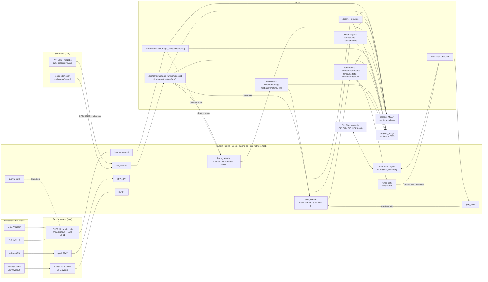
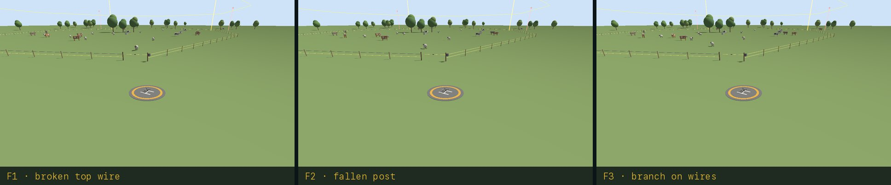
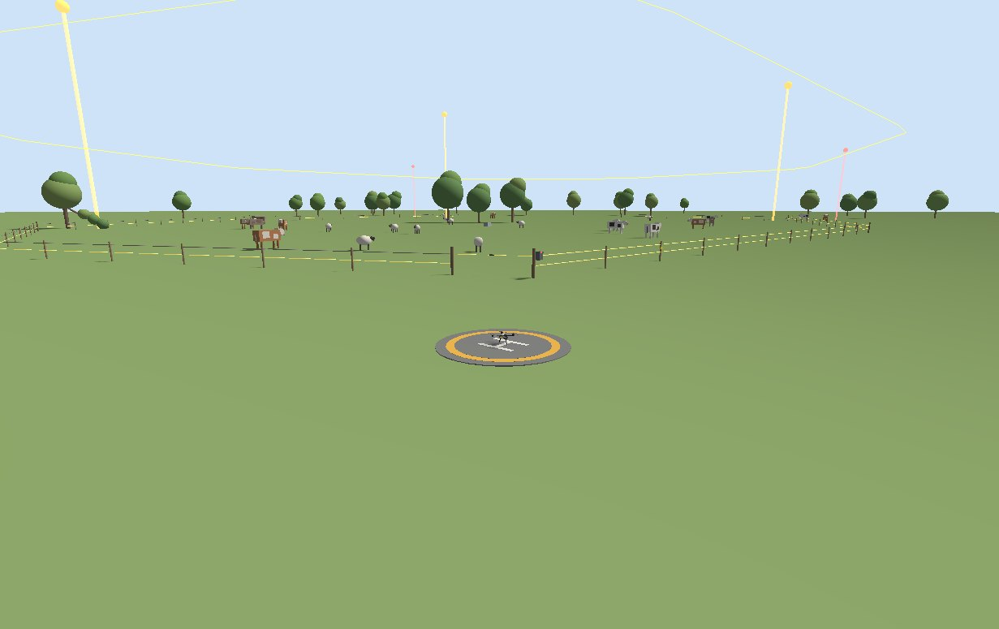
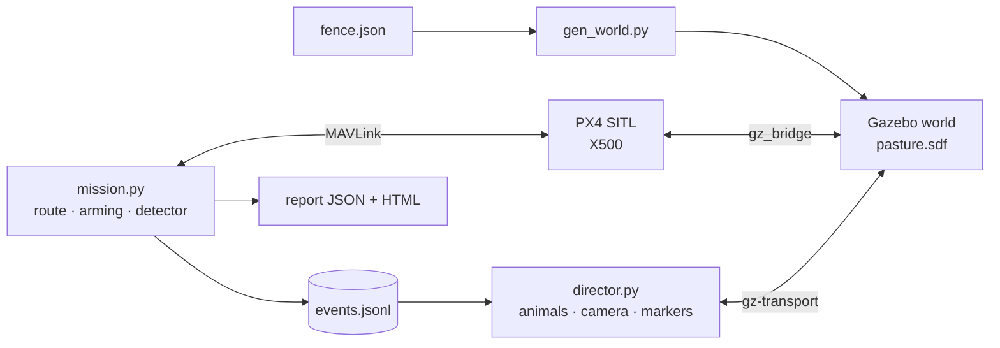
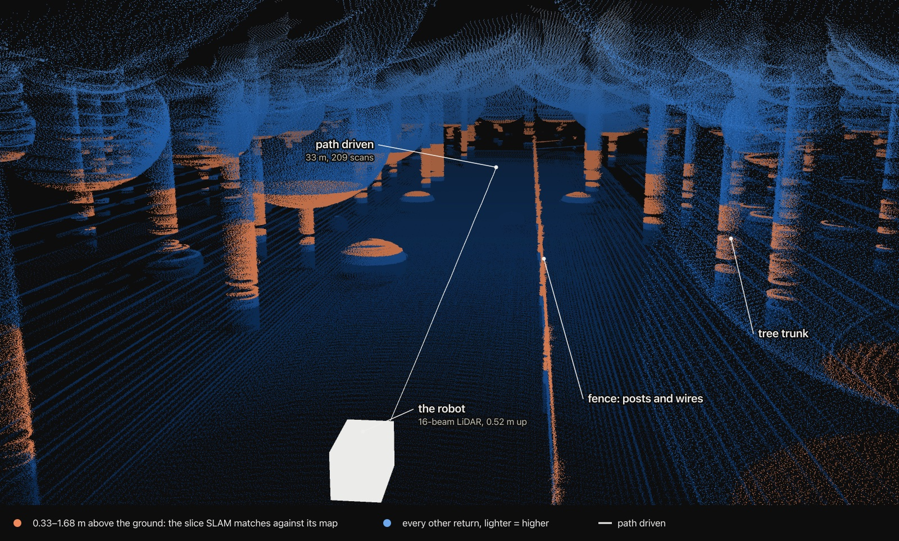

# Querra Fence · Gardian X500

[English](README.md) · [Polski](README.pl.md) · [Română](README.ro.md) · **Português** · [Deutsch](README.de.md) · [Español](README.es.md) · [Hrvatski](README.hr.md) · [Български](README.bg.md) · [Dansk](README.da.md)


**Cerca segura: proteja os seus animais de predadores.** Página do projeto, com os sensores e o roteiro:
**[cosminbmemetea.github.io/querra-fence](https://cosminbmemetea.github.io/querra-fence/?lang=pt)**

Inspeção autónoma de cercas elétricas com um PX4 **Holybro X500**, simulada de ponta a ponta no **Gazebo Harmonic**.
O drone voa sozinho ao longo da cerca, encontra avarias (fio partido, poste caído, um ramo a fazer curto-circuito nos
fios), mede onde a cerca perde tensão, deteta animais que saíram do cercado, aterra e escreve um relatório com as
coordenadas GPS de cada achado.

A documentação detalhada em `docs/` está em inglês.


<p>
  
  
</p>

## Painel de controlo de campo

O Jetson corre um painel web na porta 8080 (`http://mmx-desktop.local:8080`) para um telemóvel no hotspot ou um
portátil. Mostra as duas câmaras ao vivo, os alvos do radar LD2450 e o fix GPS, e inicia e para a recolha de dados com
o detetor de cerca v0.3. Funciona offline, em inglês ou polaco. O código e a arquitetura estão em
[`jetson/panel/`](jetson/panel/). O cartão do radar tem um mapa de calor de ocupação que se desvanece (ligar/desligar e
Limpar), e o cartão ROS 2 inicia e para o ROS 2, mostra as frequências dos tópicos e grava bags.


 

As coordenadas GPS estão desfocadas nestas capturas.

Aplicação de ambiente de trabalho: `sudo apt install ./querra-fence-panel_0.6.0_arm64.deb` adiciona à doca do Jetson um
ícone **Querra Fence** que reabre o painel (e o inicia, se for preciso). Ver [packaging/deb/](packaging/deb/).

## ROS 2 (fases 1–3)

Os sensores do Jetson também são tópicos ROS 2 Humble. Os nós correm em Docker no SSD e são clientes dos serviços que
são donos do hardware: câmaras a partir do hub do painel, GPS a partir do gpsd, radar a partir do serviço ld2450-radar.
Publicam imagens `sensor_msgs`, `NavSatFix`, alvos do radar, `PointCloud2` e marcadores. As gravações são ficheiros
rosbag2 MCAP, e o Foxglove liga-se a `ws://<jetson>:8765`. Use o cartão ROS 2 do painel ou `ros2/ros.sh`. Os detalhes
estão em [docs/ros2.md](docs/ros2.md).

A fase 2 corre o detetor de cerca em ROS 2: `fence_detector` executa o motor TensorRT FP16 do modelo YOLO11n v0.3 na
GPU do Jetson (cerca de 15 Hz, 20–30 ms por imagem, do JPEG às caixas) e publica `vision_msgs/Detection2DArray` e uma
imagem anotada. `alert_confirm` transforma deteções em `/fence/alerts` só quando 5 das últimas 8 imagens concordam a
menos de 5 m no solo. `./ros.sh demo` (ou **Demo** no painel) reproduz uma missão gravada do Gazebo por toda a cadeia;
`./ros.sh demo tcp://<mac>:5601` usa a simulação ao vivo. Layout do Foxglove:
[`ros2/foxglove/querra-layout.json`](ros2/foxglove/querra-layout.json).

A fase 3 liga o próprio PX4: `./ros.sh demo tcp://<mac>:5601 px4:=true` inicia um agente micro-ROS em UDP 8888. O
cliente uXRCE-DDS do PX4 publica-lhe `/fmu/out/*`, e `px4_pose` transforma a posição e o rumo do próprio drone em
`/px4/telemetry`, que depois coloca os alertas. No Mac, `tools/uxrce_relay.py <jetson>` reencaminha o cliente do PX4
SITL para o Jetson, por isso nada muda no PX4. Num voo simulado, a posição do PX4 coincidiu com a telemetria do
simulador a 0,6 m (mediana), e as três avarias reais foram alertadas a 2,4 m, 3,0 m e 4,2 m das posições reais.
Com `refly:=true`, o Jetson assume o controlo depois da volta de inspeção: passa o PX4 para OFFBOARD, voa baixo sobre
cada avaria confirmada para a ver de perto e devolve o controlo com Return. Em SITL o voo inteiro funcionou: 8 passagens,
depois regresso e aterragem. A verificação de perto ainda não é fiável, porque o detetor foi treinado a 12 m e não a
6 m. Detalhes e os números honestos: [docs/ros2.md](docs/ros2.md#phase-3-px4-over-uxrce-dds).



## O que faz um voo

| Passo | O que acontece |
|---|---|
| Planear | O polígono da cerca em `fence.json` torna-se uma rota suavizada a 2,5 m por fora do fio, com 56 pontos |
| Voar | O PX4 descola até 12 m, percorre os 414 m de cerca a 5 m/s, regressa e aterra (cerca de 2,5 min) |
| Detetar | Uma câmara de inspeção inclinada e um sensor EM simulado reportam avarias, perdas de tensão e animais fora do polígono |
| Relatório | `reports/raport_*.json` para software, `raport_*.html` com mapa, tabelas e o perfil de tensão |

Resultado do voo de exemplo em [`docs/sample-report`](docs/sample-report/sample-report.html):
**3 de 3 avarias** encontradas, **3 de 3 animais fugidos** encontrados, tensão perdida no fio de cima logo a seguir à
rotura, **9 de 24 animais** contados (uma passagem pelo perímetro só vê 10 a 15 m para dentro do cercado).

## Demonstração

**Câmara de inspeção.** O que o drone vê a 12 m, com as deteções desenhadas na imagem.

<p>
  
  
</p>

**As três avarias no solo.**



**Antes da descolagem.** O X500 na plataforma e o eletrificador no início da cerca.

<p>
  
  
</p>

**O relatório.** Abre na língua em que o voo correu e tem um menu com nove línguas: EN, RO, PL, PT, DE, ES, HR, BG, DA.


## Início rápido

Testado num Mac com Apple Silicon (M2, 8 GB), com o PX4 `main` (v1.18 beta) e o Gazebo Harmonic 8.10.

1. Compile o PX4 para simulação uma vez, com a configuração do Gazebo do próprio PX4:

   ```bash
   git clone --recursive https://github.com/PX4/PX4-Autopilot.git ~/PX4-Autopilot
   cd ~/PX4-Autopilot
   ./Tools/setup/macos.sh --sim-tools
   source .venv/bin/activate
   make px4_sitl
   ```

2. Execute a inspeção:

   ```bash
   git clone https://github.com/CosminBMemetea/querra-fence.git
   cd querra-fence
   ./start.sh
   ```

   O Gazebo abre, o drone voa, as deteções aparecem no terminal e o relatório abre no browser.
   **Enter** para outro voo, **Ctrl+C** para fechar tudo.

| Comando | O que faz |
|---|---|
| `./start.sh` | Voo de inspeção totalmente automático e relatório (predefinição) |
| `./start.sh manual` | Só a simulação; a consola do PX4 (`pxh>`) fica no terminal para os seus comandos |
| `./start.sh headless` | Igual à predefinição, sem a janela do Gazebo; o mais leve num portátil |
| `./start.sh mission` | Só o voo de inspeção, numa simulação que já está a correr |
| `./start.sh demo` | Um voo filmado que gera de novo tudo em `docs/media` |
| `./start.sh guard` | Terra + ar: uma estação terrestre junto à porteira (RGB, térmica, iToF, monitor da cerca) envia o drone quando vê um problema; as câmaras dela são fluxos RTSP ([detalhes](docs/ground-station.md)) |
| `./stop.sh` | Para todos os processos, incluindo restos de uma execução que falhou |
| `tools/install_launcher.sh` | Adiciona ao ambiente de trabalho um `Gardian Sim.command` que arranca com duplo clique |

Acrescente `--lang <código>` a qualquer modo (ou defina `GARDIAN_LANG`) para ter o terminal e o relatório noutra
língua: `en` (predefinição), `ro`, `pl`, `pt`, `de`, `es`, `hr`, `bg` ou `da`. A língua do relatório também se pode
mudar depois. PX4 noutro sítio: `PX4_DIR=/caminho/para/PX4-Autopilot ./start.sh`. Nada na árvore do PX4 é alterado.

## Estação terrestre + drone

`./start.sh guard` acrescenta uma estação terrestre ao estilo Jetson num poste junto à porteira: câmaras RGB e térmica
no mastro, um sensor de profundidade iToF no poste da porteira e um monitor da cerca no extremo do fio. Vigia o tempo
todo e envia o drone quando um animal sai pela porteira ou a tensão da cerca cai. As câmaras são publicadas como fluxos
RTSP, por isso um Jetson real pode correr os modelos na simulação antes de ir para o campo.
Ver [docs/ground-station.md](docs/ground-station.md).

**Pergunte ao Jetson o que vê.** `brain/server.py` corre no Jetson: recebe as imagens RTSP e o estado ao vivo
(`sim/state_server.py`), responde a perguntas escritas com um modelo local de visão e linguagem (Ollama) apoiado nos
dados dos sensores e diz a resposta em voz alta (Piper). Instalação e guião: [docs/jetson-brain.md](docs/jetson-brain.md).


## Sensor real: o radar LD2450 no Jetson

O primeiro hardware real da estação terrestre é um HiLink LD2450, um radar mmWave de 24 GHz que segue até 3 alvos.
Liga-se ao Jetson através de um adaptador USB-série CH340.
`radar/` lê-o e serve uma página de radar ao vivo:
- alvos num leque de ±60°, com movimento suave, rastos e um mapa de calor;
- distância, ângulo, velocidade e tipo de movimento de cada alvo;
- um gráfico de distância de 60 segundos e um registo de atividade.

Está empacotado como pacote Debian que corre como serviço do sistema e põe um ícone de aplicação no ambiente de trabalho:

```bash
sudo apt install ./ld2450-radar_1.0.1_all.deb     # da página de versões (releases)
# depois abra "LD2450 Radar", ou http://<jetson>:8077 a partir de qualquer dispositivo da rede
```

Detalhes, ligações e a API JSON/SSE estão em [radar/README.md](radar/README.md).


## Como funciona



| Caminho | Papel |
|---|---|
| `fence.json` | Fonte única de verdade: polígono da cerca, postes, avarias, rebanho, animais fugidos, definições de voo e de câmara |
| `sim/gen_world.py` | Gera o mundo do Gazebo: cerca de dois fios com porteira isolada e eletrificador, avarias, árvores, pátio da quinta, rebanho; aspeto "rich" (céu, relva texturada, colinas) ou o "classic" original |
| `models/x500_fence` | O X500 do PX4 mais uma câmara de inspeção de 640×400 a 15 fps, inclinada 55° para baixo, mais leve do que a de série de 1280×960 |
| `sim/mission.py` | pymavlink: parâmetros PX4 para voo suave, envio da missão, armar como GCS, detetor, relatório |
| `sim/director.py` | Python do Gazebo: animais a pastar e a andar, câmara de seguimento, rota planeada e marcadores das deteções |
| `sim/geo.py` | Geometria partilhada: postes, locais das avarias, rota exterior, ponto no polígono, local ⇄ GPS, modelo de tensão |
| `sim/report.py` | Relatório HTML com mapa SVG, perfil de tensão e um menu de línguas (nove línguas) |
| `sim/i18n.py` | Todas as mensagens que uma pessoa lê, em nove línguas (EN, RO, PL, PT, DE, ES, HR, BG, DA) |
| `tools/` | Captura da demonstração, gerador de media, gravador de cenários, atalho no ambiente de trabalho, texturas de relva (`make_textures.py`), imagens estáticas (`snap_world.sh`) |
| `ground/`, `brain/` | Nó simulado da estação terrestre; o cérebro do Jetson que responde a perguntas sobre o que vê |
| `radar/` | Radar mmWave LD2450 no Jetson: vista web ao vivo e o pacote Debian |

## Configuração

Todo o cenário está em `fence.json`. Altere-o e volte a arrancar; o mundo é gerado de novo.
O aspeto predefinido "rich" acrescenta céu, um sol baixo, relva texturada, colinas e o pátio da quinta, e mantém o
cercado plano. `"look": "classic"` em `fence.json` (ou `GARDIAN_LOOK=classic`) repõe o mundo original, verde e
plano, que os dados de treino do detetor ainda usam.

```json
"fence":   { "polygon": [[10, 6], [70, -4], [128, 14], ...], "post_spacing_m": 6.0, "strand_heights_m": [0.55, 1.0] },
"faults":  [{ "id": "F1", "type": "wire_break", "segment": 22, "strand": 1 }, ...],
"herd":    { "cows": 14, "sheep": 10 },
"mission": { "altitude_m": 12.0, "speed_ms": 5.0, "offset_outside_m": 2.5, "camera_pitch_deg": 55 }
```

As coordenadas são metros locais (x para leste, y para norte) em torno de `origin`, que define a posição GPS do pasto.

## Detetor de cerca no Jetson (YOLO11n)

A simulação treina agora a perceção real do drone. `tools/make_dataset.py` gera quintas aleatórias no Gazebo e
etiqueta cada imagem a partir da geometria 3D conhecida: 7 classes, sem etiquetagem manual. Um YOLO11n treinado nessas
imagens corre como motor TensorRT FP16 num Jetson Orin Nano. O Jetson lê a câmara simulada do drone pela rede local
(`tools/cam_stream.py`) enquanto o PX4 voa a missão e regista cada deteção com GPS.

| Modelo | Val mAP50 | No Jetson (missão simulada) | Versão |
|---|---|---|---|
| v0.1 · checkpoint da época 2 | 0.72 | fio partido F1 encontrado (0.78); fraco no poste caído | `model-v0.1` |
| v0.2 · 25 épocas | 0.921 | 13.3 fps; F1, F2, F3 todos encontrados (0.94 / 0.96 / 0.84); 385 imagens com fio partido falso | `model-v0.2` |
| v0.3 · afinado com dados dirigidos | 0.916 (teste separado 0.912) | `wire_break` teste mAP50 0.58 → 0.68; com confirmação GPS 5 de 8, alertas falsos 33 → 6, todas as avarias encontradas | `model-v0.3` |
| v0.4 · os dois visuais do mundo | 0.956 (teste separado 0.938 classic, 0.938 rich) | mundo rich: 3 de 3 avarias (v0.3: 1 de 3); missão classic: 13 alertas falsos (v0.3: 5), por isso só corre os voos ao vivo no Gazebo | `model-v0.4` |
| v0.5 · poses de voo, JPEG do stream | 0.952 (teste separado 0.937 classic, 0.937 rich) | treinado com imagens posicionadas como no voo e comprimidas como o stream da câmara: 3 de 3 avarias e 0 alertas falsos nos dois voos ao vivo (v0.4: 13 classic, 6 rich); o modelo por omissão | `model-v0.5` |


- [Registo de retreino](docs/retraining-log.md): o que cada versão falhou e o que mudou.
- [Ficha do modelo](docs/model-card.md): dados, métricas, limites e como reproduzir.
- [Modelos e dados](ml/README.md): registo de todos os modelos e conjuntos de dados, registos dos treinos e sha256 dos ficheiros dos modelos.
- [Integração com o Jetson](docs/jetson-integration.md): a fonte de câmara `sim:`, o detetor e o modo de campo no querra-scout.

## Robô terrestre debaixo das árvores (simulação, fase 0)

Debaixo da copa das árvores o drone não vê a cerca nem voa em segurança, e o GNSS erra vários metros. Aí pode
patrulhar um pequeno robô terrestre: um cercado na floresta, um parque de veados, um recinto de jardim zoológico.
A fase 0 corre em Gazebo: 500 m de cerca através de uma floresta gerada proceduralmente, com cinco avarias, um robô
skid-steer com LiDAR de 16 feixes, câmara, IMU e GNSS que se degrada sob as copas, e o "cérebro" da patrulha em ROS 2
no Jetson.



- **Teach and repeat com slam_toolbox:** o robô percorre o circuito uma vez para construir o mapa e depois
  localiza-se nele em cada patrulha. Completou o circuito em 10 de 10 patrulhas, a 0,18 m do percurso (percentil 95),
  com a posição do SLAM a 0,26 m da real (mediana) e sempre abaixo de 1 m. Debaixo das árvores o GNSS errou 4,3 m
  (mediana), e só com a odometria das rodas o robô ficou preso por volta dos 100 m.
- **No Orin Nano**, toda a pilha do robô terrestre usa cerca de 1,2 dos 6 núcleos.
- **Ainda por fazer:** encontrar as avarias a partir do chão. As cinco passam pelo campo de visão da câmara, mas o
  detetor da cerca só conhece a vista do drone.

Para correr: `./ugv.sh` no Mac e `./ros.sh ugv tcp://<mac>:5611 pose:=slam slam:=localization` no Jetson. Detalhes, figuras e resultados: [docs/ugv.md](docs/ugv.md).

## Simulado versus real

O voo é código PX4 real: a mesma missão, os mesmos parâmetros e os mesmos comandos MAVLink conduziriam um X500 físico.
A perceção ainda não é real, e as caixas nas imagens da demonstração dizem-no:

- **A deteção** em `sim/mission.py` ainda usa as posições reais do Gazebo para mostrar o que a câmara reportaria.
  O modelo de visão que a substitui já corre no Jetson (ver [Detetor de cerca](#detetor-de-cerca-no-jetson-yolo11n)).
- **A tensão da cerca** vem de um modelo simples de circuito ao longo da cerca. Uma versão real precisa de um sensor que
  capte do ar os impulsos do eletrificador, ou de monitores de tensão fixos na cerca.
- **Cobertura**: a 12 m a câmara vê cerca de 10 a 15 m para cada lado. Contar todo o rebanho exige um voo extra em grelha.

## Roteiro

1. Treinar um detetor com o fluxo da câmara do Gazebo e depois com fotos reais de cercas (fio partido, poste inclinado,
   vegetação, bovinos, ovelhas)
2. Importar a cerca de um percurso com GPS ou de um ficheiro KML/GeoJSON em vez de metros locais
3. Gimbal e câmara térmica para inspeções noturnas
4. Voo em grelha para contar todo o rebanho
5. Alertas para o telemóvel e um mapa das avarias em aberto
6. O radar LD2450 como contador real na porteira no modo de guarda, em vez do sensor iToF simulado
7. Hardware: X500 V2, Pixhawk, Raspberry Pi 5 ou Jetson como computador de bordo, com o mesmo código de missão MAVLink

A vigilância de predadores à noite (câmara térmica e radar na porteira) está planeada; ver a
[página do projeto](https://cosminbmemetea.github.io/querra-fence/?lang=pt#roadmap).

## Notas

- A simulação fala nove línguas (`--lang pl`, `--lang de`, …). Os registos estão sempre em inglês. Nos dados JSON, o
  texto que uma pessoa lê é guardado em todas as línguas.
- O Linux ainda não foi testado. Os scripts esperam o ambiente Gazebo do PX4 para macOS (`Tools/setup/macos/.pixi`) e
  usam `open` para o relatório.
- Os registos de cada execução estão em `run/`: `mission.log`, `px4.log`, `gz_server.log`, `director.log`.
  Os dois erros "Unable to load Ogre Plugin" em `gz_server.log` são normais no macOS; a câmara renderiza na mesma.
