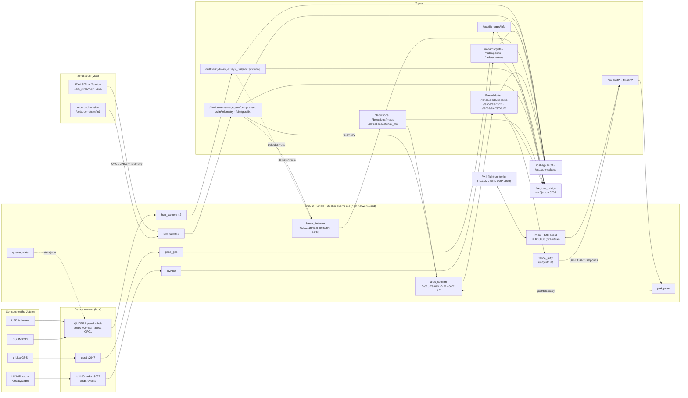
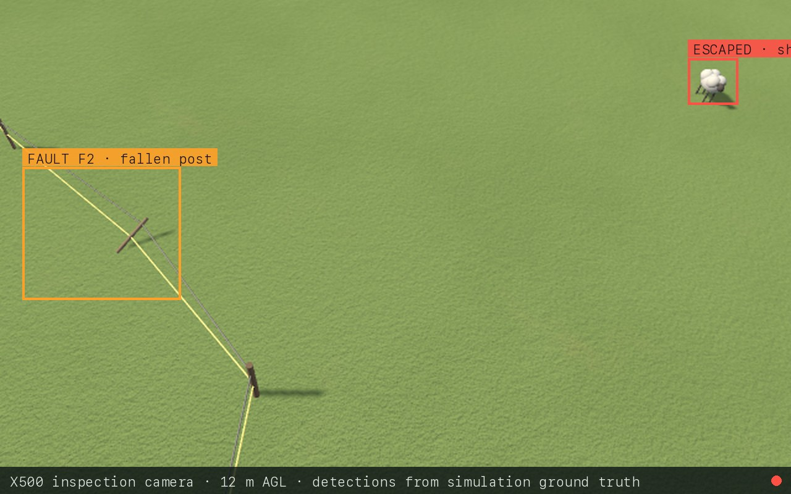
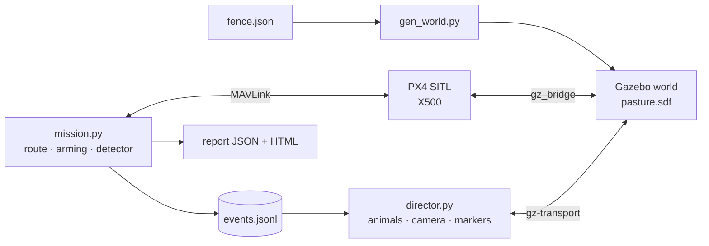

# Querra Fence · Gardian X500

[English](README.md) · [Polski](README.pl.md) · **Română** · [Português](README.pt.md) · [Deutsch](README.de.md) · [Español](README.es.md) · [Hrvatski](README.hr.md) · [Български](README.bg.md) · [Dansk](README.da.md)


**Gard sigur: protejează-ți animalele de prădători.** Pagina proiectului, cu senzorii și planul:
**[cosminbmemetea.github.io/querra-fence](https://cosminbmemetea.github.io/querra-fence/?lang=ro)**

Inspecție autonomă a gardului electric cu un PX4 **Holybro X500**, simulată cap-coadă în **Gazebo Harmonic**.
Drona zboară singură de-a lungul gardului, găsește defectele (sârmă ruptă, stâlp căzut, o creangă care scurtcircuitează
sârmele), măsoară unde își pierde gardul tensiunea, observă animalele ieșite din padoc, aterizează și scrie un raport
cu coordonatele GPS ale fiecărei constatări.

Documentația detaliată din `docs/` este în engleză.


<p>
  
  
</p>

## Panoul de control de teren

Jetson-ul rulează un panou web pe portul 8080 (`http://mmx-desktop.local:8080`) pentru un telefon pe hotspot sau un
laptop. Arată live ambele camere, țintele radarului LD2450 și fix-ul GPS și pornește și oprește colectarea de date cu
detectorul de gard v0.3. Merge offline, în engleză sau poloneză. Codul și arhitectura sunt în
[`jetson/panel/`](jetson/panel/). Cardul radarului are o hartă termică de ocupare care se estompează (pornit/oprit și
Șterge), iar cardul ROS 2 pornește și oprește ROS 2, arată frecvențele topicurilor și înregistrează bag-uri.


 

Coordonatele GPS sunt estompate în aceste capturi.

Aplicația desktop: `sudo apt install ./querra-fence-panel_0.6.0_arm64.deb` adaugă în dock-ul Jetson-ului un icon
**Querra Fence** care redeschide panoul (și îl pornește dacă e nevoie). Vezi [packaging/deb/](packaging/deb/).

## ROS 2 (fazele 1–3)

Senzorii Jetson-ului sunt și topicuri ROS 2 Humble. Nodurile rulează în Docker pe SSD și sunt clienți ai serviciilor
care dețin hardware-ul: camerele din hub-ul panoului, GPS-ul din gpsd, radarul din serviciul ld2450-radar. Publică
imagini `sensor_msgs`, `NavSatFix`, ținte radar, `PointCloud2` și markeri. Înregistrările sunt fișiere rosbag2 MCAP,
iar Foxglove se conectează la `ws://<jetson>:8765`. Folosește cardul ROS 2 din panou sau `ros2/ros.sh`. Detaliile sunt
în [docs/ros2.md](docs/ros2.md).

Faza 2 rulează detectorul de gard în ROS 2: `fence_detector` execută motorul TensorRT FP16 al modelului YOLO11n v0.3
pe GPU-ul Jetson-ului (circa 15 Hz, 20–30 ms pe cadru de la JPEG la casete) și publică `vision_msgs/Detection2DArray`
plus o imagine adnotată. `alert_confirm` transformă detecțiile în `/fence/alerts` doar când 5 din ultimele 8 cadre
sunt de acord, la cel mult 5 m pe sol. `./ros.sh demo` (sau **Demo** în panou) redă o misiune Gazebo înregistrată prin
tot lanțul; `./ros.sh demo tcp://<mac>:5601` folosește simularea live. Layout Foxglove:
[`ros2/foxglove/querra-layout.json`](ros2/foxglove/querra-layout.json).

Faza 3 conectează PX4 însuși: `./ros.sh demo tcp://<mac>:5601 px4:=true` pornește un agent micro-ROS pe UDP 8888.
Clientul uXRCE-DDS din PX4 îi publică `/fmu/out/*`, iar `px4_pose` transformă poziția și direcția proprii ale dronei în
`/px4/telemetry`, care plasează apoi alertele. Pe Mac, `tools/uxrce_relay.py <jetson>` trimite clientul PX4 SITL spre
Jetson, deci nimic nu se schimbă în PX4. Într-un zbor simulat, poziția PX4 s-a potrivit cu telemetria simulatorului la
0,6 m (mediana), iar cele trei defecte reale au fost alertate la 2,4 m, 3,0 m și 4,2 m de pozițiile lor reale.
Cu `refly:=true`, Jetson-ul preia apoi controlul după turul de inspecție: trece PX4 în OFFBOARD, zboară jos peste
fiecare defect confirmat ca să-l vadă de aproape și predă controlul cu Return. În SITL tot zborul a mers: 8 treceri,
apoi întoarcere și aterizare. Verificarea de aproape nu e încă de încredere, pentru că detectorul a fost antrenat la
12 m, nu la 6 m. Detalii și cifrele cinstite: [docs/ros2.md](docs/ros2.md#phase-3-px4-over-uxrce-dds).



## Ce face un zbor

| Pas | Ce se întâmplă |
|---|---|
| Plan | Poligonul gardului din `fence.json` devine un traseu netezit, la 2,5 m în afara sârmei, cu 56 de puncte |
| Zbor | PX4 decolează la 12 m, parcurge cei 414 m de gard cu 5 m/s, se întoarce și aterizează (circa 2,5 min) |
| Detecție | O cameră de inspecție înclinată și un senzor EM simulat raportează defecte, pierderi de tensiune și animale din afara poligonului |
| Raport | `reports/raport_*.json` pentru programe, `raport_*.html` cu hartă, tabele și profilul de tensiune |

Rezultatul zborului de exemplu din [`docs/sample-report`](docs/sample-report/sample-report.html):
**3 din 3 defecte** găsite, **3 din 3 animale evadate** găsite, tensiune pierdută pe firul de sus imediat după ruptură,
**9 din 24 de animale** numărate (un tur pe perimetru vede doar 10–15 m în interiorul padocului).

## Demo

**Camera de inspecție.** Ce vede drona de la 12 m, cu detecțiile desenate pe cadru.

<p>
  
  
</p>

**Cele trei defecte pe sol.**


**Înainte de decolare.** X500 pe platformă și energizatorul de la începutul gardului.

<p>
  
  
</p>

**Raportul.** Se deschide în limba în care a rulat zborul și are un meniu cu nouă limbi: EN, RO, PL, PT, DE, ES, HR,
BG, DA.


## Pornire rapidă

Testat pe un Mac cu Apple Silicon (M2, 8 GB), cu PX4 `main` (v1.18 beta) și Gazebo Harmonic 8.10.

1. Construiește o dată PX4 pentru simulare, cu configurația Gazebo proprie a PX4:

   ```bash
   git clone --recursive https://github.com/PX4/PX4-Autopilot.git ~/PX4-Autopilot
   cd ~/PX4-Autopilot
   ./Tools/setup/macos.sh --sim-tools
   source .venv/bin/activate
   make px4_sitl
   ```

2. Pornește inspecția:

   ```bash
   git clone https://github.com/CosminBMemetea/querra-fence.git
   cd querra-fence
   ./start.sh
   ```

   Se deschide Gazebo, drona zboară, detecțiile apar în terminal, iar raportul se deschide în browser.
   **Enter** pentru încă un zbor, **Ctrl+C** pentru a închide tot.

| Comandă | Ce face |
|---|---|
| `./start.sh` | Zbor complet automat de inspecție și raport (implicit) |
| `./start.sh manual` | Doar simularea; consola PX4 (`pxh>`) rămâne în terminal pentru comenzile tale |
| `./start.sh headless` | Ca implicit, dar fără fereastra Gazebo; cel mai ușor pe un laptop |
| `./start.sh mission` | Doar zborul de inspecție, pe o simulare care rulează deja |
| `./start.sh demo` | Un zbor filmat care regenerează tot din `docs/media` |
| `./start.sh guard` | Sol + aer: o stație de sol la poartă (RGB, termic, iToF, monitor de gard) trimite drona când vede o problemă; camerele ei sunt fluxuri RTSP ([detalii](docs/ground-station.md)) |
| `./stop.sh` | Oprește toate procesele, inclusiv resturile unei rulări căzute |
| `tools/install_launcher.sh` | Pune pe Desktop un `Gardian Sim.command` care pornește cu dublu clic |

Adaugă `--lang <cod>` la orice mod (sau setează `GARDIAN_LANG`) ca terminalul și raportul să fie în altă limbă: `en`
(implicit), `ro`, `pl`, `pt`, `de`, `es`, `hr`, `bg` sau `da`. Limba raportului se poate schimba și după aceea.
PX4 în alt loc: `PX4_DIR=/cale/spre/PX4-Autopilot ./start.sh`. Nimic din arborele PX4 nu este modificat.

## Stație de sol + dronă

`./start.sh guard` adaugă o stație de sol în stil Jetson pe un stâlp la poartă: camere RGB și termică pe catarg, un
senzor de adâncime iToF pe stâlpul porții și un monitor de gard la capătul îndepărtat al sârmei. Veghează tot timpul și
trimite drona când un animal iese pe poartă sau scade tensiunea gardului. Camerele ei sunt publicate ca fluxuri RTSP,
deci un Jetson real își poate rula modelele pe simulare înainte de a ajunge pe teren.
Vezi [docs/ground-station.md](docs/ground-station.md).

**Întreabă Jetson-ul ce vede.** `brain/server.py` rulează pe Jetson: ia cadrele RTSP și starea live
(`sim/state_server.py`), răspunde la întrebări scrise cu un model local de viziune și limbaj (Ollama), sprijinit pe
datele senzorilor, și rostește răspunsul (Piper). Instalare și scenariu: [docs/jetson-brain.md](docs/jetson-brain.md).


## Senzor real: radarul LD2450 pe Jetson

Primul hardware real al stației de sol este un HiLink LD2450, un radar mmWave de 24 GHz care urmărește până la 3 ținte.
Se conectează la Jetson printr-un adaptor USB-serial CH340.
`radar/` îl citește și servește o pagină radar live:
- ținte pe un evantai de ±60°, cu mișcare lină, urme și o hartă termică;
- distanța, unghiul, viteza și felul mișcării pentru fiecare țintă;
- un grafic de distanță pe 60 de secunde și un jurnal de activitate.

Este împachetat ca pachet Debian care rulează ca serviciu de sistem și pune un icon de aplicație pe desktop:

```bash
sudo apt install ./ld2450-radar_1.0.1_all.deb     # de pe pagina de versiuni (releases)
# apoi deschide "LD2450 Radar" sau http://<jetson>:8077 de pe orice dispozitiv din rețea
```

Detaliile, cablajul și API-ul JSON/SSE sunt în [radar/README.md](radar/README.md).


## Cum funcționează



| Cale | Rol |
|---|---|
| `fence.json` | Singura sursă de adevăr: poligonul gardului, stâlpii, defectele, turma, animalele evadate, setările de zbor și de cameră |
| `sim/gen_world.py` | Generează lumea Gazebo: gard cu două fire, poartă izolată și energizator, defecte, copaci, curtea fermei, turmă; aspect „rich” (cer, iarbă texturată, dealuri) sau cel original „classic” |
| `models/x500_fence` | X500 din PX4 plus o cameră de inspecție de 640×400, 15 fps, înclinată 55° în jos, mai ușoară decât cea standard de 1280×960 |
| `sim/mission.py` | pymavlink: parametri PX4 pentru zbor lin, încărcarea misiunii, armare ca GCS, detector, raport |
| `sim/director.py` | Python pentru Gazebo: animale care pasc și se plimbă, cameră care urmărește, traseul planificat și markerii detecțiilor |
| `sim/geo.py` | Geometrie comună: stâlpi, locurile defectelor, traseul exterior, punct în poligon, local ⇄ GPS, modelul de tensiune |
| `sim/report.py` | Raport HTML cu hartă SVG, profilul de tensiune și un meniu de limbi (nouă limbi) |
| `sim/i18n.py` | Fiecare mesaj citit de un om, în nouă limbi (EN, RO, PL, PT, DE, ES, HR, BG, DA) |
| `tools/` | Captură demo, generator de media, înregistrator de scenarii, lansator pe Desktop, texturi de iarbă (`make_textures.py`), imagini statice (`snap_world.sh`) |
| `ground/`, `brain/` | Nodul simulat al stației de sol; creierul Jetson care răspunde la întrebări despre ce vede |
| `radar/` | Radarul mmWave LD2450 pe Jetson: pagină live și pachetul Debian |

## Configurare

Tot scenariul stă în `fence.json`. Modifică-l și pornește din nou; lumea se regenerează.
Aspectul implicit „rich” adaugă cer, un soare jos, iarbă texturată, dealuri și curtea fermei, iar padocul rămâne plat.
`"look": "classic"` în `fence.json` (sau `GARDIAN_LOOK=classic`) readuce lumea originală, verde și plată, pe care
o folosesc în continuare datele de antrenare ale detectorului.

```json
"fence":   { "polygon": [[10, 6], [70, -4], [128, 14], ...], "post_spacing_m": 6.0, "strand_heights_m": [0.55, 1.0] },
"faults":  [{ "id": "F1", "type": "wire_break", "segment": 22, "strand": 1 }, ...],
"herd":    { "cows": 14, "sheep": 10 },
"mission": { "altitude_m": 12.0, "speed_ms": 5.0, "offset_outside_m": 2.5, "camera_pitch_deg": 55 }
```

Coordonatele sunt în metri locali (x spre est, y spre nord) în jurul lui `origin`, care fixează poziția GPS a pășunii.

## Detectorul de gard pe Jetson (YOLO11n)

Simularea antrenează acum percepția reală a dronei. `tools/make_dataset.py` randează ferme aleatoare în Gazebo și
etichetează fiecare cadru din geometria 3D cunoscută: 7 clase, fără etichetare manuală. Un YOLO11n antrenat pe aceste
cadre rulează ca motor TensorRT FP16 pe un Jetson Orin Nano. Jetson-ul citește camera simulată a dronei prin rețeaua
locală (`tools/cam_stream.py`) în timp ce PX4 zboară misiunea și înregistrează fiecare detecție cu GPS.

| Model | Val mAP50 | Pe Jetson (misiune simulată) | Versiune |
|---|---|---|---|
| v0.1 · checkpoint din epoca 2 | 0.72 | sârma ruptă F1 găsită (0.78); slab pe stâlpul căzut | `model-v0.1` |
| v0.2 · 25 de epoci | 0.921 | 13.3 fps; F1, F2, F3 toate găsite (0.94 / 0.96 / 0.84); 385 de cadre cu sârmă ruptă falsă | `model-v0.2` |
| v0.3 · reglat fin pe date țintite | 0.916 (test separat 0.912) | `wire_break` test mAP50 0.58 → 0.68; cu confirmare GPS 5 din 8, alerte false 33 → 6, toate defectele găsite | `model-v0.3` |
| v0.4 · ambele aspecte ale lumii | 0.956 (test separat 0.938 classic, 0.938 rich) | lumea rich: 3 din 3 defecte (v0.3: 1 din 3); misiunea classic: 13 alerte false (v0.3: 5), deci rulează doar zborurile live în Gazebo | `model-v0.4` |
| v0.5 · poziții de zbor, JPEG-ul stream-ului | 0.952 (test separat 0.937 classic, 0.937 rich) | antrenat pe cadre poziționate ca în zbor și comprimate ca stream-ul camerei: 3 din 3 defecte și 0 alerte false în ambele zboruri live (v0.4: 13 classic, 6 rich); modelul implicit | `model-v0.5` |


- [Jurnalul de reantrenare](docs/retraining-log.md): ce a ratat fiecare versiune și ce s-a schimbat.
- [Fișa modelului](docs/model-card.md): date, metrici, limite și cum se reproduce.
- [Modele și date](ml/README.md): registrul tuturor modelelor și seturilor de date, fișele antrenărilor și sha256 pentru fișierele modelelor.
- [Integrarea cu Jetson](docs/jetson-integration.md): sursa de cameră `sim:`, detectorul și modul de teren din querra-scout.

## Simulare versus realitate

Zborul este cod PX4 real: aceeași misiune, aceiași parametri și aceleași comenzi MAVLink ar conduce un X500 fizic.
Percepția nu este încă reală, iar casetele din imaginile demo o spun:

- **Detecția** din `sim/mission.py` folosește încă pozițiile reale din Gazebo ca să arate ce ar raporta camera.
  Modelul de viziune care o înlocuiește rulează deja pe Jetson (vezi [Detectorul de gard](#detectorul-de-gard-pe-jetson-yolo11n)).
- **Tensiunea gardului** vine dintr-un model simplu de circuit de-a lungul gardului. O variantă reală are nevoie de un
  senzor care prinde din aer impulsurile energizatorului sau de monitoare fixe de tensiune pe gard.
- **Acoperirea**: de la 12 m camera vede cam 10–15 m în fiecare parte. Numărarea întregii turme cere un zbor în grilă în plus.

## Plan

1. Antrenarea unui detector pe fluxul camerei din Gazebo, apoi pe poze reale de garduri (sârmă ruptă, stâlp aplecat,
   vegetație, bovine, oi)
2. Importul gardului dintr-o plimbare cu GPS sau dintr-un fișier KML/GeoJSON în loc de metri locali
3. Gimbal și cameră termală pentru inspecții de noapte
4. Zbor în grilă pentru numărarea întregii turme
5. Alerte pe telefon și o hartă a defectelor deschise
6. Radarul LD2450 ca numărător real la poartă în modul de pază, în locul senzorului iToF simulat
7. Hardware: X500 V2, Pixhawk, Raspberry Pi 5 sau Jetson drept calculator de bord, cu același cod de misiune MAVLink

Paza de prădători noaptea (cameră termală și radar la poartă) este planificată; vezi
[pagina proiectului](https://cosminbmemetea.github.io/querra-fence/?lang=ro#roadmap).

## Note

- Simularea vorbește nouă limbi (`--lang pl`, `--lang de`, …). Jurnalele sunt mereu în engleză. În datele JSON,
  textul citit de oameni este salvat în toate limbile.
- Linux nu este încă testat. Scripturile așteaptă mediul Gazebo pentru macOS al PX4 (`Tools/setup/macos/.pixi`) și
  folosesc `open` pentru raport.
- Jurnalele fiecărei rulări sunt în `run/`: `mission.log`, `px4.log`, `gz_server.log`, `director.log`.
  Cele două erori „Unable to load Ogre Plugin” din `gz_server.log` sunt normale pe macOS; camera randează oricum.
