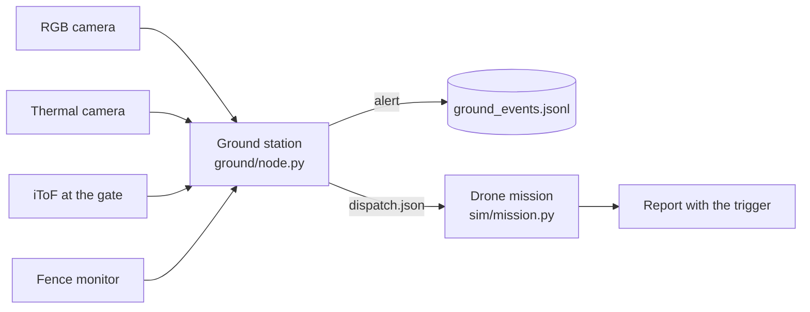

# Ground station + drone (guard mode)

A Jetson on a pole at the gate watches the pasture all the time. The drone only flies when the ground station sees a problem.


*The three simulated streams as the Jetson receives them over RTSP: RGB, thermal (animals at 38 °C on 15 °C ground), iToF depth at the gate.*

| Part | On the farm | In the simulation |
|---|---|---|
| Mast camera, RGB | Wide-angle camera on the pole, gate and nearby paddock by day | `/ground/rgb`, 640×360, 110°, 10 fps |
| Mast camera, thermal | Thermal camera for animals, people and predators at night | `/ground/thermal`, 320×240, 50°, 9 fps, animals at 38 °C |
| Gate sensor, iToF | Depth sensor on the gate post, counts animals through the opening | `/ground/depth`, 320×240, 0–8 m |
| Fence monitor | Commercial monitor at the far end of the fence, alarm contact wired to the Jetson | Voltage model with fault onset times (`onset_s` in `fence.json`) |
| Brain | Jetson AGX Orin running the models on site | `ground/node.py` |
| Air | Drone on its pad | PX4 X500, `sim/mission.py` |



## Run it

```bash
./start.sh guard            # ground station + drone on standby
./start.sh guard --share    # same, with the RTSP streams reachable from the local network (for the Jetson)
./start.sh guard --lang ro  # messages and report in Romanian
```

The scenario in `fence.json`:

1. The gate is left open (`scenario.gate_open`).
2. After `gate_escape_after_s` seconds (35 by default) the cow nearest to the gate walks out.
3. The iToF on the gate post counts it going out, and the mast camera sees it outside the fence.
4. The ground station sends the drone. The report shows "Triggered by the ground station: …".
5. At `onset_s` (75 s) the top wire breaks at F1. The fence monitor at the far end drops to 0 kV and raises an alarm. If the drone is already out, the alarm is logged and the drone finds F1 on its loop.

Cyan beams in Gazebo mark ground-station alerts; orange and red beams are the drone's findings.

## Connect the Jetson to the simulated cameras

`./start.sh guard --share` prints the stream addresses, for example:

```
rtsp://192.168.1.20:8554/ground/rgb
rtsp://192.168.1.20:8554/ground/thermal
rtsp://192.168.1.20:8554/ground/depth
rtsp://192.168.1.20:8554/drone/cam
```

On the Jetson, check one stream with hardware decoding:

```bash
gst-launch-1.0 rtspsrc location=rtsp://192.168.1.20:8554/ground/thermal latency=100 ! \
  rtph264depay ! h264parse ! nvv4l2decoder ! nvvidconv ! xvimagesink
```

Or with OpenCV (`cv2.VideoCapture("rtsp://…/ground/rgb")`). The same code later opens the real cameras: only the URLs change.

The relay (MediaMTX) has no authentication. Use `--share` only on a trusted network.

## Simulated versus real

- **Perception** in the simulation uses the true animal positions inside each camera's field of view (`SimEyes` in `ground/node.py`).
  On the Jetson it is replaced by a detector on the RTSP frames (YOLO with TensorRT or ONNX Runtime CUDA).
  The animals in Gazebo are boxes, so a real detector will not recognise them yet. Realistic cow and sheep models come next.
- **Thermal** is an ideal heat image: no emissivity, no sun-warmed ground, no fog. Real thermal footage from the field is needed to train.
- **Depth** is sent as 8-bit video over H.264, which loses metric precision. Use the raw iToF output on the real Jetson.
- **Fence monitor**: the simulation computes the voltage. On the farm, use a commercial fence monitor with an alarm contact into a Jetson GPIO through an optocoupler, never a direct connection to the fence.

## Next steps on the Jetson

1. Run `ground/node.py` on the Jetson against the simulated streams, with a `JetsonEyes` class that reads RTSP frames and runs the detector
2. Replace the simulated streams with the real RGB, thermal and iToF cameras
3. Send alerts to a phone (Telegram or ntfy) and keep short video clips around each alert
4. A week of recordings on a friend's farm to train and tune the detector on real animals, real gates and real nights
