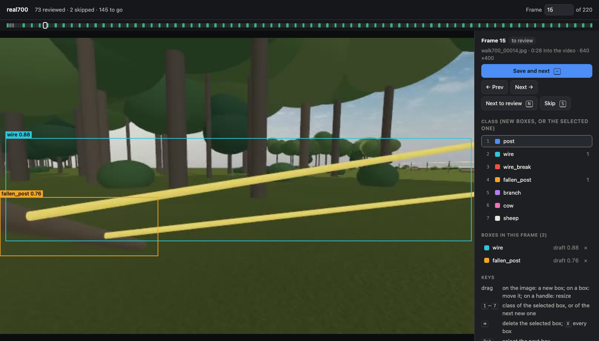

# Labelling real footage

Every score so far comes from simulated images, labelled automatically from Gazebo's geometry. Real footage needs
labels by hand, and drawing every box from nothing is slow. `tools/label_drafts.py` lets a model draw the boxes
first; you check and correct them in the browser, and the result is a test set that scores any model on real images.
It works for a phone walk ([phone-walk.md](phone-walk.md)) and for drone video ([drone-video.md](drone-video.md)).

## 1. Draft

```bash
~/.querra-train-venv/bin/python tools/label_drafts.py draft ~/Movies/IMG_1234.MOV \
    --model ~/querra-data/models/ground-yolo11n-v0.1.pt --every 2
```

- It takes one frame every `--every` seconds into `~/querra-data/real/IMG_1234/` and writes the model's boxes from
  conf 0.25 as drafts. A 10-minute walk at `--every 2` is 300 frames, about an hour of review.
- Drone video: `--model ~/querra-data/models/fence-yolo11n-v0.5.pt`. A folder of photos works too.
- **Which model drafts matters a little.** The labels lean toward what the drafting model sees, which gives it a small
  edge when scored. To test whether ground-v0.2 beats ground-v0.1, draft with v0.1: the edge then works against the
  newer model, and a win counts for more.
- Run it again on the same folder with another `--model` to redraw the drafts. Reviewed labels are never touched.

## 2. Review

```bash
python3 tools/label_drafts.py serve ~/querra-data/real/IMG_1234
```

The page opens at `http://127.0.0.1:8765`. It runs on the Mac only, needs no internet and no extra packages, and saves
each frame the moment you press Enter. Stop any time; it starts again where you left.



For each frame:

1. **Delete what is wrong:** click the box, then ⌫. Dashed boxes are drafts below conf 0.5: check those first.
2. **Fix what is loose:** drag a box to move it, or its handles to resize it.
3. **Draw what is missing:** pick the class with 1–7 and drag on the image. Look for what has no box: the drafts
   miss things too, and a missed object left out is a wrong label.
4. **Enter** saves the frame and opens the next. **S** skips a frame that shows nothing useful (blurred, the fence
   out of view); skipped frames stay out of the test set.

| Key | |
|---|---|
| 1–7 | class of the selected box, or of the next one you draw |
| ⌫, X | delete the selected box; X deletes every box of the frame |
| Tab | select the next box |
| Enter, S | save as reviewed and go on; skip |
| ← → | previous, next frame (unsaved edits are kept) |
| N | the next frame not yet reviewed |
| ⌘Z | undo |
| scroll, space+drag, F | zoom, pan, fit |
| H | hide the boxes to see the image |

The strip under the title shows every frame: green reviewed, grey skipped, dark still to do.

## What to box

The same rules as the simulator's labels (`tools/make_ground_dataset.py`), so real and simulated scores compare:

| Class | The box |
|---|---|
| `post` | each standing post, from the ground to its top |
| `wire` | the wires of one span between two posts, all strands in one box, from post to post or to the image edge |
| `wire_break` | the broken strand of a span: its hanging or fallen pieces, one box per span. The span's other strands stay in its `wire` box |
| `fallen_post` | a post leaning more than about 15–20° or lying down: the whole post |
| `branch` | a branch touching or lying on the wires: the whole branch |
| `cow`, `sheep` | each animal |

- Box the visible part only. Leave out an object more than half hidden, or smaller than about 1% of the frame's width.
- Leave out fence parts farther than about 12 m: the simulator does not label them, so no model was asked to find them.
- A frame with nothing to box is still a good frame: save it empty. It tests false alerts.

## 3. Score

```bash
~/.querra-train-venv/bin/python tools/label_drafts.py score ~/querra-data/real/IMG_1234 \
    --model ~/querra-data/models/ground-yolo11n-v0.1.pt ~/querra-data/models/ground-yolo11n-v0.2.pt
```

It scores each model on the reviewed frames: mAP50 per class, and for each fault class the recall, the precision and
the share of frames with a false box, at conf 0.5 and 0.7, the thresholds the alerts use (as in
[ml/runs/ground-v0.2](../ml/runs/ground-v0.2)). The table prints at conf 0.7; everything goes to
`~/querra-data/real/IMG_1234/scores/<model>.json`.

**Tested** on the simulated walk with the simulator's labels saved through the page for 73 of its frames: both
models scored, mAP50 0.965 (ground-v0.1) and 0.972 (ground-v0.2). The page's editing (draw, class, move, resize,
delete, undo, save, frames kept while you move between them) was driven in headless Chrome against the server.

## Keep it

- The folder is a YOLO dataset: `images/all`, `labels/all`, `reviewed.txt` (the reviewed frames) and `data.yaml`.
- Register it in [ml/datasets.json](../ml/datasets.json) with the role `test`, like the simulated test sets. The images
  stay in `~/querra-data`, out of git.
- Once there are a few hundred real frames, part of them can go into training. Keep a whole walk apart as the test
  set: frames of the same walk are too alike to test each other.
