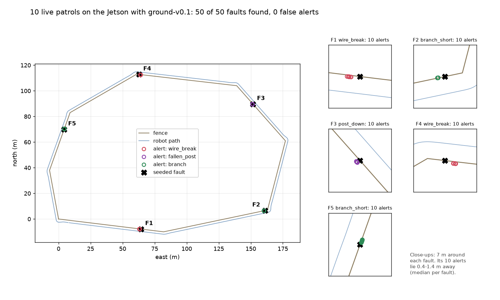

# ground-v0.1 · The fence from the ground robot's side camera

The first fence detector for the ground robot. Its camera looks at the fence from the side, 0.7 m up, under the
trees, where the drone's models (trained from 12 m above) found 2 of 5 faults and raised 19 false alerts. Live on the
Jetson, in 10 patrols in a row, ground-v0.1 found **all 5 faults every time, 50 of 50, with no false alert**.

| | |
|---|---|
| Role | Default for the ground robot's fault alerts from platform v0.13.0: `./ros.sh ugv … detect:=true` |
| Parent | model-v0.5 (fine-tuned) |
| Trained on | 3,600 frames from the robot's camera in 12 random forest enclosures; 2,720 compressed like its camera stream |
| Code | `dcd017a` |
| Run record | [ml/runs/ground-v0.1](https://github.com/CosminBMemetea/querra-fence/tree/ground-v0.1/ml/runs/ground-v0.1) |

## What changed

1. **Ground-view data** (`tools/make_ground_dataset.sh`). Random forest enclosures in the style of the patrol world:
   6–9 sided fences, 3–5 broken wires, 2–3 fallen posts and 2–3 branches on the wires each, forest density and sun
   randomised. A copy of the robot's camera (640×400, 100° wide) at robot poses 1.4–2.5 m outside the fence, with
   heading, pitch and roll noise. Labels come from Gazebo's geometry; a depth camera on the same mount removes hidden
   parts.
2. **Stream-like JPEG** on 75% of the training frames and all of the validation and test frames, as the robot's
   camera reaches the Jetson.
3. **Fine-tuned from model-v0.5** for 10 epochs: CPU, 3.5 h, in five sessions with 15-minute cooling breaks. The last
   epoch was the best, and the scores were still rising.

## Scores

| | model-v0.5 | **ground-v0.1** |
|---|---|---|
| Test enclosures (3 forests of their own seeds, 600 frames), mAP50 | 0.040 | **0.957** |
| … broken wire / fallen post / branch | 0.119 / 0.047 / 0.004 | **0.957 / 0.942 / 0.958** |
| Patrol frames of the real forest, offline, 5 of 8 frames: faults found, false alerts | 2 of 5, 19 | **5 of 5, 0** |

The patrol frames are the forest the robot patrols, one frame every 0.5 m along its route, never used for training.

## Live on the Jetson

Gazebo's forest on the Mac, the robot's brain in ROS 2 on the Jetson. The TensorRT FP16 engine (3.43 ms per frame,
286 per second) runs on the side camera. `ugv_alerts` confirms a fault when 5 of 8 frames taken 0.5 m of travel apart
see it at the same spot on the fence, placed from the SLAM pose. An alert is real when its class matches a fault
within 5 m.

| Fault | Found in 10 patrols | Alert distance from the fault, median |
|---|---|---|
| F1 broken wire | 10 | 1.2 m |
| F2 branch on the wires | 10 | 0.8 m |
| F3 fallen post | 10 | 0.4 m |
| F4 broken wire | 10 | 1.1 m |
| F5 branch on the wires | 10 | 0.4 m |
| **False alerts** | **0** | |

**Fallen posts count from conf 0.5, the other faults from 0.7.** With every class at 0.7, the first two live patrols
found 4 of 5 and missed F3 both times. ground-v0.1 scores fallen posts lower than the other faults: on its held-out
test forests conf 0.7 keeps 52% of them, conf 0.5 keeps 90% with false fallen posts in 0.5% of the frames. The
threshold was taken from those forests, not from the patrol.

## Known limits

- **The fallen post is the thin margin:** 6–7 steps near F3 show it, where 5 are needed. ground-v0.2 will add
  fallen-post data, the rarest class here (372 against 812 broken wires and 693 branches), so 0.7 works for all.
- **One patrol world.** The live patrols drive the same forest every time; the test enclosures are the check on
  other forests.
- **Simulation only.** No real ground-view images yet.

## Files

| File | What it is | SHA-256 |
|---|---|---|
| `ground-yolo11n-v0.1.pt` | PyTorch weights (Ultralytics), to fine-tune from | `a6837e2413f955a86c23b4d25c9e3aaeca411465e357a80441c3f12dcbabcaa4` |
| `ground-yolo11n-v0.1.onnx` | ONNX, 1×3×416×640. Build the Jetson engine with `trtexec --fp16` | `9eb8a54398912e68879a6f79a9e71324437fbc805da7dbcda09faaedede65911` |
| `classes.json` | Class names in output order | `4bc311cdc19b0ab73d26877dac914ffd61fb63b9e69e534b5405d5dad00e24e1` |
