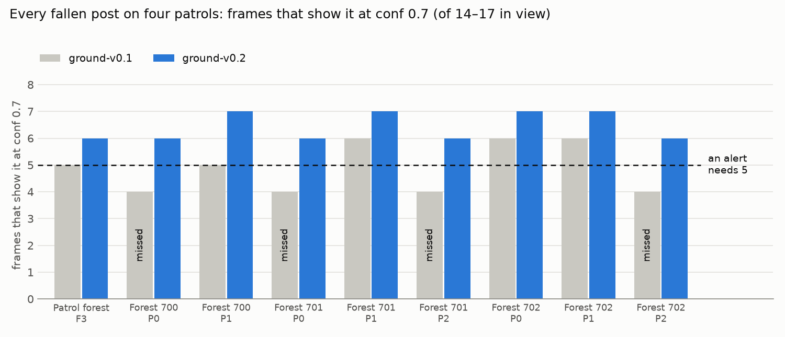

# ground-v0.2 · More fallen posts: every fault found at conf 0.7, offline (candidate)



ground-v0.1 found 50 of 50 faults in 10 live patrols, but only because fallen posts count from conf 0.5. At 0.7, the
threshold of the other faults, its first live patrols missed a fallen post, and so did its offline patrols of three
new forests. ground-v0.2 learned from 2.4 times as many fallen posts. Offline, on the patrols of four forests, it finds **every fault with every class from
conf 0.7: 29 of 29, with no false alert**.

**A candidate, not yet live-tested.** The Jetson was not available for this release. The ground robot keeps
ground-v0.1 by default until ground-v0.2 passes live patrols on it.

| | |
|---|---|
| Role | Candidate. Not used by default; the ground robot keeps ground-v0.1 (`./ros.sh ugv … detect:=true`) until ground-v0.2 passes live patrols |
| Parent | ground-v0.1 (fine-tuned) |
| Trained on | 5,100 frames from the robot's camera: ground-v0.1's 3,600 and 1,500 from 6 enclosures full of fallen posts; 908 fallen posts (ground-v0.1: 372) |
| Code | `5ab9979` |
| Run record | [ml/runs/ground-v0.2](https://github.com/CosminBMemetea/querra-fence/tree/ground-v0.2/ml/runs/ground-v0.2) |

## What changed

1. **Fallen-post data** (`tools/make_ground_dataset.sh --focus post_down --posts-down 4-6`). 6 new random forest
   enclosures (seeds 520–525, outside every other range) with 4–6 fallen posts each, and 70% of the camera poses near
   a fault, 70% of those near a fallen post. 1,500 frames, three quarters compressed like the robot's camera stream.
2. **Fine-tuned from ground-v0.1** for 8 epochs on the laptop CPU, 2.4 h. The last epoch was the best, and the scores
   were still rising.

## Scores

Offline, on forests never used for training. The patrols are the forest the robot patrols and three random forests
(seeds 700–702), one frame every 0.5 m along each route, scored as the alert chain counts: 5 of 8 frames.

| | ground-v0.1 | **ground-v0.2** |
|---|---|---|
| Test enclosures (3 forests, 600 frames), mAP50 | 0.957 | **0.979** |
| … broken wire / fallen post / branch | 0.957 / 0.942 / 0.958 | **0.982 / 0.993 / 0.972** |
| Fallen posts kept from conf 0.7 on the test enclosures, precision | 52%, 1.00 | **82%, 1.00** |
| Four patrols, every fault from conf 0.7: faults found, false alerts | 25 of 29, 0 | **29 of 29, 0** |
| Four patrols, fallen posts from 0.5 (the live rule today) | 29 of 29, 0 | 29 of 29, 0 |
| Frames that show each fallen post from conf 0.7 (an alert needs 5) | 4–6 | **6–7** |

Broken wires and branches stay within 2 frames of ground-v0.1, and at the alert thresholds no class is worse. One step
back below them: broken-wire recall at conf 0.5 on the test enclosures, 0.94 → 0.93.

## Live on the Jetson

**Not yet.** To test it, build the engine once from the ONNX in the models folder, then patrol with it:

```bash
trtexec --onnx=ground-yolo11n-v0.2.onnx --saveEngine=ground-yolo11n-v0.2-fp16.engine --fp16
./ros.sh ugv tcp://<mac-ip>:5611 pose:=slam slam:=localization detect:=true engine:=/models/ground-yolo11n-v0.2-fp16.engine
```

It becomes the default after 10 live patrols with today's rule (fallen posts from 0.5) as good as ground-v0.1's:
50 of 50 faults, no false alert.

## Known limits

- **Offline only.** ground-v0.1's live patrols showed a fallen post in 1–2 fewer steps than its offline frames, so
  the 6–7 frames at conf 0.7 may be thin on the robot. The fallen-post threshold of 0.5 stays until live patrols at
  0.7 show it can go.
- **One generator.** The new forests vary the layout, the trees and the light, not the style, and every branch fault
  has the same shape.
- **Simulation only.** No real ground-view images yet; [v0.14.0](https://github.com/CosminBMemetea/querra-fence/releases/tag/v0.14.0)
  adds the phone walk and a labelling page to get them.

## Files

| File | What it is | SHA-256 |
|---|---|---|
| `ground-yolo11n-v0.2.pt` | PyTorch weights (Ultralytics), to fine-tune from | `5a8a9dafca3f312bc118969129c5d3d3cc5f421e4c9b778e99c7523cf71af9f0` |
| `ground-yolo11n-v0.2.onnx` | ONNX, 1×3×416×640. Build the Jetson engine with `trtexec --fp16` | `0eb81e25f9f943849fd084992002eb55681495841fda169ba1e84f5ab45cf8c9` |
| `classes.json` | Class names in output order (the same as ground-v0.1) | `4bc311cdc19b0ab73d26877dac914ffd61fb63b9e69e534b5405d5dad00e24e1` |
