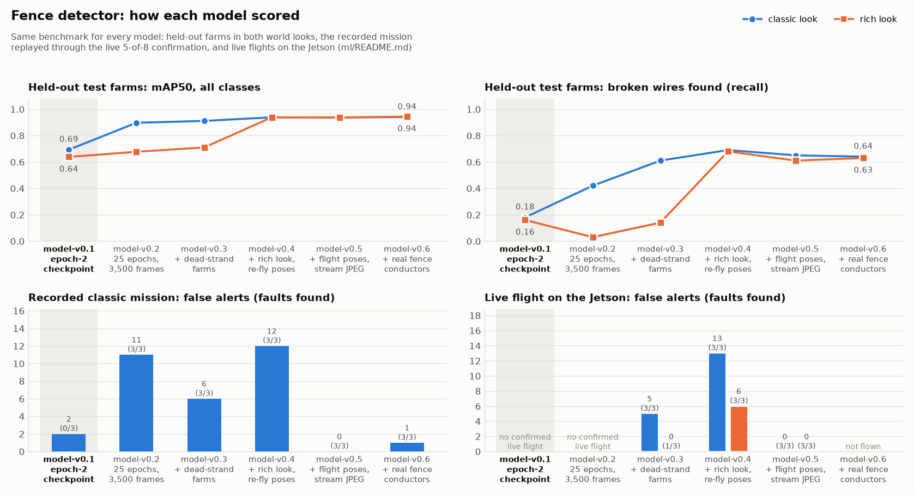
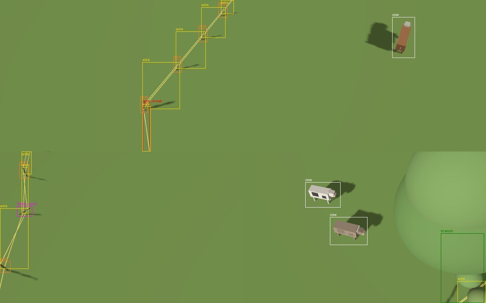
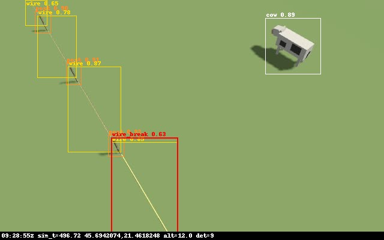

# model-v0.1 · Preliminary checkpoint

The first fence detector. It is the checkpoint after epoch 2 of the run that became model-v0.2, exported early to
test the whole loop on the Jetson: Gazebo → LAN → TensorRT → GPS-tagged log. It is a pre-release.

| | |
|---|---|
| Role | Jetson pipeline test only, never a platform default |
| Parent | `yolo11n.pt` (COCO) |
| Trained on | 3,500 frames from 10 random farms (`fence_yolo`), 700 frames from 2 more farms for validation |
| Code | `b37ef60` |
| Registry | [ml/models.json](https://github.com/CosminBMemetea/querra-fence/blob/main/ml/models.json) |

## What changed

- **First model.** `tools/make_dataset.py` renders random farms in Gazebo and computes every box from the known 3D
  geometry, so no frame was labelled by hand. 7 classes: post, wire, broken wire, fallen post, branch, cow, sheep.
- **Training:** YOLO11n at 640 px on the CPU, stopped after 2 epochs.

## Scores

The shared benchmark, the same for every model ([ml/benchmark](https://github.com/CosminBMemetea/querra-fence/tree/main/ml/benchmark)).
Scored from the ONNX export, because the `.pt` was not kept.

| | model-v0.1 |
|---|---|
| Held-out test farms, classic look (mAP50) | 0.693 |
| Held-out test farms, rich look (mAP50) | 0.638 |
| Broken wires found on the test farms (recall), classic / rich | 0.18 / 0.16 |
| Recorded classic mission, 5-of-8 confirmation: faults alerted, false alerts | 0 of 3, 2 |

## In flight on the Jetson

60 s of the simulated mission, 874 frames at 14.6 fps:

| Fault | Frames within 30 m | Frames detected | Best confidence |
|---|---|---|---|
| F1 broken wire | 228 | 46 (20%) | 0.78 |
| F2 fallen post | 240 | 7 (3%) | 0.63 |
| F3 branch | not reached in the 60 s window | | |

There were 72 false `wire_break` frames more than 45 m from F1.

## Known limits

- Undertrained, most of all on the rare fault classes. The fallen post was seen in 3% of the frames near it.
- With 5-of-8 confirmation it alerts on none of the three faults in the recorded mission.

## Files

| File | What it is | SHA-256 |
|---|---|---|
| `fence-yolo11n-v0.1.onnx` | ONNX, 1×3×416×640. Build the Jetson engine with `trtexec --fp16` | `f810500460193b528776105f5859ebc7e6442decf64989cba641c61efde3ae45` |
| `classes.json` | Class names in output order | `c64ac943dbbfb1298d036f7156f1c2bf395fd5eb88052dcbb5a0267b3c7378b8` |

---
[Retraining log](https://github.com/CosminBMemetea/querra-fence/blob/main/docs/retraining-log.md) ·
[Model card](https://github.com/CosminBMemetea/querra-fence/blob/main/docs/model-card.md) ·
[All releases and models](https://github.com/CosminBMemetea/querra-fence/blob/main/ml/README.md)
