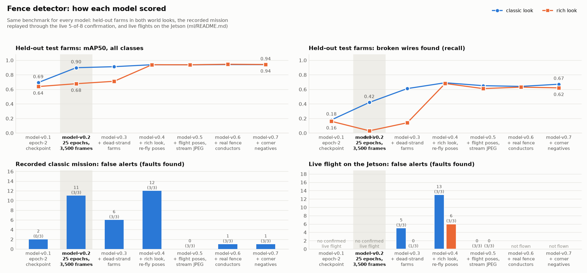
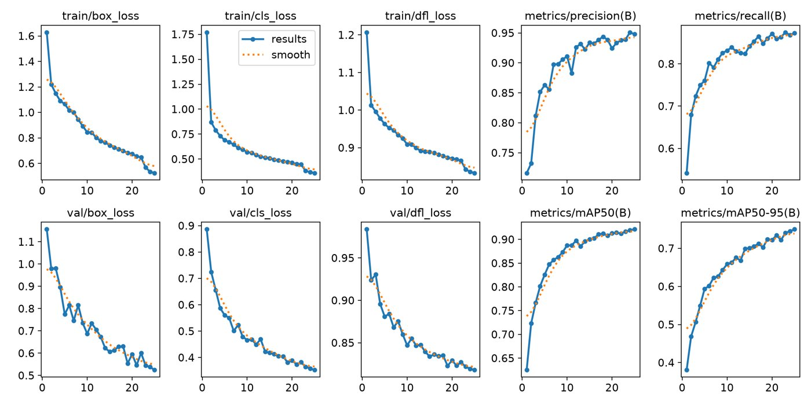
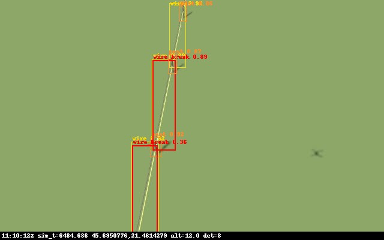

# model-v0.2 · First full model

The first fully trained fence detector: 25 epochs on the same farms as model-v0.1. It finds all three faults in the
simulated mission, but it also calls an intact fence a broken wire far too often.

| | |
|---|---|
| Role | Jetson tests; selectable in the panel's field mode from platform v0.3.0 |
| Parent | `yolo11n.pt` (COCO) |
| Trained on | 3,500 frames from 10 random farms (`fence_yolo`), 700 frames from 2 more farms for validation |
| Code | `1b8a3ab` |
| Registry | [ml/models.json](https://github.com/CosminBMemetea/querra-fence/blob/main/ml/models.json) |

## What changed

- **Full training:** 25 epochs, 640 px, batch 16, on the CPU (about 2 hours). Mosaic augmentation, turned off for the
  last 3 epochs.
- **The data:** the farms vary the fence shape, post spacing, wire heights, faults (2–3 broken wires, 1–2 fallen
  posts, 1–2 branches), herd, sun angle and grass colour. The camera varies in height (5–20 m), tilt (35–80°),
  heading and roll.

## Scores

The shared benchmark, the same for every model ([ml/benchmark](https://github.com/CosminBMemetea/querra-fence/tree/main/ml/benchmark)):

| | model-v0.1 | model-v0.2 |
|---|---|---|
| Held-out test farms, classic look (mAP50) | 0.693 | **0.897** |
| Held-out test farms, rich look (mAP50) | 0.638 | 0.677 |
| Broken wires found on the test farms (recall), classic / rich | 0.18 / 0.16 | **0.42** / 0.03 |
| Recorded classic mission, 5-of-8 confirmation: faults alerted, false alerts | 0 of 3, 2 | **3 of 3**, 11 |

Validation (the 2 held-out farms), mAP50 per class: post 0.968, wire 0.977, `wire_break` 0.818, `fallen_post` 0.916,
`branch` 0.934, cow 0.915, sheep 0.922; **all 0.921** (mAP50-95 0.750).

## In flight on the Jetson

TensorRT FP16 at 640×416. `trtexec` measures 4.7 ms per frame on the GPU. In the pipeline the detector takes 20.8 ms
per frame (29.4 ms at p95), and the mission ran at 13.3 fps against the camera's 15. Full flight: 165 s,
2,196 frames.

| Fault | Frames within 30 m | Frames detected | Best confidence |
|---|---|---|---|
| F1 broken wire | 235 | 113 (48%) | 0.94 |
| F2 fallen post | 223 | 58 (26%) | 0.96 |
| F3 branch | 162 | 14 (9%) | 0.84 |

## Known limits

**False broken wires.** `wire_break` fired in **385 frames** far from F1 (conf ≥ 0.5). `fallen_post` and `branch`
gave no false alarms.
- After a wire breaks, the simulation draws the rest of that strand in grey ("dead"). From 12 m a grey strand is
  almost invisible.
- So an intact fence with a dead top wire looks like "one wire is missing", which is what a break looks like.
- The training farms had too few dead wires, always in the same grey.

A higher threshold trades false alarms for missed faults; it is not a fix:

| Threshold | False frames (> 45 m from F1) | Frames detecting F1 (< 30 m) |
|---|---|---|
| 0.5 | 385 | 85 |
| 0.6 | 292 | 65 |
| 0.7 | 192 | 46 |
| 0.8 | 89 | 16 |

## Files

| File | What it is | SHA-256 |
|---|---|---|
| `fence-yolo11n-v0.2.pt` | PyTorch weights (Ultralytics), to fine-tune from | `3005b8e42ff3b25e7ab146c3ccb441a20271fe2a374ca87f7243636f8329ac67` |
| `fence-yolo11n-v0.2.onnx` | ONNX, 1×3×416×640. Build the Jetson engine with `trtexec --fp16` | `46c0124bb15dbb6c5fe0a047f31fabff4da707de98ce325dc1291469f538ac9f` |
| `classes.json` | Class names in output order | `c64ac943dbbfb1298d036f7156f1c2bf395fd5eb88052dcbb5a0267b3c7378b8` |
| `metrics.md` | Scores at release | `95f469b1b83507894cc9bb4da8640308fed6d9ef9280cf69982fb1eb273b19e2` |

---
[Changes since model-v0.1](https://github.com/CosminBMemetea/querra-fence/compare/model-v0.1...model-v0.2) ·
[Retraining log](https://github.com/CosminBMemetea/querra-fence/blob/main/docs/retraining-log.md) ·
[Model card](https://github.com/CosminBMemetea/querra-fence/blob/main/docs/model-card.md) ·
[All releases and models](https://github.com/CosminBMemetea/querra-fence/blob/main/ml/README.md)
