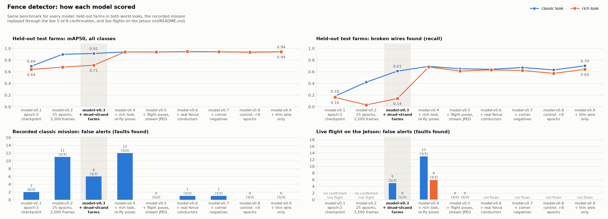
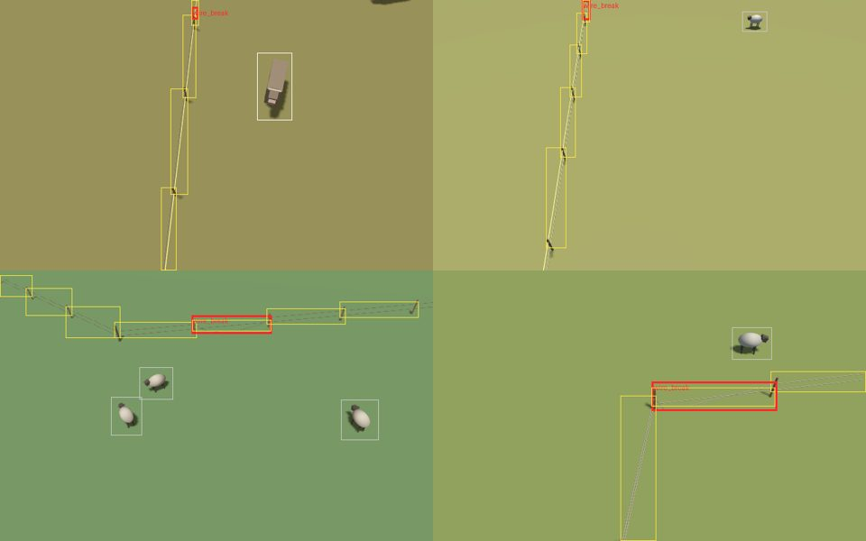
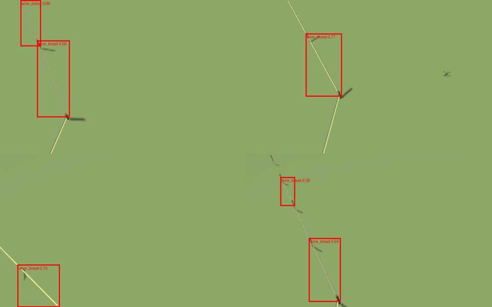

# model-v0.3 · Targeted data for the false broken wire

Fine-tuned from model-v0.2 on farms full of broken and dead strands, and paired with multi-frame GPS confirmation.
False alerts on the mission fall from 33 to 6, with all three faults still found.

| | |
|---|---|
| Role | The default detector: field mode from platform v0.3.0, the ROS 2 detector from v0.5.0 |
| Parent | model-v0.2 |
| Trained on | 4,800 frames: 2,400 from 8 new dead-strand farms (`fence_yolo_v2`) + 2,400 v0.2 training frames |
| Code | `c51aa61` (dataset v2), `ba20f26` (confirmation and mission replay) |
| Registry | [ml/models.json](https://github.com/CosminBMemetea/querra-fence/blob/main/ml/models.json) |

## What changed

1. **More of the confusing data** (`tools/make_dataset.py --style v2`):
   - 8 new training farms (2,400 frames) with 3–4 breaks each, so long stretches of fence carry a dead strand;
   - the dead strand is drawn in random colours (grey, the live yellow, dull or dark) and is always labelled `wire`;
   - breaks come in three shapes: ends hanging, snapped wire on the grass, one end still tied;
   - 60% of the poses imitate the inspection flight.
2. **Fine-tuned from v0.2** for 10 epochs on 4,800 frames: the new frames plus 2,400 v0.2 training frames, so the
   model keeps what it knew. CPU, AdamW (lr 0.0009), mosaic off for the last 3 epochs. Best epoch: 9.
3. **A held-out test set:** 3 new farm seeds (140–142, 750 frames), never used for training or model selection.
4. **Multi-frame GPS confirmation** (`tools/confirm.py`). Every fault box is placed on the ground using the GPS,
   altitude, heading and camera angle. An alert is raised only when 5 of the last 8 frames put the same fault class
   within 5 m, at conf ≥ 0.7.

## Scores

The shared benchmark, the same for every model ([ml/benchmark](https://github.com/CosminBMemetea/querra-fence/tree/main/ml/benchmark)):

| | model-v0.2 | model-v0.3 |
|---|---|---|
| Held-out test farms, classic look (mAP50) | 0.897 | **0.911** |
| Held-out test farms, rich look (mAP50) | 0.677 | 0.710 |
| Broken wires found on the test farms (recall), classic / rich | 0.42 / 0.03 | **0.61** / 0.14 |
| Recorded classic mission, 5-of-8 confirmation: faults alerted, false alerts | 3 of 3, 11 | 3 of 3, **6** |
| Recorded classic mission: false `wire_break` frames, conf ≥ 0.7 | 242 | **153** |

Confirmation and data together, on the recorded mission (all settings still alert on all three faults):

| Confirmation | v0.2 false alerts | v0.3 false alerts |
|---|---|---|
| None (every frame, conf ≥ 0.5) | 33 | 31 |
| 3 of 5 frames within 5 m, conf ≥ 0.5 | 27 | 21 |
| 3 of 5 frames, conf ≥ 0.7 | 20 | 9 |
| **5 of 8 frames, conf ≥ 0.7** | 11 | **6** |

## In flight on the Jetson

TensorRT FP16, 4.9 ms per frame on the GPU, detector 18.6 ms p50 / 26.1 ms p95 in the pipeline.

| Simulated mission, Jetson | v0.2 | v0.3 |
|---|---|---|
| False `wire_break` frames (> 45 m from F1), conf ≥ 0.5 | 385 | **341** |
| conf ≥ 0.6 / 0.7 / 0.8 | 292 / 192 / 89 | 236 / 139 / 49 |
| F1 frames with `wire_break` (< 30 m), conf ≥ 0.5 / 0.7 / 0.8 | 85 / 46 / 16 | 100 / 69 / 47 |
| Confirmed alerts | no confirmation | 13: all 3 faults (5 spots) + 8 false |

Later flights through ROS 2 with PX4's own pose (2026-11-20):

| World | Faults found | False alerts |
|---|---|---|
| classic | 3 of 3 (2.4 / 3.0 / 4.2 m from the truth) | 5 |
| rich (v0.9.0) | 1 of 3 (the branch) | 0 |

## Known limits

- **The dead strand beside the live one.** The remaining false broken wires sit where the yellow live strand and the
  thin grey dead strand of the same fence run side by side, or swap at a post. From 12 m that looks like a strand
  ending.
- **Classic look only.** In the rich world (textured grass, hills) it finds 1 of 3 faults. model-v0.4 fixes that.

## Files

| File | What it is | SHA-256 |
|---|---|---|
| `fence-yolo11n-v0.3.pt` | PyTorch weights (Ultralytics), to fine-tune from | `bfa0a2f5df9ff2e27c326564acd0ec6a3f0db02d99ec2ea282849e3d8bc2e636` |
| `fence-yolo11n-v0.3.onnx` | ONNX, 1×3×416×640. Build the Jetson engine with `trtexec --fp16` | `68f4a1023710965feeae4dcb18245fd94f16fc6868b72c9d0f28c53443209436` |
| `classes.json` | Class names in output order | `c64ac943dbbfb1298d036f7156f1c2bf395fd5eb88052dcbb5a0267b3c7378b8` |
| `confirm.py` | The 5-of-8 GPS confirmation | `970d936076e6a4c13f79a0c74a139503a7e54aa27bda8a32b9c4b7b2ebb07706` |
| `metrics.md` | Scores at release | `02f97dca95835f18c889d346a1866aa6eac6ee24356fec11ff53a6b85031ad36` |

---
[Changes since model-v0.2](https://github.com/CosminBMemetea/querra-fence/compare/model-v0.2...model-v0.3) ·
[Retraining log](https://github.com/CosminBMemetea/querra-fence/blob/main/docs/retraining-log.md) ·
[Model card](https://github.com/CosminBMemetea/querra-fence/blob/main/docs/model-card.md) ·
[All releases and models](https://github.com/CosminBMemetea/querra-fence/blob/main/ml/README.md)
