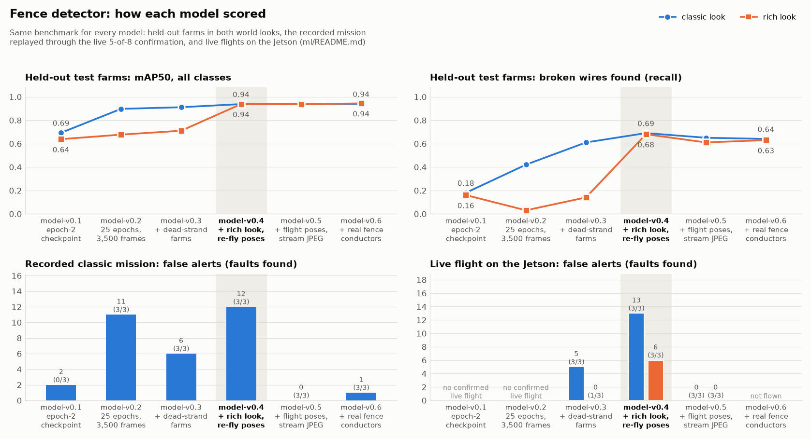
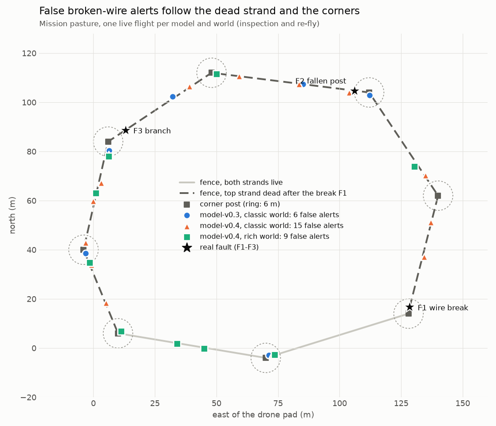

# model-v0.4 · Both world looks

Fine-tuned from model-v0.3 on both simulation looks. In the rich world it finds all three faults where v0.3 found
one. On the classic mission it raises more false broken-wire alerts, so it runs the live Gazebo flights and v0.3 stays
the default.

| | |
|---|---|
| Role | Live Gazebo flights from platform v0.10.0 (`ros.sh demo tcp://…`); selectable in field mode |
| Parent | model-v0.3 |
| Trained on | 7,200 frames: 3,600 rich-look + 1,200 classic re-fly-pose + 1,400 v2 + 1,000 v1 frames |
| Code | `fb6ff9f` |
| Run record | [ml/runs/model-v0.4](https://github.com/CosminBMemetea/querra-fence/tree/main/ml/runs/model-v0.4) |

## What changed

1. **The rich look in the training data.** `make_dataset.py --look rich` randomises the sun height and strength, the
   sky fill, the ambient light and the grass tint, with its own terrain per farm. 12 new farms, 3,600 frames.
2. **Re-fly close-ups** (`--style v3`). 20% of the poses copy the re-fly hover: 4.5–8 m high, 48–62° down, mostly at
   faults, away from tree crowns.
3. **Fine-tuned from v0.3** for 8 epochs on 7,200 frames, half rich and half classic, keeping old data so nothing is
   forgotten. CPU, 3.4 h, paused twice to cool the laptop. The last epoch was the best.
4. **Scored on 9 held-out sets** in both looks, on the recorded mission, and in live flights in both looks.

## Scores

The shared benchmark, the same for every model ([ml/benchmark](https://github.com/CosminBMemetea/querra-fence/tree/main/ml/benchmark)):

| | model-v0.3 | model-v0.4 |
|---|---|---|
| Held-out test farms, classic look (mAP50) | 0.911 | **0.938** |
| Held-out test farms, rich look (mAP50) | 0.710 | **0.938** |
| Broken wires found on the test farms (recall), classic / rich | 0.61 / 0.14 | **0.69 / 0.68** |
| Re-fly close-ups, rich look (mAP50) | 0.584 | **0.984** |
| Recorded classic mission, 5-of-8 confirmation: faults alerted, false alerts | 3 of 3, **6** | 3 of 3, 12 |
| Recorded classic mission: false `wire_break` frames, conf ≥ 0.7 | **153** | 257 |

## In flight on the Jetson

Gazebo → LAN → TensorRT FP16 (3.6 ms per frame) → 5-of-8 confirmation → PX4 pose, inspection loop only:

| World | model-v0.3 | model-v0.4 |
|---|---|---|
| **rich** (the default look) | 1 of 3 faults, 0 false alerts | **3 of 3 faults**, 6 false alerts |
| classic | 3 of 3 faults, 5 false alerts | 3 of 3 faults, **13 false alerts** |

**Re-fly** (6 m, the 8 nearest alerts):
- **Rich:** verified the real broken wire and the branch, and rejected all 5 false alerts it visited. It missed the
  real fallen post: the alert sat 2.9 m away, so the post was at the edge of the view.
- **Classic:** verified the branch, rejected 6 false alerts, and wrongly verified one at a corner post.

## Known limits

The false alerts land in the same places in every flight, with both models:
- at **corner posts**, where the strand turns;
- on the stretch after the break, where the **dead grey strand** runs beside the live one (12 of the 13 on the
  classic mission).

The offline tests use random camera poses and did not show this; only the flight did. The next model trains on
inspection-flight poses.

## Files

| File | What it is | SHA-256 |
|---|---|---|
| `fence-yolo11n-v0.4.pt` | PyTorch weights (Ultralytics), to fine-tune from | `858a47768ebebcc27139e216134c5494a9de48ea727e07b4914eab6d6260199a` |
| `fence-yolo11n-v0.4.onnx` | ONNX, 1×3×416×640. Build the Jetson engine with `trtexec --fp16` | `b2f3c736bfbed1706b42e50b9d232d1acdc4902bc6c9028515f02fba0474c892` |
| `classes.json` | Class names in output order | `c64ac943dbbfb1298d036f7156f1c2bf395fd5eb88052dcbb5a0267b3c7378b8` |

---
[Changes since model-v0.3](https://github.com/CosminBMemetea/querra-fence/compare/model-v0.3...model-v0.4) ·
[Retraining log](https://github.com/CosminBMemetea/querra-fence/blob/main/docs/retraining-log.md) ·
[Model card](https://github.com/CosminBMemetea/querra-fence/blob/main/docs/model-card.md) ·
[All releases and models](https://github.com/CosminBMemetea/querra-fence/blob/main/ml/README.md)
