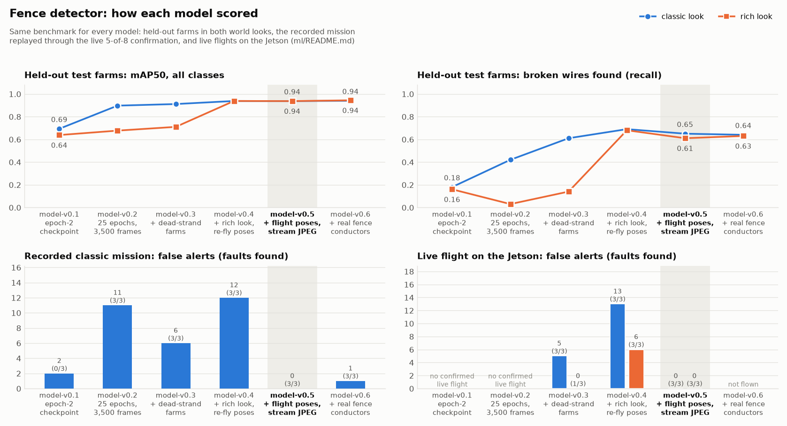

# model-v0.5 · Flight poses and the camera stream's JPEG

Fine-tuned from model-v0.4 on frames posed like the inspection flight and compressed like the camera stream. It is
the first model with no false alert in any flight: the live classic and rich flights on the Jetson and the recorded
mission replay. It finds all three faults in each.

| | |
|---|---|
| Role | Default from platform v0.11.0: the replay demo, live Gazebo flights, the ROS 2 detector and field mode |
| Parent | model-v0.4 |
| Trained on | 9,600 frames: 4,800 new flight-pose frames (2,400 classic, 2,400 rich) + 4,800 from earlier datasets; 6,119 compressed like the stream |
| Code | `38b8990` |
| Run record | [ml/runs/model-v0.5](https://github.com/CosminBMemetea/querra-fence/tree/main/ml/runs/model-v0.5) |

## What changed

1. **Found the cause of v0.4's false alerts: JPEG.** The camera reaches the Jetson as MJPEG (`-q:v 4`, 4:2:0
   colour), but every model was trained on lossless PNG. At 12 m a wire is 1–2 px wide, and JPEG blocks cut it into
   pieces. Compressed like the stream, synthetic flight frames give v0.3 and v0.4 8.2% and 14.8% false broken-wire
   frames. The recorded flight gives 7.7% and 12.9%. As PNG, the same frames give 1.0% and 0.2%.
2. **Measured how the drone looks at the fence.** `tools/flight_poses_from_ulog.py` reads PX4 logs of the mission.
   The camera is mounted at 55°, but the drone noses down in flight, so the camera looks 48–67° down (median 58°). The
   drone flies 2.4 m outside the fence, rolls down to −12° in the corners, and spends 48% of the time within 12 m of
   a corner.
3. **Flight-pose data** (`make_dataset.py --style v4`). 70% of the poses fly each farm's inspection route at those
   attitudes. 16 new farms, 8 in each look, 4,800 frames.
4. **Stream-like JPEG** (`tools/jpeg_like_stream.py`). 75% of the new frames and 50% of the old ones are compressed
   at a random quality. Validation uses the stream's own quality.
5. **Fine-tuned from v0.4** for 6 epochs. CPU, 3.4 h, in three sessions with 15-minute cooling breaks. The last epoch
   was the best.

## Scores

The shared benchmark ([ml/benchmark](https://github.com/CosminBMemetea/querra-fence/tree/main/ml/benchmark)), plus a
new set of frames posed like the flight and compressed like the stream (`stream.json`):

| | model-v0.3 | model-v0.4 | model-v0.5 |
|---|---|---|---|
| Recorded classic mission, 5-of-8 confirmation: faults alerted, false alerts | 3 of 3, 6 | 3 of 3, 12 | **3 of 3, 0** |
| Recorded classic mission: false `wire_break` frames, conf ≥ 0.7 | 153 | 257 | **1** |
| Flight poses, mission pasture, stream JPEG, classic / rich (mAP50) | 0.896 / 0.591 | 0.884 / 0.887 | **0.963 / 0.954** |
| Frames with a false `wire_break` there, classic / rich | 8.2% / 0.0% | 14.8% / 9.8% | **0.0% / 0.0%** |
| Held-out test farms, PNG, classic / rich (mAP50) | 0.911 / 0.710 | **0.938 / 0.938** | 0.937 / 0.937 |
| Broken wires found on the test farms (recall), classic / rich | 0.61 / 0.14 | **0.69 / 0.68** | 0.65 / 0.61 |

On the PNG sets v0.5 equals v0.4. Its broken-wire precision is equal or higher on every set and its recall a
little lower.

## In flight on the Jetson

Gazebo → LAN → TensorRT FP16 (3.65 ms per frame) → 5-of-8 confirmation → PX4 pose, inspection loop only:

| World | model-v0.3 | model-v0.4 | model-v0.5 |
|---|---|---|---|
| **rich** (the default look) | 1 of 3 faults, 0 false alerts | 3 of 3 faults, 6 false alerts | **3 of 3 faults, 0 false alerts** |
| classic | 3 of 3 faults, 5 false alerts | 3 of 3 faults, 13 false alerts | **3 of 3 faults, 0 false alerts** |

**Re-fly** (6 m, 5 s hover over each alert):
- verified the broken wire and the fallen post in both looks;
- did not see the branch up close: both branch alerts sat about 4 m from the branch, at the edge of the hover view;
- in the rich look, hovering over the fallen post, raised one broken-wire alert on the loose wires there.

## Known limits

- **Fewer frames see a broken wire.** In the replay, the broken wire is seen in 66 frames (v0.4: 147), best
  confidence 0.87 (v0.4: 0.94). The 5-of-8 confirmation still raises the alert in both flights, with a smaller margin.
- **Branch alerts sit about 4 m off**, so the re-fly misses the branch.
- **Simulation only.** Not tested on real fences. The real camera's stream is MJPEG too, which is why this model is
  also the field-mode default.

## Files

| File | What it is | SHA-256 |
|---|---|---|
| `fence-yolo11n-v0.5.pt` | PyTorch weights (Ultralytics), to fine-tune from | `aada10a358b504fac95baa873ae6e037ca5f115768ea2095bb4ce2af940cb0bc` |
| `fence-yolo11n-v0.5.onnx` | ONNX, 1×3×416×640. Build the Jetson engine with `trtexec --fp16` | `24be9ad3d4279d09d5153e243469d72d897b65c3898fea5e6a860dc6ff422601` |
| `classes.json` | Class names in output order | `c64ac943dbbfb1298d036f7156f1c2bf395fd5eb88052dcbb5a0267b3c7378b8` |

---
[Changes since model-v0.4](https://github.com/CosminBMemetea/querra-fence/compare/model-v0.4...model-v0.5) ·
[Retraining log](https://github.com/CosminBMemetea/querra-fence/blob/main/docs/retraining-log.md) ·
[Model card](https://github.com/CosminBMemetea/querra-fence/blob/main/docs/model-card.md) ·
[All releases and models](https://github.com/CosminBMemetea/querra-fence/blob/main/ml/README.md)
