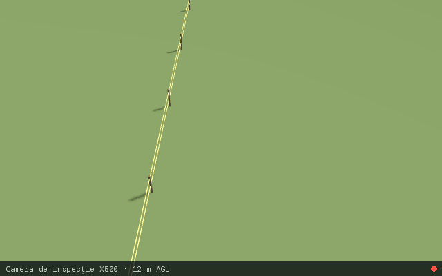

# v0.1.0 · First fence inspection flight



First release of **Querra Fence · Gardian X500**. A PX4 Holybro X500 inspects an electric pasture fence on its own, in
Gazebo Harmonic. One flight takes about 2.5 minutes:
- takeoff to 12 m;
- a 414 m loop along the fence at 5 m/s;
- return and landing.

In the sample run it found 3 of 3 faults (broken top wire, fallen post, branch across the wires) and 3 of 3 escaped
animals. It also found the point where the top wire loses voltage. Each finding has GPS coordinates in a JSON and an
HTML report.

**Models:** none yet. Detection is simulated from Gazebo ground truth.

## Highlights

- **One config file.** `fence.json` generates the pasture world: fence, faults, herd, flight and camera settings.
- **A real PX4 mission** over MAVLink, tuned for smooth flight and ready to reuse on a physical X500.
- **Inspection camera** (640×400, tilted 55°) with annotated demo frames. Animals graze, wander and escape.
- **English and Romanian:** `--lang ro` for the terminal, and an EN | RO switch in the report.
- **One command for everything:** `./start.sh`, with manual, headless, mission-only and demo modes.

## Install or run

```bash
git clone https://github.com/CosminBMemetea/querra-fence.git
cd querra-fence && ./start.sh
```

Needs PX4-Autopilot built for SITL with Gazebo Harmonic (see the README). Tested on an Apple Silicon Mac.

## Known limits

- Detection and the fence-voltage sensor are simulated from Gazebo ground truth. A vision model comes next.
- A perimeter pass sees 10 to 15 m into the paddock, so counting the herd needs an extra grid flight.
- The demo images carry Romanian labels for now.
- Linux is not tested yet.

---
[Commits up to v0.1.0](https://github.com/CosminBMemetea/querra-fence/commits/v0.1.0) ·
[CHANGELOG](https://github.com/CosminBMemetea/querra-fence/blob/v0.1.0/CHANGELOG.md) ·
[All releases and models](https://github.com/CosminBMemetea/querra-fence/blob/main/ml/README.md)
