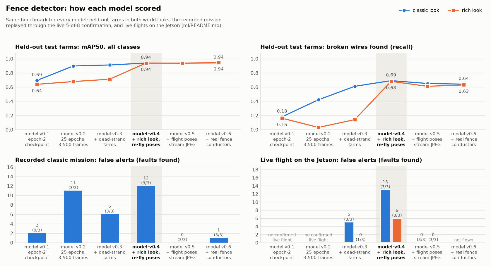
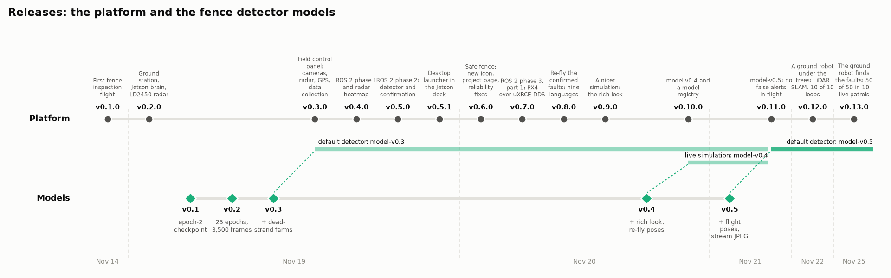

# v0.10.0 · model-v0.4 and a model registry



A second fence detector trained on both simulation looks, and a registry that records every model and dataset: data,
code commit, scores, live flights and sha256.

**Models:**
- The default is still **model-v0.3**: the ROS 2 detector, the classic replay demo and field mode.
- Live Gazebo flights (`ros.sh demo tcp://…`) use **[model-v0.4](https://github.com/CosminBMemetea/querra-fence/releases/tag/model-v0.4)**.

## Highlights

- **model-v0.4**, fine-tuned from v0.3 on 7,200 frames: half in the rich look, half classic, with re-fly close-ups.
  It finds all three faults in the rich world, where v0.3 found one. On the classic mission it raises more false
  broken-wire alerts, at corner posts and along the dead strand, so v0.3 stays the default.
- **Model and dataset registry** in [`ml/`](https://github.com/CosminBMemetea/querra-fence/tree/main/ml):
  - `models.json` covers every model from v0.1 to v0.4: status, data, code commit, training, offline and live
    scores, and the sha256 of every file, checked against the releases, the Mac and the Jetson;
  - `datasets.json` holds the generator command and commit, seeds and splits. Test splits are marked, and the
    validator refuses a model trained on one;
  - `runs/model-v0.4/` keeps the arguments, scores per epoch, data mix, held-out and replay scores, the live flights
    alert by alert, and the engine build;
  - `tools/model_registry.py` validates the registries, writes the model table and checks local files.
- **Tools:**
  - `make_dataset.py --look rich` and `--style v3` (re-fly poses);
  - `tools/mix_dataset.py` for training mixes;
  - `tools/eval_sets.py` scores the held-out sets of both looks;
  - `train_yolo.py --resume` continues a paused run.
- **Jetson:**
  - `ros.sh demo tcp://…` picks model-v0.4, and `engine:=` overrides it;
  - `doctor` checks both engines;
  - the detector overlay names the model;
  - the panel lists v0.4 for field mode.



## Measured

| | model-v0.3 | model-v0.4 |
|---|---|---|
| Held-out test, classic look (mAP50) | 0.911 | **0.938** |
| Held-out test, rich look (mAP50) | 0.710 | **0.938** |
| Live flight, rich world: faults found, false alerts | 1 of 3, 0 | **3 of 3**, 6 |
| Live flight, classic world: faults found, false alerts | 3 of 3, 5 | 3 of 3, **13** |

## Install or run

On the Jetson, after copying `ros2/` and building the engine (see the model-v0.4 release):

```bash
cd /ssd/querra/ros2
./ros.sh demo tcp://<mac-ip>:5601 px4:=true refly:=true   # live Gazebo: model-v0.4
./ros.sh demo                                            # classic replay: model-v0.3
./ros.sh doctor                                          # checks both engines
```

The registry, in the repository:

```bash
python3 tools/model_registry.py                 # validate and print the model table
python3 tools/model_registry.py --check DIR     # sha256 of local model files against the registry
```

## Known limits

- model-v0.4 raises 13 false broken-wire alerts on the classic mission (v0.3: 5). Offline tests did not show it; only
  the flight did.
- The re-fly visits the 8 nearest alerts. With 18 alerts on the classic mission, two real faults were not revisited.
- Everything is still simulation. Real frames from the field recorder come next.

---
[Changes since v0.9.0](https://github.com/CosminBMemetea/querra-fence/compare/v0.9.0...v0.10.0) ·
[CHANGELOG](https://github.com/CosminBMemetea/querra-fence/blob/v0.10.0/CHANGELOG.md) ·
[All releases and models](https://github.com/CosminBMemetea/querra-fence/blob/main/ml/README.md)
