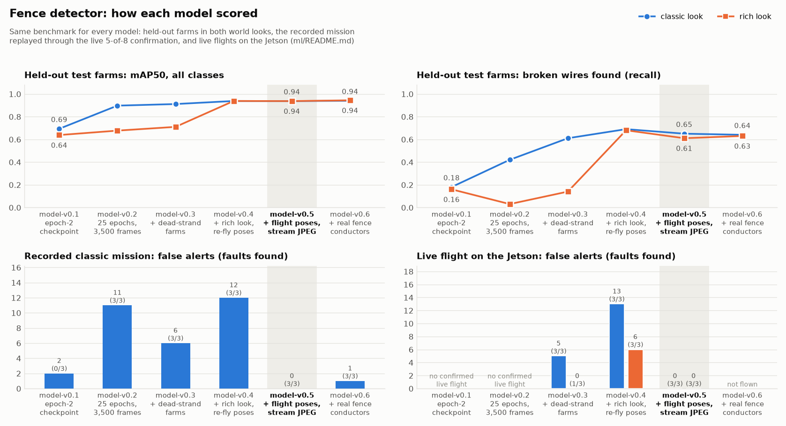

# v0.11.0 · model-v0.5: no false alerts in flight



A new fence detector, trained on frames posed like the inspection flight and compressed like the camera stream, and
now the default everywhere. It finds all three faults with no false alert in the live flights and in the recorded
mission.

**Models:**
- The default for everything is **[model-v0.5](https://github.com/CosminBMemetea/querra-fence/releases/tag/model-v0.5)**:
  `./ros.sh demo` (replay), `./ros.sh demo tcp://…` (live Gazebo), the ROS 2 detector and field mode in the panel.
- model-v0.3 and model-v0.4 are retired. They stay selectable with `engine:=` and in the panel.

## Highlights

- **model-v0.5**, fine-tuned from v0.4 on 9,600 frames. Live on the Jetson it finds 3 of 3 faults with **0 false
  alerts** in both world looks (v0.4: 13 classic, 6 rich).
- **The cause of the false alerts:** the camera stream's JPEG compression (MJPEG, `-q:v 4`, 4:2:0). The models were
  trained on lossless PNG, and at 12 m a 1–2 px wire breaks into JPEG blocks. Compressed the same way, synthetic
  flight frames predict the false broken-wire frames of the recorded flight within about one percentage point.
- **Data tools:**
  - `tools/flight_poses_from_ulog.py` measures the flight's camera pitch, offset, heading and roll in PX4 logs
    (camera 48–67° down, median 58°, 2.4 m outside the fence);
  - `make_dataset.py --style v4` renders farms from those poses along each farm's inspection route;
  - `tools/jpeg_like_stream.py` makes dataset copies compressed like the stream;
  - `tools/eval_sets.py` reads `.jpg` sets and reports `wb_false`, the share of frames with a false broken wire;
  - `tools/train_with_breaks.py` trains in sessions with cooling breaks.
- **Benchmark for every model** in [`ml/benchmark/`](https://github.com/CosminBMemetea/querra-fence/tree/main/ml/benchmark):
  - model-v0.1 to v0.5 on the same 9 held-out sets and the recorded mission replay;
  - a new set of 8 stream-like test sets (`stream.json`) for v0.3 to v0.5.
- **Registry:**
  - model-v0.5 with its 12 new datasets and the run record `ml/runs/model-v0.5/`;
  - charts drawn from the registry (`tools/model_charts.py`).
- **Release notes as files:**
  - every release has its text in `docs/release-notes/<tag>.md`, on one template per track;
  - `tools/release_notes.py` checks them, drafts included, and publishes them with `gh`.
- **Jetson:**
  - `ros.sh`, the launch file and the detector node default to the v0.5 engine;
  - field mode uses v0.5, and the panel lists v0.5.

## Measured

| | model-v0.3 | model-v0.4 | model-v0.5 |
|---|---|---|---|
| Live flight, rich world: faults found, false alerts | 1 of 3, 0 | 3 of 3, 6 | **3 of 3, 0** |
| Live flight, classic world: faults found, false alerts | 3 of 3, 5 | 3 of 3, 13 | **3 of 3, 0** |
| Recorded mission replay: faults found, false alerts | 3 of 3, 6 | 3 of 3, 12 | **3 of 3, 0** |
| Held-out test, PNG, classic / rich (mAP50) | 0.911 / 0.710 | 0.938 / 0.938 | 0.937 / 0.937 |
| Detector on the Jetson GPU (TensorRT FP16) | | 3.64 ms | 3.65 ms |

## Install or run

On the Jetson, copy `ros2/` and build the engine from the model-v0.5 ONNX:

```bash
cd ~/querra-scout-20261107/models/fence-yolo
/usr/src/tensorrt/bin/trtexec --onnx=fence-yolo11n-v0.5.onnx --saveEngine=fence-yolo11n-v0.5-fp16.engine --fp16
cd /ssd/querra/ros2
./ros.sh doctor                                          # checks the v0.5 engine
./ros.sh demo                                            # classic replay: model-v0.5
./ros.sh demo tcp://<mac-ip>:5601 px4:=true refly:=true   # live Gazebo: model-v0.5
```

## Known limits

- model-v0.5 sees the broken wire in fewer frames than v0.4 (66 against 147 in the replay, best confidence 0.87).
  The 5-of-8 confirmation still raises the alert, with a smaller margin.
- Branch alerts sit about 4 m from the branch, so the re-fly misses it up close.
- Everything is still simulation. Real frames from the field recorder come next.

---
[Changes since v0.10.0](https://github.com/CosminBMemetea/querra-fence/compare/v0.10.0...v0.11.0) ·
[CHANGELOG](https://github.com/CosminBMemetea/querra-fence/blob/v0.11.0/CHANGELOG.md) ·
[All releases and models](https://github.com/CosminBMemetea/querra-fence/blob/main/ml/README.md)
