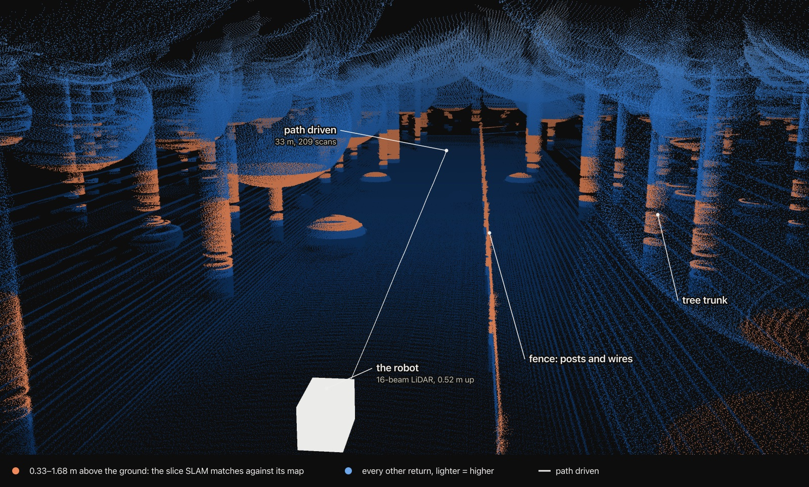
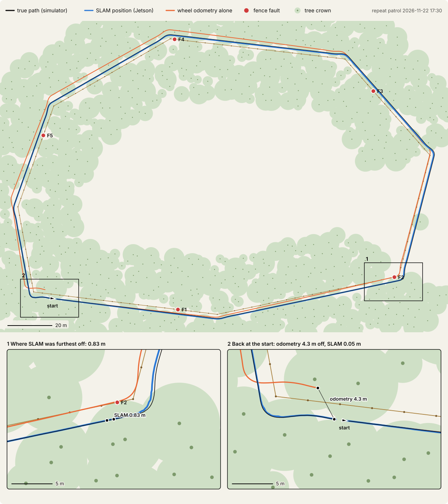
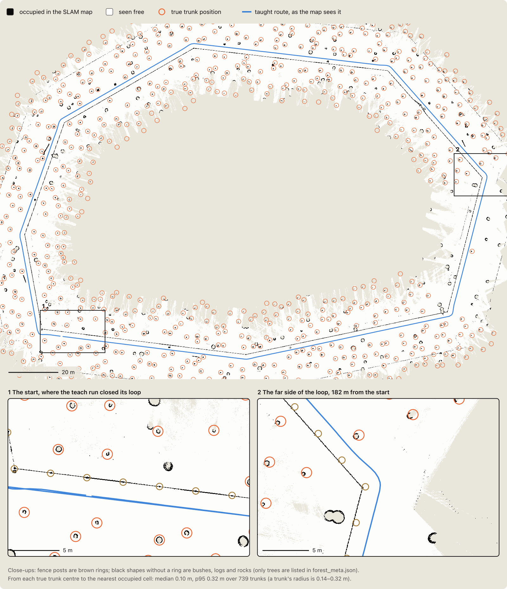

# v0.12.0 · A ground robot under the trees: LiDAR SLAM, 10 of 10 loops



Under the trees the drone can neither see the fence nor fly safely, and GNSS is metres off. This release adds a
second inspector for those places: a small ground robot, simulated end to end in Gazebo, with its brain in ROS 2 on
the Jetson. It localises with LiDAR SLAM (teach and repeat) and completed the forest loop in 10 of 10 patrols.

**Models:** the drone keeps [model-v0.5](https://github.com/CosminBMemetea/querra-fence/releases/tag/model-v0.5)
(default since v0.11.0). The ground robot has no fault detector yet in this release.

## Highlights

- **A forest to patrol:** 500 m of fence through a procedural forest of 880 trees, with bushes, logs, rocks, pinch
  points and five faults (two broken wires, two branches on the wires, a fallen post).
- **A robot to patrol it:** a 4×4 skid steer with a 16-beam LiDAR, a side camera and an IMU. GNSS degrades with the
  sky the crowns hide; wheel odometry has realistic scale and heading errors.
- **LiDAR SLAM, teach and repeat** (slam_toolbox on the Orin Nano): the robot maps the loop once, saves the route as
  the map sees it, and localises against that map on every patrol.
- **10 of 10 loops** (2 repeats, then 8 in a row from clean starts):

  | | Each patrol |
  |---|---|
  | Route completed | 99.7–99.8% in 717–751 s |
  | Off the true route | 0.18–0.19 m at the 95th percentile |
  | SLAM position against the truth | 0.25–0.27 m median, under 1 m throughout |
  | Faults through the camera's view | 5 of 5 |
  | Obstacle stops, link gaps | 0 |

  For comparison, GNSS under the trees: 4.3 m median. On wheel odometry alone the robot stopped at the first tight
  spot (about 100 m).
- **On the Orin Nano** the whole ground-robot stack uses 119% of one core of six (it started at 327%).
- **The map fits the forest:** 0.10 m on median from each true trunk centre to the nearest occupied cell, over 739
  trunks.
- **Pictures from the logs and from Gazebo:** the patrol from above, the error along the loop, the LiDAR cloud in 3D
  (the whole loop, one scan, the faults), and the SLAM map against the true forest.
- **GPS fix:** gpsd reported a 3D fix at 0,0 with the u-blox 7. The panel and the ROS 2 node now detect it, ask
  gpsd for NAV-POSLLH and report no position until it agrees.
- README in nine languages and the project page now cover the ground robot.

<p>
  
  
</p>

## Install or run

On the Mac (Gazebo comes with PX4) and on the Jetson:

```bash
./ugv.sh                                                              # Mac: the forest world and the relay
./ros.sh ugv tcp://<mac-ip>:5611 pose:=slam slam:=mapping              # Jetson: teach (drive once, save map + route)
./ros.sh ugv tcp://<mac-ip>:5611 pose:=slam slam:=localization         # Jetson: repeat (patrol on SLAM)
tools/ugv_series.sh 10                                                # Mac: ten patrols, each scored
```

The robot's sensor stream is about 0.5 MB/s from the Mac to the Jetson: use 5 GHz Wi-Fi or Ethernet (2.4 GHz stalled).

## Known limits

- **Faults are not found from the ground yet.** All five pass through the camera's view, but model-v0.5 knows only
  the drone's view from 12 m. The ground view needs its own data and model; that is the next step.
- **Flat ground, a static forest.** No slopes, mud or roots, and nothing changes between the teach run and the
  patrols.
- **The simulated wires are 36 mm thick**, like wide polytape. A real 2.5 mm steel wire would barely show in a
  16-beam LiDAR.
- No ground robot hardware yet: this is phase 0, in simulation.

---
[Changes since v0.11.0](https://github.com/CosminBMemetea/querra-fence/compare/v0.11.0...v0.12.0) ·
[CHANGELOG](https://github.com/CosminBMemetea/querra-fence/blob/v0.12.0/CHANGELOG.md) ·
[Ground robot docs](https://github.com/CosminBMemetea/querra-fence/blob/v0.12.0/docs/ugv.md)
