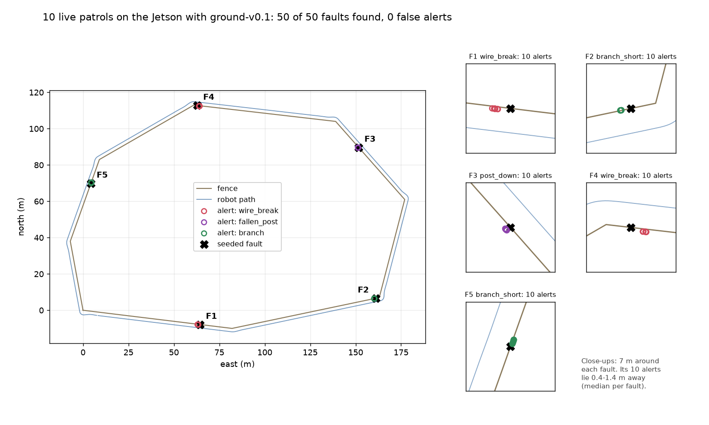

# v0.13.0 · The ground robot finds the faults: 50 of 50 in 10 live patrols



In v0.12.0 the ground robot patrolled the forest and every fault passed through its camera's view, but nothing
looked for them. Now it does: a fence detector trained for its side view runs on the Jetson during the patrol and
confirms the faults it sees. In 10 live patrols in a row it found all five faults every time, with no false alert.

**Models:**
- The ground robot's fault alerts use **[ground-v0.1](https://github.com/CosminBMemetea/querra-fence/releases/tag/ground-v0.1)**,
  the first model of a new track for the ground view (`./ros.sh ugv … detect:=true`).
- The drone keeps [model-v0.5](https://github.com/CosminBMemetea/querra-fence/releases/tag/model-v0.5) for everything
  else.

## Highlights

- **ground-v0.1**, model-v0.5 fine-tuned on 3,600 frames from the robot's camera in random forests. On test forests
  it never saw: mAP50 0.957 (model-v0.5: 0.040).
- **10 live patrols on the Jetson, each from a clean start:**

  | | Each patrol |
  |---|---|
  | Faults found | **5 of 5** (50 of 50 in all) |
  | False alerts | **0** |
  | Alert position | 0.4–1.4 m from the fault (median per fault) |
  | Route completed | 99.7% in 692–780 s, SLAM median 0.25–0.27 m |

- **Fault alerts on the robot** (`detect:=true`): the detector runs on the side camera with TensorRT (3.43 ms per
  frame) and `ugv_alerts` confirms a fault when 5 of 8 frames taken 0.5 m of travel apart see it at the same spot on
  the fence. Frames are counted by distance, not time: at 0.8 m/s and 10 frames per second, counting every frame
  would let a bush mistaken for a branch for half a second raise an alert. Alerts show in Foxglove, go to
  `/fence/alerts`, and are logged on the Mac, where `tools/ugv_eval.py` scores them.
- **Fallen posts count from conf 0.5, the others from 0.7.** At 0.7 the first live patrols missed the fallen post.
  The threshold was taken from held-out forests, where 0.5 keeps 90% of the fallen posts (0.7: 52%) with false ones
  in 0.5% of the frames.
- **Ground-view data and scoring:** `tools/make_ground_dataset.sh` renders random forests from the robot's camera;
  `tools/ground_patrol_eval.py` scores a model on the patrol frames as the alert chain would.
- **Real fence video** ([docs/drone-video.md](https://github.com/CosminBMemetea/querra-fence/blob/v0.13.0/docs/drone-video.md)):
  `tools/video_eval.py` runs a fence model over a drone video with the Jetson's alert rule, ready for footage from a
  DJI Mini 4 Pro. With DJI's subtitle file every alert gets a map position. The page says how to fly so the camera
  sees the fence as the drone models learned it (12 m, gimbal 55° down, 2–3 m beside the fence).
- **The model registry** now has a table for ground models, and a release track for them (`ground-vX.Y`).
- README in nine languages and the project page cover the ground robot's fault alerts.

## Install or run

On the Mac and on the Jetson:

```bash
./ugv.sh                                                                         # Mac: the forest world and the relay
./ros.sh ugv tcp://<mac-ip>:5611 pose:=slam slam:=localization detect:=true       # Jetson: patrol and look for faults
tools/ugv_series.sh 10 mmx@<jetson-ip> detect:=true                              # Mac: ten patrols, each scored
~/.querra-train-venv/bin/python tools/video_eval.py DJI_..._D.MP4 --pitch 55     # Mac: a drone video, with its .SRT
```

The Jetson needs the engine built once from the release's ONNX:
`trtexec --onnx=ground-yolo11n-v0.1.onnx --saveEngine=ground-yolo11n-v0.1-fp16.engine --fp16` in the models folder.

## Known limits

- **The fallen post is the thin margin:** 6–7 steps near it show it where 5 are needed, and it needs its own
  threshold. ground-v0.2 will add fallen-post data.
- **One static forest.** The patrols drive the same world as the teach run, on flat ground.
- **The video tool is tested on simulated video** (a recorded mission as a DJI-style MP4 and subtitle file: the same
  5 alerts as the mission evaluation). Real footage comes next.
- **Simulation only:** no ground robot hardware, no real ground-view images yet.

---
[Changes since v0.12.0](https://github.com/CosminBMemetea/querra-fence/compare/v0.12.0...v0.13.0) ·
[CHANGELOG](https://github.com/CosminBMemetea/querra-fence/blob/v0.13.0/CHANGELOG.md) ·
[Ground robot docs](https://github.com/CosminBMemetea/querra-fence/blob/v0.13.0/docs/ugv.md) ·
[ground-v0.1 run record](https://github.com/CosminBMemetea/querra-fence/tree/v0.13.0/ml/runs/ground-v0.1)
