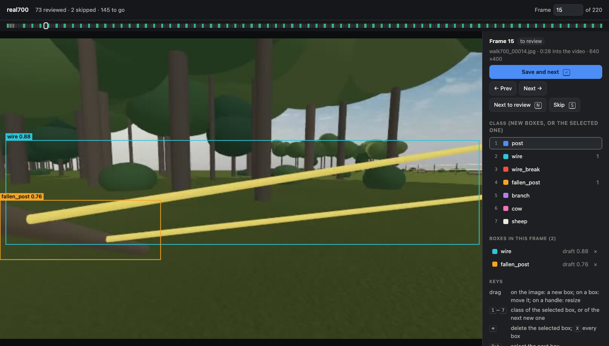

# v0.14.0 · Ready for real footage: a phone walk, a labelling page, and ground-v0.2 (candidate)



Every score in this project so far was measured in simulation. This release prepares the first real images: how to
film a real fence with a phone the way the ground robot's camera would see it, and a page to label real frames
quickly, with a model drafting the boxes, so that every model can be scored on real footage. It also brings the next
ground model, ground-v0.2, as a candidate: better than ground-v0.1 offline everywhere, not yet tested live.

**Models:**
- The drone keeps [model-v0.5](https://github.com/CosminBMemetea/querra-fence/releases/tag/model-v0.5) (default since
  v0.11.0).
- The ground robot keeps [ground-v0.1](https://github.com/CosminBMemetea/querra-fence/releases/tag/ground-v0.1) for its
  fault alerts, with fallen posts from conf 0.5.
- New: **[ground-v0.2](https://github.com/CosminBMemetea/querra-fence/releases/tag/ground-v0.2), a candidate.**
  Offline it finds 29 of 29 faults on four patrols with every class from conf 0.7. It becomes the default after live
  patrols on the Jetson.

## Highlights

- **Label real footage** ([docs/labelling.md](https://github.com/CosminBMemetea/querra-fence/blob/v0.14.0/docs/labelling.md)),
  with `tools/label_drafts.py`:
  - `draft` takes frames from a video and lets a model draw the boxes;
  - `serve` opens a review page on the Mac: delete, fix, draw what is missing, Enter saves;
  - `score` scores any model on the reviewed frames, with mAP50 per class and the recall, precision and false frames
    of each fault class at the alert thresholds.

  It needs no internet, and the page no extra packages.
- **The phone walk** ([docs/phone-walk.md](https://github.com/CosminBMemetea/querra-fence/blob/v0.14.0/docs/phone-walk.md)):
  film a fence with the phone's ultra-wide lens at 0.7 m, 1.5–2.5 m from the fence, at a slow walk, which is the
  robot camera's view. Then run a ground model over the video with the robot's alert rule (`tools/video_eval.py
  --class-conf`, new). The page also says how to stage faults safely on an electric fence.
- **ground-v0.2**, ground-v0.1 fine-tuned with 1,500 frames full of fallen posts:

  | Offline, forests never trained on | ground-v0.1 | ground-v0.2 |
  |---|---|---|
  | Test enclosures, mAP50 | 0.957 | **0.979** |
  | Fallen posts kept from conf 0.7 | 52% | **82%** |
  | Four patrols, every fault from conf 0.7 | 25 of 29, 0 false | **29 of 29, 0 false** |

- **Patrols of new forests** (`tools/make_ground_dataset.sh --patrol --patrol-seed S`): three random forests never
  trained on join the patrol forest as a test, with 29 faults in all. `--focus` and `--posts-down` make targeted
  training data.
- **Cooling breaks hold** when training is started detached (`tools/train_with_breaks.py`).
- **Model registry:** a `candidate` status, and the ground table shows all four patrols.

## Install or run

On the Mac, with the models from their releases in `~/querra-data/models`:

```bash
~/.querra-train-venv/bin/python tools/video_eval.py IMG_1234.MOV --model ~/querra-data/models/ground-yolo11n-v0.2.pt --no-srt --fps 2
~/.querra-train-venv/bin/python tools/label_drafts.py draft IMG_1234.MOV --model ~/querra-data/models/ground-yolo11n-v0.1.pt --every 2
python3 tools/label_drafts.py serve ~/querra-data/real/IMG_1234
~/.querra-train-venv/bin/python tools/label_drafts.py score ~/querra-data/real/IMG_1234 --model ~/querra-data/models/ground-yolo11n-v0.1.pt ~/querra-data/models/ground-yolo11n-v0.2.pt
```

Nothing changed on the Jetson: v0.13.0's setup holds.

## Known limits

- **ground-v0.2 is not live-tested.** The Jetson was not available for this release. The robot keeps ground-v0.1 with
  fallen posts from conf 0.5, and ground-v0.2's margin at 0.7 (6–7 frames where 5 are needed) still has to hold live.
- **Tested on simulated video only.** The phone walk and the labelling page were checked on forest 700's patrol played
  as a 2 fps walk: 8 alerts for the 8 faults, none false. The page's editing was driven in headless Chrome. No real
  footage has gone through them yet.
- **A phone is not the robot.** Height and distance wander, and the lens differs; a phone walk's scores are a guide.
- **Every published score is still from simulation.**

---
[Changes since v0.13.0](https://github.com/CosminBMemetea/querra-fence/compare/v0.13.0...v0.14.0) ·
[CHANGELOG](https://github.com/CosminBMemetea/querra-fence/blob/v0.14.0/CHANGELOG.md) ·
[Phone walk](https://github.com/CosminBMemetea/querra-fence/blob/v0.14.0/docs/phone-walk.md) ·
[Labelling](https://github.com/CosminBMemetea/querra-fence/blob/v0.14.0/docs/labelling.md) ·
[ground-v0.2 run record](https://github.com/CosminBMemetea/querra-fence/tree/v0.14.0/ml/runs/ground-v0.2)
