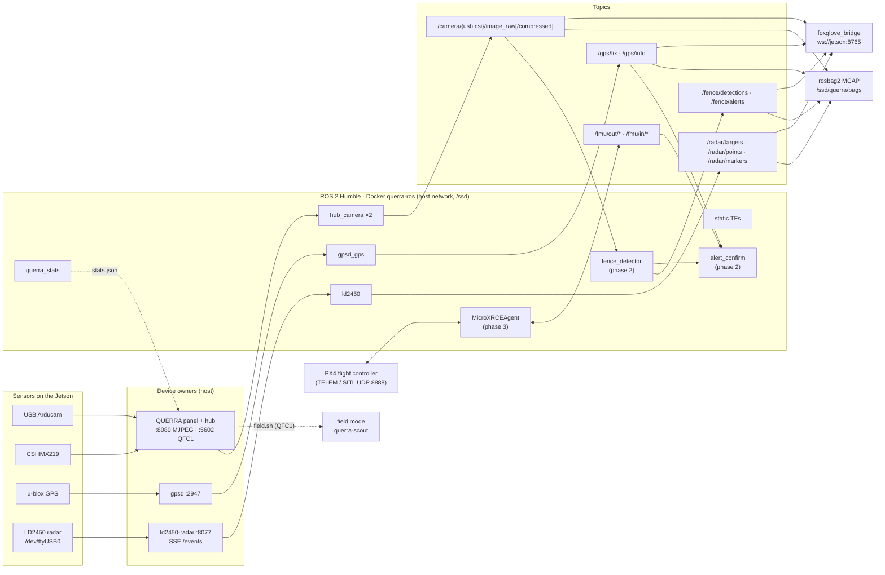

# v0.4.0 · ROS 2 phase 1 and radar heatmap


ROS 2 is now easy to run on the Jetson, and the radar card shows where things have been.

**Models:** field mode runs **model-v0.3**. ROS 2 has no detector yet; it arrives in phase 2 (v0.5.0).

## Highlights

- **ROS 2 phase 1** (`ros2/`): ROS 2 Humble in Docker.
  - The image, the workspace and the bags live on the SSD; the root disk is untouched.
  - Nodes for both cameras (from the panel hub), the GPS (gpsd) and the LD2450 radar (the ld2450-radar SSE stream).
  - Static TFs, foxglove_bridge on `:8765` and rosbag2 MCAP recording.
  - No node opens `/dev/video*`, the GPS port or `/dev/ttyUSB0`.
- **ROS 2 card in the panel** (English and Polish):
  - Start and Stop, and the live nodes and topic rates from the new `querra_stats` node;
  - a bag recording of 10, 30 or 60 s, and the bag list with `.tar` downloads;
  - the Foxglove address, and start at boot (off by default).
- **Radar heatmap:** a decaying occupancy map over the ±60° / 6 m fan, on a 10 cm grid that fades with a time
  constant of 20 s. It has on/off and Clear buttons.
- **`ros2/ros.sh`:** `start`, `stop`, `status`, `record N`, `bags`, `doctor`, `logs`, `shell` and `build`.

## Measured

On the Jetson Orin Nano Super, with the panel running:

| Topic | Rate |
| --- | --- |
| `/camera/usb/image_raw/compressed` | 9.1 Hz |
| `/camera/csi/image_raw/compressed` | 8.4–8.7 Hz |
| `/radar/targets`, `/radar/points`, `/radar/markers` | 9.9 Hz |
| `/gps/fix`, `/gps/info` | 1.8 Hz |

A 20 s MCAP bag is about 5 MB. The container uses about 5% CPU and 270 MB of RAM.

## Architecture



Solid lines run in this release. Phase 2 adds the YOLO11n TensorRT detector and the 5-of-8 GPS confirmation as ROS 2
nodes. Phase 3 connects PX4 over uXRCE-DDS. See
[docs/ros2.md](https://github.com/CosminBMemetea/querra-fence/blob/v0.4.0/docs/ros2.md).

## Install or run

- **Panel:** open `http://mmx-desktop.local:8080`, go to the ROS 2 card and press **Start ROS 2**. Rates appear after
  about 20 s. Use **Record bag** for 10, 30 or 60 s, and download the bag as a `.tar`.
- **Foxglove:** connect the Foxglove app to `ws://<jetson>:8765`.
- **Shell on the Jetson:**

```bash
cd /ssd/querra/ros2
./ros.sh doctor      # docker, the image, the panel hub, gpsd, the radar service, ports and disk
./ros.sh start       # ./ros.sh start foxglove:=false to skip the bridge
./ros.sh status      # nodes and topic rates
./ros.sh record 30   # MCAP to /ssd/querra/bags
./ros.sh stop
```

## Known limits

- No detector in ROS 2 yet (phase 2), and no PX4 connection (phase 3).
- The Foxglove layout comes in v0.5.0; for now the panels are set up by hand.

## Files

| File | What it is | SHA-256 |
|---|---|---|
| `querra-fence-panel-ros2-v0.4.0.tar.gz` | `jetson/panel/`, `ros2/` and `docs/ros2.md`, no images | `641f68580a05aef89210b7e195185e2fbf47a73642defab0fa56d3b1c725aadd` |

---
[Changes since v0.3.0](https://github.com/CosminBMemetea/querra-fence/compare/v0.3.0...v0.4.0) ·
[CHANGELOG](https://github.com/CosminBMemetea/querra-fence/blob/v0.4.0/CHANGELOG.md) ·
[All releases and models](https://github.com/CosminBMemetea/querra-fence/blob/main/ml/README.md)
