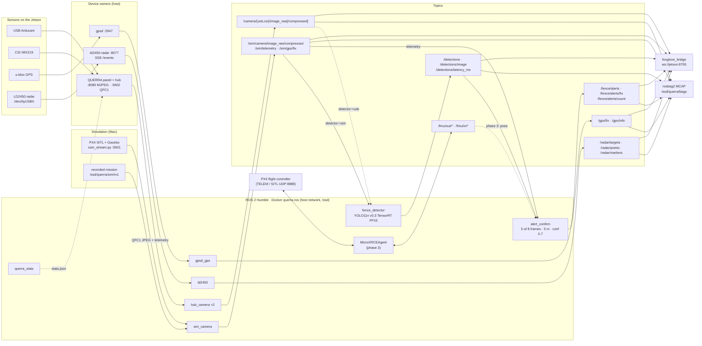

# v0.5.0 · ROS 2 phase 2: detector and confirmation


 

The fence detector now runs on ROS 2 on the Jetson. The simulation camera feeds YOLO11n on the GPU, and an alert is
raised when 5 of 8 frames agree on the ground. Everything is visible live in Foxglove and in the panel. GPS
coordinates are blurred in all captures.

**Models:** **model-v0.3** runs in the ROS 2 detector and in field mode.

## Highlights

- **`fence_detector`:** the model-v0.3 TensorRT FP16 engine through querra_scout's `YOLODetector`, the same code as
  field mode. It takes the newest frame only, so it never builds a queue. It publishes:
  - `/detections` (`vision_msgs/Detection2DArray`);
  - `/detections/image` (annotated);
  - `/detections/latency_ms`.
- **`alert_confirm`:** `tools/confirm.py` on ROS 2.
  - It projects boxes to the ground from the position, altitude, heading and camera pitch.
  - An alert needs 5 of the last 8 frames within 5 m at conf ≥ 0.7.
  - It publishes `/fence/alerts` (`FenceAlert`), `/fence/alerts/fix` and `/fence/alerts/count`, transient-local.
- **`sim_camera`:** the Gazebo camera and telemetry, from the live simulation (`tcp://<mac>:5601`) or from a recorded
  mission, replayed and looped.
- New messages `Telemetry` and `FenceAlert`, and the launch argument `detector:=none|sim|usb`.
- **Panel:** a *Demo: sim + detector* button. The ROS 2 card shows detector frames, boxes, latency and confirmed
  alerts (English and Polish).
- Foxglove layout `ros2/foxglove/querra-layout.json`, and an interview walkthrough, `docs/interview-demo.md`.

## Measured

On the Jetson Orin Nano Super (25 W):

| | |
| --- | --- |
| Sim camera / detections | 15 Hz / 15 Hz (99% of frames) |
| Detector latency (JPEG decode + TensorRT + post-processing) | p50 ≈ 26 ms, max 34 ms |
| Load with both live cameras and the panel | CPU ≈ 50%, RAM 4.5 / 7.6 GB, ≈ 9 W |
| Recorded mission m1 | 10 confirmed alerts: the 3 real faults + 7 false |
| 95 s demo bag (sim + detections + alerts) | 31 MB MCAP |

## Architecture



## Install or run

```bash
cd /ssd/querra/ros2
./ros.sh doctor                    # checks
./ros.sh demo                      # recorded mission -> detector -> alerts (or the panel's Demo button)
./ros.sh demo tcp://<mac-ip>:5601  # live PX4 + Gazebo simulation (tools/cam_stream.sh on the Mac)
./ros.sh start detector:=usb       # detector on the real USB camera
./ros.sh record 30                 # also: status, stop
```

Foxglove: connect to `ws://<jetson>:8765` and import `ros2/foxglove/querra-layout.json`.

## Known limits

- The recorded mission gives 7 false alerts next to the 3 real faults, mostly where the dead strand runs beside the
  live one.
- Alerts are placed with the simulator's telemetry. PX4's own pose comes in phase 3 (v0.7.0).
- `detector:=usb` is a bench test on the real camera: no fence, no GPS motion, so no alerts.

## Files

| File | What it is | SHA-256 |
|---|---|---|
| `querra-fence-panel-ros2-v0.5.0.tar.gz` | `jetson/panel/` and `ros2/` (no config) | `e7b59b819b8bb1e0279c37eab3b562b00ecbb38a979425a9d1aa55b43ff28733` |
| `panel-demo.gif` | Panel demo, desktop (GPS blurred) | `870d665e85f2ecd4cb0c0be78ab9c4dc18acecf452fae638f7781c4a4cedb807` |
| `panel-demo-phone.gif` | Panel demo, phone (GPS blurred) | `12eef86cb105cf32a47bfac7c6664364f135743a50437b2b218fd6e9a43c4257` |
| `panel-desktop.png` | Panel screenshot, desktop | `17cfec0b7f081cc1145b73b5c8fcb172a049ed0ccd9825b971be0bb768a833d4` |

---
[Changes since v0.4.0](https://github.com/CosminBMemetea/querra-fence/compare/v0.4.0...v0.5.0) ·
[CHANGELOG](https://github.com/CosminBMemetea/querra-fence/blob/v0.5.0/CHANGELOG.md) ·
[All releases and models](https://github.com/CosminBMemetea/querra-fence/blob/main/ml/README.md)
