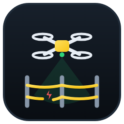

# v0.5.1 · Desktop launcher in the Jetson dock



A **Querra Fence** app for the Jetson's GNOME dock. Close the panel window and reopen it with one click. If the panel
isn't running, the launcher starts it first.

**Models:** unchanged. Field mode and the ROS 2 detector run **model-v0.3**.

## Highlights

- **`/usr/bin/querra-fence`:**
  - checks `http://localhost:8080`;
  - if the panel is down, starts it exactly like the `# querra-panel` boot crontab line (as `mmx`) and waits until
    it answers;
  - opens it in an app window: `chromium-browser --app … --class=QuerraFence` with its own profile, or Firefox or
    `xdg-open` as fallbacks.
- **`querra-fence.desktop`** with `StartupWMClass=QuerraFence`, so the window groups under the dock icon. Right-click
  actions: **ROS 2 demo (sim + detector)** and **Foxglove connection info**.
- **Icon** (SVG and a 256 px PNG) in the panel's colours.
- It does not change field-mode autostart, the panel files or the radar serial port.

## Install or run

```bash
sudo apt install ./querra-fence-panel_0.5.1_arm64.deb
```

The icon is added to the dock for `mmx` when a desktop session is running. Otherwise: Activities → "Querra Fence" →
right-click → Add to Favorites. Remove it with `sudo apt remove querra-fence-panel`.

## Known limits

- Snap Chromium cannot initialise the GPU on the Jetson, so the app window can open blank. Fixed in v0.6.0.
- Upgrades pin the dock icon again. Fixed in v0.6.0.

## Files

| File | What it is | SHA-256 |
|---|---|---|
| `querra-fence-panel_0.5.1_arm64.deb` | Desktop launcher for the Jetson (arm64) | `336f3785e639fd1b9c47b300812264dc24f2729fa011639a35e125e2eb68b7dd` |

Sources and build script: [`packaging/deb/`](https://github.com/CosminBMemetea/querra-fence/tree/v0.5.1/packaging/deb).

---
[Changes since v0.5.0](https://github.com/CosminBMemetea/querra-fence/compare/v0.5.0...v0.5.1) ·
[CHANGELOG](https://github.com/CosminBMemetea/querra-fence/blob/v0.5.1/CHANGELOG.md) ·
[All releases and models](https://github.com/CosminBMemetea/querra-fence/blob/main/ml/README.md)
