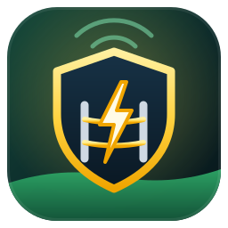

# v0.6.0 · Safe fence: new icon, project page, reliability fixes



**Safe fence: protect your animals from predators.** This release adds a new icon and a project page in English and
Polish, plus reliability fixes for the desktop launcher, the ROS 2 nodes and the field panel.

**Project page:** https://cosminbmemetea.github.io/querra-fence/ ([po polsku](https://cosminbmemetea.github.io/querra-fence/?lang=pl)).
It covers what works today, the sensors in and alerts out, and the roadmap.

**Models:** unchanged. Field mode and the ROS 2 detector run **model-v0.3**.

## Highlights

- **Desktop launcher** (in the .deb):
  - **The blank window is fixed.** Chromium now starts with `--disable-gpu` on the Jetson, because snap Chromium
    cannot initialise the GPU there. If Chromium fails, the launcher falls back to Firefox. Browser output goes to
    `~/.cache/querra-fence.log`.
  - **New icon:** a shield around a live electric fence, in 48–512 px for the dock.
  - **New right-click action:** **Restart the panel**, plus the `--restart` and `--version` options.
  - **Starting the panel:** a fast check, then the panel's own `restart.sh`, which also clears a hung panel.
  - The **ROS 2 demo** action sends the panel PIN when `config.json` requires one.
  - **Foxglove info** shows the LAN address, not a Docker bridge address.
  - `build.sh` works from a clean clone and writes a valid DEP-5 copyright file.
- **ROS 2** (in the repository):
  - `/fence/alerts` carries one message per confirmed alert, so a late Foxglove client or bag still gets every alert.
    Re-sightings go to `/fence/alerts/updates`.
  - `fence_detector` survives a bad frame, and `sim_camera` retries a missing recording or a dropped live stream.
  - `querra_stats` no longer forces the annotated image to be encoded.
  - `ros.sh` uses the NVIDIA runtime explicitly and mounts only host folders that exist. `demo` checks the recording
    first. `doctor` also checks the runtime, the engine, the demo recording and `/ssd`.
- **Panel:** the radar shows "no data" when the sensor is silent, and the ROS 2 card shows when its stats are stale.
  Camera streams notice clients that left. A favicon and a phone home-screen icon.
- **Docs:** a [README in Polish](https://github.com/CosminBMemetea/querra-fence/blob/v0.6.0/README.pl.md).

## Install or run

```bash
sudo apt install ./querra-fence-panel_0.6.0_arm64.deb
querra-fence --version        # querra-fence 0.6.0
```

It replaces 0.5.1 in place. The dock icon stays where you left it, and upgrades no longer pin it again. Remove it with
`sudo apt remove querra-fence-panel`. The ROS 2 and panel changes run from the repository: copy `ros2/` and
`jetson/panel/` to the Jetson.

## Known limits

- Only the launcher is packaged. The panel and ROS 2 are updated by copying folders from the repository.
- Predator detection is planned, not built.

## Files

| File | What it is | SHA-256 |
|---|---|---|
| `querra-fence-panel_0.6.0_arm64.deb` | Desktop launcher for the Jetson (arm64) | `853277bcffdad410ac270669f5a45956fef199d97d36834cb56df00002f60c62` |

Sources and build script: [`packaging/deb/`](https://github.com/CosminBMemetea/querra-fence/tree/v0.6.0/packaging/deb).

---
[Changes since v0.5.1](https://github.com/CosminBMemetea/querra-fence/compare/v0.5.1...v0.6.0) ·
[CHANGELOG](https://github.com/CosminBMemetea/querra-fence/blob/v0.6.0/CHANGELOG.md) ·
[All releases and models](https://github.com/CosminBMemetea/querra-fence/blob/main/ml/README.md)
