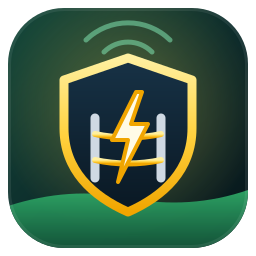

# v0.7.0 · ROS 2 phase 3, part 1: PX4 over uXRCE-DDS



PX4 now talks to ROS 2 on the Jetson over uXRCE-DDS, and alerts are placed with the drone's own pose instead of the
simulator's.

**Models:** unchanged. Field mode and the ROS 2 detector run **model-v0.3**.

## Highlights

- **micro-ROS agent** in the ROS 2 image: a Micro-XRCE-DDS agent built against Humble's Fast DDS. `px4:=true` starts
  it on UDP 8888, and `./ros.sh doctor` checks it.
- **`px4_msgs`** (minimal): eight messages copied unchanged from the PX4 tree the simulation runs (v1.18 beta). They
  cover the pose, the status and the offboard messages for the next step.
- **`px4_pose` node:** PX4's global position, local position and status become `/px4/telemetry` (position, altitude,
  heading, speed, flight phase) and `/px4/gps/fix`. With `px4:=true`, `alert_confirm` places alerts with this pose.
- **`tools/uxrce_relay.py`** forwards PX4 SITL's client from the Mac to the Jetson. `start.sh` exports
  `ROS_DOMAIN_ID=42`. PX4 itself is unchanged.
- **`./ros.sh demo tcp://MAC:5601 px4:=true`** passes extra launch arguments, and bags record the PX4 topics.
- **Docs and project page:** phase 3 part 1 is marked done.

## Measured

One full simulated flight:

| | |
|---|---|
| PX4 pose against the simulator's telemetry | 0.62 m median, 2.2 m max |
| The three real faults, alert position error | 2.4 m, 3.0 m and 4.2 m |

## Install or run

On the Mac: `./start.sh headless`, `tools/cam_stream.sh` and `tools/uxrce_relay.py <jetson>`. On the Jetson:

```bash
cd /ssd/querra/ros2
./ros.sh demo tcp://<mac-ip>:5601 px4:=true
```

## Known limits

- Tested in SITL only. A real flight controller on the TELEM port is not tested yet.
- The Jetson only listens to PX4. Flying back to a fault (offboard) comes next, in v0.8.0.

---
[Changes since v0.6.0](https://github.com/CosminBMemetea/querra-fence/compare/v0.6.0...v0.7.0) ·
[CHANGELOG](https://github.com/CosminBMemetea/querra-fence/blob/v0.7.0/CHANGELOG.md) ·
[All releases and models](https://github.com/CosminBMemetea/querra-fence/blob/main/ml/README.md)
