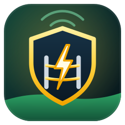

# v0.8.0 · Re-fly the confirmed faults; nine languages



After the inspection loop, the Jetson takes over PX4 and flies back low over every confirmed fault for a close look.
The simulation, the reports, the READMEs and the project page now come in nine languages.

**Models:** unchanged. Field mode and the ROS 2 detector run **model-v0.3**.

## Highlights

- **`fence_refly` node** (phase 3, part 2, `refly:=true`). When PX4 enters Return after the mission, the Jetson takes
  over in OFFBOARD over uXRCE-DDS.
  - It visits every confirmed alert nearest-first at 6 m, and stops 4.2 m before the fault so the 55° camera
    centres it.
  - It hovers 5 s, counts the detector frames, then hands back with Return.
  - The setpoint moves at most 4 m/s. The offboard stream stays alive until PX4 is in Return.
  - If a pilot or a failsafe changes the mode, the node aborts.
- **Nine languages** (EN, RO, PL, PT, DE, ES, HR, BG, DA):
  - **Simulation and report:** `sim/i18n.py` covers the terminal and the HTML report, which has a language menu.
    `--lang <code>` picks the language. JSON text fields hold every language, and older EN/RO reports still open.
  - **READMEs:** `README.<lang>.md` for every language. The translated prose lives in `docs/i18n/*.tpl.md`, and
    `docs/i18n/build_readmes.py` copies the shared parts (diagrams, commands, config) from `README.md`.
  - **Project page:** a language menu, with the translations in `docs/assets/i18n/<lang>.json`, loaded on demand.

## Measured

One SITL flight with re-fly: 5 min 13 s, 852 m. The handover, the 8 visits, the Return and the landing all worked.

## Install or run

```bash
cd /ssd/querra/ros2
./ros.sh demo tcp://<mac-ip>:5601 px4:=true refly:=true
```

On the Mac, `./start.sh --lang de` (or any of the nine codes) picks the language.

## Known limits

- The close-up verdicts are not reliable yet: model-v0.3 was trained at 12 m, not at 6 m.
- The verdict is a majority rule (at least half of the hover frames). It was chosen after one flight and is not
  validated.

---
[Changes since v0.7.0](https://github.com/CosminBMemetea/querra-fence/compare/v0.7.0...v0.8.0) ·
[CHANGELOG](https://github.com/CosminBMemetea/querra-fence/blob/v0.8.0/CHANGELOG.md) ·
[All releases and models](https://github.com/CosminBMemetea/querra-fence/blob/main/ml/README.md)
