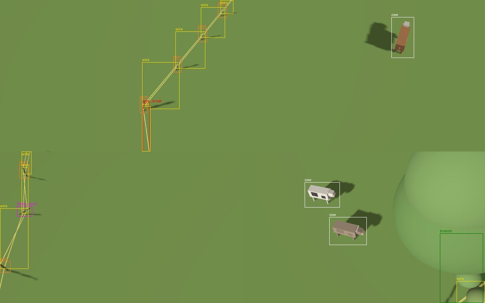
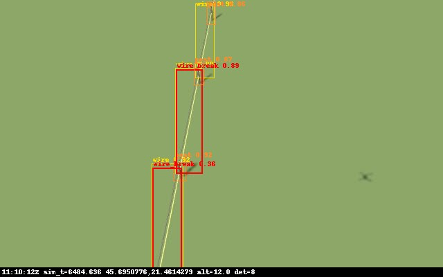

# Retraining log: fence detector

This log follows the fence detector from version to version. Each entry records what we trained, how it scored, what it
got wrong on the Jetson, and what we changed because of it. Model files are attached to the GitHub releases
(`model-v0.x`). The model card is in [model-card.md](model-card.md).

**Classes:** `post`, `wire`, `wire_break`, `fallen_post`, `branch`, `cow`, `sheep`

**How we test.** The trained model is exported to ONNX and built into a TensorRT FP16 engine on the Jetson Orin Nano.
The Jetson then runs it on the drone camera, which `tools/cam_stream.py` streams from Gazebo over the LAN while PX4
flies the inspection mission. Every frame is logged with the simulated GPS. A frame counts toward a fault when the
drone is within 30 m of it. A detection counts as a **false alarm** when the drone is more than 45 m from the real fault
of that class.

## v0.1 · preliminary checkpoint (`model-v0.1`)

- **Data:** 4,200 frames rendered from 12 random farms by `tools/make_dataset.py`, with labels computed from Gazebo
  ground truth (no hand labelling). 10 farms (3,500 frames) for training, 2 held-out farms (700 frames) for validation.
- **Training:** YOLO11n at 640 px, CPU. This is the checkpoint after **epoch 2** of the run that became v0.2.
  Exported early to test the Jetson pipeline end to end.
- **Validation:** mAP50 **0.72** (all classes).
- **On the Jetson** (60 s of the simulated mission, 874 frames at 14.6 fps):

| Fault | Frames within 30 m | Frames detected | Best confidence |
|---|---|---|---|
| F1 broken wire | 228 | 46 (20%) | 0.78 |
| F2 fallen post | 240 | 7 (3%) | 0.63 |
| F3 branch | not reached in the 60 s window | | |

- **False alarms:** 72 frames flagged `wire_break` more than 45 m from F1.
- **Takeaway:** the whole loop works (Gazebo → LAN → Jetson → TensorRT → GPS-tagged log). The model was undertrained,
  especially on the rare fault classes.

## v0.2 · first full model (`model-v0.2`)

- **Data:** the same 4,200 frames (12 farms: 10 train, 2 held-out validation). The farms vary the fence shape, post
  spacing, wire heights, faults (2–3 broken wires, 1–2 fallen posts, 1–2 branches), herd, sun angle and grass colour.
  The camera varies in height (5–20 m), tilt (35–80°), heading and roll.

| Class | Train boxes | Val boxes |
|---|---|---|
| post | 11,458 | 2,559 |
| wire | 13,148 | 2,886 |
| wire_break | 956 | 141 |
| fallen_post | 444 | 57 |
| branch | 403 | 117 |
| cow | 1,624 | 234 |
| sheep | 1,173 | 169 |

- **Training:** YOLO11n, 25 epochs, 640 px, batch 16, CPU (about 2 hours). Mosaic augmentation, turned off for the
  last 3 epochs.
- **Validation (2 held-out farms):**

| Class | mAP50 | mAP50-95 |
|---|---|---|
| post | 0.968 | 0.846 |
| wire | 0.977 | 0.878 |
| wire_break | 0.818 | 0.604 |
| fallen_post | 0.916 | 0.789 |
| branch | 0.934 | 0.636 |
| cow | 0.915 | 0.756 |
| sheep | 0.922 | 0.743 |
| **all** | **0.921** | **0.750** |

- **On the Jetson** (TensorRT FP16, input 640×416):
  - `trtexec` measures 4.7 ms per frame on the GPU.
  - In the pipeline the detector takes 20.8 ms per frame (29.4 ms at p95), including pre- and post-processing.
  - The full mission ran at **13.3 fps** against the camera's 15. Gazebo to Jetson latency is about 13 ms.
  - Full flight: 165 s, 2,196 frames.

| Fault | Frames within 30 m | Frames detected | Best confidence |
|---|---|---|---|
| F1 broken wire | 235 | 113 (48%) | 0.94 |
| F2 fallen post | 223 | 58 (26%) | 0.96 |
| F3 branch | 162 | 14 (9%) | 0.84 |

### What v0.2 missed: false broken-wire alarms

All three faults were found, and `fallen_post` and `branch` produced **no** false alarms. But `wire_break` fired in
**385 frames** far from F1 (confidence ≥ 0.5).

**Root cause.** After a wire breaks, the simulation draws the rest of that strand in grey ("dead"). From 12 m a grey
strand is almost invisible, so an intact fence with a dead top wire looks like "one wire is missing", which is what a
break looks like. The training farms did contain dead wire labelled `wire`, but too few examples, and always in the
same grey. A real dead wire looks exactly like a live one, so this is partly a simulation artefact the model learned.

A higher confidence threshold trades false alarms for missed detections. It is not a fix:

| Threshold | False frames (>45 m from F1) | Frames detecting F1 (<30 m) |
|---|---|---|
| 0.5 | 385 | 85 |
| 0.6 | 292 | 65 |
| 0.7 | 192 | 46 |
| 0.8 | 89 | 16 |

## v0.3 · planned fix (in progress)

1. **More of the confusing data.** New farms with 3–4 breaks each, so long stretches of fence have a dead strand. The
   dead strand is drawn in random colours (grey, the live yellow, dull or dark) and always labelled `wire`. Breaks take
   three shapes (ends hanging, snapped wire on the grass, one end still tied), and more poses imitate the inspection
   flight.
2. **Fine-tune from v0.2** on the old and new data together.
3. **Evaluate honestly** on the 2 held-out validation farms, on a separate **test set of new farm seeds never used for
   training or validation**, and on frames from the real `fence.json` pasture.
4. **Confirm before alerting.** On the Jetson, raise an alert only when N of the last M frames agree within about 5 m
   (GPS), instead of reacting to single frames.

Results will be added here when v0.3 is released.
