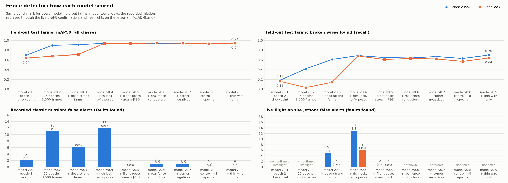
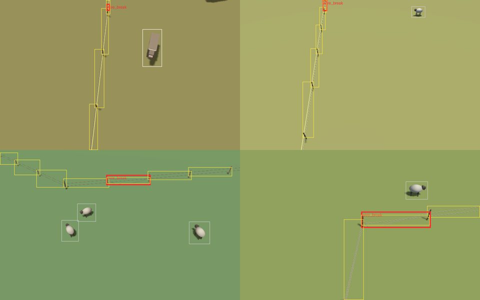
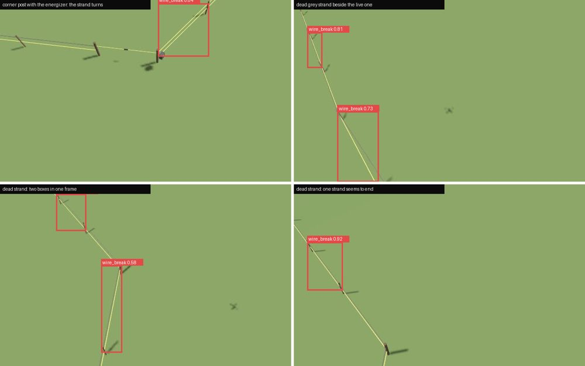

# Retraining log: fence detector

This log follows the fence detector from version to version. Each entry records what we trained, how it scored, what it
got wrong on the Jetson, and what we changed because of it. Model files are attached to the GitHub releases
(`model-v0.x`). The model card is in [model-card.md](model-card.md). The model and dataset registries (data, code
commit, scores, live results and sha256 of every model) and the run records are in [ml/](../ml/README.md).

**Classes:** `post`, `wire`, `wire_break`, `fallen_post`, `branch`, `cow`, `sheep`

**How we test.** The trained model is exported to ONNX and built into a TensorRT FP16 engine on the Jetson Orin Nano.
The Jetson then runs it on the drone camera, which `tools/cam_stream.py` streams from Gazebo over the LAN while PX4
flies the inspection mission. Every frame is logged with the simulated GPS. A frame counts toward a fault when the
drone is within 30 m of it. A detection counts as a **false alarm** when the drone is more than 45 m from the real fault
of that class.

## v0.1 · preliminary checkpoint (`model-v0.1`)

- **Data:** 4,200 frames rendered from 12 random farms by `tools/make_dataset.py`, with labels computed from Gazebo
  ground truth (no hand labelling). 10 farms (3,500 frames) for training, 2 held-out farms (700 frames) for validation.
- **Training:** YOLO11n at 640 px, CPU. This is the checkpoint after **epoch 2** of the run that became v0.2.
  Exported early to test the Jetson pipeline end to end.
- **Validation:** mAP50 **0.72** (all classes).
- **On the Jetson** (60 s of the simulated mission, 874 frames at 14.6 fps):

| Fault | Frames within 30 m | Frames detected | Best confidence |
|---|---|---|---|
| F1 broken wire | 228 | 46 (20%) | 0.78 |
| F2 fallen post | 240 | 7 (3%) | 0.63 |
| F3 branch | not reached in the 60 s window | | |

- **False alarms:** 72 frames flagged `wire_break` more than 45 m from F1.
- **Takeaway:** the whole loop works (Gazebo → LAN → Jetson → TensorRT → GPS-tagged log). The model was undertrained,
  especially on the rare fault classes.

## v0.2 · first full model (`model-v0.2`)

- **Data:** the same 4,200 frames (12 farms: 10 train, 2 held-out validation). The farms vary the fence shape, post
  spacing, wire heights, faults (2–3 broken wires, 1–2 fallen posts, 1–2 branches), herd, sun angle and grass colour.
  The camera varies in height (5–20 m), tilt (35–80°), heading and roll.

| Class | Train boxes | Val boxes |
|---|---|---|
| post | 11,458 | 2,559 |
| wire | 13,148 | 2,886 |
| wire_break | 956 | 141 |
| fallen_post | 444 | 57 |
| branch | 403 | 117 |
| cow | 1,624 | 234 |
| sheep | 1,173 | 169 |

- **Training:** YOLO11n, 25 epochs, 640 px, batch 16, CPU (about 2 hours). Mosaic augmentation, turned off for the
  last 3 epochs.
- **Validation (2 held-out farms):**

| Class | mAP50 | mAP50-95 |
|---|---|---|
| post | 0.968 | 0.846 |
| wire | 0.977 | 0.878 |
| wire_break | 0.818 | 0.604 |
| fallen_post | 0.916 | 0.789 |
| branch | 0.934 | 0.636 |
| cow | 0.915 | 0.756 |
| sheep | 0.922 | 0.743 |
| **all** | **0.921** | **0.750** |

- **On the Jetson** (TensorRT FP16, input 640×416):
  - `trtexec` measures 4.7 ms per frame on the GPU.
  - In the pipeline the detector takes 20.8 ms per frame (29.4 ms at p95), including pre- and post-processing.
  - The full mission ran at **13.3 fps** against the camera's 15. Gazebo to Jetson latency is about 13 ms.
  - Full flight: 165 s, 2,196 frames.

| Fault | Frames within 30 m | Frames detected | Best confidence |
|---|---|---|---|
| F1 broken wire | 235 | 113 (48%) | 0.94 |
| F2 fallen post | 223 | 58 (26%) | 0.96 |
| F3 branch | 162 | 14 (9%) | 0.84 |

### What v0.2 missed: false broken-wire alarms

All three faults were found, and `fallen_post` and `branch` produced **no** false alarms. But `wire_break` fired in
**385 frames** far from F1 (confidence ≥ 0.5).

**Root cause.** After a wire breaks, the simulation draws the rest of that strand in grey ("dead"). From 12 m a grey
strand is almost invisible, so an intact fence with a dead top wire looks like "one wire is missing", which is what a
break looks like. The training farms did contain dead wire labelled `wire`, but too few examples, and always in the
same grey. A real dead wire looks exactly like a live one, so this is partly a simulation artefact the model learned.

A higher confidence threshold trades false alarms for missed detections. It is not a fix:

| Threshold | False frames (>45 m from F1) | Frames detecting F1 (<30 m) |
|---|---|---|
| 0.5 | 385 | 85 |
| 0.6 | 292 | 65 |
| 0.7 | 192 | 46 |
| 0.8 | 89 | 16 |

## v0.3 · targeted data for the false broken wire (`model-v0.3`)

**What we changed.**

1. **More of the confusing data** (`tools/make_dataset.py --style v2`). 8 new training farms (2,400 frames) with 3–4
   breaks each, so long stretches of fence carry a dead strand. The dead strand is drawn in random colours (grey, the
   live yellow, dull or dark) and is always labelled `wire`. Breaks come in three shapes (ends hanging, snapped wire on
   the grass, one end still tied), and 60% of the poses imitate the inspection flight.
2. **Fine-tuned from v0.2** for 10 epochs on 4,800 frames: the 2,400 new frames plus 2,400 random v0.2 training frames,
   so the model keeps what it knew. CPU, AdamW (lr 0.0009), mosaic off for the last 3 epochs. Best epoch: 9.
3. **Evaluated on data never used for training:**
   - the 2 old validation farms (700 frames)
   - 2 new validation farms in the v2 style (600 frames)
   - a **test set of 3 new farm seeds** (140–142, 750 frames), never used for training or model selection
   - 400 frames rendered from the mission pasture itself (`fence.json`)
4. **Multi-frame GPS confirmation** (`tools/confirm.py`). Every fault box is placed on the ground using GPS, altitude,
   heading and the camera angle. An alert is raised only when N of the last M frames put the same fault class within
   5 m. One spot gives one alert.

### Scores, v0.2 → v0.3 (mAP50)

| Set | All classes | `wire_break` | `wire_break` precision / recall |
|---|---|---|---|
| Old validation farms (700) | 0.921 → 0.916 | 0.818 → 0.778 | 0.86 / 0.73 → 0.77 / 0.74 |
| New validation farms, v2 style (600) | 0.913 → **0.932** | 0.556 → **0.681** | 0.67 / 0.46 → 0.71 / 0.60 |
| **Held-out test, new seeds (750)** | 0.897 → **0.912** | 0.577 → **0.684** | 0.80 / 0.42 → 0.70 / 0.61 |
| Mission pasture frames (400) | 0.956 → 0.958 | 0.805 → 0.775 | 0.79 / 0.79 → 0.66 / 0.81 |

The other classes stayed within ±0.02. v0.2 had only been tested on farms like its training data. On the new farms with
many dead strands it found fewer than half the breaks (recall 0.42), and v0.3 raises that to 0.61. The cost is
precision: v0.3 calls `wire_break` more readily, which shows on the old farms and the mission pasture.

### The simulated mission, v0.2 → v0.3

The same recorded flight (`tools/cam_record.py`: 1,986 frames at 12 m) was replayed through both models with
`tools/eval_mission.py`. This was PyTorch on CPU, not the Jetson, so the absolute counts differ from the 385 measured on
the Jetson for v0.2. Compare the two columns with each other.

| | v0.2 | v0.3 |
|---|---|---|
| F1 broken wire: frames that saw it (of 249 nearby) | 130 | 121 |
| F2 fallen post (of 242) | 67 | 65 |
| F3 branch (of 242) | 66 | 66 |
| False `wire_break` frames (> 45 m from F1), conf ≥ 0.5 | 485 | 413 (−15%) |
| False `wire_break` frames, conf ≥ 0.7 | 242 | 153 (−37%) |
| False `fallen_post` / `branch` frames, conf ≥ 0.5 | 2 / 0 | 1 / 0 |

**Alerts** (one per spot on the ground) are what the farmer sees. All settings below still alert on all three real
faults.

| Confirmation | v0.2 false alerts | v0.3 false alerts |
|---|---|---|
| None (every frame, conf ≥ 0.5) | 33 | 31 |
| 3 of 5 frames within 5 m, conf ≥ 0.5 | 27 | 21 |
| 3 of 5 frames, conf ≥ 0.7 | 20 | 9 |
| **5 of 8 frames, conf ≥ 0.7** | 11 | **6** |

Better data alone removed few false frames, and confirmation alone removed few alerts. Combined, false alerts fell from
33 to 6 (−82%), and all three faults were still found. 5 of 8 frames at conf ≥ 0.7 is now the default in `tools/confirm.py` and on the Jetson.

### On the Jetson (TensorRT FP16, live confirmation)

v0.3 was built into an FP16 engine on the Jetson Orin Nano (GPU time 4.9 ms per frame). It ran live on the simulated
mission with confirmation switched on in querra-scout (`alerts.jsonl`, 5 of 8 frames). The v0.2 numbers come from the
same mission flown earlier the same day with the same analysis, so this is the comparison with the 385.

| Jetson, simulated mission | v0.2 | v0.3 |
|---|---|---|
| False `wire_break` frames (> 45 m from F1), conf ≥ 0.5 | **385** | **341** (−11%) |
| conf ≥ 0.6 / 0.7 / 0.8 | 292 / 192 / 89 | 236 / 139 / 49 |
| F1 frames with `wire_break` (< 30 m), conf ≥ 0.5 / 0.7 / 0.8 | 85 / 46 / 16 | 100 / 69 / 47 |
| False `fallen_post` / `branch` frames | 0 / 0 | 0 / 0 |
| Confirmed alerts | no confirmation | 13: all 3 faults (5 spots) + 8 false `wire_break` spots |
| Detector time per frame (p50 / p95) | 20.8 / 29.4 ms | 18.6 / 26.1 ms |

At a strict threshold the gain is clear. At conf ≥ 0.8, v0.3 sees F1 in 47 frames against 49 false frames; v0.2 saw it
in 16 against 89. Alerts that used to need a person to look at hundreds of frames now come down to 13 spots on the
map, including the 3 real faults.

### What v0.3 still misses

The remaining false `wire_break` boxes in the mission pasture sit where the yellow live strand and the thin grey dead
strand of the same fence run side by side, or swap at a post. From 12 m that looks like a strand ending. The random v2
farms taught the general case (validation and test improved a lot). They did not cover this exact look: mission
lighting and a dead strand running for hundreds of metres.

### Domain check: the "rich" world (2026-11-20)

The simulation got a nicer default look: sky, a low afternoon sun, textured grass, hills, a farmyard and rounder
animals. The ground's average colour in the inspection camera was matched to the classic world: about (133, 154, 89)
against (141, 163, 104). The texture, the normal map and the shadows still differ.

The same live chain (Gazebo → LAN → Jetson TensorRT v0.3 → 5-of-8 confirmation, PX4 pose) was run over one mission in
each look:

| World | Real faults alerted | False alerts |
| --- | --- | --- |
| classic | 3 of 3 (2.4 / 3.0 / 4.2 m) | 5 |
| rich | 1 of 3 (branch, 4.0 m) | 0 |

The model has never seen texture on the ground. It misses the broken wire and the fallen post, and it stops raising
the false broken wire. This is a small sim-to-sim version of the sim-to-real gap. The cure is the same: train on
varied looks.

## v0.4 · both world looks (`model-v0.4`)

Full run record: [ml/runs/model-v0.4](../ml/runs/model-v0.4/README.md).

**What we changed.**

1. **The rich look in the training data.** `tools/make_dataset.py --look rich` randomises the sun height and
   strength, the sky fill, the ambient light and the grass tint, with its own terrain per farm. 12 new farms
   (3,600 frames), plus 2 validation farms and the test seeds 140–142 rendered again in the rich look.
2. **Re-fly close-ups** (`--style v3`). 20% of the poses copy the re-fly hover: 4.5–8 m high, 48–62° down, mostly at
   faults, away from tree crowns. There are 4 new classic farms in this style, and a close-up test set in each look.
3. **Fine-tuned from v0.3** for 8 epochs on 7,200 frames: half rich, half classic, with old data kept so nothing is
   forgotten (`tools/mix_dataset.py`). CPU, 3.4 h, paused twice to cool the laptop (`--resume`).
4. **Scored on 9 held-out sets** in both looks (`tools/eval_sets.py`), on the recorded mission, and in live flights in
   both looks.

### Scores, v0.3 → v0.4 (mAP50)

| Set | All classes | `wire_break` | `wire_break` precision / recall |
|---|---|---|---|
| **Held-out test, classic (750)** | 0.911 → **0.938** | 0.684 → **0.822** | 0.70 / 0.61 → 0.85 / 0.69 |
| **Held-out test, rich (750)** | 0.710 → **0.938** | 0.330 → **0.789** | 0.85 / 0.14 → 0.84 / 0.68 |
| Mission pasture frames, classic (400) | 0.958 → **0.981** | 0.775 → **0.900** | 0.66 / 0.81 → 0.93 / 0.79 |
| Mission pasture frames, rich (400) | 0.657 → **0.977** | 0.151 → **0.877** | 0.70 / 0.05 → 0.87 / 0.84 |
| Re-fly close-ups, rich (400) | 0.584 → **0.984** | 0.053 → **0.968** | 0.60 / 0.01 → 0.98 / 0.89 |

On every held-out set but one, v0.4 scores higher. In the rich look it goes from nearly blind (`wire_break` recall
0.14) to as good as in the classic look.

### In flight: better in the rich world, worse on the classic mission

Live chain: Gazebo → LAN → Jetson TensorRT FP16 (3.6 ms per frame) → 5-of-8 confirmation → PX4 pose.
The table counts the inspection loop only.

| World | v0.3 | v0.4 |
|---|---|---|
| **rich** (the default look) | 1 of 3 faults, 0 false alerts | **3 of 3 faults**, 6 false alerts |
| classic | 3 of 3 faults, 5 false alerts | 3 of 3 faults, **13 false alerts** |

The recorded classic mission confirms it, replayed through both models with the same confirmation: 6 false alerts
for v0.3, 12 for v0.4. v0.4 sees the real broken wire in more frames (147 against 121) and fires much more often on
the intact fence (257 false frames at conf ≥ 0.7, against 153).

The false alerts land in the same places in every flight, with both models. Three spots appear in all three
flights, each within 4 m of a **corner post**, where the strand turns. On the classic mission, 12 of the 13 false
alerts of v0.4 are on the stretch after the break, where the **dead grey strand** runs beside the live one.

**Why the offline tests missed it.** The test sets use random camera poses. The inspection flight is one narrow case:
12 m high, along the fence, minutes of the same dead strand, and a turn at every corner. Rendered frames of the
mission pasture gave `wire_break` precision 0.93, and the flight over the same pasture still doubled the false
alerts. A model is not better until it flies better.

**Re-fly.**
- **Rich:**
  - Verified the real broken wire and the branch.
  - Rejected all 5 false alerts it visited.
  - Missed the real fallen post: the alert sat 2.9 m away, so the post was at the edge of the view.
- **Classic:** verified the branch, rejected 6 false alerts, and wrongly verified one at a corner post.

**Decision.**
- v0.4 runs the **live Gazebo flights** (`ros.sh demo tcp://…`), because the rich look is the default world.
- **v0.3 stays the default** for the ROS 2 detector, the classic replay demo and field mode.

## v0.5 · flight poses and the stream's JPEG (`model-v0.5`)

Full run record: [ml/runs/model-v0.5](../ml/runs/model-v0.5/README.md).

**What we found first.** v0.4 was better than v0.3 on every held-out set and worse in the classic flight. Two
differences between the tests and the flight explain it:

1. **JPEG.** The camera reaches the Jetson as MJPEG (`-q:v 4`, 4:2:0 colour); the models were trained on lossless
   PNG. The wires are 1–2 px wide at 12 m, and JPEG blocks cut them into pieces. The same synthetic flight frames,
   scored as PNG and as stream-like JPEG, against the recorded flight:

   | Frames with a false broken wire, conf ≥ 0.7 | v0.3 | v0.4 |
   |---|---|---|
   | Synthetic flight over the mission pasture, PNG | 1.0% | 0.2% |
   | The same frames, JPEG like the stream | 8.2% | 14.8% |
   | The recorded mission flight (real stream) | 7.7% | 12.9% |

   Compressed like the stream, the synthetic frames predict the flight within a percentage point. v0.4 is more
   sensitive to JPEG than v0.3.
2. **Attitude.** The camera is mounted at 55°, but the drone noses down to fly. PX4 logs of the mission
   (`tools/flight_poses_from_ulog.py`) give a camera pitch of 48–67° (median 58°), 2.4 m outside the fence, roll down
   to −12° in the corners, and 48% of the time within 12 m of a corner.

**What we changed.**

1. **Flight-pose data** (`--style v4`). 70% of the poses fly each farm's inspection route at an attitude drawn from
   the measured flight. 16 new farms, 8 in each look (4,800 frames), plus flight-pose test sets: 3 new seeds and the
   mission pasture, in both looks.
2. **Stream-like JPEG** (`tools/jpeg_like_stream.py`). 75% of the new frames and 50% of the old ones are compressed
   like the stream at a random quality. Validation and the new test sets use the stream's own `-q:v 4`.
3. **Fine-tuned from v0.4** for 6 epochs on 9,600 frames, half new flight poses and half old data. CPU, 3.4 h, in
   three sessions with 15-minute cooling breaks (`tools/train_with_breaks.py`).
4. **A new offline score**, `wb_false`: the share of frames with a false broken wire at conf ≥ 0.7
   (`tools/eval_sets.py`). On the stream-like flight sets it matches the false alerts of a real flight.

### Scores, v0.4 → v0.5

| Set | All classes (mAP50) | `wire_break` (mAP50) | Frames with a false `wire_break` |
|---|---|---|---|
| **Flight poses, mission pasture, stream JPEG, classic (400)** | 0.884 → **0.963** | 0.26 → **0.79** | 14.8% → **0.0%** |
| **Flight poses, mission pasture, stream JPEG, rich (400)** | 0.887 → **0.954** | 0.34 → **0.77** | 9.8% → **0.0%** |
| Flight poses, test seeds, stream JPEG, classic (750) | 0.860 → **0.926** | 0.27 → **0.62** | 6.8% → **0.4%** |
| Flight poses, test seeds, stream JPEG, rich (750) | 0.856 → **0.914** | 0.21 → **0.52** | 9.2% → **0.3%** |
| Held-out test, classic, PNG (750) | 0.938 → 0.937 | 0.822 → 0.808 | |
| Held-out test, rich, PNG (750) | 0.938 → 0.937 | 0.789 → 0.783 | |

On the old PNG sets v0.5 equals v0.4. Its `wire_break` precision is equal or higher on every set, and its recall a
little lower.

### In flight: no false alerts

| | v0.3 | v0.4 | v0.5 |
|---|---|---|---|
| Live flight, rich | 1 of 3 faults, 0 false alerts | 3 of 3, 6 | **3 of 3, 0** |
| Live flight, classic | 3 of 3, 5 | 3 of 3, 13 | **3 of 3, 0** |
| Recorded mission replay | 3 of 3, 6 | 3 of 3, 12 | **3 of 3, 0** |
| False `wire_break` frames in the replay, conf ≥ 0.7 | 153 | 257 | **1** |

**Re-fly.** In both looks it verified the broken wire and the fallen post. It did not see the branch up close: both
branch alerts sat about 4 m from the branch. In the rich look, hovering over the fallen post, it raised one broken-wire
alert on the loose wires there.

**Decision.** **v0.5 is the default for everything** from platform v0.11.0: the replay demo, live Gazebo flights, the
ROS 2 detector and field mode. v0.3 and v0.4 are retired and stay selectable.

## v0.6 · real fence conductors, not adopted (`model-v0.6`)

Full run record: [ml/runs/model-v0.6](../ml/runs/model-v0.6/README.md).

**Why.** Rendered with real conductors at their real size, v0.5 found no broken wire on any of them, and fallen posts
dropped from 93% to about 60% on thin wire ([the stress test](../ml/runs/model-v0.5/README.md#fence-looks-a-stress-test)).
Training on real conductors had fixed thin wire for the ground robot ([ground-v0.3](../ml/runs/ground-v0.3/README.md)).

**What we changed.** 12 new farms at flight poses, 750 frames each of steel wire, polywire, polyrope and polytape (3x
supersampled, 75% JPEG like the stream). From 11 m steel wire and polywire are a tenth of a pixel, so their frames
have no wire or broken-wire boxes (`--no-wire-labels`). Added to v0.5's mix (12,600 frames) and fine-tuned from v0.5
for 8 epochs on the M2's GPU, 1.5 h.

### Scores, v0.5 → v0.6

| | v0.5 | v0.6 |
|---|---|---|
| Fallen posts found from 0.7, steel wire / polywire | 59% / 61% | **75% / 76%** |
| Broken wires found from 0.7, polyrope / polytape | 0% / 4% | 3% / 8% |
| Held-out test mAP50, classic / rich (PNG) | 0.937 / 0.937 | 0.940 / 0.944 |
| False `wire_break` frames, flight stream sets | 0.0–0.4% | **0.2–1.2%** |
| Mission replay: faults, false alerts | 3 of 3, 0 | **3 of 3, 1** |
| False `wire_break` frames in the replay, conf ≥ 0.7 | 1 | **15** |
| TTPLA real photos with a false broken wire from 0.5 | 0.4% | **3.5%** |

The false alert sits at a corner post, where the strands of a span line up into what looks like one. v0.5 boxes the
same spot just under the alert rule. Counting broken wires from 0.75 removes the alert in the replay, but on the
stream sets no threshold makes v0.6 as good as v0.5 on both broken wires found and false frames.

**Decision.** **Not adopted**; v0.5 stays the default. Training on real conductors helps fallen posts, not breaks: from
the flight, a break in thin wire stays out of reach, and more positive examples brought more false breaks.

## v0.7 · negatives for broken wires, not adopted (`model-v0.7`)

Full run record: [ml/runs/model-v0.7](../ml/runs/model-v0.7/README.md).

**Why.** v0.6's false alert was at a corner post, and its run suggested negatives: frames near corners with every
wire whole. v0.7 tests that, keeping the steel-wire and polywire frames (for fallen posts) and dropping the rope and
tape breaks (which did not teach breaks).

**What we changed.** 8 new farms rendered with no broken wire (`--breaks 0`), 90% of their flight poses within 12 m
of a corner (`--corner-share 0.9`), 2,000 frames; plus the 1,500 steel-wire and polywire frames of v0.6. Added to
v0.5's mix (13,100 frames) and fine-tuned from v0.5 for 8 epochs on the M2's GPU, 1.7 h. Validation is v0.5's, so
the two compare.

### Scores, v0.5 → v0.7

| | v0.5 | v0.7 |
|---|---|---|
| Validation mAP50 (same 1,800 frames) | 0.952 | 0.957 |
| Fallen posts found from 0.7, steel wire / polywire | 59% / 61% | **70% / 72%** |
| `wire` mAP50, polyrope / polytape | 0.952 / 0.966 | **0.898 / 0.778** |
| False `wire_break` frames, flight stream sets | 0.0–0.4% | **0.0–0.8%** |
| False `wire_break` frames, test stream sets (4) | 0.3–1.2% | **0.8–2.3%** |
| Mission replay: faults, false alerts | 3 of 3, 0 | **3 of 3, 1** |
| False `wire_break` frames in the replay, conf ≥ 0.7 | 1 | **8** |
| TTPLA real photos with a false broken wire from 0.5 | 0.4% | 1.0% |

The false alert is v0.6's, at the same corner: the negatives did not lower the confidence there (6 frames from 0.7,
v0.6: 5, v0.5: 1). A broken-wire threshold of 0.75 removes it in the replay, but on the flight test farms no threshold
makes v0.7 as good as v0.5 on both breaks found and false frames.

**Decision.** **Not adopted**; v0.5 stays the default. Two lessons: v0.6 and v0.7 share the thin-wire frames and 8
more epochs on v0.5's mix, and both raise false breaks, so one of those may be the cause rather than the data each added; and
thin wire labelled as no wire, without rope and tape beside it, teaches the model to miss rope and tape.

## v0.8 · control run: more training, no new data, not adopted (`model-v0.8`)

Full run record: [ml/runs/model-v0.8](../ml/runs/model-v0.8/README.md).

**Why.** v0.6 and v0.7 added different data and both raised false breaks. What they shared was the steel-wire and
polywire frames, and 8 more epochs on top of v0.5. v0.8 keeps the epochs and drops the data: v0.5 fine-tuned 8
epochs on its own 9,600 frames, nothing added, the same settings. 1.2 h on the M2's GPU.

### Scores, v0.5 → v0.8

| | v0.5 | v0.8 | v0.7, for reference |
|---|---|---|---|
| False `wire_break` frames, test stream sets (4) | 0.3–1.2% | **0.1–0.5%** | 0.8–2.3% |
| Mission replay: faults, false alerts | 3 of 3, 0 | 3 of 3, 0 | 3 of 3, 1 |
| False `wire_break` frames in the replay, conf ≥ 0.5 / ≥ 0.7 | 9 / 1 | **4 / 1** | 24 / 8 |
| Breaks found from 0.7, flight test farms classic / rich | 23% / 16% | **9% / 9%** | 21% / 20% |
| `wire_break` mAP50, 9 held-out sets | | **lower on all 9** | |
| TTPLA real photos with a false branch from 0.5 | 1.0% | **19.5%** | 0.8% |

**The extra training did not raise false breaks: the data v0.6 and v0.7 added did.** The steel-wire and polywire
frames, in both, are the first suspect. But v0.8 is not a better model. It is less sure of every break, true ones too,
so at the same false-break rate it finds no more than v0.5; and 8 more epochs on frames v0.5 had already seen cost it
on every held-out set and on real photos.

**Decision.** **Not adopted**; v0.5 stays the default.

## v0.9 · steel-wire and polywire frames only, not adopted (`model-v0.9`)

Full run record: [ml/runs/model-v0.9](../ml/runs/model-v0.9/README.md).

**Why.** The control v0.8 showed that the data v0.6 and v0.7 added raised their false breaks, not the extra epochs.
v0.9 adds only the 1,500 steel-wire and polywire frames both shared (no wire boxes) to v0.5's mix and trains exactly
like the control, so the two differ by those frames alone. 11,100 frames, 1.4 h on the M2's GPU.

### Scores, v0.5 → v0.9

| | v0.5 | control v0.8 | v0.9 |
|---|---|---|---|
| False `wire_break` frames, test stream sets (4) | 0.3–1.2% | 0.1–0.5% | **0.4–1.6%** |
| False `wire_break` frames in the replay, conf ≥ 0.5 / ≥ 0.7 | 9 / 1 | 4 / 1 | **23 / 5** |
| Break boxes at v0.7's false-alert corner, from 0.5 / 0.7 | 5 / 1 | 0 / 0 | **6 / 2** |
| Mission replay: faults, false alerts | 3 of 3, 0 | 3 of 3, 0 | 3 of 3, 0 |
| Breaks found at 0.4% false, classic flight test farms | 23% | | **15%** |
| Fallen posts found from 0.7, steel wire / polywire | 59% / 61% | 48% / 55% | **81% / 82%** |
| `wire` mAP50, polyrope / polytape | 0.952 / 0.966 | 0.956 / 0.969 | **0.881 / 0.747** |
| `wire_break` mAP50, 9 held-out sets | | lower on all 9 | **higher on 8** |

**The steel-wire and polywire frames are the cause of the false breaks.** They also made the model more sure of true
breaks and gave the best fallen-post recall on thin wire yet, but they cost rope and tape wires, as in v0.7.

**Decision.** **Not adopted**; v0.5 stays the default. Five times v0.5's false-break frames in the replay, fewer breaks
found at the same false rate on the flight look closest to the mission, rope and tape wires lost, and not flown.

## v0.10 · planned

- **The same frames, labelled as they look.** The likely mechanism: a thin wire drawn at real size still shows as a
  faint line, and with no box the model learns to drop faint wires, then reads a wire that stops as a break. Box the
  thin wire where it is visible in the image, leave it out where it is not, and train exactly like v0.9: one change.
  The goal is the control's false breaks with v0.9's fallen posts.
- **Compare at the same false-break rate** and keep TTPLA as the guard on every run.
- **New data, not more epochs.** Repeating v0.5's frames overfits (v0.8).
- **Real frames first.** A reviewed set of real fence footage (the DJI Mini 4 Pro, the field recorder, the Commons
  photos) would tell which of these simulator scores carry over. It matters more than another simulated mix.
- **Re-fly to the refined positions.** Alerts now take the mean of every sighting (0.4–1.4 m from their fault in the
  replay, before 2.3–5.8 m); a live re-fly in SITL with the Jetson to confirm the branch is now in view.
- **Broken-wire margin.** v0.5 sees the recorded broken wire in 66 frames (v0.4: 147), best confidence 0.87.
- **Fallen post up close.** Loose wires on a fallen post look broken from 6 m.
- **Re-fly budget.** Visit every alert, or rank by confidence, not only by distance.
