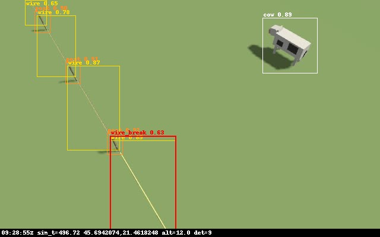

# Retraining log: fence detector

This log follows the fence detector from version to version. Each entry records what we trained, how it scored, what it
got wrong on the Jetson, and what we changed because of it. Model files are attached to the GitHub releases
(`model-v0.x`). The model card is in [model-card.md](model-card.md).

**Classes:** `post`, `wire`, `wire_break`, `fallen_post`, `branch`, `cow`, `sheep`

**How we test.** The trained model is exported to ONNX and built into a TensorRT FP16 engine on the Jetson Orin Nano.
The Jetson then runs it on the drone camera, which `tools/cam_stream.py` streams from Gazebo over the LAN while PX4
flies the inspection mission. Every frame is logged with the simulated GPS. A frame counts toward a fault when the
drone is within 30 m of it. A detection counts as a **false alarm** when the drone is more than 45 m from the real fault
of that class.

## v0.1 · preliminary checkpoint (`model-v0.1`)

- **Data:** 4,200 frames rendered from 12 random farms by `tools/make_dataset.py`, with labels computed from Gazebo
  ground truth (no hand labelling). 10 farms (3,500 frames) for training, 2 held-out farms (700 frames) for validation.
- **Training:** YOLO11n at 640 px, CPU. This is the checkpoint after **epoch 2** of the run that became v0.2.
  Exported early to test the Jetson pipeline end to end.
- **Validation:** mAP50 **0.72** (all classes).
- **On the Jetson** (60 s of the simulated mission, 874 frames at 14.6 fps):

| Fault | Frames within 30 m | Frames detected | Best confidence |
|---|---|---|---|
| F1 broken wire | 228 | 46 (20%) | 0.78 |
| F2 fallen post | 240 | 7 (3%) | 0.63 |
| F3 branch | not reached in the 60 s window | | |

- **False alarms:** 72 frames flagged `wire_break` more than 45 m from F1.
- **Takeaway:** the whole loop works (Gazebo → LAN → Jetson → TensorRT → GPS-tagged log). The model was undertrained,
  especially on the rare fault classes.

