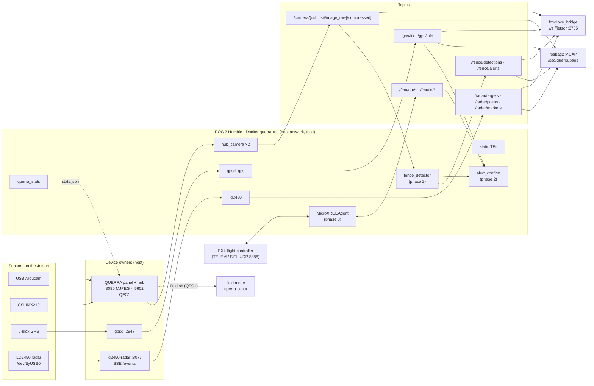

# ROS 2 on the Jetson

QUERRA Fence moves to ROS 2 Humble in three phases. The services that already own the hardware stay as they are,
and ROS 2 nodes are their clients. Nothing fights over a camera or a serial port.



Solid lines run today. Dotted boxes marked phase 2 or 3 are planned. The panel's ROS 2 card reads `querra_stats`
(nodes and topic rates) and starts, stops and records through `ros2/ros.sh`.

## Phase 1: sensors on ROS 2 (done)

- **Runtime:** Docker image `querra-ros:humble`, built from `ros:humble-ros-base` (arm64) plus rosbag2 MCAP storage,
  foxglove_bridge, OpenCV and `sensor_msgs_py`. Docker's data-root is `/ssd/docker`, so the image (1.3 GB) and the bags
  stay off the 57 GB eMMC root disk, which has 5.7 GB free. The container uses host networking and stays stopped until
  `./ros.sh start`.
- **Cameras:** `hub_camera` reads the panel hub's MJPEG stream (640 px, about 9 fps). It publishes the JPEG as
  `CompressedImage` without re-encoding. It decodes to a `bgr8` `Image` only while someone subscribes to the raw topic.
- **GPS:** `gpsd_gps` is a gpsd client. `NavSatFix` carries the fix status and a diagonal covariance from gpsd's
  `epx`/`epy`/`epv`. `GpsInfo` carries the fix type, satellites used and seen, HDOP, speed, track and the time since
  the last fix.
- **Radar:** `ld2450` is a client of the service's `/events` SSE stream and never opens `/dev/ttyUSB0`.
  `RadarTargets` carries the sensor-frame x and y, speed, distance, angle and resolution per occupied slot, plus the
  connected, fps, frames, bad, error and demo fields. `PointCloud2` and `MarkerArray` use the REP 103 radar frame
  (x forward, y left), and the markers show the ±60° / 6 m field and a label per target.
- **TF:** static `base_link` → `usb_camera_optical`, `csi_camera_optical`, `radar` and `gps`. The offsets are
  placeholders until the sensors are measured on the airframe.

Measured on the Jetson (Orin Nano Super, 25 W) with the panel running:

| Topic | Rate |
| --- | --- |
| `/camera/usb/image_raw/compressed`, `/camera/usb/image_raw` | 9.1 Hz |
| `/camera/csi/image_raw/compressed` | 8.1 Hz |
| `/radar/targets`, `/radar/points`, `/radar/markers` | 10.0 Hz |
| `/gps/fix`, `/gps/info` | 1.4–1.6 Hz (gpsd TPV) |

A 20 s MCAP bag of all topics is 5.1 MB (888 messages). The container uses about 5 % CPU and 270 MB RAM while no one
subscribes to raw images.

## Using it

From the panel (`http://mmx-desktop.local:8080`, ROS 2 card): **Start ROS 2** or **Stop**, live node list and topic
rates, **Record bag** for 10, 30 or 60 s with a list of bags and `.tar` downloads, the Foxglove address
(`ws://<jetson>:8765`), and **Start ROS 2 at boot** (a user crontab line tagged `# querra-ros`, off by default).

From a shell on the Jetson, in `/ssd/querra/ros2`:

```bash
./ros.sh doctor        # docker, data-root on /ssd, image, panel hub, gpsd, radar service, ports, disk
./ros.sh start         # nodes + foxglove_bridge; ./ros.sh start foxglove:=false to skip the bridge
./ros.sh status        # nodes and topic rates
./ros.sh record 30     # MCAP bag to /ssd/querra/bags
./ros.sh bags | logs | shell | stop | build
```

## Phase 2: detector and confirmation nodes (next)

- A `fence_detector` node runs the YOLO11n model-v0.3 TensorRT engine on `/camera/usb/image_raw` and publishes
  `vision_msgs/Detection2DArray` plus an annotated `CompressedImage`. It needs an L4T base image with TensorRT
  (`dustynv/ros:humble-*` for JetPack 6) or the host's TensorRT mounted into the container.
- An `alert_confirm` node ports `tools/confirm.py`. It projects each box to the ground with the GPS fix, heading and
  camera pitch, needs 5 of the last 8 frames to agree within 5 m, merges alerts within 10 m, and publishes `FenceAlert`
  with `NavSatFix` and the class.
- Field mode (`field.sh`) then becomes a launch file plus `ros2 bag record`. The panel keeps its Start and Stop buttons
  and calls the launch instead of `field.sh`.

## Phase 3: PX4 over uXRCE-DDS

- Run `MicroXRCEAgent` on the Jetson, connected to the flight controller's TELEM port (serial) or to the SITL
  simulation (UDP 8888). PX4's `uxrce_dds_client` then publishes `/fmu/out/vehicle_global_position`,
  `vehicle_attitude` and `vehicle_status` with `px4_msgs`.
- Alerts use the vehicle's own position and attitude instead of the separate u-blox fix. Offboard setpoints from
  `/fmu/in/trajectory_setpoint` let the Jetson re-fly a confirmed fault at low altitude for a closer look.
- Test in Gazebo first with the same launch files, through the existing PX4 SITL setup on the Mac.
