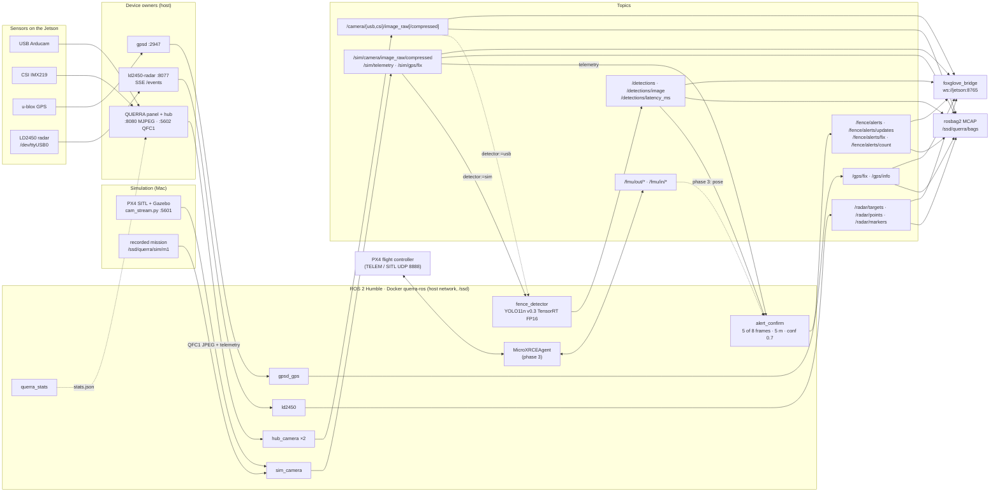

# ROS 2 on the Jetson

QUERRA Fence moves to ROS 2 Humble in three phases. The services that already own the hardware stay as they are,
and ROS 2 nodes are their clients. Nothing fights over a camera or a serial port.



Solid lines run today. Dotted boxes marked phase 2 or 3 are planned. The panel's ROS 2 card reads `querra_stats`
(nodes and topic rates) and starts, stops and records through `ros2/ros.sh`.

## Phase 1: sensors on ROS 2 (done)

- **Runtime:** Docker image `querra-ros:humble`, built from `ros:humble-ros-base` (arm64) plus rosbag2 MCAP storage,
  foxglove_bridge, OpenCV and `sensor_msgs_py`. Docker's data-root is `/ssd/docker`, so the image (1.3 GB) and the bags
  stay off the 57 GB eMMC root disk, which has 5.7 GB free. The container uses host networking and stays stopped until
  `./ros.sh start`.
- **Cameras:** `hub_camera` reads the panel hub's MJPEG stream (640 px, about 9 fps). It publishes the JPEG as
  `CompressedImage` without re-encoding. It decodes to a `bgr8` `Image` only while someone subscribes to the raw topic.
- **GPS:** `gpsd_gps` is a gpsd client. `NavSatFix` carries the fix status and a diagonal covariance from gpsd's
  `epx`/`epy`/`epv`. `GpsInfo` carries the fix type, satellites used and seen, HDOP, speed, track and the time since
  the last fix.
- **Radar:** `ld2450` is a client of the service's `/events` SSE stream and never opens `/dev/ttyUSB0`.
  `RadarTargets` carries the sensor-frame x and y, speed, distance, angle and resolution per occupied slot, plus the
  connected, fps, frames, bad, error and demo fields. `PointCloud2` and `MarkerArray` use the REP 103 radar frame
  (x forward, y left), and the markers show the ±60° / 6 m field and a label per target.
- **TF:** static `base_link` → `usb_camera_optical`, `csi_camera_optical`, `radar` and `gps`. The offsets are
  placeholders until the sensors are measured on the airframe.

Measured on the Jetson (Orin Nano Super, 25 W) with the panel running:

| Topic | Rate |
| --- | --- |
| `/camera/usb/image_raw/compressed`, `/camera/usb/image_raw` | 9.1 Hz |
| `/camera/csi/image_raw/compressed` | 8.1 Hz |
| `/radar/targets`, `/radar/points`, `/radar/markers` | 10.0 Hz |
| `/gps/fix`, `/gps/info` | 1.4–1.6 Hz (gpsd TPV) |

A 20 s MCAP bag of all topics is 5.1 MB (888 messages). The container uses about 5 % CPU and 270 MB RAM while no one
subscribes to raw images.

## Using it

From the panel (`http://mmx-desktop.local:8080`, ROS 2 card): **Start ROS 2** or **Stop**, live node list and topic
rates, **Record bag** for 10, 30 or 60 s with a list of bags and `.tar` downloads, the Foxglove address
(`ws://<jetson>:8765`), and **Start ROS 2 at boot** (a user crontab line tagged `# querra-ros`, off by default).

From a shell on the Jetson, in `/ssd/querra/ros2`:

```bash
./ros.sh doctor        # docker, data-root on /ssd, image, panel hub, gpsd, radar service, ports, disk
./ros.sh start         # nodes + foxglove_bridge; ./ros.sh start foxglove:=false to skip the bridge
./ros.sh status        # nodes and topic rates
./ros.sh record 30     # MCAP bag to /ssd/querra/bags
./ros.sh demo          # phase 2 on the recorded mission; ./ros.sh demo tcp://<mac>:5601 for the live simulation
./ros.sh start detector:=usb   # detector on the real USB camera
./ros.sh bags | logs | shell | stop | build
```

## Phase 2: detector and confirmation nodes (done)

- **`sim_camera`** (namespace `/sim`) publishes the Gazebo inspection camera and the drone telemetry:
  `/sim/camera/image_raw/compressed`, `/sim/telemetry` (`querra_fence_msgs/Telemetry`) and `/sim/gps/fix`. The source is
  either the live simulation (`tcp://<mac>:5601` from `tools/cam_stream.sh`, the QFC1 stream with JPEG and telemetry) or a
  recording made with `tools/cam_record.py`, replayed at real time and looped. The recorded mission `m1` (171 s, 2,535
  frames, the simulated farm with three faults, no people) is on the Jetson in `/ssd/querra/sim/m1`.
- **`fence_detector`** runs the YOLO11n model-v0.3 TensorRT FP16 engine (640×416) through `querra_scout`'s
  `YOLODetector`, the same code as field mode. It always takes the newest frame and drops the rest, so it never builds a
  queue. It publishes `/detections` (`vision_msgs/Detection2DArray`, same stamp as the image), `/detections/image`
  (annotated JPEG, only encoded while someone subscribes) and `/detections/latency_ms`. TensorRT 10, CUDA 12.6, the
  engine and `querra_scout` are mounted read-only from JetPack on the host; the image only adds `vision_msgs` and Pillow.
- **`alert_confirm`** is `tools/confirm.py` on ROS 2: it projects each box centre to the ground with the position,
  altitude, heading and camera pitch from `Telemetry`, needs 5 of the last 8 frames to agree within 5 m at conf ≥ 0.7, and
  merges alerts within 10 m. It publishes `/fence/alerts` (`FenceAlert`: id, class, lat/lon, max conf, frames,
  sightings; one message per confirmed alert), `/fence/alerts/fix` (`NavSatFix` per new alert, for Foxglove's Map) and
  `/fence/alerts/count`. All three are transient-local, so a late subscriber (Foxglove, a bag) still gets every alert.
  Re-sightings of a known alert go to `/fence/alerts/updates` (volatile), so they never push earlier alerts out of the
  latched history.
- **Launch:** `detector:=none` (default, phase 1 only), `detector:=sim` (sim camera → detector → confirmation) or
  `detector:=usb` (the detector on the real USB camera; no confirmation, since a bench has no fence).

Measured on the Jetson (25 W) with `./ros.sh demo`, the panel and both live cameras running:

| | |
| --- | --- |
| `/sim/camera/image_raw/compressed` | 15 Hz (the recording's rate) |
| `/detections`, `/detections/image` | 15 Hz (99 % of frames) |
| Detector latency, JPEG decode + TensorRT + post-processing | p50 about 26 ms, max 34 ms |
| Jetson | CPU about 50 %, GPU up to 86 %, RAM 4.5 of 7.6 GB, about 9 W |
| Alerts on mission `m1` | 10 confirmed: the three real faults plus 7 false (6 in the offline evaluation of v0.3) |

A 95 s demo bag with only the simulation topics, detections and alerts is 31 MB (8,485 messages).

Foxglove: open `ws://<jetson>:8765` in the Foxglove app and import
[`ros2/foxglove/querra-layout.json`](../ros2/foxglove/querra-layout.json): annotated detections, map with the drone track
and alerts, detector latency and alert count, the alert messages, the radar in 3D and both live cameras.

Next: field mode (`field.sh`) becomes a launch file plus `ros2 bag record`, and the panel's Start and Stop call it.

## Phase 3: PX4 over uXRCE-DDS

- Run `MicroXRCEAgent` on the Jetson, connected to the flight controller's TELEM port (serial) or to the SITL
  simulation (UDP 8888). PX4's `uxrce_dds_client` then publishes `/fmu/out/vehicle_global_position`,
  `vehicle_attitude` and `vehicle_status` with `px4_msgs`.
- Alerts use the vehicle's own position and attitude instead of the separate u-blox fix. Offboard setpoints from
  `/fmu/in/trajectory_setpoint` let the Jetson re-fly a confirmed fault at low altitude for a closer look.
- Test in Gazebo first with the same launch files, through the existing PX4 SITL setup on the Mac.
