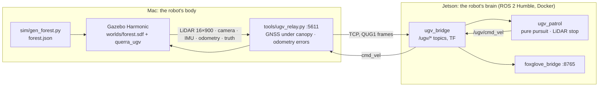
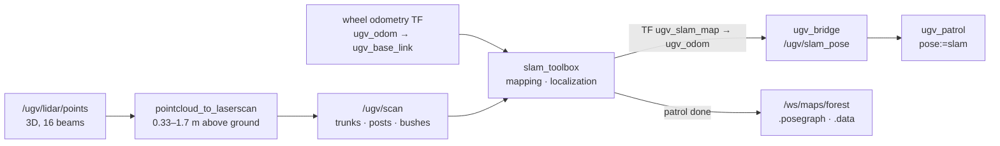

# Ground robot (UGV) · phase 0: simulation

The drone inspects open pasture. Under trees it can neither see the fence nor fly safely, and GNSS gets poor. A small
ground robot can patrol there: a fenced woodland paddock, a deer park, a zoo or safari enclosure. This is the
simulation phase: the robot, the forest and the patrol run before any hardware is bought.

Under a canopy, LiDAR and SLAM earn their place. Tree trunks are good landmarks, and GNSS cannot be trusted. On open
pasture the reverse holds, which is why the drone does without them.



## The world

`forest.json` describes it; `sim/gen_forest.py` turns it into `worlds/forest.sdf`, the robot model and
`worlds/forest_meta.json` (route, spawn pose, sensor mounts, tree crowns, faults). Nothing generated is in git.

- **Enclosure:** an 8-sided paddock, 499 m of two-strand electric fence on 129 posts, 4 m apart. It reuses the
  pasture's fence and fault code (`sim/geo.py`, `sim/gen_world.py`), so a fault looks the same to both robots.
- **Faults:**
  - F1, wire_break (upper strand);
  - F2, branch_short (a branch across the wires);
  - F3, post_down;
  - F4, wire_break (lower strand);
  - F5, branch_short.
- **Forest:** 883 trees (a third spruce) in a 24 m band around the fence, with undergrowth.
  - **Route strip:** a cleared strip 1.3 m each side of the route, outside the fence.
  - **Obstacles next to the route:** 6 pinch points (a trunk 1.25–1.4 m from the route), 5 logs and 8 rocks. All
    of them have collisions.
  - **Clearing:** one fence edge runs through a clearing, with open sky.
  - **Sky cover along the route:** open for 10% of it, partial for 29%, dense canopy for 61%.
- **Route:** the fence polygon pushed 1.9 m outward, 516 m, a point every 0.5 m. The robot drives it once
  counter-clockwise, with the fence on its left: teach and repeat.

## The robot

| | |
|---|---|
| Base | 4×4 skid steer, 0.80 × 0.50 m, 30 kg, wheels r = 0.16 m. Tyre friction 1.0 along, 0.35 sideways, calibrated with `tools/ugv_calibrate.py` (commanded and real turns agree within 1%) |
| LiDAR | 16 beams, ±15°, 900 samples per turn, 0.3–40 m, 10 Hz, 0.8 m above the ground |
| Camera | 640×400, 100° wide, 10 fps, looking left at the fence, 6° down, 0.7 m up |
| IMU | 100 Hz (50 Hz to the Jetson) |
| Wheel odometry | Gazebo's, plus an error model: 1% distance scale, 2% turn scale, 1° heading drift per 100 m, only while moving |
| GNSS | 5 Hz. The truth plus noise (1 m under open sky, up to 4 m under canopy) and a wandering multipath bias (up to 6 m, 30 s correlation). Only a 2D fix above 60% sky cover; no fix above 90%. Sky cover is the share of the sky above a 15° mask that the crowns within 20 m hide, each weighted by 0.45 because leaves attenuate the signal rather than stop it. The robot is never told its true error |

## Run it

```bash
./ugv.sh                     # Mac: forest world, Gazebo window, relay on tcp://<mac>:5611 (headless: ./ugv.sh headless)
cd /ssd/querra/ros2 && ./ros.sh ugv tcp://<mac-ip>:5611            # Jetson: patrol on wheel odometry
./ros.sh ugv tcp://<mac-ip>:5611 pose:=truth                       # patrol on ground truth (tests the chain)
./ros.sh ugv tcp://<mac-ip>:5611 pose:=truth slam:=mapping         # teach: map while driving, saved to /ws/maps/forest
./ros.sh ugv tcp://<mac-ip>:5611 pose:=slam slam:=localization     # repeat: patrol on the SLAM pose against that map
python3 tools/ugv_eval.py --json                                   # Mac: score the patrols in the newest log
```

- **Foxglove:** connect to `ws://<jetson>:8765`, or `ws://localhost:8765` through an SSH tunnel for the web app, and
  import `ros2/foxglove/ugv-layout.json`. The layout shows the 3D view (point cloud, route, fence, faults, true
  path in green, odometry path in orange), the camera, a map with the GNSS fix, and a plot of odometry drift and
  GNSS error.
- **Restart a patrol from the spawn pose:** publish `restart` on `/ugv/patrol/cmd`.

## Results (2026-11-22)

**The chain.** Every stream arrives on the Jetson at its rate:

| Stream | Rate on the Jetson |
|---|---|
| LiDAR point cloud | 10 Hz, about 12,500 points |
| Camera | 10 fps, about 20 KB per JPEG |
| IMU | 50 Hz |
| Odometry | 28 Hz |
| GNSS | 5 Hz |

The patrol commands come back at 20 Hz. Gazebo runs at about 0.9× real time on the M2 with 878 trees, the LiDAR and
the camera.

**Patrols** (`tools/ugv_eval.py`, scored against the simulator's truth):

| Pose the patrol drives on | Result | Route | Off the route (max) | Odometry drift | Faults through the camera's view |
|---|---|---|---|---|---|
| Ground truth (control), first version of the world (sparser forest) | done | 99.8% in 706 s | 0.32 m | (not used) | 5 of 5 |
| Ground truth (control), final world, before turning on the spot | blocked at 221 m: a pinch-point trunk on the outside of a sharp corner (56°), after overshooting the corner by 0.5 m | 43% | 0.50 m | (not used) | 2 of 5 |
| Ground truth (control), final world, turning on the spot at sharp corners | done, no obstacle stops | 99.8% in 762 s (0.68 m/s) | 0.31 m | 5.3 m over the loop if it had driven on it (1.0 m per 100 m) | 5 of 5 |
| Wheel odometry, run 1 | blocked at 107 m: a spruce's low branches hung into the strip at 0.9–1.0 m | 21% | 0.81 m | 1.1 m (1.0 m per 100 m) | 1 of 5 |
| Wheel odometry, run 2 (spruces trimmed) | blocked at 95 m: a trunk at a pinch point, after drifting 0.6 m off the line | 19% | 0.61 m | 1.0 m (1.1 m per 100 m) | 1 of 5 |

After the blocked corner, `ugv_patrol` turns on the spot when the target is more than 35° off its heading, as skid
steers do. With that change, the control patrol completes the final world: the world is passable for a robot that
knows where it is.

**GNSS under the canopy.** Over the whole loop (the control patrol), the fix was there all the time, but 3D for
only 35% of it. The error was 4.4 m median and 9.9 m at the 95th percentile:

| Sky | Share of the loop | Error, median | Error, 95th percentile |
|---|---|---|---|
| Open (the clearing) | 10% | 1.9 m | 4.3 m |
| Partial cover | 25% | 4.5 m | 9.5 m |
| Dense canopy | 66% | 4.9 m | 10.4 m |

**What it means.** At its tightest, the strip leaves 0.59 m from the route centre to the nearest obstacle in the
robot's height band (`tools/ugv_clearance.py`; 5th percentile 1.1 m). The robot is 0.72 m wide, so it has about
0.2 m to spare there. A robot that holds its line and turns on the spot at sharp corners passes, as the control patrol shows. Wheel odometry is good to
about 1% of the distance, a good figure for a skid steer, and it still puts the robot 0.6 m off within 100 m. GNSS
error under the trees is many times the margin. The robot needs localisation from the trees themselves: LiDAR SLAM,
fused with odometry, the IMU and GNSS where the sky is open.

**A requirement found on the way.** Untrimmed spruces hang branches at 0.9–1.0 m, inside the robot's 1.0 m height
envelope. A strip a ground robot patrols needs its low branches cut back above about 1.3 m. That is a maintenance
requirement for the customer, not something the robot can solve.

## SLAM: teach and repeat

A ground robot that patrols the same strip every day does not need to discover the forest each time. It drives the
route once while a map is built (teach), then localises against that map on every patrol (repeat). Its error then
stays bounded by how well the scans match the map, instead of growing with the distance driven.



- **Scan:** `pointcloud_to_laserscan` turns the 3D point cloud into a 2D scan from a slice 0.33–1.7 m above the
  ground. That holds the trunks, fence posts and bushes, and leaves out the ground and the crowns.
- **SLAM:** slam_toolbox (`ros2/src/querra_fence_ros/config/ugv_slam_*.yaml`) uses the wheel odometry as its prior.
  Its map frame starts at the spawn pose; `ugv_bridge` places it in the world.
- **Why not KISS-ICP:** KISS-ICP (3D LiDAR odometry) has no Humble package for arm64. slam_toolbox does, and it
  also does what LiDAR odometry alone cannot: close the loop, and localise against a saved map.
- **Teach:** the mapping run drives on ground truth, standing in for an operator who drives the robot by remote
  control once. When the patrol is done, `ugv_patrol` asks slam_toolbox to save the map.
- **Repeat:** `slam:=localization pose:=slam`. The patrol drives on the SLAM pose, localised against that map.

**Results so far (2026-11-22):**

| Run | SLAM error (median / max / at the end) | Wheel odometry drift | Notes |
|---|---|---|---|
| Teach 1: stamps on arrival, default settings | 3.1 / 7.1 / 6.4 m | 4.6 m | Worse than odometry. The heading drifted on every left turn, because each stream's own delay was mixed into its stamps |
| Teach 2: Gazebo's simulation time on every sample (`/clock`), defaults | 3.7 / 9.0 / 8.3 m | 6.9 m | Still no loop closure. The indoor defaults trust the odometry's heading over the scans and search only 4 m for a loop |
| Teach 3: simulation time + outdoor tuning | 1.08 / 4.6 m, **0.01 m after the loop closed** | 14.8 m | The loop closed at the start. The map was saved after the closure |
| Repeat 1: localisation against that map, patrol on the SLAM pose | 0.84 / 6.3 m over the first 275 m | 7 m | Passed the tight spots at 95 m and 107 m where odometry stopped. For 400 s localisation held steady: 1.1–1.3 m from the truth, heading within 0.3°. Then the Wi-Fi link between the Mac and the Jetson stalled (4–5 s gaps from 414 s); localisation lost its heading in the last 10 s, and the link carried nothing for about 13 minutes. The patrol held still on its stale pose, as it should |
| Teach 4: 5 GHz link; the route saved as the map sees it | 1.01 / 2.41 m, 0.38 m at the end | 4.5 m | No link gaps. The saved route (the pose graph after the loop closed, 1,536 points) lies 0.13 m from the true route on median, 0.39 m at most |
| Repeat 3: as repeat 2, with the localisation and bridge lighter on the CPU (below); Wi-Fi power saving off | 0.26 / 0.83 m, 0.05 m at the end | 4.3 m | The whole loop: 99.7% in 832 s (0.62 m/s), no obstacle stops, 5 of 5 faults through the camera's view. Off the true route: 0.01 m median, 0.18 m p95, 0.62 m max. No link gaps |
| **Repeat 2: localisation, patrol on the SLAM pose along the taught route** | 0.30 / 1.13 m, 0.02 m at the end | 4.2 m | **The whole loop: 99.7% in 735 s (0.70 m/s), no obstacle stops, 5 of 5 faults through the camera's view. Off the true route: 0.01 m median, 0.17 m p95, 0.60 m max.** One 3.3 s link gap, ridden out |

**On the Orin Nano** during the repeat run: the localisation node used about two CPU cores, `ugv_bridge` 60–75% of
one, the stats node about a third of one.

**Why the Jetson stopped answering.** It did not crash or reboot: its log runs on without a gap, with no memory,
thermal or network event, and the ROS container stayed up. Its link is 2.4 GHz Wi-Fi at about −59 dBm, which carries
the robot's stream (LiDAR, camera, IMU, odometry: about 0.5 MB/s) plus Foxglove. That link stalled and then dropped.
On a real robot the sensors are wired to the Jetson; the Wi-Fi link exists only because the Mac plays the robot's
body. For simulation runs the Jetson should be on Ethernet (or 5 GHz).

**The steady 1.1–1.3 m error is the map's warp.** The teach run's drift was closed at the loop's end, which spreads
the correction along the loop but leaves the map up to about a metre off the world. The route comes from the world
(`forest_meta.json`), so a robot localised in the map follows it up to a metre off. Real teach and repeat records the
route in the map's own frame during the teach run, so the warp does not matter.

**Teach and repeat fixes it.** With the route saved as the map sees it (`ugv_patrol` saves slam_toolbox's pose graph
after the loop closes, in `/ws/maps/forest.route.json`), the route and the SLAM pose come from the same map. In
repeat 2 the SLAM pose was 0.30 m from the truth on median, yet the robot drove 0.01 m from the true route on median
and 0.17 m at the 95th percentile: the map's warp cancels out.

**CPU on the Orin Nano** (`./ros.sh cpu 120`, two minutes into a repeat patrol, % of one core; the board has six):

| Process | Before | After | What changed |
|---|---|---|---|
| slam_toolbox localisation | 194% | **39%** | The localisation config only (the mapping one is unchanged): a scan every 0.5 m instead of 0.3 m, a shorter local chain, a smaller per-step window, 2° coarse angles, an 8 m window to match back to the map |
| `ugv_bridge` | 77% | **33%** | The point cloud and JPEGs go to ROS as `array('B')`. rclpy checks a `bytes` value one element at a time in Python, which for the cloud is 230 KB ten times a second. The visualisation trails are published every 2 s, capped at 2,000 points |
| stats | 39% | 28% | The ground robot's launch skips `/clock`, `/tf`, `/map` (14 MB), the eval and trail topics |
| `ugv_patrol` | 12% | 12% | |
| pointcloud_to_laserscan | 5% | 6% | |
| **All, in the container** | **327%** | **119%** | the board 57% → 22% busy overall |

Accuracy did not suffer: repeat 3 (after) against repeat 2 (before): 0.18 against 0.17 m p95 off the route, SLAM error
0.26 against 0.30 m median, and its maximum went from 1.13 to 0.83 m. The robot drove a little slower (0.62 against
0.70 m/s).

Open:
- ten repeat patrols, against the 9-of-10 goal;
- the stats node (28%) and the patrol's point-cloud check, if the CPU is needed for the detector.

## Phase 0 goals

| Goal | Status |
|---|---|
| The whole chain runs (Gazebo → relay → ROS 2 on the Jetson → commands back), every sensor at its rate | done |
| The robot completes the loop autonomously in at least 9 of 10 patrols | on SLAM (teach and repeat): 2 of 2 so far; ten to run. On wheel odometry: no, blocked at about 100 m in 2 of 2 patrols. On ground truth: yes |
| At least 4 of 5 faults found, at most 1 false alert per patrol | not yet. All 5 pass through the camera's view, but model-v0.5 knows only the drone's 55° view; the ground view needs its own data and model |
| Localisation error under 1 m with poor GNSS, on the Orin Nano | yes in repeat 3: 0.26 m median, 0.43 m p95, 0.83 m max against the truth (0.18 m p95 off the true route), with the whole ground-robot stack at 119% of one core of six (localisation 39%) |

## Next steps

1. **Localisation.** LiDAR SLAM (KISS-ICP or slam_toolbox on a 2D slice) fused with odometry, the IMU and GNSS in
   an EKF (`robot_localization`). The patrol already takes its pose from a topic, so it switches without code
   changes. Measure against the same goals: 9 of 10 loops, under 1 m error.
2. **Ground-view detector.** Render fence frames from the robot's camera pose (0.7 m up, 1.9 m from the fence,
   looking sideways), train and score as for the drone models, then run it on `/ugv/camera`.
3. **Ten patrols per change**, scored with `tools/ugv_eval.py`, as with the drone's models.
4. **The real walk.** Walk a real forest fence with the Jetson, the camera at 0.7 m and the u-blox logging its
   accuracy. That calibrates the GNSS and odometry models and gives the first real ground-view images.

## Known limits

- **Flat ground.** No slopes, mud or roots yet: the terrain is the main risk for a real robot.
- **Near-field blind zone.** The LiDAR's lowest beam reaches the ground about 3 m ahead. A low log or rock closer
  than about 2 m is invisible to it. A real robot adds a tilted LiDAR or a depth camera.
- **No obstacle avoidance.** The patrol stops for an obstacle in its path and gives up after 20 s.
- **Synthetic error models.** The odometry and GNSS errors are models, not measurements. The planned walk along a
  real forest fence, with the u-blox logging its accuracy, is what calibrates them.
- **Detector.** The fence detector (model-v0.5) has only seen the fence from above. The ground view needs its own
  data and model.
