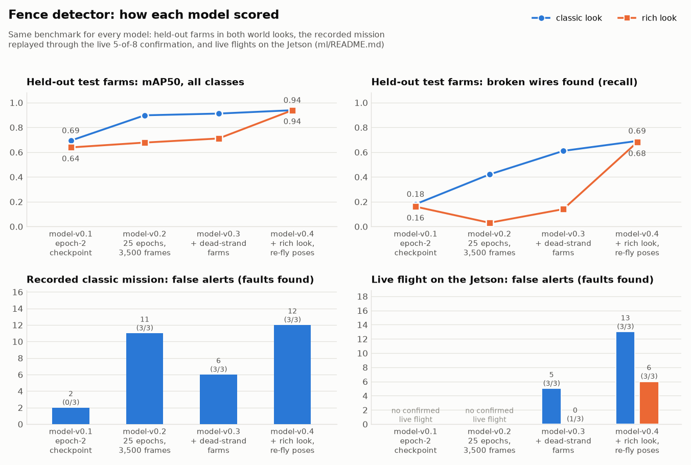
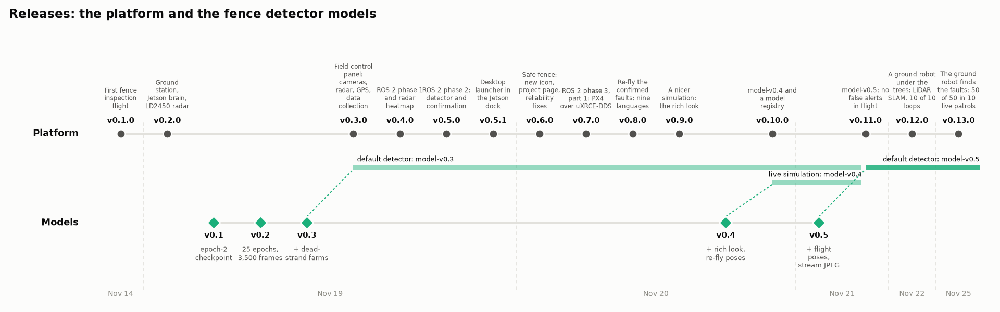

# Fence detector: models and data

Every fence detector model has a record here: the data it was trained on, the code that made that data, how it was
trained, how it scored offline and in live flights, and why it is or is not used. The story behind each version is in
[docs/retraining-log.md](../docs/retraining-log.md). Intended use and limits are in the
[model card](../docs/model-card.md).

| File | What it holds |
|---|---|
| [models.json](models.json) | **Model registry.** One entry per model: status, data, code commit, training, scores, live results, sha256 of every file |
| [datasets.json](datasets.json) | **Dataset registry.** Generator command and commit, look, seeds, splits and the role of each split (train / val / test) |
| [runs/](runs) | **Run records** from model-v0.4 on: training arguments, scores per epoch, data mix, held-out scores, live flights, engine build |
| [benchmark/](benchmark) | **The shared benchmark** scored for every model: 9 held-out sets ([heldout.json](benchmark/heldout.json)), the recorded mission replay ([mission_replay.json](benchmark/mission_replay.json)) and, from model-v0.3 on, 8 sets compressed like the camera stream ([stream.json](benchmark/stream.json)) |
| [tools/model_registry.py](../tools/model_registry.py) | Validates both registries, writes the table below, checks local files against the hashes |
| [tools/model_charts.py](../tools/model_charts.py) | Draws the two charts below from `models.json` and the git tags |
| [docs/release-notes/](../docs/release-notes) | The text of every GitHub release; [tools/release_notes.py](../tools/release_notes.py) checks and publishes it |



## Models

<!-- registry:start -->
| Model | Status | Date | Trained on | Test mAP50 classic / rich | `wire_break` recall classic / rich | Mission replay: faults, false alerts | Live classic | Live rich | Run |
|---|---|---|---|---|---|---|---|---|---|
| **model-v0.5** | default | 2026-11-21 | 9,600 frames, 6 datasets | 0.937 / 0.937 | 0.65 / 0.61 | 3 of 3, 0 | 3 of 3, 0 | 3 of 3, 0 | [model-v0.5](runs/model-v0.5) |
| **model-v0.4** | retired | 2026-11-20 | 7,200 frames, 4 datasets | 0.938 / 0.938 | 0.69 / 0.68 | 3 of 3, 12 | 3 of 3, 13 | 3 of 3, 6 | [model-v0.4](runs/model-v0.4) |
| **model-v0.3** | retired | 2026-11-19 | 4,800 frames, 2 datasets | 0.911 / 0.71 | 0.61 / 0.14 | 3 of 3, 6 | 3 of 3, 5 | 1 of 3, 0 | – |
| **model-v0.2** | retired | 2026-11-19 | 3,500 frames, 1 dataset | 0.897 / 0.677 | 0.42 / 0.03 | 3 of 3, 11 | 3 of 3, 385 false frames | – | – |
| **model-v0.1** | retired | 2026-11-19 | 3,500 frames, 1 dataset | 0.693 / 0.638 | 0.18 / 0.16 | 0 of 3, 2 | 2 of 3 (60 s flight, F3 not reached), 72 false frames | – | – |
<!-- registry:end -->

- **Test:** the held-out farms with seeds 140–142 in each world look. These farms are never used for training or for
  picking an epoch.
- **Mission replay:** the recorded classic mission flight (1,986 frames from the camera stream) through each model and
  the live confirmation, 5 of 8 frames at conf ≥ 0.7. It is the same input for every model, so it is the fairest
  comparison of false alerts. model-v0.1 is scored from its ONNX export, because its `.pt` was not kept.
- **Stream sets** ([stream.json](benchmark/stream.json), not in the table): held-out frames posed like the inspection
  flight and JPEG-compressed like the camera stream. `wb_false`, the share of frames with a false broken wire at
  conf ≥ 0.7, is the offline score that matches the false alerts of a live flight.
- **Live:** one inspection flight over the mission pasture. Gazebo streams the camera to the Jetson, which runs the
  TensorRT engine with 5-of-8 GPS confirmation (conf ≥ 0.7) and places alerts with PX4's own pose. An alert is a real
  fault when its class matches one of F1–F3 within 15 m.
- **Statuses:**
  - `default`: what the system uses unless told otherwise (the ROS 2 detector, the replay demo, field mode).
  - `live-sim`: used for live Gazebo flights (`ros.sh demo tcp://…`).
  - `candidate`: better than the default offline; waits for live tests before it is used by default.
  - `retired`: kept for comparison.

### Ground robot models

The ground robot's camera looks at the fence from the side, 0.7 m up, so it has its own models, trained on frames
from that view ([docs/ugv.md](../docs/ugv.md)). Same 7 classes.

<!-- ground-registry:start -->
| Model | Status | Date | Trained on | Test mAP50 | Patrol frames offline, every fault from conf 0.7: faults, false alerts | Live patrols: faults, false alerts | Run |
|---|---|---|---|---|---|---|---|
| **ground-v0.1** | default | 2026-11-25 | 3,600 frames, 1 dataset | 0.957 | 5 of 5, 0 false; all 4 forests: 25 of 29, 0 false | 10 patrols: 50 of 50, 0 | [ground-v0.1](runs/ground-v0.1) |
| **ground-v0.2** | candidate | 2026-11-26 | 5,100 frames, 2 datasets | 0.979 | 5 of 5, 0 false; all 4 forests: 29 of 29, 0 false | – | [ground-v0.2](runs/ground-v0.2) |
| **ground-v0.3** | candidate | 2026-11-27 | 9,100 frames, 3 datasets | 0.981 | 5 of 5, 0 false; all 4 forests: 29 of 29, 0 false | – | [ground-v0.3](runs/ground-v0.3) |
<!-- ground-registry:end -->

- **Test:** 3 random forest enclosures of their own seed range (900–902), JPEG like the robot's camera stream.
- **Patrol frames offline:** the real forest world along the robot's route, one frame every 0.5 m, scored by
  `tools/ground_patrol_eval.py` like the alert chain: 5 of 8 frames confirm, every fault from conf 0.7. "All 4
  forests" adds the patrols of three random forests never trained on (seeds 700–702): 29 faults in all.
- **Live patrols:** repeat patrols on the Jetson (`tools/ugv_series.sh 10 … detect:=true`), each from a clean start.
  `ugv_alerts` confirms 5 of 8 frames 0.5 m apart (fallen posts from conf 0.5, the others from 0.7); an alert is
  real when its class matches a fault within 5 m.

## Releases



One repository, two release tracks:

| Track | Tag | Title | Notes sections |
|---|---|---|---|
| Platform (simulation, Jetson, ROS 2, panel) | `vX.Y.Z` | `vX.Y.Z · <theme>` | **Models:** line, Highlights, (Measured), (Architecture), Install or run, Known limits, (Files) |
| Fence detector | `model-vX.Y` | `model-vX.Y · <theme>` | Evolution chart, role table, What changed, Scores, In flight on the Jetson, Known limits, Files |
| Ground robot's detector | `ground-vX.Y` | `ground-vX.Y · <theme>` | Role table, What changed, Scores, Live on the Jetson, Known limits, Files |

- The release text lives in `docs/release-notes/<tag>.md`. The first line is the title.
- Images are pinned to a commit, so a release page never changes when `main` does.
- Files are listed with their SHA-256. Model weights are attached to the model release only; TensorRT engines are
  built on the Jetson.
- A platform release says which model it uses. A model release says from which platform release it is used.
- Tags are never moved. Only titles and notes are edited.

```bash
python3 tools/release_notes.py              # check every notes file against the rules above
python3 tools/release_notes.py --apply      # set the title and notes of every GitHub release (gh)
python3 tools/release_notes.py --verify     # compare GitHub with the files
```

## How a model is made

1. **Data.** `tools/make_dataset.sh` renders random farms in Gazebo and writes YOLO labels from the 3D ground truth.
   Each new dataset gets an entry in `datasets.json` with its command and the commit of the generator. Test splits are
   marked `"role": "test"`. The validator refuses a model that trains or validates on one of them.
2. **Mix.** `tools/mix_dataset.py` writes the training mix as lists of images, so nothing is copied. Old data stays in
   the mix so the model keeps what it learned.
3. **Train.** `tools/train_yolo.py --data … --model <parent>.pt --name fence-yolo11n-vX.Y`. `--resume` continues a
   paused run. The output is `best.pt` and `best.onnx` (416×640). On the laptop,
   `tools/train_with_breaks.py --every 2 --pause 15 -- <train_yolo arguments>` stops after every 2 epochs, cools down
   for 15 minutes and resumes.
4. **Score offline.** `tools/eval_sets.py <parent>.pt <new>.pt --json …` scores both models on the held-out sets of
   both looks; `--sets` with the `*_q4` datasets scores the stream sets. `tools/eval_mission.py` replays the recorded
   mission flight through each model.
5. **Build the engine on the Jetson.**
   `trtexec --onnx=… --saveEngine=fence-yolo11n-vX.Y-fp16.engine --fp16` in `~/querra-scout-20261107/models/fence-yolo`.
6. **Fly it.** Run the live chain in both looks with
   `./ros.sh demo tcp://MAC:5601 px4:=true refly:=true engine:=/models/<engine>`.
   Offline scores alone are not enough: model-v0.4 scored better offline and still raised more false alerts on the
   classic mission. The cause was the stream's JPEG compression; the stream sets now show it before the flight.
7. **Record and decide.** Copy the run record to `runs/model-vX.Y/`. Score the new model on the shared benchmark and add
   it to `benchmark/`. Add the model to `models.json` with its hashes (`shasum -a 256`), a status and a one-line
   `summary`. Run `python3 tools/model_registry.py --write` and `tools/model_charts.py`, and update the retraining log
   and the model card.
8. **Release.** Write `docs/release-notes/model-vX.Y.md`, then publish `model-vX.Y` with `.pt`, `.onnx` and
   `classes.json` attached and `--latest=false`, so the platform release stays "Latest".

```bash
python3 tools/model_registry.py                          # validate and print the table
python3 tools/model_registry.py --write                  # rewrite the table above
python3 tools/model_registry.py --check ~/querra-data/models   # sha256 of local model files against the registry
```

## Where the files are

| What | Where |
|---|---|
| Weights (`.pt`, `.onnx`) | GitHub release `model-vX.Y`; training machine `~/querra-data/models` |
| TensorRT engines | Jetson `~/querra-scout-20261107/models/fence-yolo` (mounted as `/models` in the ROS 2 container). Engines are built per device and are not released |
| Datasets | Training machine `~/querra-data/<dataset id>` (0.1–1.7 GB each); rebuilt from `datasets.json` |
| Runs | `runs/` here (small text files); the full Ultralytics output stays in `~/querra-data/train/` |
