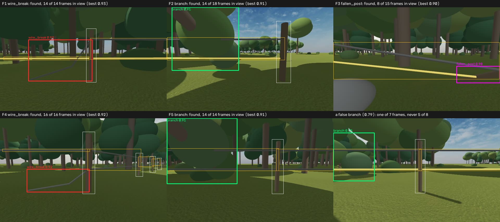
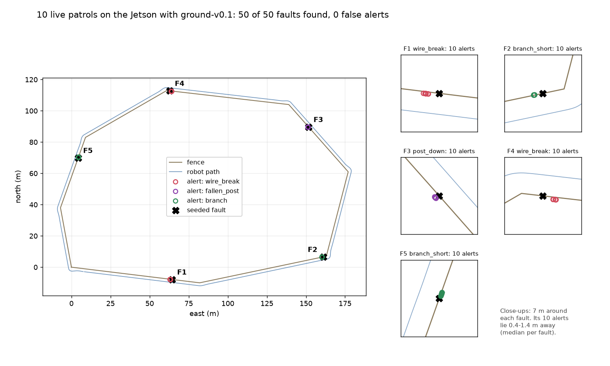

# ground-v0.1 · the fence from the ground robot's side camera

| | |
|---|---|
| Status | **live in simulation**: 10 of 10 live patrols on the Jetson, 50 of 50 faults found, 0 false alerts. Not released and not in [models.json](../../models.json) yet |
| Date | 2026-11-25 |
| Parent | model-v0.5 (fine-tuned) |
| Code | `dcd017a` (the ground dataset generator and patrol scorer of `54f574b`, test frames named `T`) |
| Files | `ground-yolo11n-v0.1.pt` (5,486,042 bytes, sha256 `a6837e2413f955a86c23b4d25c9e3aaeca411465e357a80441c3f12dcbabcaa4`), `ground-yolo11n-v0.1.onnx` 416×640 (10,610,506 bytes, sha256 `9eb8a54398912e68879a6f79a9e71324437fbc805da7dbcda09faaedede65911`), Jetson engine `ground-yolo11n-v0.1-fp16.engine` (8,099,084 bytes, sha256 `7c561333347ed7b6cc7dba967fd9fd6f622d660adb3fe5811a05a8bf1da920dd`) |

## Why

The ground robot drives 1.9 m beside the fence with its camera 0.7 m up, looking sideways. In the v0.12.0 patrols
all five faults passed through its view, but model-v0.5 knows only the drone's view from 12 m. On the patrol of the
forest it found 2 of 5 faults and raised 19 false alerts. The ground view needs its own data and model; this is the
first.

## Data

Synthetic, auto-labelled from Gazebo's ground truth, the drone's 7 classes ([datasets.json](../../datasets.json)).

| Dataset | Split | Frames | Role |
|---|---|---|---|
| `ground_yolo_stream`: 12 random forest enclosures (seeds 500–511), 2,720 of the frames JPEG like the robot's camera stream | train | 3,600 | train |
| `ground_yolo_stream`: 2 more enclosures (seeds 512–513), all JPEG `-q:v 4` | val | 600 | epoch choice |
| `ground_yolo_stream`: 3 enclosures from another seed range (900–902), all JPEG `-q:v 4` | test | 600 | scoring only |
| `ground_patrol_q4`: the real `forest.json` world along the robot's route, one frame every 0.5 m, JPEG `-q:v 4` | test | 1,032 | scoring only |

Training labels: 812 broken wires, 372 fallen posts, 693 branches on the wires. The camera is a copy of the robot's
(640×400, 100° wide) at robot poses 1.4–2.5 m outside the fence with heading, pitch and roll noise; 45% of the poses
are near a fault. A depth camera on the same mount removes hidden parts, and nothing beyond 12 m is labelled.

## Training

YOLO11n fine-tuned from model-v0.5 for 10 epochs at 640 px, batch 16, on the laptop CPU (Apple M2, 8 GB). AdamW
with lr 0.000909 and 3 warm-up epochs, as Ultralytics chose; mosaic off for the last 3 epochs.
`tools/train_with_breaks.py` ran 5 sessions of 2 epochs with 15-minute cooling breaks, resuming with the optimizer
state: **3.5 h** including the breaks. The last epoch was the best and is the model ([args.yaml](args.yaml),
[results.csv](results.csv)). The scores were still rising, so more epochs would likely help.

| Epoch | mAP50 | mAP50-95 | Precision | Recall |
|---|---|---|---|---|
| 1 | 0.697 | 0.445 | 0.731 | 0.668 |
| 2 | 0.835 | 0.570 | 0.868 | 0.767 |
| 4 | 0.870 | 0.621 | 0.849 | 0.826 |
| 6 | 0.909 | 0.684 | 0.904 | 0.856 |
| 8 | 0.927 | 0.709 | 0.942 | 0.869 |
| **10** | **0.933** | **0.736** | 0.939 | 0.875 |

## Offline scores

### Test enclosures

The 3 enclosures of the test seeds, never used for training or epoch choice, JPEG like the stream
([eval_test.json](eval_test.json); model-v0.5 on the same frames: [baseline_model-v0.5_test.json](baseline_model-v0.5_test.json)).

| mAP50 | model-v0.5 | **ground-v0.1** |
|---|---|---|
| all classes | 0.040 | **0.957** |
| post | 0.017 | 0.980 |
| wire | 0.011 | 0.950 |
| `wire_break` | 0.119 | **0.957** |
| `fallen_post` | 0.047 | **0.942** |
| `branch` | 0.004 | **0.958** |

Precision 0.928, recall 0.909, mAP50-95 0.764.

### The patrol of the forest

The frames along the robot's route in the real `forest.json` world, scored by `tools/ground_patrol_eval.py` as the
alert chain would count them: an alert needs the same fault class in 5 of 8 consecutive frames (4 m of route); it is
a find when a fault of its class lies within 4 m ([patrol_conf0.7.json](patrol_conf0.7.json),
[patrol_conf0.5.json](patrol_conf0.5.json); model-v0.5: [baseline_model-v0.5_patrol.json](baseline_model-v0.5_patrol.json)).
The phase 0 goal is at least 4 of 5 faults and at most 1 false alert.

| | model-v0.5, conf 0.5 | ground-v0.1, conf 0.5 | **ground-v0.1, conf 0.7** (the Jetson's) |
|---|---|---|---|
| Faults found | 2 of 5 | 5 of 5 | **5 of 5** |
| False alerts | 19 | 0 | **0** |
| F1 broken wire: frames that show it, of those in view | 0 of 14 | 14 of 14 | 14 of 14 |
| F2 branch | 6 of 18 | 14 of 18 | 12 of 18 |
| F3 fallen post | 0 of 15 | 8 of 15 | **5 of 15** |
| F4 broken wire | 3 of 16 | 16 of 16 | 16 of 16 |
| F5 branch | 7 of 14 | 14 of 14 | 12 of 14 |
| Frames with a fault class where there is none | – | 7 (branch) | 4 (branch) |

**Goal met offline.** The thin margin is the fallen post: at conf 0.7 only 5 of its 15 frames show it, exactly the
5 an alert needs. It lies across the strip and drags the wires down, so it fills the frame only briefly. The false
branch frames are leafy bushes behind the wire; they never last for 5 of 8 frames.

## Live on the Jetson

Gazebo's forest on the Mac (`./ugv.sh`); on the Jetson, `./ros.sh ugv tcp://<mac>:5611 pose:=slam
slam:=localization detect:=true`. The TensorRT FP16 engine (TensorRT 10.3: 3.43 ms median on the GPU, 286
inferences/s, [trtexec.txt](trtexec.txt)) runs on the robot's side camera. `ugv_alerts` confirms a fault when 5 of
8 frames taken 0.5 m of travel apart see it within 5 m of each other, as the offline patrol counts. It places each box
on the fence (1.9 m to the left, the angle from the image column) from the SLAM pose. `tools/ugv_eval.py` scores the
alerts from the relay's log: a find when a fault of the alert's class lies within 5 m.

**First rule: every fault class from conf 0.7.** Two patrols, 4 of 5 faults each, 0 false alerts. Both missed F3,
the fallen post: 4 of the 13 steps near it showed it, one short of an alert
([live/patrols-conf0.7.txt](live/patrols-conf0.7.txt)). ground-v0.1 scores fallen posts lower than the other faults.
The fix was taken from the held-out forests, not from the patrol:

| Fallen posts, held-out forests | conf 0.7 | conf 0.5 |
|---|---|---|
| Test (600 frames, 61 fallen posts): recall / precision | 0.52 / 1.00 | **0.90 / 0.95** |
| Test: frames with a false fallen post | 0.0% | 0.5% |
| Validation (600 frames, 76 fallen posts): recall / precision | 0.62 / 1.00 | **0.86 / 0.97** |
| Validation: frames with a false fallen post | 0.0% | 0.3% |

**The alert rule since then: fallen posts from conf 0.5, the others from 0.7** (`class_conf` in `ugv_alerts`).
Before the series, two checks. The offline patrol with this rule found 5 of 5 with 0 false alerts, F3 in 8 of 15
frames ([patrol_conf0.7_fallen0.5.json](patrol_conf0.7_fallen0.5.json)). Replaying the steps logged in a live
patrol at 0.7 confirmed F3 0.4 m from the post, and nothing else changed.

**10 patrols in a row, each from a clean start** (`tools/ugv_series.sh 10 … detect:=true`,
[live/series.txt](live/series.txt)): **10 of 10 loops completed, 50 of 50 faults found, 0 false alerts.**

| Fault | Alerts | Distance to the fault: median (max) | Lowest alert conf | 0.5 m steps near it that show it |
|---|---|---|---|---|
| F1 broken wire | 10 | 1.2 m (1.4) | 0.76 | 10–13 of 10–13 |
| F2 branch | 10 | 0.8 m (0.9) | 0.88 | 10–12 of 13–15 |
| F3 fallen post | 10 | 0.4 m (0.4) | 0.58 | **6–7 of 11–14** (5 needed) |
| F4 broken wire | 10 | 1.1 m (1.2) | 0.82 | 12–14 of 12–14 |
| F5 branch | 10 | 0.4 m (0.6) | 0.88 | 10–11 of 11–13 |

The route, as in v0.12.0: 99.7% in 692–780 s, off the route 0.18–0.20 m at the 95th percentile, SLAM median
0.25–0.27 m, max 0.81–1.01 m, no link gaps and no obstacle stops.

The fallen post is still the thin margin: 6–7 steps show it where 5 are needed.

## Next

1. **Register and release** when asked: an entry in [models.json](../../models.json) (the registry's table is built
   for drone models, so ground models need their own table) and the release notes.
2. **ground-v0.2:** more fallen-post frames (the rarest class: 372 against 812 broken wires and 693 branches) and
   more epochs, so fallen posts are confident at 0.7 like the other faults and `class_conf` can go.
3. **The real walk:** the first real ground-view images (see [docs/ugv.md](../../../docs/ugv.md)).
