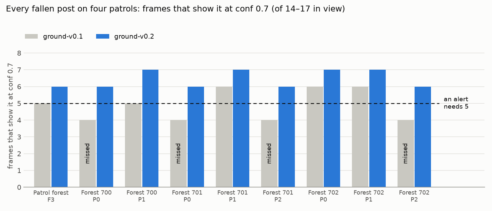
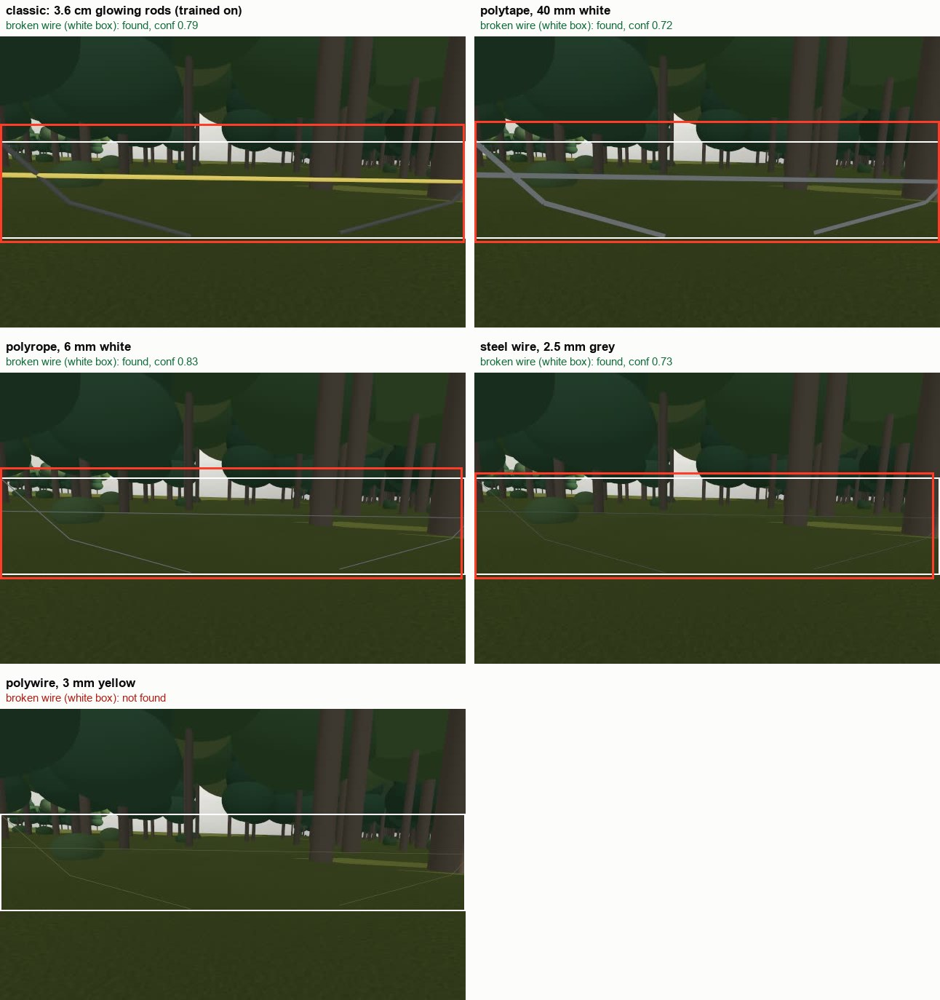

# ground-v0.2 · more fallen posts

| | |
|---|---|
| Status | **candidate**: better than [ground-v0.1](../ground-v0.1) on every offline check; not used by default until it passes live patrols on the Jetson. Released as [ground-v0.2](https://github.com/CosminBMemetea/querra-fence/releases/tag/ground-v0.2) with platform v0.14.0 |
| Date | 2026-11-26 |
| Parent | ground-v0.1 (fine-tuned) |
| Code | `5ab9979` (`make_ground_dataset.py --focus --posts-down`) |
| Files | `ground-yolo11n-v0.2.pt` (5,485,786 bytes, sha256 `5a8a9dafca3f312bc118969129c5d3d3cc5f421e4c9b778e99c7523cf71af9f0`), `ground-yolo11n-v0.2.onnx` 416×640 (10,610,502 bytes, sha256 `0eb81e25f9f943849fd084992002eb55681495841fda169ba1e84f5ab45cf8c9`); no Jetson engine yet |

## Why

ground-v0.1 found every fault in 10 live patrols, but only because fallen posts count from conf 0.5. At 0.7, the
threshold of the other faults, the first live patrols missed F3, offline it missed 4 of the 8 fallen posts in three
new forests, and on its test forests 0.7 kept 52% of them. The fallen post was its rarest class: 372 labels
against 812 broken wires and 693 branches. ground-v0.2 adds fallen-post data.

## Data

| Dataset | Split | Frames | Role |
|---|---|---|---|
| `ground_yolo_stream` (seeds 500–511), as ground-v0.1 | train | 3,600 | train |
| `ground_yolo_fp_stream`: 6 new enclosures (seeds 520–525) with 4–6 fallen posts each, 70% of the poses near a fault and 70% of those near a fallen post; 1,143 frames JPEG like the stream | train | 1,500 | train |
| `ground_yolo_stream` (seeds 512–513), as ground-v0.1 | val | 600 | epoch choice |
| `ground_yolo_stream` (seeds 900–902), as ground-v0.1 | test | 600 | scoring only |
| The patrol of `forest.json` and of three random forests (seeds 700–702), JPEG `-q:v 4` | test | 3,293 | scoring only |

Training labels: fallen posts **908** (ground-v0.1: 372), broken wires 970, branches 798
([datasets.json](../../datasets.json), mix in [data.yaml](data.yaml)). The new enclosures come from the same
generator with seeds outside every other range; nothing from the validation, test or patrol worlds was trained on.

## Training

Fine-tuned from ground-v0.1 for 8 epochs at 640 px, batch 16, on the laptop CPU (Apple M2, 8 GB). AdamW, lr 0.000909,
3 warm-up epochs, mosaic off for the last 3 ([args.yaml](args.yaml), [results.csv](results.csv)). 2.4 h of
training, 3.0 h with the breaks. The last epoch was the best, and the scores were still rising.

| Epoch | mAP50 | mAP50-95 | Precision | Recall |
|---|---|---|---|---|
| 1 | 0.923 | 0.731 | 0.913 | 0.873 |
| 2 | 0.922 | 0.714 | 0.897 | 0.869 |
| 4 | 0.932 | 0.733 | 0.937 | 0.879 |
| 6 | 0.946 | 0.759 | 0.926 | 0.894 |
| **8** | **0.956** | **0.786** | 0.946 | 0.900 |

ground-v0.1 ended at 0.933 / 0.736 on the same validation frames.

Cooling breaks: `tools/train_with_breaks.py` stopped after epoch 2 for 15 minutes. A VS Code restart ended that
break, and the run was restarted detached (`( nohup … & )`). A shell without job control starts such a job with
Ctrl+C (SIGINT) ignored, the training process inherited that, and the stop for the next break did nothing: epochs 3–8
ran in one session of 1.8 h. The weights are what an uninterrupted run gives; the laptop just got fewer breaks. Since
then the script resets SIGINT before it starts training and terminates a run that ignores the stop.

## Offline scores

### Test enclosures

The 3 enclosures of the test seeds, JPEG like the stream ([eval_test.json](eval_test.json)).

| mAP50 | ground-v0.1 | **ground-v0.2** |
|---|---|---|
| all classes | 0.957 | **0.979** |
| post | 0.980 | 0.989 |
| wire | 0.950 | 0.961 |
| `wire_break` | 0.957 | **0.982** |
| `fallen_post` | 0.942 | **0.993** |
| `branch` | 0.958 | **0.972** |

Precision 0.963 (0.928), recall 0.927 (0.909), mAP50-95 0.813 (0.764).

### Each fault class at the alert thresholds

The alerts count a sighting from a confidence threshold, so this is the table that matters: recall and precision per
fault class, and the frames with a false box of that class ([thresholds.json](thresholds.json); a box is right when
it overlaps a labelled one of its class by IoU 0.3).

| Test enclosures (600 frames) | ground-v0.1 | **ground-v0.2** |
|---|---|---|
| Fallen posts (61) from **0.7**: recall / precision / frames with a false one | 0.52 / 1.00 / 0.0% | **0.82 / 1.00 / 0.0%** |
| Fallen posts from 0.5 (the live rule today) | 0.90 / 0.95 / 0.5% | **0.95 / 0.98 / 0.2%** |
| Broken wires (141) from 0.7 | 0.83 / 0.97 / 0.7% | 0.85 / 0.98 / 0.5% |
| Branches (114) from 0.7 | 0.88 / 0.99 / 0.2% | 0.88 / 1.00 / 0.0% |

| Validation enclosures (600 frames) | ground-v0.1 | **ground-v0.2** |
|---|---|---|
| Fallen posts (76) from **0.7** | 0.62 / 1.00 / 0.0% | **0.76 / 1.00 / 0.0%** |
| Fallen posts from 0.5 | 0.86 / 0.97 / 0.3% | 0.91 / 0.99 / 0.2% |
| Broken wires (126) from 0.7 | 0.68 / 0.93 / 1.2% | 0.72 / 0.94 / 1.0% |
| Branches (126) from 0.7 | 0.76 / 1.00 / 0.0% | 0.81 / 1.00 / 0.0% |

Better or equal everywhere the alerts look. One step back where they don't: broken-wire recall below 0.7 (test at
0.5: 0.94 → 0.93; validation at 0.6: 0.84 → 0.79), with no more false broken wires at any threshold.

### Four patrols

The patrol of the forest the robot drives and of three random forests never trained on (seeds 700–702), one frame
every 0.5 m, scored by `tools/ground_patrol_eval.py` as the alert chain counts: 5 of 8 frames, a find when a fault of
its class lies within 4 m ([patrols/](patrols)).

| Patrol | Faults | ground-v0.1, every fault from 0.7 | **ground-v0.2, every fault from 0.7** | ground-v0.2, fallen posts from 0.5 |
|---|---|---|---|---|
| The forest | 5 | 5 of 5, 0 false | **5 of 5, 0 false** | 5 of 5, 0 false |
| Forest 700 | 8 | 7 of 8, 0 false | **8 of 8, 0 false** | 8 of 8, 0 false |
| Forest 701 | 8 | 6 of 8, 0 false | **8 of 8, 0 false** | 8 of 8, 0 false |
| Forest 702 | 8 | 7 of 8, 0 false | **8 of 8, 0 false** | 8 of 8, 0 false |
| **All four** | 29 | 25 of 29, 0 false | **29 of 29, 0 false** | 29 of 29, 0 false |

- **Fallen posts:** at 0.7 each shows in 6–7 frames (ground-v0.1: 4–6); from 0.5, in 7–10 (ground-v0.1: 7–8).
- **The other faults** hardly moved: broken wires in 12–16 frames, branches in 12–15, each within 2 frames of
  ground-v0.1.
- **False frames:** a fault class where the scorer sees none. In the forest, one frame with a branch on a bush behind
  the wire (ground-v0.1: 4); it never lasts 5 of 8 frames. The others are the real faults seen from 4.1–6.9 m, just
  beyond the 4 m the scorer matches within: a broken wire in forests 701 and 702, and fallen post P1 in forest 702.

### Fence looks: a stress test

Every ground model so far learned one fence look: strands drawn as rods 3.6 cm thick, glowing yellow, and grey where a
break cut the current. A real fence's conductors are 2.5 mm steel, 3 mm polywire, 6 mm polyrope or 4 cm tape, and none
glows. The same 3 test forests were rendered in each look (`make_ground_dataset.sh --fence-look`, code `da01160`), at 3x
supersampling so that a wire thinner than a pixel shows as the faint line a camera records, and compressed like the
stream ([fence_looks/looks.json](fence_looks/looks.json)).

| ground-v0.2, 600 test frames per look | mAP50 | `wire` mAP50 | Broken wires found from 0.7 | Fallen posts from 0.7 | Branches from 0.7 |
|---|---|---|---|---|---|
| Classic (as trained) | 0.977 | 0.962 | 86% | 82% | 86% |
| Polytape, 40 mm white | **0.983** | 0.965 | 78% | 79% | 87% |
| Polyrope, 6 mm white | **0.971** | 0.922 | 81% | 78% | 93% |
| Steel wire, 2.5 mm grey | 0.777 | **0.436** | **17%** | 63% | 83% |
| Polywire, 3 mm yellow | 0.669 | **0.196** | **1%** | 55% | 84% |

- **Thick conductors are fine:** on tape and rope the model scores as on the look it learned, so it learned the fence,
  not the yellow.
- **Thin wire is not:** the wire itself is mostly missed and broken wires almost never reach 0.7. Fallen posts drop too
  (the dragged-down wires are part of how the model sees them). Posts and branches hold. No look adds false boxes
  (0-0.8% of frames at 0.7).
- **The rendering is not the cause:** the classic look supersampled scores 0.977, the original test set 0.979.
- **Part of it is the camera.** 640 pixels across 100 degrees: a 2.5 mm wire 1.9 m away covers half a pixel. A real
  robot needs about 2,000 pixels across, a narrower lens or a closer route to see it as a line.

ground-v0.1 is lower in every look (steel 0.752, polywire 0.649).

## Decision

**Candidate.** It meets the goal set for it offline: every fallen post found with every fault class at 0.7, in all
four patrols, with no false alert and no class worse at the thresholds the alerts use.

It becomes the default only after live patrols on the Jetson (the TensorRT engine is not built yet), first with
today's rule, fallen posts from 0.5, where it has more margin than ground-v0.1. Whether `class_conf` can go is a
separate live test: at 0.7 the fallen posts show in 6–7 frames where 5 are needed, and ground-v0.1's live patrols
showed 1–2 fewer than its offline frames.

## Next

1. **ground-v0.3:** trained on a mix of fence looks, thin wire most of all (above).
2. **Live on the Jetson:** build the engine from the ONNX, then `tools/ugv_series.sh 10 … detect:=true` with
   `engine:=/models/ground-yolo11n-v0.2-fp16.engine`. Then a few patrols with every fault from 0.7, which needs
   `ugv_alerts`' `class_conf` as a launch argument.
3. **Branches of more than one shape:** every branch fault is the same model, so the branch score says little yet.
4. **The real walk:** the first real ground-view images ([docs/ugv.md](../../../docs/ugv.md)).
