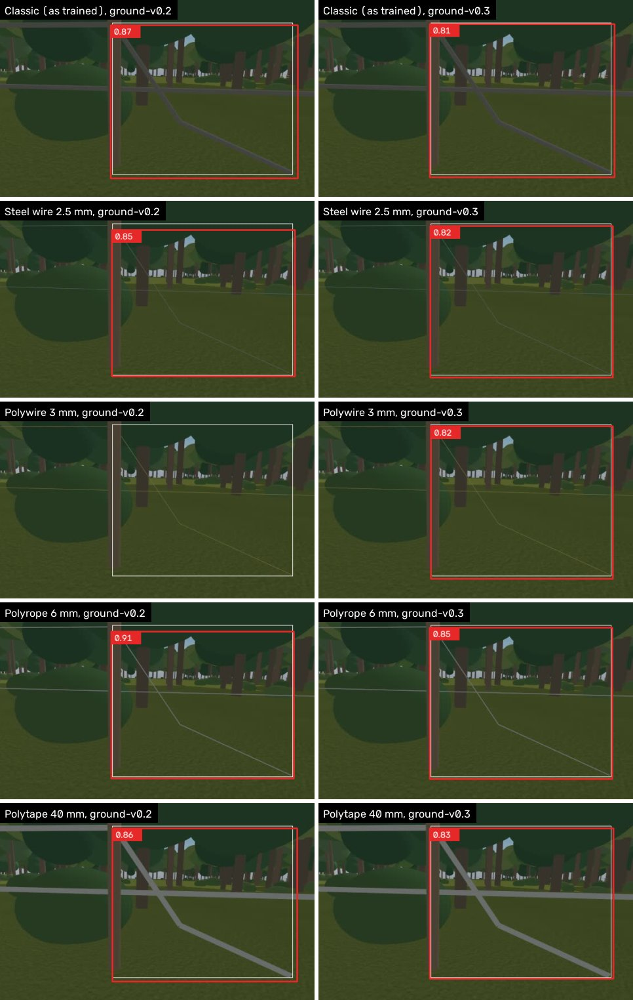
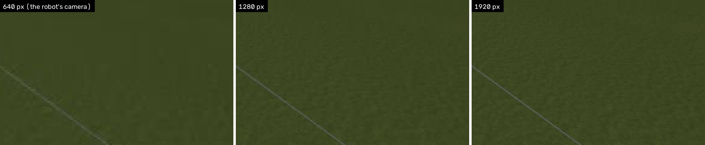

# ground-v0.3 · thin wire

| | |
|---|---|
| Status | **candidate**: on real fence conductors far better than [ground-v0.2](../ground-v0.2), and as good on the checks the alerts use when broken wires count from conf 0.6; not used by default until it passes live patrols on the Jetson. Not released |
| Date | 2026-11-27 |
| Parent | ground-v0.2 (fine-tuned) |
| Code | `da01160` (`make_ground_dataset.py --fence-look --supersample`) |
| Files | `ground-yolo11n-v0.3.pt` (5,485,786 bytes, sha256 `69bb56a5ae00d1d44aa410abf619d30ed9984f1f8089491ddd94c80a965a1022`), `ground-yolo11n-v0.3.onnx` 416×640 (10,610,502 bytes, sha256 `5e2a2b3fc94aea4db6928da476237a1373d5a5cd4611bfe5a5a63a88916f3da2`); no Jetson engine yet |

## Why

Every ground model so far learned strands drawn as 3.6 cm rods, glowing yellow. Ground-v0.2's
[stress test](../ground-v0.2#fence-looks-a-stress-test) drew the same test forests with real conductors: it held on
tape and rope, but on thin wire it lost the wire itself (`wire` mAP50 0.44 on steel, 0.20 on polywire), and broken
wires reached conf 0.7 in 17% and 1% of the frames. Most electric fences are steel wire or polywire. ground-v0.3 adds
training frames drawn in real conductors, thin wire most of all.

## Data

| Dataset | Split | Frames | Role |
|---|---|---|---|
| `ground_yolo_stream` (seeds 500–511), classic look, as ground-v0.2 | train | 3,600 | train |
| `ground_yolo_fp_stream` (seeds 520–525), classic look, fallen-post focus, as ground-v0.2 | train | 1,500 | train |
| `ground_yolo_looks_stream`: 16 new enclosures (seeds 530–545) in real conductors, 6 steel wire, 6 polywire, 2 polyrope, 2 polytape; rendered at 3x supersampling; 3,026 of the 4,000 frames JPEG like the stream | train | 4,000 | train |
| `ground_yolo_stream` (seeds 512–513), as ground-v0.2 | val | 600 | epoch choice |
| `ground_yolo_looks_stream` (seeds 546–547, steel wire and polywire, JPEG `-q:v 4`) | val | 500 | epoch choice |
| `ground_yolo_stream` (seeds 900–902), as ground-v0.2 | test | 600 | scoring only |
| `ground_look_*_q4`: the same 3 test enclosures in each of the 5 looks, as ground-v0.2's stress test | test | 5 × 600 | scoring only |
| The patrol of `forest.json` and of three random forests (seeds 700–702), JPEG `-q:v 4` | test | 3,293 | scoring only |

9,100 training frames, 6,889 of them JPEG like the stream, 3,000 in thin wire. Training labels: broken wires
**1,795** (ground-v0.2: 970), fallen posts 1,348 (908), branches 1,581 (798)
([datasets.json](../../datasets.json), mix in [data.yaml](data.yaml)). The new enclosures come from the same
generator with seeds outside every other range; nothing from the validation, test or patrol worlds was trained on.

## Training

Fine-tuned from ground-v0.2 for 8 epochs at 640 px, **batch 8 on the M2's GPU** (`--device mps`), AdamW lr 0.000909,
3 warm-up epochs, mosaic off for the last 3 ([args.yaml](args.yaml), [results.csv](results.csv)). The first full run
on the GPU: about 9 minutes an epoch where the CPU took about 20 for fewer frames. 1.2 h of training, 2.2 h with the
breaks. The last epoch was the best, and the scores were still rising.

| Epoch | mAP50 | mAP50-95 | Precision | Recall |
|---|---|---|---|---|
| 1 | 0.923 | 0.723 | 0.923 | 0.843 |
| 2 | 0.915 | 0.708 | 0.930 | 0.845 |
| 4 | 0.932 | 0.759 | 0.928 | 0.864 |
| 6 | 0.940 | 0.764 | 0.932 | 0.869 |
| **8** | **0.948** | **0.793** | 0.926 | 0.895 |

The validation set now includes 500 thin-wire frames, so these are not comparable with ground-v0.2's 0.956.

Cooling breaks: 15 minutes before training and after epochs 2, 4 and 6, as planned. The laptop's lid was closed just
after training started, and the Mac slept until morning: epoch 1 moved forward only in the short wake-ups macOS makes
overnight, and took 10.6 hours. The computation is the same, so the weights are what an uninterrupted run gives.

## Offline scores

### Fence looks

The same 3 test enclosures in each look, at 3x supersampling, JPEG like the stream, as ground-v0.2's stress test
([fence_looks/looks.json](fence_looks/looks.json); ground-v0.2's numbers in
[its record](../ground-v0.2/fence_looks/looks.json)).

| 600 test frames per look | mAP50 | `wire` mAP50 | Broken wires found from 0.7 | from 0.5 | Fallen posts from 0.7 | Branches from 0.7 |
|---|---|---|---|---|---|---|
| Steel wire, 2.5 mm grey | 0.777 → **0.972** | 0.436 → **0.948** | 17% → **77%** | 31% → **90%** | 63% → **84%** | 83% → 93% |
| Polywire, 3 mm yellow | 0.669 → **0.973** | 0.196 → **0.955** | 1% → **72%** | 3% → **90%** | 55% → **83%** | 84% → 95% |
| Polyrope, 6 mm white | 0.971 → 0.982 | 0.922 → 0.963 | 81% → 84% | 90% → 92% | 78% → 79% | 93% → 95% |
| Polytape, 40 mm white | 0.983 → 0.983 | 0.965 → 0.968 | 78% → 80% | 92% → 92% | 79% → 77% | 87% → 95% |
| Classic (as trained) | 0.977 → 0.980 | 0.962 → 0.969 | 86% → 83% | 92% → 95% | 82% → 84% | 86% → 92% |

- **Thin wire now scores almost like the thick conductors:** the wire is found (`wire` mAP50 0.95 against 0.96–0.97),
  and broken wires from conf 0.5 in 90% of the frames. From 0.7 they are found less often than on thick conductors
  (72–77% against 80–84%): the model is less sure of a wire it sees as a faint line.
- **No look adds false boxes:** at 0.7, at most 0.8% of frames with a false broken wire, 0.2% with a false fallen post,
  none with a false branch.

The picture is the first such frame in file order, not a chosen one: a close, long hanging wire, so ground-v0.2 finds
it on steel too; on polywire it does not. ground-v0.3's confidences are a few points lower in every look (0.81–0.85
against 0.85–0.91), as in the tables below.

### Test enclosures

The 3 enclosures of the test seeds in the classic look, JPEG like the stream ([eval_test.json](eval_test.json)).

| mAP50 | ground-v0.2 | **ground-v0.3** |
|---|---|---|
| all classes | 0.979 | **0.981** |
| post | 0.989 | 0.992 |
| wire | 0.961 | 0.968 |
| `wire_break` | 0.982 | 0.975 |
| `fallen_post` | 0.993 | 0.982 |
| `branch` | 0.972 | **0.990** |

Precision 0.945 (0.963), recall 0.944 (0.927), mAP50-95 0.837 (0.813).

### Each fault class at the alert thresholds

Recall / precision / frames with a false box of the class ([thresholds.json](thresholds.json); a box is right when it
overlaps a labelled one of its class by IoU 0.3).

| Test enclosures (600 frames) | ground-v0.2 | **ground-v0.3** |
|---|---|---|
| Broken wires (141) from 0.7 | 0.85 / 0.98 / 0.5% | 0.79 / 0.97 / 0.5% |
| Broken wires from **0.6** | 0.93 / 0.96 / 0.8% | **0.90 / 0.97 / 0.7%** |
| Broken wires from 0.5 | 0.93 / 0.96 / 1.0% | 0.96 / 0.96 / 0.8% |
| Fallen posts (61) from 0.7 | 0.82 / 1.00 / 0.0% | 0.80 / 1.00 / 0.0% |
| Fallen posts from 0.5 (the live rule) | 0.95 / 0.98 / 0.2% | 0.97 / 0.97 / 0.3% |
| Branches (114) from 0.7 | 0.88 / 1.00 / 0.0% | **0.94 / 1.00 / 0.0%** |

| Validation enclosures (600 frames) | ground-v0.2 | **ground-v0.3** |
|---|---|---|
| Broken wires (126) from 0.7 | 0.72 / 0.94 / 1.0% | 0.72 / 0.97 / 0.5% |
| Broken wires from 0.6 | 0.79 / 0.93 / 1.2% | 0.83 / 0.95 / 1.0% |
| Fallen posts (76) from 0.7 | 0.76 / 1.00 / 0.0% | 0.78 / 1.00 / 0.0% |
| Fallen posts from 0.5 | 0.91 / 0.99 / 0.2% | 0.91 / 1.00 / 0.0% |
| Branches (126) from 0.7 | 0.81 / 1.00 / 0.0% | **0.86 / 1.00 / 0.0%** |

One step back: on the test enclosures, broken wires from 0.7 drop from 85% to 79%. They are still found, at lower
confidence: from 0.6 ground-v0.3 finds 90%, more than ground-v0.2 from 0.7 (85%), with a false one in 0.7% of the
frames against 0.5%.
With ground-v0.3, broken wires should count from 0.6 (`class_conf wire_break=0.6`, as fallen posts count from 0.5).

### Four patrols

The patrol of the forest the robot drives and of three random forests never trained on (seeds 700–702), scored as the
alert chain counts: 5 of 8 frames, a find when a fault of its class lies within 4 m ([patrols/](patrols)).

| Patrol | Faults | ground-v0.2, every fault from 0.7 | **ground-v0.3, every fault from 0.7** | ground-v0.3, fallen posts from 0.5 | ground-v0.3, fallen posts 0.5, broken wires 0.6 |
|---|---|---|---|---|---|
| The forest | 5 | 5 of 5, 0 false | **5 of 5, 0 false** | 5 of 5, 0 false | 5 of 5, 0 false |
| Forest 700 | 8 | 8 of 8, 0 false | **8 of 8, 0 false** | 8 of 8, 0 false | 8 of 8, 0 false |
| Forest 701 | 8 | 8 of 8, 0 false | **8 of 8, 0 false** | 8 of 8, 0 false | 8 of 8, 0 false |
| Forest 702 | 8 | 8 of 8, 0 false | **8 of 8, 0 false** | 8 of 8, 0 false | 8 of 8, 0 false |
| **All four** | 29 | 29 of 29, 0 false | **29 of 29, 0 false** | 29 of 29, 0 false | 29 of 29, 0 false |

- **Broken wires:** at 0.7 each shows in 10–16 frames (ground-v0.2: 12–16); B2 in forest 701, 20 frames in view, drops
  from 12 to 10. From 0.6: 13–16.
- **Fallen posts:** 6–7 frames at 0.7, as ground-v0.2; 7–10 from 0.5.
- **Branches:** 13–15 frames (ground-v0.2: 12–15).
- **False frames:** a fault class where the scorer sees none within 4 m. Broken wires: 1 frame (ground-v0.2: 3);
  fallen posts: 2, as ground-v0.2. **Branches: 15 (ground-v0.2: 1).** All 15 lie 4.1–6.4 m from a real branch, in
  runs that continue that branch's own frames (up to 6 in a row in the forest), with the box on foliage over the wire
  at the edge of the frame. In the alert chain they extend the real branch's alert rather than raise one of their own.
  The model now sees branches from farther away, but the same look, a bush behind the wire, could raise a false
  branch on a real fence with bushes: one to watch on real footage.

## A sharper camera

Would a camera with more pixels find thin wire better? The same 3 test forests, seen by a camera of the robot's lens
1,280 and 1,920 pixels wide instead of 640 (`make_ground_dataset.sh --width`, code `1470fe3`), 2x supersampled, JPEG
like the stream ([resolution/resolution.json](resolution/resolution.json)). A 2.5 mm wire 1.9 m away covers 0.35,
0.7 and 1.1 pixels.

The camera does record more: at 1,280 and 1,920 pixels the wire is a crisp line. ground-v0.3 cannot use it:

| ground-v0.3, 600 frames | 640 camera | 1,280 camera, shrunk to 640 | 1,920 camera, shrunk to 640 | 1,280 at full size | 1,920 at full size |
|---|---|---|---|---|---|
| Classic: mAP50 | 0.980 | 0.979 | 0.981 | 0.748 | 0.178 |
| Steel wire: mAP50 | 0.972 | 0.980 | 0.976 | 0.742 | 0.181 |
| Steel wire: broken wires from 0.7 / from 0.5 | 77% / 90% | 79% / 94% | 75% / 92% | 38% / 76% | 14% / 40% |
| Polywire: mAP50 | 0.973 | 0.967 | 0.964 | 0.734 | 0.176 |
| Polywire: broken wires from 0.7 / from 0.5 | 72% / 90% | 73% / 90% | 70% / 86% | 32% / 71% | 14% / 39% |

- **Shrunk to the 640 pixels the model reads, a sharper camera adds little**, at most a few points: shrinking the
  frame averages the wire back to what the 640 camera records.
- **At full size the model fails, on the classic look as much as on thin wire**: every post and wire is 2 or 3 times
  larger in pixels than anything it learned (posts mAP50 0.61 at 1,280, 0.15 at 1,920).
- So a sharper camera helps only with a model trained at its size. That is the test still to run: training data
  rendered at 1,280 pixels and a model trained at 1,280 (about four times the computation per frame, on the Jetson
  too: about 14 ms instead of 3.4).

## Decision

**Candidate.** It fixes what the stress test found, thin wire, and loses nothing on the checks the alerts use: the
classic test set scores higher (mAP50 0.981 against 0.979), and on the four patrols every fault is found with no false alert,
with every class at 0.7, with today's live rule and with broken wires from 0.6.

It becomes the default only after live patrols on the Jetson, with `class_conf` fallen posts 0.5 and broken wires 0.6:
at 0.7 its broken wires show in 10–16 frames where 5 are needed, and ground-v0.1's live patrols showed 1–2 fewer than
offline. All of it is simulated: the thin wire is the simulator's 3x supersampled render, an approximation of how a
real camera records a wire thinner than a pixel. Real footage is the test that matters.

## Next

1. **Real footage:** the phone walk ([docs/phone-walk.md](../../../docs/phone-walk.md)) and DJI video of a real
   fence, labelled with [docs/labelling.md](../../../docs/labelling.md), scored against ground-v0.2.
2. **Live on the Jetson:** build the engine from the ONNX, then `tools/ugv_series.sh 10 … detect:=true` with
   `engine:=/models/ground-yolo11n-v0.3-fp16.engine` and broken wires from 0.6.
3. **The camera:** a 1,280-pixel camera records the wire as a line ([above](#a-sharper-camera)), but only a model
   trained at 1,280 pixels can use it. Render training data at `--width 1280` and train at `imgsz 1280`.
4. **Branches of more than one shape**, and bushes behind the wire as hard negatives.
