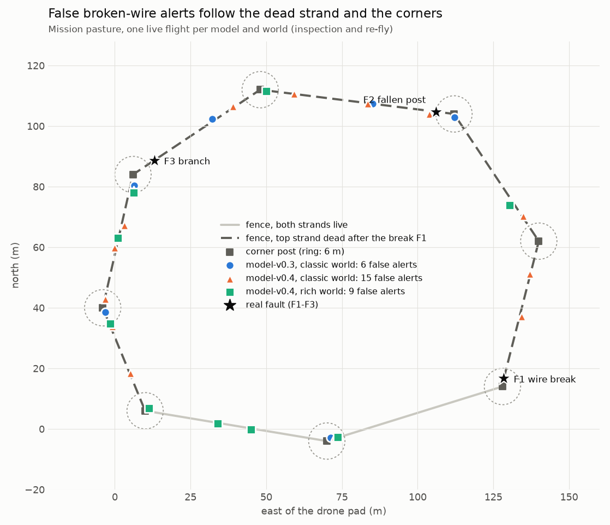
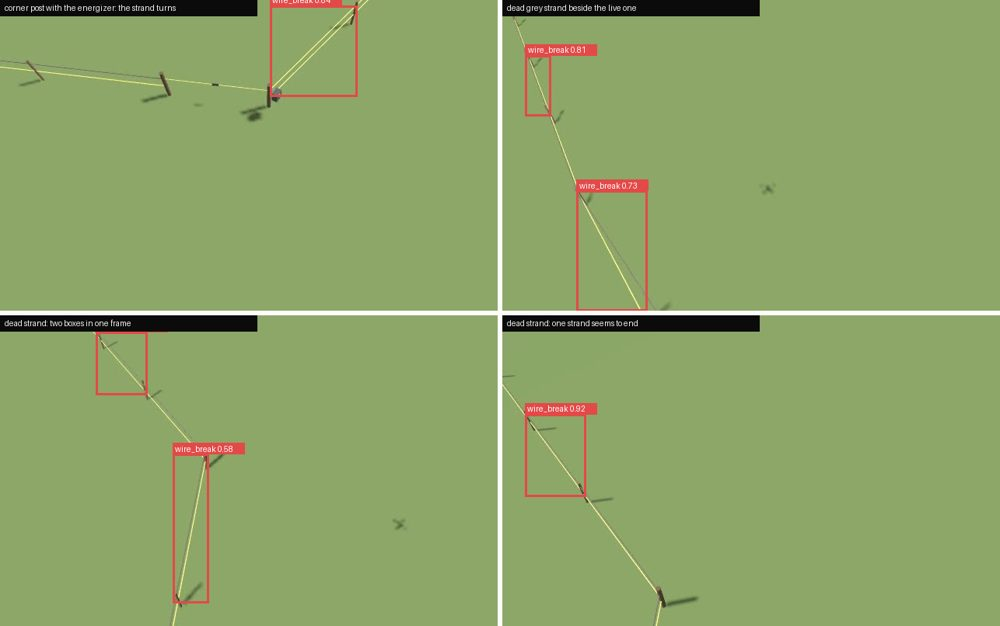

# model-v0.4 · trained on both world looks

| | |
|---|---|
| Status | **live-sim**: live Gazebo flights on the Jetson (`ros.sh demo tcp://…`); model-v0.3 stays the default |
| Date | 2026-11-20 |
| Parent | model-v0.3 (fine-tuned) |
| Code | `fb6ff9f` (dataset generator, mix, eval and training scripts as used) |
| Files | `fence-yolo11n-v0.4.pt`, `.onnx` (416×640), Jetson engine `fence-yolo11n-v0.4-fp16.engine`; sha256 in [models.json](../../models.json) |

## Why

Since v0.9.0 the simulation looks "rich": textured grass, terrain, sky and a low sun. model-v0.3 had only seen the
flat classic world. In a live flight over the rich world it found **1 of 3** faults. The cure for a domain gap is the
same in simulation and in reality: train on varied looks.

## Data

| Dataset ([datasets.json](../../datasets.json)) | Look | Split | Frames in the mix |
|---|---|---|---|
| `fence_yolo_rich`: 12 new farms, random sun, sky fill, ambient light, grass tint and terrain | rich | train | 3,600 |
| `fence_yolo_v3c`: 4 new farms with low re-fly hover poses (v3 style) | classic | train | 1,200 |
| `fence_yolo_v2`: farms full of dead strands (from v0.3) | classic | train | 1,400 of 2,400 |
| `fence_yolo`: the original farms (from v0.2) | classic | train | 1,000 of 3,500 |
| **Training total** | | | **7,200** |
| `fence_yolo_rich` + `fence_yolo_v2` validation farms | both | val | 1,200 |

The mix is half rich and half classic, and keeps old data so the model does not forget it
(`tools/mix_dataset.py`, [data.yaml](data.yaml)). The v3 style adds 20% close-up poses like the re-fly hover:
4.5–8 m high, 48–62° down, mostly at faults, never inside a tree crown.

## Training

YOLO11n fine-tuned from model-v0.3 for 8 epochs at 640 px, batch 16, on the laptop CPU (Apple M2, 8 GB). The GPU
path (MPS) was slower because of memory swapping. Ultralytics chose AdamW with lr 0.000909 and 3 warm-up epochs.
Mosaic was off for the last 3 epochs. The run was paused twice to let the laptop cool and resumed with `--resume`
(optimizer state kept): **3.4 h** in total. The last epoch was the best and is the model
([args.yaml](args.yaml), [results.csv](results.csv)).

| Epoch | mAP50 | mAP50-95 | Precision | Recall |
|---|---|---|---|---|
| 1 | 0.933 | 0.750 | 0.937 | 0.883 |
| 2 | 0.932 | 0.740 | 0.950 | 0.871 |
| 3 | 0.923 | 0.715 | 0.941 | 0.853 |
| 4 | 0.932 | 0.746 | 0.936 | 0.880 |
| 5 | 0.942 | 0.764 | 0.947 | 0.893 |
| 6 | 0.946 | 0.774 | 0.932 | 0.909 |
| 7 | 0.952 | 0.790 | 0.968 | 0.889 |
| **8** | **0.956** | **0.804** | 0.946 | 0.913 |

Validation set: rich and v2 validation farms (1,200 frames). The dip at epoch 3 is the peak of the warm-up learning
rate. Final per-class mAP50: post 0.988, wire 0.989, `wire_break` 0.835, `fallen_post` 0.959, `branch` 0.967,
cow 0.974, sheep 0.977.

## Offline scores, model-v0.3 → model-v0.4

`tools/eval_sets.py`, PyTorch on CPU, mAP50 ([eval_heldout.json](eval_heldout.json)). The validation farms were
watched during training (not used to pick an epoch: the last one was kept). The test seeds, the mission pasture and
the re-fly close-ups were never used for training.

| Set | Frames | mAP50, all classes | `wire_break` mAP50 | `wire_break` precision / recall | `fallen_post` | `branch` |
|---|---|---|---|---|---|---|
| classic: old validation farms | 700 | 0.916 → **0.927** | 0.778 → **0.834** | 0.77 / 0.74 → 0.86 / 0.75 | 0.917 → 0.911 | 0.927 → **0.942** |
| classic: v2 validation farms | 600 | 0.932 → **0.956** | 0.681 → **0.818** | 0.71 / 0.60 → 0.87 / 0.67 | 0.966 → **0.977** | 0.956 → **0.961** |
| **classic: test seeds 140-142** | 750 | 0.911 → **0.938** | 0.684 → **0.822** | 0.70 / 0.61 → 0.85 / 0.69 | 0.911 → **0.934** | 0.920 → **0.941** |
| classic: mission pasture | 400 | 0.958 → **0.981** | 0.775 → **0.900** | 0.66 / 0.81 → 0.93 / 0.79 | 0.981 → **0.995** | 0.995 → 0.995 |
| classic: re-fly close-ups | 400 | 0.970 → **0.981** | 0.930 → **0.963** | 0.89 / 0.84 → 0.97 / 0.88 | 0.979 → **0.991** | 0.995 → 0.995 |
| rich: validation farms | 600 | 0.603 → **0.954** | 0.138 → **0.858** | 0.66 / 0.09 → 0.82 / 0.76 | 0.736 → **0.922** | 0.451 → **0.976** |
| **rich: test seeds 140-142** | 750 | 0.710 → **0.938** | 0.330 → **0.789** | 0.85 / 0.14 → 0.84 / 0.68 | 0.827 → **0.946** | 0.717 → **0.962** |
| rich: mission pasture | 400 | 0.657 → **0.977** | 0.151 → **0.877** | 0.70 / 0.05 → 0.87 / 0.84 | 0.629 → **0.995** | 0.772 → **0.995** |
| rich: re-fly close-ups | 400 | 0.584 → **0.984** | 0.053 → **0.968** | 0.60 / 0.01 → 0.98 / 0.89 | 0.799 → **0.989** | 0.718 → **0.995** |

On paper v0.4 is better on every set but one (`fallen_post` on the old farms, −0.006). In the rich look it goes from
nearly blind to as good as in the classic look.

## The mission replay

The classic mission flight recorded from the Jetson's camera stream (1,986 frames in flight at 12 m) replayed
through both models with `tools/eval_mission.py`, then through the live confirmation (5 of 8 frames, conf ≥ 0.7)
([mission_replay.json](mission_replay.json)).

| | model-v0.3 | model-v0.4 |
|---|---|---|
| F1 broken wire: frames that saw it (of 249 nearby) | 121 | **147** |
| F2 fallen post (of 242) / F3 branch (of 242) | 65 / 66 | 66 / 62 |
| False `wire_break` frames > 45 m from F1, conf ≥ 0.5 | 413 | 551 |
| False `wire_break` frames, conf ≥ 0.7 | 153 | **257** |
| Confirmed alerts | 10: 3 faults + 6 false | 18: 3 faults + **12 false** |

## Live flights on the Jetson

Gazebo on the Mac streams the camera over the LAN. On the Jetson the TensorRT FP16 engine runs, alerts are confirmed
5 of 8 and placed with PX4's own pose over uXRCE-DDS. One mission per look, the inspection part. An alert is real
when its class matches a fault within 15 m ([live/flights.json](live/flights.json), raw check outputs in
[live/](live)).

| World | model-v0.3 | model-v0.4 |
|---|---|---|
| **rich** (the default look) | 1 of 3 faults, 0 false alerts | **3 of 3 faults**, 6 false alerts |
| classic | 3 of 3 faults, 5 false alerts | 3 of 3 faults, **13 false alerts** |

The detector still runs at 3.6 ms per frame on the GPU (`trtexec`: 293 inferences/s, [trtexec.txt](trtexec.txt)).

**Re-fly** (after the loop the drone flies back to 6 m over up to 8 alerts, nearest first, and hovers 5 s each):

- **Rich:**
  - Verified the real broken wire (65 of 65 frames) and the branch (68 of 68).
  - Rejected all 5 false alerts it visited.
  - Missed the real fallen post: 4 of 56 frames. The alert sat 2.9 m from the post, so the post was at the edge of the
    hover view.
- **Classic:**
  - Verified the branch.
  - Rejected 6 false alerts.
  - Verified one false alert 1.9 m from a corner post (58 of 73 frames, conf 0.92).
  - With 18 alerts, the 8 nearest did not include the broken wire or the fallen post.

## What went wrong

The live false alerts fall in the same places in every flight and with both models. **Three spots appear in all
three flights, each within 4 m of a corner post.** In the classic world, 12 of the 13 false alerts of v0.4 lie on the
stretch after the real break F1. There the top strand is dead and drawn grey, so from 12 m one strand of the pair
seems to end. This is the case v0.3 already struggled with, and v0.4 makes it worse.

**Why the offline tests missed it.** The test sets sample random camera poses over many farms. The inspection flight
is narrower: 12 m high, along the fence, the same view of a long dead strand for minutes, and a turn at every corner.
The mission-pasture test set scored `wire_break` precision 0.93, yet the flight over the same pasture doubled the
false alerts. **A model is not better until it flies better.**

## Decision

- **model-v0.4 for live Gazebo flights.** The rich look is the default world, and v0.4 finds all three faults there.
  `ros.sh demo tcp://…` uses it, and `engine:=` overrides.
- **model-v0.3 stays the default**: the ROS 2 detector, the classic replay demo and field mode.
- The panel offers v0.4 in field mode, but does not select it.

## Next: model-v0.5

- **Flight poses.** Frames posed like the inspection flight: 12 m, along the fence, through the corners. Use new farm
  seeds with long dead stretches, in both looks.
- **Hard negatives.** Corners and live/dead strand pairs as labelled negatives.
- **Re-fly budget.** Visit all alerts, or rank by confidence, not only by distance.
- **Real frames** from the field recorder, as soon as there are any.

## Files

| File | Content |
|---|---|
| [args.yaml](args.yaml) | Ultralytics arguments (as saved by the last resumed session) |
| [results.csv](results.csv) | Losses and validation metrics per epoch |
| [data.yaml](data.yaml) | The training mix (`tools/mix_dataset.py` command) |
| [eval_heldout.json](eval_heldout.json) | `tools/eval_sets.py`: 9 held-out sets, v0.3 and v0.4 |
| [mission_replay.json](mission_replay.json) | `tools/eval_mission.py` on the recorded classic mission, v0.3 and v0.4 |
| [live/flights.json](live/flights.json) | Live flights: every alert with class, confidence, phase, nearest fault, verdict; re-fly reports |
| [live/*_px4_check.txt](live) | Raw live checks: PX4 pose against the simulator, alerts against the true faults |
| [trtexec.txt](trtexec.txt) | TensorRT FP16 engine build on the Jetson Orin Nano |
