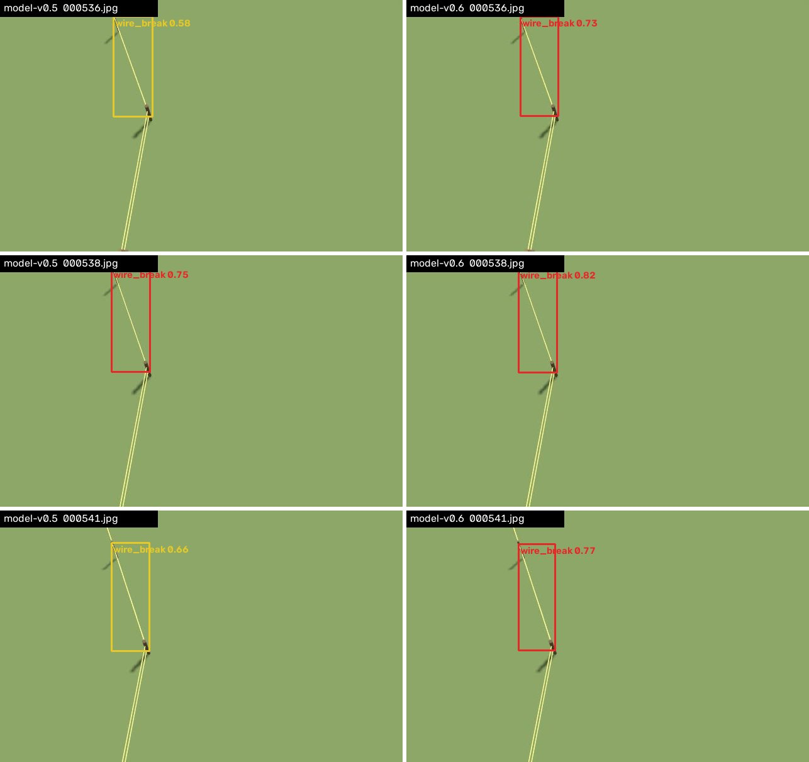

# model-v0.6 · real fence conductors (not adopted)

| | |
|---|---|
| Status | **not adopted**: model-v0.5 stays the default. Kept for comparison |
| Date | 2026-11-27 |
| Parent | model-v0.5 (fine-tuned) |
| Code | `9c4cb0a` (`make_dataset.py --fence-look … --no-wire-labels …`, supersampling, eval scripts as used) |
| Files | `fence-yolo11n-v0.6.pt`, `.onnx` (416×640); no Jetson engine; sha256 in [models.json](../../models.json) |

## Why

model-v0.5 learned one fence look: strands drawn as rods 3.6 cm thick. In the
[fence-look stress test](../model-v0.5#fence-looks-a-stress-test) it found no broken wire on any real conductor, and
fallen posts dropped from 93% to about 60% on thin wire. ground-v0.3 recovered thin wire for the ground robot by
training on real conductors ([ground-v0.3](../ground-v0.3)). model-v0.6 tries the same for the drone.

From the flight, a strand of steel wire or polywire is a tenth of a pixel wide: no model can find it, or a break in it.
So those frames were labelled **without** `wire` and `wire_break` boxes (`--no-wire-labels steel,polywire`): the
model learns their posts, fallen posts and branches but is not asked to find a wire it cannot see. Polyrope (6 mm) and
polytape (40 mm) still show, and keep every label.

## Data

| Dataset ([datasets.json](../../datasets.json)) | Split | Frames in the mix |
|---|---|---|
| model-v0.5's training mix (6 datasets, [its data](../model-v0.5#data)) | train | 9,600 |
| **`drone_yolo_looks_stream`**: 12 new farms in real conductors, flight poses, 3x supersampled | train | 3,000 |
| **Training total** (8,402 JPEG like the stream) | | **12,600** |
| model-v0.5's validation farms + `drone_yolo_looks_stream` val (polyrope, polytape) | val | 2,300 |

- **The new farms** (seeds 350–361, style v4, 250 frames each): 750 frames each of steel wire, polywire, polyrope and
  polytape, in both world looks. Labels: `wire_break` 419 (in rope and tape only), `fallen_post` 287, `branch` 273.
- The mix and its command: [data.yaml](data.yaml).

## Training

YOLO11n fine-tuned from model-v0.5 for 8 epochs at 640 px, batch 8, on the M2's GPU (MPS). AdamW, lr 0.000909, 3
warm-up epochs, mosaic off for the last 3. `tools/train_with_breaks.py`: 15-minute cooling breaks before training and
after epochs 2, 4 and 6. **1.5 h of training**, 2.6 h with the breaks. The last epoch was the best and is the model
([args.yaml](args.yaml), [results.csv](results.csv)).

| Epoch | mAP50 | mAP50-95 | Precision | Recall |
|---|---|---|---|---|
| 1 | 0.925 | 0.750 | 0.948 | 0.869 |
| 2 | 0.918 | 0.732 | 0.926 | 0.855 |
| 3 | 0.926 | 0.730 | 0.945 | 0.870 |
| 4 | 0.928 | 0.749 | 0.929 | 0.875 |
| 5 | 0.928 | 0.758 | 0.945 | 0.877 |
| 6 | 0.934 | 0.773 | 0.955 | 0.875 |
| 7 | 0.941 | 0.770 | 0.945 | 0.895 |
| **8** | **0.944** | **0.789** | 0.948 | 0.901 |

The validation set includes the 500 rope and tape frames, so it does not compare with model-v0.5's 0.952. Final
per-class mAP50: post 0.992, wire 0.988, `wire_break` 0.737 (precision 0.84, recall 0.61), `fallen_post` 0.987,
`branch` 0.977, cow 0.965, sheep 0.962.

## Fence looks: the stress test again

The same 750 flight test frames per look as for model-v0.5 (seeds 160–162, 3x supersampled, JPEG like the stream;
[fence_looks/looks.json](fence_looks/looks.json)). None of these farms is in the training.

| model-v0.5 → **model-v0.6** | mAP50 | `wire` mAP50 | Broken wires from 0.7 | from 0.5 | Fallen posts from 0.7 | Branches from 0.7 |
|---|---|---|---|---|---|---|
| Classic | 0.919 → **0.928** | 0.993 → 0.993 | 22% → **26%** | 39% → 49% | 93% → 92% | 81% → **86%** |
| Polytape, 40 mm | 0.865 → **0.883** | 0.966 → 0.982 | 4% → **8%** | 8% → 17% | 87% → **91%** | 81% → **88%** |
| Polyrope, 6 mm | 0.840 → **0.873** | 0.952 → 0.980 | 0% → **3%** | 2% → 12% | 78% → **85%** | 81% → **88%** |
| Polywire, 3 mm | 0.741 → **0.756** | 0.461 → 0.434 | 0% → 0% | 0% → 0% | 61% → **76%** | 77% → **84%** |
| Steel wire, 2.5 mm | 0.712 → **0.725** | 0.293 → 0.219 | 0% → 0% | 0% → 0% | 59% → **75%** | 77% → **79%** |

- **Fallen posts on thin wire: +15 points** (59% → 75% on steel wire, 61% → 76% on polywire). The training taught the
  model to see a leaning post without the dragged-down wires it used to rely on.
- **Broken wires on real conductors are still not found.** On rope and tape a few more come through (3% and 8% of the
  frames from 0.7, 12% and 17% from 0.5), far from the 22% on the classic look that the 5-of-8 confirmation needs.
  419 broken-wire labels in rope and tape were not enough to learn a cue other than the classic look's.
- No false fallen posts or branches in any look. False broken wires stay rare here (at most 0.5% of frames from 0.7
  on the real conductors, 1.2% on the classic look).

## The checks that decide: false broken wires

### Stream sets

The 8 sets posed like the flight and compressed like the stream, whose `wb_false` matched model-v0.4's live false
alerts ([eval_stream.json](eval_stream.json), [benchmark/stream.json](../../benchmark/stream.json)).

| Set | Frames | mAP50 v0.5 → **v0.6** | `wire_break` mAP50 | `wire_break` P / R | `wb_false` |
|---|---|---|---|---|---|
| **classic flight, mission pasture, JPEG** | 400 | 0.963 → 0.967 | 0.793 → 0.811 | 1.00 / 0.69 → 0.92 / 0.71 | 0.0% → **0.2%** |
| **rich flight, mission pasture, JPEG** | 400 | 0.954 → 0.956 | 0.772 → 0.785 | 0.93 / 0.71 → 0.86 / 0.75 | 0.0% → **0.5%** |
| classic flight, test seeds 160–162, JPEG | 750 | 0.926 → 0.927 | 0.623 → 0.614 | 0.71 / 0.58 → 0.65 / 0.57 | 0.4% → **1.1%** |
| rich flight, test seeds 160–162, JPEG | 750 | 0.914 → 0.924 | 0.516 → 0.544 | 0.73 / 0.33 → 0.65 / 0.43 | 0.3% → **1.2%** |
| classic, test seeds 140–142, JPEG | 750 | 0.910 → 0.915 | 0.671 → 0.682 | 0.76 / 0.54 → 0.76 / 0.60 | 1.2% → 1.3% |
| rich, test seeds 140–142, JPEG | 750 | 0.920 → 0.931 | 0.705 → 0.726 | 0.80 / 0.52 → 0.81 / 0.62 | 0.4% → 0.5% |
| classic flight, mission pasture, PNG | 400 | 0.974 → 0.974 | 0.863 → 0.855 | 1.00 / 0.68 → 0.97 / 0.75 | 0.0% → 0.0% |
| rich flight, mission pasture, PNG | 400 | 0.969 → 0.970 | 0.867 → 0.856 | 1.00 / 0.78 → 0.90 / 0.79 | 0.0% → 0.2% |

model-v0.6 finds more broken wires per frame and raises more false ones: broken-wire precision falls on 6 of the 8
sets, and on the four flight sets the frames with a false break go from 0.0–0.4% to 0.2–1.2%.

### The mission replay

The recorded classic mission (1,986 frames of the real stream), 5 of 8 frames at conf ≥ 0.7
([mission_replay.json](mission_replay.json)).

| | model-v0.5 | **model-v0.6** |
|---|---|---|
| F1 broken wire: frames that saw it (of 249 nearby), best conf | 66, 0.87 | **73, 0.92** |
| F2 fallen post (of 242) / F3 branch (of 242) | 68 / 64 | 68 / 63 |
| False `wire_break` frames, conf ≥ 0.5 | 9 | **35** |
| False `wire_break` frames, conf ≥ 0.7 | 1 | **15** |
| Confirmed alerts | 5: 3 faults + 0 false | **5: 3 faults + 1 false** |

The false alert is at a corner post, 57 m from F1. From the inspection pose the two strands of the next span line up
into what looks like one, which reads as a strand missing. model-v0.5 boxes the same spot (conf 0.58–0.75) but stays
under 5 of 8; model-v0.6 crosses it (0.73–0.82):

### A higher threshold does not fix it

Counting broken wires only from 0.75 removes the false alert in the replay (4 alerts, 3 of 3 faults). But 0.75 was
picked after seeing the replay, so it was tested on the stream sets, which played no part in the choice
([wb_thresholds.json](wb_thresholds.json); share of labelled breaks found, IoU 0.3, and frames with a false break):

| Set | model-v0.5 from 0.7 | model-v0.6 from 0.7 | from 0.75 | from 0.8 |
|---|---|---|---|---|
| classic flight, mission pasture | 67%, 0.0% | 71%, 0.2% | 71%, 0.2% | 58%, 0.2% |
| rich flight, mission pasture | 50%, 0.0% | 71%, 0.5% | 71%, 0.5% | 58%, 0.0% |
| classic flight, test 160–162 | 23%, 0.4% | 27%, 1.1% | 17%, 0.7% | 11%, 0.3% |
| rich flight, test 160–162 | 16%, 0.3% | 23%, 1.2% | 17%, 0.7% | 10%, 0.4% |
| classic, test 140–142 | 33%, 1.2% | 41%, 1.3% | 32%, 0.9% | 25%, 0.5% |
| rich, test 140–142 | 29%, 0.4% | 38%, 0.5% | 33%, 0.5% | 22%, 0.3% |

From 0.75, model-v0.6 still has more false-break frames than model-v0.5 on five of the six sets. From 0.8 it has
about as many, but finds fewer breaks on five of the six, half as many on the flight test farms. No threshold makes
it as good as model-v0.5 on both counts. The drone's alert path also has a single threshold for every
class (`tools/confirm.py`); only the ground robot's takes one per class.

### The shared held-out sets (PNG)

[eval_heldout.json](eval_heldout.json), [benchmark/heldout.json](../../benchmark/heldout.json): mAP50 up by up to
0.007 or down by up to 0.003, `wire_break` up to +0.047 (classic mission pasture), false-break frames 0.0–0.8%.

| Set | Frames | mAP50 v0.5 → v0.6 | `wire_break` mAP50 | `wire_break` P / R |
|---|---|---|---|---|
| classic: old validation farms | 700 | 0.928 → 0.929 | 0.850 → 0.845 | 0.88 / 0.74 → 0.90 / 0.74 |
| classic: v2 validation farms | 600 | 0.956 → 0.960 | 0.816 → 0.825 | 0.95 / 0.66 → 0.91 / 0.70 |
| **classic: test seeds 140–142** | 750 | 0.937 → 0.940 | 0.808 → 0.821 | 0.89 / 0.65 → 0.95 / 0.64 |
| classic: mission pasture | 400 | 0.976 → 0.983 | 0.865 → 0.912 | 1.00 / 0.72 → 0.94 / 0.83 |
| classic: re-fly close-ups | 400 | 0.982 → 0.980 | 0.972 → 0.963 | 0.97 / 0.89 → 0.94 / 0.94 |
| rich: validation farms | 600 | 0.952 → 0.956 | 0.849 → 0.868 | 0.90 / 0.73 → 0.87 / 0.79 |
| **rich: test seeds 140–142** | 750 | 0.937 → 0.944 | 0.783 → 0.800 | 0.89 / 0.61 → 0.95 / 0.63 |
| rich: mission pasture | 400 | 0.976 → 0.975 | 0.865 → 0.865 | 1.00 / 0.72 → 0.85 / 0.88 |
| rich: re-fly close-ups | 400 | 0.987 → 0.984 | 0.969 → 0.972 | 0.96 / 0.88 → 0.96 / 0.87 |

### Real photos: power lines (TTPLA)

TTPLA's 1,242 drone photos of power lines, where every fault box and every animal box is false
([real/ttpla.json](real/ttpla.json); [model-v0.5's run](../model-v0.5#real-photos-power-lines-ttpla)).

| Frames with a false… | model-v0.5 from 0.7 | **model-v0.6 from 0.7** | model-v0.5 from 0.5 | **model-v0.6 from 0.5** |
|---|---|---|---|---|
| broken wire | 0 | 2 (0.2%) | 5 (0.4%) | **44 (3.5%)** |
| fallen post | 1 | 2 | 15 (1.2%) | 12 (1.0%) |
| branch | 1 | 1 | 13 (1.0%) | **68 (5.5%)** |
| cow | 316 (25%) | **577 (46%)** | 1,042 (84%) | 1,069 (86%) |

The same direction on real images: more boxes, more of them false. Real cables are seen a little more (a wire box in
178 of 1,231 cable frames, against 144) and real poles still not (3 of 333).

## Decision

**Not adopted.** model-v0.5 stays the default everywhere, and no TensorRT engine was built.

- **Gained:** fallen posts and branches on real conductors (+15 points on thin wire), equal or higher mAP50 on every
  stream set and most held-out sets, and more frames that see F1 in the replay (73 against 66), model-v0.5's known weak spot.
- **Lost:** precision on broken wires, the class that raised every false alert so far: 15 false frames in the replay
  against 1, one false confirmed alert against none, false-break frames on the flight sets up from 0.0–0.4% to
  0.2–1.2%, and 9 times as many on TTPLA from 0.5. No threshold makes up for it.
- **Not reached:** broken wires on real conductors stay out of reach from the flight (0–8% of frames).

## What it teaches, and next

- **Training on real conductors helps fallen posts, not breaks.** For breaks, the drone's camera at 11 m is the
  limit: on steel wire and polywire nothing can be learned, and rope and tape breaks need many more examples. The
  ground robot, the low re-fly or a 4K camera close up remain the way to see a break in thin wire.
- **More positives need more negatives.** Corner posts, where strands line up, are where both models see a break. A
  next try should add corner-heavy flight frames with no break (or hard negatives mined from the replay's false
  frames), and keep the real-conductor farms for fallen posts.
- **A per-class threshold in the drone's alert path** (as `ugv_alerts.py` has) would let a future model trade
  broken-wire recall for precision without touching the other classes.

## Files

| File | Content |
|---|---|
| [args.yaml](args.yaml) | Ultralytics arguments (as saved by the last resumed session) |
| [results.csv](results.csv) | Losses and validation metrics per epoch |
| [data.yaml](data.yaml) | The training mix (`tools/mix_dataset.py` command) |
| [eval_stream.json](eval_stream.json) | `tools/eval_sets.py`: the 8 stream sets, model-v0.5 and model-v0.6 |
| [eval_heldout.json](eval_heldout.json) | `tools/eval_sets.py`: the 9 shared held-out sets, model-v0.6 |
| [wb_thresholds.json](wb_thresholds.json) | Broken wires found and false-break frames at conf 0.7, 0.75 and 0.8 on the 6 JPEG stream sets, both models |
| [mission_replay.json](mission_replay.json) | `tools/eval_mission.py` on the recorded classic mission, both models, and the replay with broken wires from 0.75 and 0.8 |
| [false-alert-corner.jpg](false-alert-corner.jpg) | The frames behind model-v0.6's false alert in the replay, both models' boxes |
| [fence_looks/looks.json](fence_looks/looks.json) | The fence-look stress test, model-v0.6 (model-v0.5's in [its run](../model-v0.5/fence_looks/looks.json)) |
| [real/ttpla.json](real/ttpla.json) | `tools/ttpla_check.py` on the 1,242 TTPLA photos, model-v0.6 |
